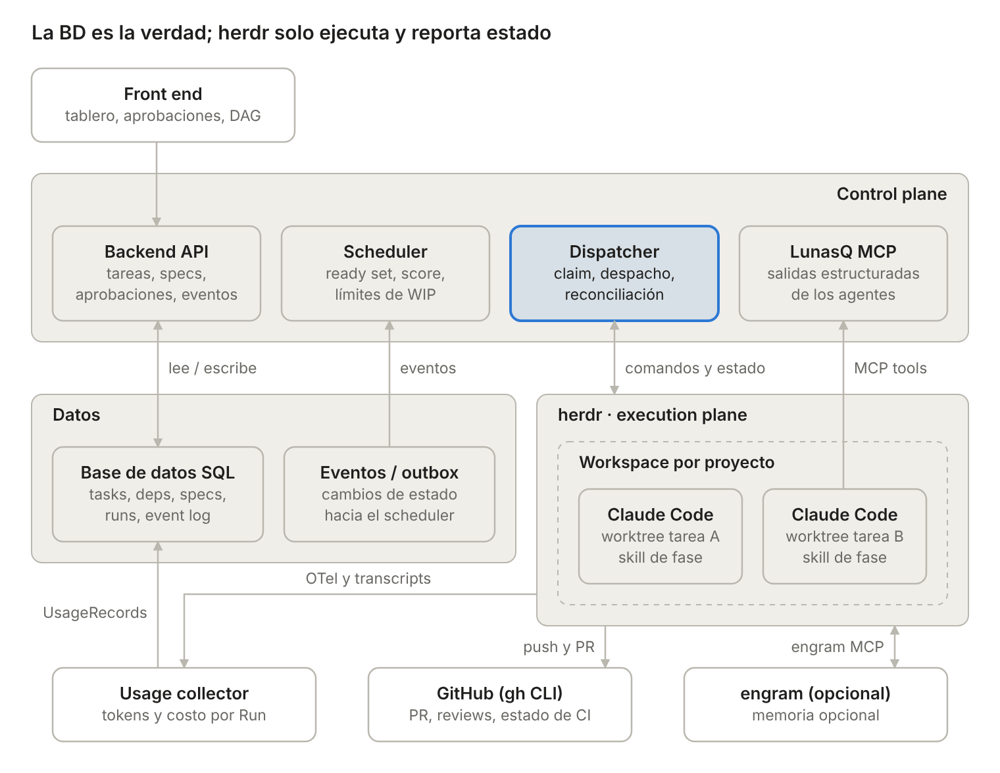
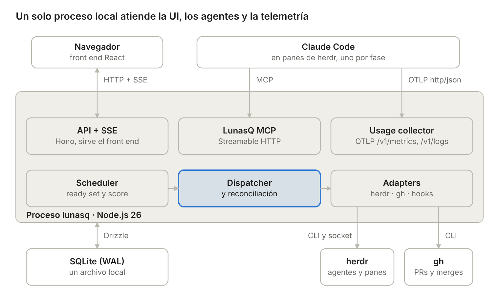
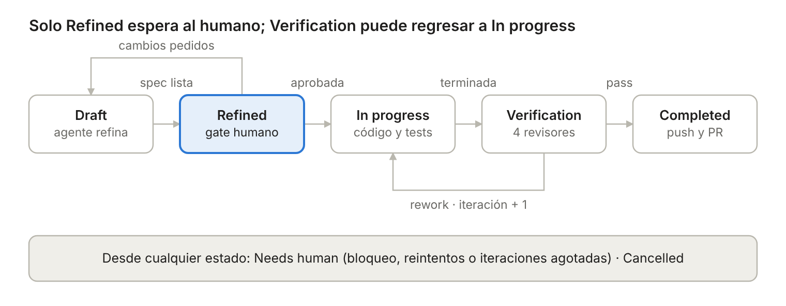

<div align="center">

# LunasQ

**A multi‑project task queue that dispatches coding agents: you define the intent, they refine, implement and verify it, and deliver it as a PR.**

[](.github/workflows/ci.yml)
[](.node-version)

</div>

LunasQ is a **lights‑on** *AI software factory*: specialized agents work on their own and you keep two human gates, **approving the spec** and **merging each PR**. It runs on your machine, in a single local process, and uses [herdr](https://herdr.dev) to launch and observe the agents.

## Table of contents

- [What is LunasQ](#what-is-lunasq)
- [Features](#features)
- [Architecture](#architecture)
- [Requirements](#requirements)
- [Quick start](#quick-start)
- [Usage](#usage)
- [Configuration](#configuration)
- [Repository structure](#repository-structure)
- [Development](#development)
- [Documentation](#documentation)
- [Contributing](#contributing)
- [Project status and v1 scope](#project-status-and-v1-scope)

## What is LunasQ

A human writes a task's *intent* («I want a professional README»). LunasQ turns it into a PR ready for review without you having to sit down with the agent:

```text
intent → refinement → spec gate (human) → implementation → verification → PR → merge (human)
```

1. **Refinement.** An agent reads the repo, clarifies the intent (if in doubt, it asks you in the Inbox) and writes a *spec*: domain model, requirements, Given / When / Then acceptance criteria and a task list.
2. **Spec gate.** You approve it or request changes. Without approval no code is written.
3. **Implementation.** Another agent works with TDD in the task's own worktree, checks off the task list and declares the end with a structured handoff. LunasQ runs the project's test command as a gate.
4. **Verification.** An independent session acts as *approver*: it launches the reviewers that apply (code, security, UI, UX), verifies each criterion and issues `pass` or `reject` with what needs fixing. A `reject` sends the task back to implementation (at most 3 iterations; after that it moves to *Needs human*).
5. **Delivery.** LunasQ rebases onto the base branch, pushes and opens the PR with evidence and a risk label.
6. **Merge.** You do it. LunasQ detects the merge and releases the tasks that depended on this one.

It is meant for queueing many tasks from several repos, letting them advance in parallel and spending your attention only on deciding: *is this spec what I want?* and *should this PR be merged?*

## Features

- **Multi‑project.** Each project is a repo with its base branch, test command, per‑phase agent profile and concurrency limits.
- **Dependencies as a DAG.** A task waits for its dependencies' PRs to be merged; cycles are rejected. The scheduler orders by priority, *aging* and unblock boost.
- **One worktree per task.** Each task has its own branch (`lunasq/<id>`) and checkout in all phases, so several tasks of the same repo run in parallel without stepping on each other.
- **MCP as the output channel.** Agents report spec, checklist and verdicts with tools of the LunasQ MCP, validated with a run token; nothing is inferred by reading the terminal.
- **Verification with reviewers.** The approver chooses among four read‑only reviewers (code, security, UI, UX) and justifies the ones it skips; Claude uses native subagents and Copilot/Codex use isolated read-only CLI executions.
- **Per‑phase hooks.** Project scripts in `lunasq/hooks/` that LunasQ runs before and after each phase (version bump, test deploys, notices).
- **Question inbox.** Agents ask asynchronously with `ask_human`; you answer in the UI and the agent resumes with your answer.
- **Claude Code, Copilot CLI and Codex CLI providers.** The agent is chosen per phase and project, with fallback across enabled providers if one fails to start; Settings can disable a CLI that is unavailable.
- **Idempotent and reconcilable.** The database is the source of truth; herdr is ephemeral state that a reconciliation loop compares and corrects.
- **Traceability.** Append‑only Event log, `LunasQ-Task` and `LunasQ-Run` trailers on every commit and an evidence file in `lunasq/tasks/<id>.md`.
- **Visible consumption.** Claude tokens and cost per Run via local OTLP; Copilot/Codex usage is marked partial when unavailable.
- **Spanish and English UI.** The interface defaults to Spanish; the ES/EN button in the header switches the language and remembers the choice. The repo, the API and the MCP are English only.

## Architecture

Four own pieces (front end, backend, scheduler, dispatcher) and an own MCP. herdr and GitHub (through the `gh` CLI) are external dependencies behind adapters; engram (project memory) is optional and only the agents use it.



All of LunasQ is a single Node.js process on `localhost`: it receives the UI over HTTP and SSE, the agents over MCP and the telemetry over OTLP.



Each task goes through a state machine with a single approval gate and a quality loop between *In progress* and *Verification*. Each state with an agent has a sub‑state (`queued`, `running`, `waiting_human`).



Principles: the database is the truth, reconciliation instead of fire‑once, structured outputs through MCP, per‑task isolation, independent verifier and idempotency. Full detail in [docs/design.md](docs/design.md).

## Requirements

| Tool | Version | What for |
| --- | --- | --- |
| Node.js 26 | Pinned in [.node-version](.node-version) | Runtime |
| pnpm 11 | Pinned in `packageManager` of `package.json` | Monorepo manager |
| [herdr](https://herdr.dev) | ≥ 0.9.5, with its server running | Runs and observes the agents |
| [Claude Code](https://claude.com/claude-code) | ≥ 2.1.312 (optional if another provider is installed) | Default agent |
| `gh` | Authenticated (`gh auth status`) | PRs and merge detection |
| GitHub Copilot CLI | ≥ 1.0.0 (optional) | Alternative agent |
| [OpenAI Codex CLI](https://developers.openai.com/codex/cli) | ≥ 0.122.0 (optional) | Alternative agent and verification provider |

At least one provider CLI must be installed. `pnpm lunasq doctor` checks this and tells you what is missing; unavailable providers can be disabled from Settings.

## Quick start

```bash
# 1. Install dependencies
pnpm install

# 2. Check the machine and install skills, reviewers and MCP configuration
pnpm lunasq install            # optional: --port <n> to change the port

# 3. Check that everything is green
pnpm lunasq doctor

# 4. Start the server and the UI
pnpm dev
```

`install` installs nothing if requirements are missing and lists the ones that are. `dev` runs the LunasQ server (port 7360 by default) in watch mode and Vite together, and Vite prints the UI URL (normally `http://localhost:5173`). Ctrl-C stops both.

To run only the server, use `pnpm lunasq start`. It serves the UI on its own port once the front end is built with `pnpm --filter @lunasq/web build`.

## Usage

1. **Create a project** with `POST /api/projects`: repo (`owner/name`), base branch, local path and test command. Optionally, per‑phase agent profile, concurrency limits and worktree bootstrap script.
2. **Create tasks** from **Nueva tarea**: intent, priority (integer, higher = higher priority) and dependencies.
3. **Answer questions** in the **Bandeja** (Inbox) when the refiner has doubts; the agent resumes with your answer.
4. **Review the spec.** Open it from «Specs por aprobar» in the Inbox and **approve** or use **Pedir cambios** with comments; each round creates a new version.
5. **Follow progress** on the board: checklist, Runs, consumption and events of each task.
6. **Merge the PR** on GitHub when you are satisfied. LunasQ detects it by polling and releases the dependent tasks.

If an agent gets blocked, runs out of retries or verification runs out of iterations, the task moves to *Needs human*: review the reason and resume or cancel it. The full guide, with a script to try it on a real project, is in [docs/pilot.md](docs/pilot.md).

## Configuration

LunasQ keeps everything of its own in `~/.lunasq/` (change it with `LUNASQ_HOME`):

| File | Contents |
| --- | --- |
| `config.json` | Port (`port`, 7360 by default) and whether telemetry is passed to the panes (`telemetry`) |
| `mcp.json` | Stable LunasQ MCP configuration for Claude Code |
| `lunasq.db` | SQLite database (WAL mode) with tasks, specs, Runs and Event log |
| `claude-settings.json` | Settings with the reviewer subagents' hooks |

Codex receives its authenticated LunasQ MCP configuration per Run; LunasQ does not edit Codex's global configuration.

| Variable | Effect |
| --- | --- |
| `LUNASQ_HOME` | LunasQ directory instead of `~/.lunasq` |
| `CLAUDE_CONFIG_DIR` | Claude Code directory where `install` copies skills and reviewers (`~/.claude` by default) |
| `LUNASQ_API` | Target of the front end's `/api` proxy in development |

**Per‑project hooks.** Each managed repo can define executable scripts in `lunasq/hooks/<point>/` (for example `before_delivery/10-bump-version`), sorted alphabetically, with a timeout and a `block` or `warn` policy in `lunasq/hooks/config`. LunasQ always reads them from the base branch, never from the task's branch. Available points: `before_` and `after_` of `refinement`, `implementation`, `verification` and `delivery`, plus `after_merge` and `on_failure`. Detail in [docs/design.md](docs/design.md) and [ADR uw-10-hooks](docs/decisions/uw-10-hooks.md).

## Repository structure

Modular monolith with pnpm workspaces. The rule: `domain` only depends on `schemas` and is never imported «upwards».

| Path | Contents |
| --- | --- |
| `packages/schemas` | Shared Zod v4 schemas (entities, handoffs, events) and JSON Schema generation |
| `packages/domain` | State machine, guards and scheduler rules in pure TypeScript |
| `packages/db` | Drizzle schema, migrations, repositories and outbox over SQLite |
| `packages/adapters` | Everything external (herdr, `gh`, git, processes, hooks), each with its fake |
| `packages/server` | Hono API, SSE, LunasQ MCP, usage collector, scheduler, dispatcher and reconciliation |
| `packages/web` | React + Vite front end that consumes the types of `schemas` |
| `packages/cli` | `lunasq` binary: `install`, `doctor` and `start` |
| `packages/e2e` | End‑to‑end pilot with Playwright against the full runtime with fake herdr and GitHub |
| `assets/skills` | Phase skills: `refine-task`, `implement-task` and `verify-task` |
| `assets/agents` | Definitions of the four reviewer subagents |
| `tooling/` | Repo tests: dependency boundaries and this README |
| `docs/` | Design, stack, ADRs and images |

## Development

```bash
pnpm install
pnpm test        # Vitest in all projects
pnpm lint        # Biome (lint and format)
pnpm format      # applies the format
pnpm typecheck   # tsc -b in strict mode
pnpm e2e         # builds the front end and runs Playwright
```

Tests that use real tools (they spend tokens or need your machine; they run apart from the suite):

```bash
pnpm --filter @lunasq/adapters test:herdr   # herdr adapter contract
pnpm --filter @lunasq/adapters test:gh      # gh adapter contract
pnpm --filter @lunasq/server test:herdr     # dispatcher against real herdr
pnpm --filter @lunasq/server test:claude    # reviewers with real Claude Code
pnpm --filter @lunasq/server test:usage     # usage collector
pnpm --filter @lunasq/server test:skills    # skills with real Claude Code
```

The working rules in the repo (architecture, boundaries, idempotency) are in [AGENTS.md](AGENTS.md).

## Documentation

| Document | Contents |
| --- | --- |
| [docs/design.md](docs/design.md) | Full design: domain, state machine, scheduler, dispatcher, hooks, MCP, verification and audit |
| [docs/tech-stack.md](docs/tech-stack.md) | Stack, packages and boundaries, external integrations and tooling |
| [docs/decisions/](docs/decisions/) | ADRs with the decisions made during implementation |
| [docs/pilot.md](docs/pilot.md) | Script to try LunasQ end to end on a real project |

## Contributing

1. Create a branch from `main` and make small commits, with the test together with or before the code it covers.
2. Before opening the PR, run `pnpm typecheck`, `pnpm lint` and `pnpm test`; if you change an adapter, also run its real tests.
3. If a decision changes while you implement, update the corresponding `.md` in the same PR; a new decision goes in an ADR in `docs/decisions/`.
4. Do not add dependencies that are not in [docs/tech-stack.md](docs/tech-stack.md) without justifying them in the PR or in an ADR.
5. Open the PR against `main`. [CI](.github/workflows/ci.yml) runs two checks: `check` (typecheck, lint and tests) and `e2e` (Playwright). Both must pass and the merge is always human.

## Project status and v1 scope

LunasQ is under active development. v1 covers the complete flow described above, with Claude Code, GitHub Copilot CLI and OpenAI Codex CLI as agents, a single machine and a single user.

**Out of scope in v1:** automatic merge, direct commits to `main`, production deployment done by LunasQ (it can be configured with project hooks), lanes by task size, acceptance tests hidden from the builder, multi‑user with roles and automatic intake from GitHub issues (planned for v2). The full roadmap is in [docs/design.md](docs/design.md).
