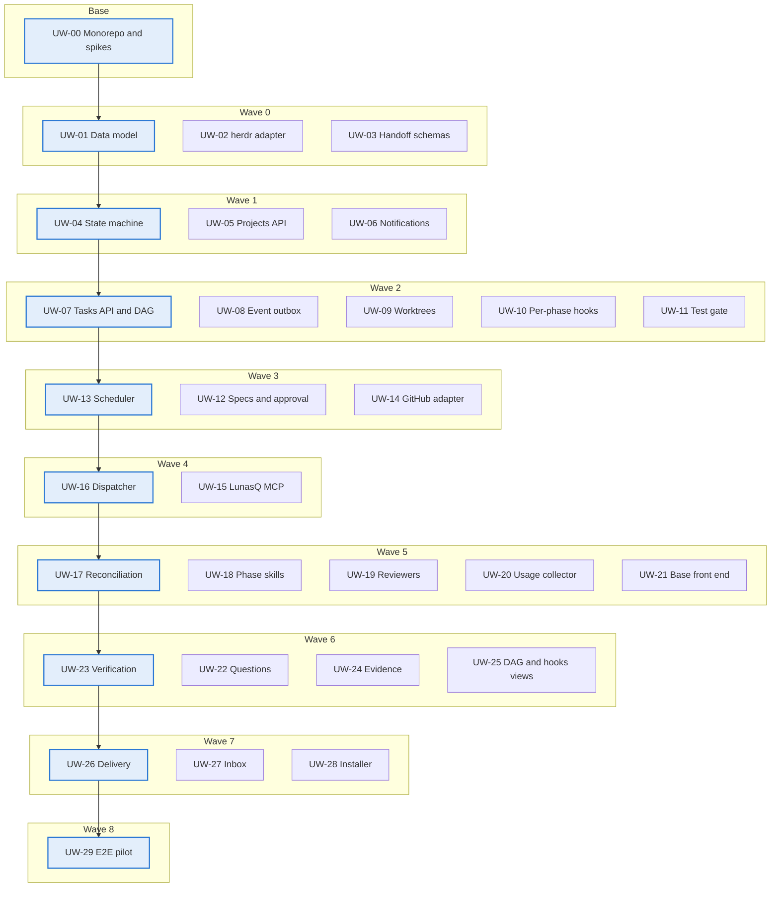

# LunasQ v1 — Units of work

Oct 28, 2026 · @Sergio Sanchez

LunasQ v1 is implemented in 30 units of work: UW-00 as the base and 29 more, grouped into 8 epics and ordered in 9 waves, on the stack defined in the tech stack doc; each unit can be built and tested separately, and its dependencies indicate which contract must exist first (it can be replaced by a fake in the meantime). Reference design: [design.md](design.md) · Tech stack: [tech-stack.md](tech-stack.md).

## Implementation order

UW-00 goes before everything and each wave depends only on earlier waves; within a wave, the units can be worked on in parallel. The critical path (base → data → states → tasks → scheduler → dispatcher → reconciliation → verification → delivery → pilot) marks the minimum of sequential steps.

Mermaid source

To move work forward outside the critical path, the herdr adapter includes an in-memory fake and the handoff schemas are defined first, so orchestration and the contract with agents advance without waiting for herdr or Claude Code.

## Backlog

The 30 units in wave order. All depend on UW-00, which goes first; after that, a unit can start when all its dependencies are Done. Each unit's status lives in its own file, `docs/units/uw-XX.md` (`status: Pending | Done` in the frontmatter), so parallel units do not edit the same table.

| ID | Unit of work | Epic | Wave | Depends on |
| --- | --- | --- | --- | --- |
| UW-00 | Monorepo and technical validations | Project base | Base | — |
| UW-01 | Data model and persistence | Data and domain | 0 | — |
| UW-02 | herdr adapter | Orchestration and execution | 0 | — |
| UW-03 | Handoff JSON schemas | Contract with agents | 0 | — |
| UW-04 | State machine and Event log | Data and domain | 1 | UW-01 |
| UW-05 | Projects API | Data and domain | 1 | UW-01 |
| UW-06 | Notifications | Orchestration and execution | 1 | UW-02 |
| UW-07 | Tasks API and dependencies (DAG) | Data and domain | 2 | UW-01, UW-04 |
| UW-08 | Event outbox | Data and domain | 2 | UW-01, UW-04 |
| UW-09 | Worktree lifecycle | Orchestration and execution | 2 | UW-02, UW-05 |
| UW-10 | Per-phase hooks | Delivery and integration | 2 | UW-02, UW-04, UW-05 |
| UW-11 | Test gate | Quality and verification | 2 | UW-02, UW-04, UW-05 |
| UW-12 | Specs and approval | Data and domain | 3 | UW-04, UW-07 |
| UW-13 | Scheduler | Orchestration and execution | 3 | UW-07, UW-08 |
| UW-14 | GitHub adapter (gh) | Delivery and integration | 3 | UW-04, UW-07 |
| UW-15 | LunasQ MCP | Contract with agents | 4 | UW-01, UW-03, UW-04, UW-12 |
| UW-16 | Dispatcher | Orchestration and execution | 4 | UW-02, UW-04, UW-09, UW-13 |
| UW-17 | Signals, timeouts and reconciliation | Orchestration and execution | 5 | UW-06, UW-16 |
| UW-18 | Phase skills | Contract with agents | 5 | UW-03, UW-15 |
| UW-19 | Reviewer subagents | Quality and verification | 5 | UW-15 |
| UW-20 | Usage collector | Observability and audit | 5 | UW-01, UW-16 |
| UW-21 | Base front end | Front end and rollout | 5 | UW-05, UW-07, UW-12 |
| UW-22 | Questions and blocks | Human in the loop | 6 | UW-06, UW-15, UW-16, UW-17 |
| UW-23 | Verification phase | Quality and verification | 6 | UW-11, UW-15, UW-17, UW-19 |
| UW-24 | Evidence file | Observability and audit | 6 | UW-15, UW-17 |
| UW-25 | DAG and hooks views | Front end and rollout | 6 | UW-07, UW-10, UW-21 |
| UW-26 | Delivery phase | Delivery and integration | 7 | UW-09, UW-10, UW-11, UW-14, UW-23 |
| UW-27 | Inbox of approvals and questions | Human in the loop | 7 | UW-12, UW-21, UW-22 |
| UW-28 | LunasQ installer | Front end and rollout | 7 | UW-18, UW-19 |
| UW-29 | End-to-end pilot | Front end and rollout | 8 | UW-20, UW-24, UW-25, UW-26, UW-27, UW-28 |

## Detail by epic

Each unit has a closed scope and a verifiable done criterion; the dependencies are in the backlog.

### E0 · Project base

| ID | Scope | Package and stack | Done when |
| --- | --- | --- | --- |
| UW-00 | Monorepo with its empty packages and dependency boundaries; strict TypeScript, Biome, Vitest and CI. Validation spikes: MCP SDK v2 or v1.x, run token via `--mcp-config` per Run, better-sqlite3 on Node 26, minimum herdr version | Root of `lunas-queue` · Node.js 26 LTS, pnpm workspaces, TypeScript, Biome, Vitest, GitHub Actions | CI green with one test per package; each spike with its result and decision recorded in the repo |

### E1 · Data and domain

| ID | Scope | Package and stack | Done when |
| --- | --- | --- | --- |
| UW-01 | Schema for Project, Task, TaskDependency, Spec, Run, Question, UsageRecord, Event and outbox, with migrations | `packages/db` · Drizzle ORM + drizzle-kit, better-sqlite3, SQLite in WAL | The migrations apply on a clean database; keys, uniqueness and relations tested; priority as an unsigned integer |
| UW-04 | State machine with sub‑states and guards; append‑only Event log with actor and payload | `packages/domain` (pure TypeScript) · events table in `packages/db` | Tests of all valid and invalid transitions; no transition happens without its event |
| UW-05 | Projects API: repo, base branch, local path, agent profile per phase, limits, test command and bootstrap | `packages/server` (Hono routes) · config validated with Zod in `packages/schemas` | The profile validates `kind = claude`; other modules read the configuration without touching the database |
| UW-07 | Tasks API (intent, tags, priority, cancellation) and edges with cycle detection | `packages/server` · DAG rules in `packages/domain` | An edge that closes a cycle is rejected; ancestors and descendants available for the scheduler |
| UW-08 | Outbox that publishes state changes to the scheduler and dispatcher | `packages/db` (outbox table) · in-process publisher in `packages/server` | No event is lost on a crash between the commit and the publication |
| UW-12 | Versioned specs with a domain model; approve, request changes or edit and approve; diff between versions | `packages/server` + `packages/db` · spec schema in `packages/schemas` | The approval is tied to an exact version; requesting changes returns to Draft with comments |

### E2 · Orchestration and execution

| ID | Scope | Package and stack | Done when |
| --- | --- | --- | --- |
| UW-02 | herdr adapter: workspaces, worktrees, panes, `agent start`, `prompt`, `read`, `wait`, metadata, notifications, `session.snapshot` and `events.subscribe` (per-pane subscription to `pane.agent_status_changed`) with event-loss handling (stream close → re‑subscribe and reconcile, ADR 0004); in-memory fake | `packages/adapters` · `child_process` for the CLI with JSON output, Unix socket with NDJSON | The same contract suite passes against real herdr and against the fake |
| UW-06 | Notifications through herdr and the UI, with escalation at 1 minute | `packages/server` (SSE to the UI) + `packages/adapters` (herdr toast) | A notification arrives through both channels without being duplicated |
| UW-09 | Worktree per task: creation, bootstrap, reopening, removal and orphan detection | `packages/adapters` (worktrees via herdr) + `packages/server` | Two tasks of the same repo work in parallel; repeating the operation duplicates nothing |
| UW-13 | Ready set, score with priority, aging and boost, priority inheritance, limits (global default 5), no preemption | Rules in `packages/domain` · in-process module in `packages/server` that reacts to the outbox and to a tick | DAG scenarios produce the expected order; the limits are never exceeded |
| UW-16 | Atomic claim with run token; dispatch sequence; pane environment variables (including `LUNASQ_RUN_TOKEN`); stable MCP configuration file with `${LUNASQ_RUN_TOKEN}` passed with `--mcp-config --strict-mcp-config` (ADR 0002); worktree folder trust in Claude Code (ADR 0004); session identity; phase closing | `packages/server` + `packages/adapters` · better-sqlite3 synchronous transaction for the claim | A phase is dispatched end to end against the fake and against herdr; repeating the dispatch does not duplicate agents |
| UW-17 | Signals, nudges, 30 min phase timeout with pause, 3 retries with backoff, `failure_reason`, reconciliation with snapshot and orphans | `packages/server` + `packages/adapters` (`events.subscribe`, `session.snapshot`) | Each simulated failure scenario ends in the expected state and notification |

### E3 · Contract with agents

| ID | Scope | Package and stack | Done when |
| --- | --- | --- | --- |
| UW-03 | Versioned handoff schemas: common envelope and body per phase; valid and invalid examples | `packages/schemas` · Zod v4 as the source; JSON Schema generated and versioned in the repo | The validator accepts the valid examples and rejects the invalid ones with clear errors |
| UW-15 | LunasQ MCP tools, run token validation, `get_task_context` gate, handoff validation, test gate and transition triggering | `packages/server` · official MCP SDK for TypeScript with Streamable HTTP mounted on Hono; Zod schemas from `packages/schemas` | Each tool has contract tests; an invalid handoff or an old run token is rejected |
| UW-18 | Skills `refine-task` (DDD), `implement-task` (TDD), `verify-task` (fan-out, checklist, reversal test), with best-effort instructions for engram | `assets/skills` · Claude Code skills markdown | Each skill produces a valid handoff on a test task. Delivery has no skill: LunasQ does it in UW-26 ([ADR uw-18-skills-fase](decisions/uw-18-skills-fase.md)) |

### E4 · Quality and verification

| ID | Scope | Package and stack | Done when |
| --- | --- | --- | --- |
| UW-11 | Test gate on receiving `submit_for_verification` and before accepting a pass; output and result stored | `packages/adapters` (execution in a herdr pane with a wrapper that records the exit code) + `packages/server` | A red suite blocks the transition even if the agent says otherwise |
| UW-19 | Read-only reviewer subagents on Opus, compact output; `SubagentStart` and `SubagentStop` hooks | `assets/agents` · Claude Code subagent frontmatter; the hooks call a local Hono endpoint | All 4 are launched from a test session and LunasQ records each execution |
| UW-23 | Phase orchestration: approver on Sonnet, verdict validation against the hooks, pass or reject, cap of 3 iterations, risk label, refuted findings | `packages/server` · verdict rules in `packages/domain` | A pass case and a reject case go through the loop; the fourth iteration ends in Needs human |

### E5 · Human in the loop

| ID | Scope | Package and stack | Done when |
| --- | --- | --- | --- |
| UW-22 | Asynchronous `ask_human`, `waiting_human` with timeout pause, answer to the live pane or in a new Run, permission blocks | `packages/server` + `packages/adapters` (`agent prompt`) · events to the UI via SSE | A question answered minutes or hours later reaches the right agent |
| UW-27 | Inbox: specs to approve, open Questions and blocked agents with access to the pane | `packages/web` · TanStack Query with SSE invalidation, shadcn/ui, diff viewer for specs | Everything that waits for the human appears and is resolved from the Inbox |

### E6 · Delivery and integration

| ID | Scope | Package and stack | Done when |
| --- | --- | --- | --- |
| UW-10 | Per-phase hooks read from `lunasq/hooks/` in the base branch, `lunasq/hooks/config`, pane execution, block or warn, commit with trailers, recording | `packages/adapters` (hook executor, base branch reading with git) + `packages/server` | The hooks run in order; a hook modified in the task's branch is never executed |
| UW-14 | Create PR, read status, CI and reviews; merge polling; a PR closed without merge sends dependents to Needs human | `packages/adapters` · `gh` CLI with `--json` via `child_process` | A detected merge releases the dependent tasks |
| UW-26 | Delivery: `before_delivery`, rebase, final test gate, commits with trailers, push, PR with intent, criteria, evidence and risk label, `after_delivery` | `packages/server` + `packages/adapters` (git and `gh`) | A task with a pass ends in a PR with trailers and a risk label |

### E7 · Observability and audit

| ID | Scope | Package and stack | Done when |
| --- | --- | --- | --- |
| UW-20 | OTLP receiver, task, Run and phase attributes, UsageRecord, breakdown by reviewer, read‑only Task.usage | `packages/server` · OTLP/HTTP JSON endpoints (`/v1/metrics`, `/v1/logs`) in Hono, without a separate Collector; `packages/db` | A task's usage matches what Claude Code reports |
| UW-24 | `lunasq/tasks/{id}.md` with one section per Run: metadata, `failure_reason`, JSON handoff, verdict, gate and hooks output, transcripts in markdown | `packages/server` · own markdown generator; secret redaction with gitleaks-style patterns | The file is updated on every Run close and travels in the PR |

### E8 · Front end and rollout

| ID | Scope | Package and stack | Done when |
| --- | --- | --- | --- |
| UW-21 | Board per project, global queue, task creation, task detail with Runs, Event log, spec versions, usage and evidence | `packages/web` · React + Vite, TanStack Router, Query and Table, shadcn/ui on Tailwind; served as static files by `packages/server` | A task is created and followed end to end without using the API by hand |
| UW-25 | Dependency DAG and hooks view with their latest executions | `packages/web` · React Flow (`@xyflow/react`) with dagre layout | The DAG reflects the real dependencies; each hook shows content and executions |
| UW-28 | Installer: verification of herdr, Claude Code and `gh`, herdr integration for Claude Code, skills, subagents, LunasQ MCP registration and telemetry | `packages/cli` · `lunasq` binary (`start`, `install`, `doctor`) published on npm | A clean machine is ready with a single command and `lunasq doctor` in green |
| UW-29 | Pilot on a real project with at least 3 tasks with dependencies, a rework, a question and a hook; UI end-to-end suite | The whole monorepo · Playwright against a server with the herdr fake | The tasks end in mergeable PRs; the e2e suite runs in CI; pilot findings as new tasks |
