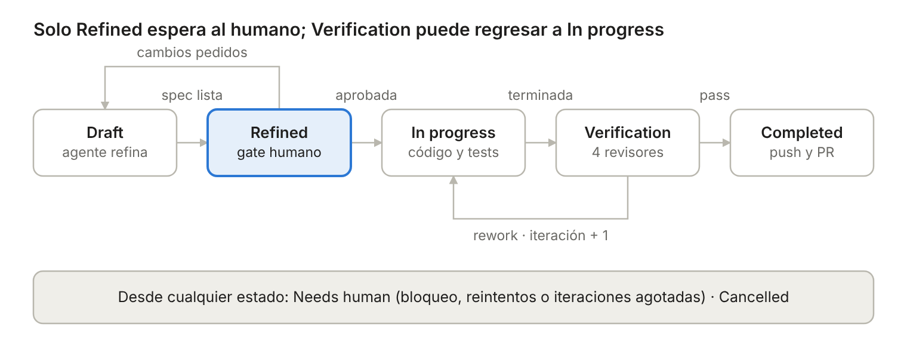
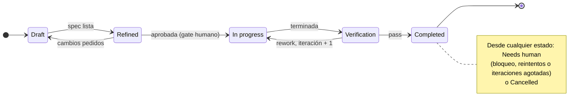
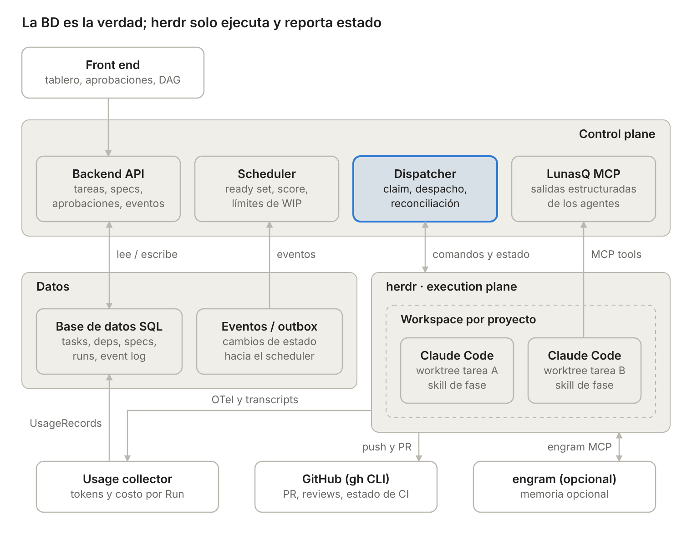
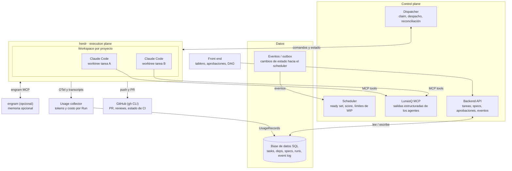

# LunasQ — Diseño

Oct 28, 2026 · @Sergio Sanchez

## Objetivo y principios

LunasQ (repositorio `lunas-queue`) es una cola de tareas multi‑proyecto donde un humano define el intent y agentes de codificación (Claude Code en v1) la refinan, implementan, verifican y entregan como PR; herdr es la capa de ejecución y observación, no la fuente de verdad.

**Modelo de factory:** LunasQ es una AI software factory *lights‑on*: agentes especializados refinan, implementan y verifican con memoria opcional del proyecto (engram), y el humano conserva dos gates, aprobar la spec y mergear cada PR.

**Alcance:** crear tareas con intent, prioridad y dependencias; despacho automático a agentes en herdr; gates humanos en refinamiento; loop implementación ↔ verificación; commit, push y PR.

**Agentes soportados:** v1 solo soporta Claude Code, en todas las fases. Codex y otros agentes se integran en v2 o posteriores; el LunasQ MCP, las skills, el perfil de agente y el adapter de herdr se mantienen agnósticos para que sumarlos no cambie la arquitectura.

**Fuera de alcance (v1):** merge automático, commits directo a main, despliegue a producción hecho por LunasQ (se puede configurar con hooks del proyecto), carriles por tamaño de tarea, pruebas de aceptación ocultas al builder (posible versión futura) e intake automático desde GitHub issues (planeado para v2).

Principios:

1. **Control plane vs execution plane.** La base de datos del sistema es la verdad. herdr guarda estado efímero (sus eventos no son durables), así que todo se reconcilia contra la BD.
2. **Reconciliación, no disparo único.** El dispatcher es un loop que compara estado deseado (BD) contra estado real (herdr) y corrige, al estilo de un controller de Kubernetes.
3. **Salidas estructuradas por MCP.** El agente reporta requerimientos, checklist y veredictos mediante tools MCP, no se infieren leyendo la terminal. La terminal solo se usa para liveness (working / blocked / idle).
4. **Aislamiento por tarea.** Cada tarea trabaja siempre en su propio git worktree y branch, en todas las fases, para que varias tareas del mismo repo corran en paralelo sin pisarse.
5. **Independencia del verificador.** Quien verifica no es la misma sesión que implementó.
6. **Idempotencia.** Cada transición y cada acción contra herdr o git puede repetirse sin efectos duplicados.

## Modelo de dominio

Siete entidades bastan (más UsageRecord, ver Consumo); la clave es separar la **Task** (qué) del **Run** (cada intento de un agente en una fase), para tener historial de reintentos y loops.

| Entidad | Propósito | Campos clave |
| --- | --- | --- |
| Project | Un repo y su configuración; mapea 1:1 a un workspace de herdr | repo, rama base, perfil de agente por fase (kind, modelo, args), límite de concurrencia, comando de tests, hooks por fase (en lunasq/hooks/ del repo), ruta local, bootstrap del worktree |
| Task | Unidad de trabajo en la cola | intent, tags, prioridad (entero sin signo), estado, sub‑estado, iteración de verificación, branch, ruta del worktree, URL y estado del PR (abierto / mergeado / cerrado), etiqueta de riesgo (read‑only), caused\_by (tarea que originó este bugfix, opcional), usage (read‑only) |
| TaskDependency | Arista del DAG | task\_id, depends\_on\_id |
| Spec | Salida versionada del refinamiento | versión, modelo de dominio (bounded context, glosario, agregados, invariantes, eventos), requerimientos, acceptance criteria, task list, estado de aprobación |
| Run | Un intento de un agente en una fase | fase, tipo de agente, workspace/pane/nombre en herdr, identidad de sesión del agente (session id nativo o nombre de sesión), run token, inicio, fin, resultado, failure\_reason (texto), handoff (JSON), usage (read‑only) |
| Event | Log append‑only de transiciones y acciones | task\_id, tipo, actor (humano / agente / sistema), payload, timestamp |
| Question | Pregunta asíncrona del agente al humano | task\_id, run\_id, pregunta, contexto, estado (abierta / respondida / cancelada), respuesta, quién y cuándo respondió |

Decisiones de modelado:

- **Spec versionada.** Cada ronda de refinamiento crea una versión nueva; la aprobación humana se liga a una versión concreta. Implementación y verificación leen siempre la versión aprobada.
- **Acceptance criteria como items direccionables.** Cada criterio tiene id, para que el verificador emita un veredicto por criterio (pass / fail / evidencia) y no un booleano global.
- **Event log como auditoría.** Permite reconstruir por qué una tarea regresó a in progress y alimenta la UI de historial.
- **Run token y timeouts.** Cada Run tiene un token único que se inyecta al pane; solo el Run activo puede mover la tarea. Las tareas atoradas se detectan con señales de herdr y un timeout por fase, sin heartbeat del agente.

## Máquina de estados

Se conservan tus cinco estados con New renombrado a Draft; Draft incluye la tarea recién creada y el refinamiento en curso, Refined es el único gate humano y el loop de calidad vive entre In progress y Verification.

Fuente Mermaid

Cada estado con agente tiene un sub‑estado: `queued` (esperando slot o dependencias), `running` (agente vivo en herdr) o `waiting_human` (pregunta abierta). Así la columna del tablero no cambia mientras la tarea espera.

| Transición | Disparador | Guard | Actor |
| --- | --- | --- | --- |
| Draft → Refined | submit\_spec | Spec con requerimientos, criterios y task list completos | Agente refinador |
| Refined → Draft | Cambios pedidos | Comentarios del humano adjuntos a la versión | Humano |
| Refined → In progress | Aprobación | Versión de spec aprobada (las dependencias ya se validaron antes de refinar) | Humano, luego scheduler |
| In progress → Verification | submit\_for\_verification | Gate de tests en verde ejecutado por LunasQ; cada criterio con al menos un test; commits en el branch de la tarea | Agente implementador |
| Verification → In progress | submit\_verdict = rework | Iteración menor al máximo | Agente verificador |
| Verification → Completed | submit\_verdict = pass, luego entrega | Veredicto pass del verificador, gate de tests en verde, tests coherentes y todos los criterios en pass; push y PR exitosos | Sistema (entrega), con el veredicto del verificador |
| Cualquiera no terminal → Needs human | Bloqueo con timeout, reintentos o iteraciones agotadas | — | Sistema |
| Verification → In progress | Conflictos al integrar la rama base en la entrega | Sin subir la iteración | Sistema |
| Cualquiera no terminal → Cancelled | Cancelación | Agente vivo se detiene y se limpia | Humano |
| Needs human → estado previo | Reanudar | Vuelve al estado previo al último escalamiento, con sub‑estado `queued` si lleva agente; opcionalmente reinicia la iteración | Humano |

Completed y Cancelled son terminales. El catálogo de comandos, los guards, los sub‑estados y el Event log están en [ADR 0007](decisions/0007-maquina-de-estados.md).

## Arquitectura

Cuatro piezas propias (front end, backend, scheduler, dispatcher) y un MCP propio; herdr y GitHub (vía el CLI gh) son dependencias externas detrás de adapters; engram es opcional y solo lo usan los agentes.

Fuente Mermaid

| Componente | Responsabilidad | Notas |
| --- | --- | --- |
| Front end | Crear tareas, aprobar specs, ver cola, DAG, historial y consumo | No habla con herdr; todo pasa por el backend |
| Backend API | CRUD de tareas, validación de DAG, transiciones de estado, auth | Único escritor de estado de negocio |
| Base de datos SQL | Tasks, dependencias, specs, runs, usage, event log | Claims atómicos para el scheduler |
| Eventos / outbox | Publicar cambios de estado de forma confiable | Outbox evita perder eventos entre BD y cola |
| Scheduler | Calcular ready set y score; respetar WIP limits | Puede ser parte del dispatcher en v1 |
| Dispatcher | Despachar fases a herdr, observar señales, reconciliar | Adapter de herdr aislado del resto |
| LunasQ MCP | Contrato de entrada y salida de los agentes | Valida que el Run que llama sea el activo |
| Usage collector | Recibir telemetría OTLP y transcripts; escribir UsageRecords por Run | Normaliza por tipo de agente; aplica tabla de precios |
| herdr | Workspaces, worktrees, panes, agentes, estado, notificaciones | Estado efímero, nunca fuente de verdad |
| GitHub (CLI `gh`) | PR, reviews, CI | Solo el CLI gh, detrás de un adapter: crear PR, leer CI y reviews, detectar merges por polling |
| engram | Memoria persistente del proyecto (Brain) | Dependencia débil: los agentes lo usan vía su MCP si está instalado; LunasQ no lo integra |

## Scheduler: prioridad, dependencias y concurrencia

El scheduler no ordena una lista: calcula un **ready set** (tareas cuyas dependencias ya están satisfechas) y de ahí elige por score, respetando límites de concurrencia.

**Dependencias como DAG**

- Se valida ausencia de ciclos al crear o editar una arista; se rechaza la operación si cierra un ciclo. Las aristas se agregan mientras la tarea dependiente está en Draft y no pueden apuntar a una tarea cancelada ([ADR 0010](decisions/0010-api-tareas-dag.md)).
- Una tarea está *ready* cuando todas sus dependencias tienen su PR mergeado a la rama base. Aplica desde el refinamiento: con dependencias pendientes la tarea se queda en Draft sin agente. Si el PR de una dependencia se cierra sin merge, sus dependientes pasan a Needs human.
- Dependencias cross‑project permitidas, pero visibles en la UI como riesgo.

**Score de prioridad**

score = prioridad base + aging + boost por desbloqueo

- **Prioridad base:** entero sin signo definido por el humano; mayor número = mayor prioridad. Empates se rompen por antigüedad. La UI sugiere valores espaciados (p. ej. de 100 en 100) para poder insertar tareas entre otras sin renumerar.
- **Aging:** sube con el tiempo en ready, evita starvation de tareas de baja prioridad; se configura en las mismas unidades que la prioridad (puntos por hora en ready).
- **Boost por desbloqueo:** una tarea que bloquea a muchas otras sube; se calcula con el número de descendientes en el DAG (camino crítico).
- **Herencia de prioridad:** si una tarea de prioridad 900 depende de una de 100, la de 100 hereda 900 como prioridad efectiva mientras la bloquee. La prioridad efectiva se calcula; la prioridad base que capturó el humano no cambia.

**Concurrencia (WIP limits)**

| Nivel | Qué limita | Por qué |
| --- | --- | --- |
| Global | Agentes vivos totales | CPU, memoria, rate limits de proveedores |
| Por proyecto | Tareas en in progress por repo | Conflictos de merge, carga de CI |
| Por tipo de agente | Instancias por tipo de agente (en v1 solo Claude Code) | Cuotas y costo por proveedor |
| Por fase | Refinamiento vs implementación | Refinar es barato y desbloquea al humano; conviene más slots |

Todos los límites son configurables; el global tiene default de 5 y los demás son opcionales. Sin preemption: una tarea de mayor prioridad espera el siguiente slot libre. Los gates humanos no consumen slots: una tarea en refined esperando aprobación no tiene agente vivo.

## Dispatcher e integración con herdr (propuesta inicial)

El dispatcher es un worker de larga vida con dos entradas (eventos de la BD y eventos de herdr) y un loop de reconciliación periódico; cada "despacho" es una secuencia idempotente sobre primitivas que herdr ya expone en su CLI y socket API ([CLI reference](https://herdr.dev/docs/cli-reference/), [Socket API](https://herdr.dev/docs/socket-api/)).

**Primitivas de herdr que usa el diseño**

| Necesidad del sistema | Primitiva de herdr |
| --- | --- |
| Un workspace por proyecto | `workspace create` con cwd y label |
| Aislamiento por tarea | `worktree create`: crea checkout + branch y lo abre como workspace agrupado bajo el del proyecto |
| Levantar un agente | `agent start` con nombre único y `--kind` (claude en v1) sobre un pane de shell libre |
| Enviar la instrucción de fase | `agent prompt` (opcionalmente con wait) |
| Saber si trabaja, terminó o pide permiso | `events.subscribe` a `pane.agent_status_changed` (suscripción por pane; ver ADR 0004), o `agent wait` |
| Mostrar tarea y fase en el sidebar | `pane report-metadata` con tokens (task id, fase, iteración) |
| Avisar al humano | `notification show` |
| Reconstruir estado tras caídas | `session.snapshot` |
| Limpiar | `pane close`, `worktree remove` |

**Secuencia de despacho (una fase)**

1. **Claim.** El scheduler elige la tarea de mayor score del ready set y la reclama de forma atómica en la BD, creando un Run con un token único. Si el claim falla, la tarea ya fue tomada.
2. **Asegurar workspace del proyecto.** Si no existe en herdr, crearlo; guardar su id en Project.
3. **Asegurar checkout de la tarea.** Siempre, en todas las fases. La primera vez `worktree create` crea branch y checkout desde la rama base (no es idempotente: antes se consulta `worktree list` y se usa `open` si ya existe; ADR 0004); en fases siguientes y loops de rework `worktree open` reabre el mismo.
4. **Levantar agente.** Crear pane/tab (con `pane split --env`, que fija las variables del Run en el pane), `agent start` con nombre determinístico (p. ej. `t<id>-<fase>-<n>`, cumple el patrón de nombres de herdr) y el perfil de esa fase: kind como --kind; modelo y argumentos extra después de --. El nombre determinístico hace la operación idempotente.
5. **Prompt de fase.** Enviar un prompt corto que invoque la skill de la fase y le indique el task id; el agente obtiene el contexto completo vía MCP, no por el prompt.
6. **Observar.** El Run pasa a running; el dispatcher escucha los cambios de estado del pane en herdr y arranca el timer de la fase.
7. **Cerrar fase.** La señal primaria es la tool MCP de fin de fase con salida estructurada. Se aplica la transición en la BD, se guarda la identidad de sesión en el Run, se cierra el pane y se libera el slot.

**Ciclo de vida del worktree**

Una tarea = un worktree = un branch, desde el primer despacho hasta el merge; todas sus fases y reintentos trabajan sobre el mismo checkout.

| Momento | Acción | Notas |
| --- | --- | --- |
| Primer despacho (refinamiento) | Crear worktree y branch desde la rama base | Branch `lunasq/<task id>`, desde `origin/<rama base>` tras un `git fetch`; idempotente consultando `worktree list` y usando `open` si ya existe (ADR 0004, ADR 0012) |
| Worktree creado | Correr el bootstrap del proyecto | Instalar dependencias, copiar config local; corre como proceso hijo y el worktree consta como listo en la BD solo si termina bien, así se reintenta (ADR 0012) |
| Fases siguientes y rework | Reabrir el mismo worktree | El agente nuevo hereda el estado del código, no el contexto de la sesión |
| Tarea dependiente | Crear su worktree desde la rama base, que ya incluye el merge de sus dependencias | Sin stacked branches |
| Entrega | Rebase sobre la rama base dentro del worktree, push, PR | Conflictos regresan la tarea a in progress |
| Después del merge o cancelación | `worktree remove` | No borra el branch; requiere forzar si hay cambios sin commit |

Restricciones: dos tareas nunca comparten branch ni worktree, y el reconciliador detecta worktrees huérfanos (tarea inexistente, cancelada o con el PR mergeado; ADR 0012) para limpiarlos. Costo a vigilar: disco y tiempo de bootstrap por tarea, que pesa más con muchas tareas en paralelo.

**Señales y cómo se interpretan**

| Señal | Interpretación | Acción |
| --- | --- | --- |
| MCP: fase completada | Salida válida | Transición de estado, cierre del agente |
| herdr: `blocked` | Prompt de permiso en la TUI del agente | Item en la bandeja; si sigue así 1 minuto, notificación por herdr y UI; se responde en herdr |
| herdr: `idle`/`done` sin señal MCP | Se detuvo sin reportar | Nudge (re‑prompt) N veces, luego marcar Run fallido |
| Pane cerrado o proceso salió | Crash | Run fallido; hasta 3 reintentos con backoff, luego Needs human |
| Timeout de fase vencido | Agente atorado o fase más larga de lo esperado | Marcar Needs human y notificar; el agente no se detiene |

**Timeout de fase.** Configurable por proyecto y por fase, default 30 minutos. Corre mientras el Run está en running y se pausa en `blocked` o `waiting_human`, porque ese tiempo depende del humano. Al vencer, la tarea pasa a Needs human con notificación; el agente sigue vivo para que decidas si esperar, intervenir o cancelar.

**Sin heartbeat ni lease en v1.** La liveness sale de herdr sin costo de tokens: estado del agente, pane cerrado o proceso terminado. Supuesto: una sola instancia de dispatcher. Si después se escala a varias, se agrega un lease del lado del servidor que renueva el dispatcher, nunca el agente.

**Identidad de sesión por Run.** El pane se cierra al terminar la fase, así que cada Run guarda cómo encontrar su sesión después: para revisarla, reanudarla o correlacionar su consumo. Se guarda lo mejor disponible, en este orden:

1. **Session id nativo del agente,** fijado por el dispatcher en los args de arranque si el CLI lo permite.
2. **Session id reportado por herdr** en `agent_session`, cuando la integración oficial del agente lo publica.
3. **Nombre de sesión** como respaldo: el nombre determinístico del agente en herdr (`t<id>-<fase>-<n>`) más la ruta del transcript si se conoce.

El Run registra también qué fuente se usó, para saber si la sesión se puede reanudar o solo identificar.

**Loop de reconciliación**

Cada N segundos y al reconectar con herdr: tomar `session.snapshot`, compararlo con los Runs activos en la BD y corregir. Runs sin pane → reintentar. Panes con prefijo del sistema sin Run → cerrar (huérfanos). Esto cubre el caso documentado de `events_lost` (en protocol 22 herdr cierra el stream sin mensaje explícito: todo cierre cuenta como pérdida; ADR 0004), donde herdr corta la suscripción si el consumidor se atrasa.

**Dónde vive el dispatcher: servicio externo (decidido)**

El dispatcher es un servicio propio que controla herdr por su CLI o socket API, detrás de un adapter. Así queda desacoplado del ciclo de vida y la versión del plugin API de herdr (pre‑1.0), se puede probar sin herdr usando un fake del adapter, y puede atender varias máquinas con `--machine` si algún día hace falta. Un plugin de herdr queda solo como opción futura para mostrar el tablero dentro de la TUI, sin lógica de despacho.

## Hooks por fase

Cada proyecto puede configurar comandos que LunasQ ejecuta al inicio y al final de cada fase, para automatizar pasos propios como bump de versión, deploys a ambientes de prueba, notificaciones o generación de changelog. Los ejecuta LunasQ, no el agente, así que corren siempre y en el mismo punto del flujo.

**Puntos de enganche**

| Hook | Cuándo corre | Ejemplos |
| --- | --- | --- |
| `before_refinement` / `after_refinement` | Antes de despachar al refinador / después de `submit_spec`, antes del gate humano | Preparar datos de prueba; notificar que hay una spec por aprobar |
| `before_implementation` / `after_implementation` | Antes de despachar al implementador / después de `submit_for_verification` y del gate de tests | Levantar servicios locales; análisis estático adicional |
| `before_verification` / `after_verification` | Antes de despachar al verificador / después de `submit_verdict` | Deploy a un ambiente efímero para los revisores de UI y UX; reporte de cobertura |
| `before_delivery` / `after_delivery` | Antes del rebase, push y PR / después de crear el PR | Bump de versión y changelog antes del push; avisar en un canal que hay PR |
| `after_merge` | Cuando LunasQ detecta el PR mergeado | Deploy a staging o producción, publicar release |
| `on_failure` | Cuando un Run termina sin éxito | Recolectar logs, avisar por otro canal |

**Dónde se definen**

Los hooks viven en el repo del proyecto, en `./lunasq/hooks/`, versionados con el código y revisados por PR como cualquier otro cambio. El front end solo los muestra; no se editan desde ahí.

- **Un directorio por punto de enganche:** `lunasq/hooks/before_delivery/`, `lunasq/hooks/after_merge/`, etc. Cada script ejecutable dentro es un hook.
- **Orden:** los scripts de un mismo punto corren en orden alfabético del nombre de archivo, así un prefijo numérico (`10-bump-version`, `20-changelog`) define la secuencia.
- **Ajustes por script:** timeout y política de fallo se declaran en `lunasq/hooks/config`; si un script no aparece ahí, usa los valores por defecto (política `block`).
- **Vista en el front end:** por proyecto, los hooks de cada punto con su contenido, tal como están en la rama base, y sus últimas ejecuciones por tarea con salida, duración y código de salida.

La carpeta `lunasq/` del repo queda con dos partes: `hooks/` (configuración, versionada) y `tasks/` (archivos de evidencia por tarea).

**Definición de cada hook**

| Campo | Significado |
| --- | --- |
| Comando | Script ejecutable en lunasq/hooks/\<punto>/; corre en el worktree de la tarea (`after_merge` corre en el checkout de la rama base) |
| Timeout | Tiempo máximo; al vencer cuenta como fallo. Se declara en lunasq/hooks/config |
| Política de fallo | `block`: la transición se detiene y la tarea pasa a Needs human; `warn`: se registra y el flujo sigue. Se declara en lunasq/hooks/config; por defecto block |
| Orden | Orden alfabético del nombre de archivo dentro del directorio del punto |

**Contrato de ejecución**

- LunasQ pasa variables de entorno con el contexto: id de tarea y de Run, fase, ruta del worktree, branch, rama base, URL del PR cuando existe y resultado de la fase.
- Corren en un pane de herdr dentro del workspace de la tarea, así se ven igual que los agentes; no consumen slots de agente.
- Si un hook modifica archivos (p. ej. el bump de versión en `before_delivery`), LunasQ los incluye en un commit con los trailers de la tarea antes del push.
- La salida, duración y código de salida de cada hook se guardan en el Event log y en el archivo de evidencia `lunasq/tasks/{id}.md`.
- Los hooks deben ser idempotentes, porque una fase puede repetirse por rework o reintentos.

**Seguridad:** LunasQ lee lunasq/hooks/ de la rama base, nunca del branch de la tarea, y un cambio a un hook solo entra en vigor cuando su PR se mergea. Así un agente no puede cambiar un hook dentro de su worktree y hacer que LunasQ ejecute un comando arbitrario.

## MCPs y skills

El contrato entre el sistema y cualquier agente es un **MCP propio (LunasQ MCP)** más una **skill por fase**; así Claude Code hoy, y Codex u otro agente compatible con MCP en v2, siguen el mismo protocolo sin código específico por proveedor.

**LunasQ MCP (propio, expuesto por el backend)**

| Tool | Fase | Qué hace |
| --- | --- | --- |
| get\_task\_context | Todas | Intent, spec aprobada, historial de verificación, convenciones del proyecto; obligatoria antes de cualquier tool de salida |
| submit\_spec | Refinamiento | Envía modelo de dominio (DDD), requerimientos, acceptance criteria y task list como nueva versión de Spec |
| ask\_human | Todas | Registra una Question y regresa de inmediato; el agente termina su turno y la respuesta llega después como prompt nuevo |
| update\_checklist | Implementación | Marca items de la task list; alimenta el progreso en la UI |
| submit\_for\_verification | Implementación | Declara fin de implementación con resumen, commits y mapa criterio → tests; dispara el gate de tests |
| submit\_verdict | Verificación | Pass o reject, veredicto por criterio, reporte de cada revisor, must‑fix consolidados, hallazgos refutados con su motivo y etiqueta de riesgo; cada revisor omitido requiere justificación |
| report\_failure | Todas | El agente declara que no puede continuar y por qué |

Las tools validan el run token que el dispatcher inyecta al pane; una sesión vieja no puede mover la tarea.

**Skills (una por fase, versionadas con el sistema)**

| Skill | Responsabilidad | Salida obligatoria |
| --- | --- | --- |
| refine-task | Leer el repo, aclarar el intent, modelar con DDD y escribir criterios verificables en lenguaje del dominio | submit\_spec |
| implement-task | TDD contra la spec aprobada: test que falla, implementación mínima, refactor; commits pequeños | submit\_for\_verification |
| verify-task | Lanzar los 4 subagentes revisores, consolidar, refutar hallazgos, verificar cada criterio y la coherencia de los tests, sin editar código | submit\_verdict |
| deliver-task | Rebase sobre rama base, push, crear PR con resumen y criterios | PR url vía MCP |
| herdr (oficial) | Que el agente sepa operar herdr si necesita panes auxiliares | — |

Regla de diseño: las skills describen el *cómo*; el MCP es el único canal de *salida*. Si un agente termina sin llamar la tool de salida, el dispatcher lo trata como fase incompleta.

**Handoff entre fases**

Cada fase arranca con un agente nuevo, pero no con contexto vacío: la tool de salida de cada fase incluye un handoff estructurado en JSON que se valida y se guarda en el Run y que el siguiente agente recibe en `get_task_context`.

| Fase que termina | Handoff que deja | Lo recibe |
| --- | --- | --- |
| Refinamiento | Spec aprobada con modelo de dominio + notas: archivos y módulos relevantes, decisiones tomadas y descartadas, supuestos | Implementación |
| Implementación | Resumen de cambios, mapa criterio → tests, archivos tocados, decisiones de diseño, cómo correr las pruebas, pendientes conocidos | Verificación |
| Verificación con rework | Veredicto por criterio y hallazgos accionables con archivo y motivo | Implementación, siguiente iteración |
| Cualquier fase que se reintenta | Questions con sus respuestas, último checklist y resumen del Run fallido | La misma fase |

Reglas:

- El handoff es JSON con esquema fijo por fase y tamaño acotado; el detalle vive en el repo (diff y commits), no en el handoff.
- El verificador recibe la spec, el diff y el resumen del implementador como afirmaciones a comprobar, no su razonamiento; así conserva su independencia.
- Si una fase termina sin handoff (crash o timeout), el siguiente Run recibe el último checklist y el diff actual del worktree.

**Formato del handoff (JSON)**

El handoff nunca es texto libre: es un objeto JSON que el LunasQ MCP valida contra un JSON Schema versionado por fase. Si no cumple el esquema, la tool de salida rechaza la llamada con los errores de validación y el agente corrige y reintenta; la fase no se cierra con un handoff inválido.

Todos los handoffs comparten un sobre común y agregan un cuerpo según la fase:

| Parte | Campos | Fases |
| --- | --- | --- |
| Sobre común | versión del esquema, task id, run id, fase, resultado, resumen corto, archivos relevantes, decisiones, riesgos o pendientes conocidos | Todas |
| Cuerpo de refinamiento | modelo de dominio (bounded context, glosario, agregados, invariantes, eventos), criterios con id, task list, supuestos | Refinamiento |
| Cuerpo de implementación | mapa criterio → tests, commits, cambios por módulo, cómo correr las pruebas, desviaciones de la spec | Implementación |
| Cuerpo de verificación | veredicto pass o reject, veredicto por criterio, reporte por revisor, revisores omitidos con justificación, must‑fix, hallazgos refutados con motivo, etiqueta de riesgo | Verificación |

Como el formato es fijo, LunasQ puede usar los campos sin interpretar texto: armar el siguiente `get_task_context`, poblar la UI y renderizar el handoff en el archivo de evidencia `lunasq/tasks/{id}.md` como bloque JSON. Un cambio de esquema sube su versión, y LunasQ conserva la capacidad de leer handoffs de versiones anteriores. Esquemas, ejemplos válidos e inválidos y reglas entre campos: `packages/schemas` ([ADR 0006](decisions/0006-handoff-v1.md)).

## Prácticas de ingeniería por fase

Cada fase sigue una práctica obligatoria y las tres se encadenan: DDD produce criterios en lenguaje del dominio, TDD convierte cada criterio en tests antes del código, y la verificación comprueba la trazabilidad, corre la suite y revisa que los tests sean coherentes.

| Fase | Práctica | Artefacto obligatorio | Cómo se comprueba |
| --- | --- | --- | --- |
| Refinamiento | DDD | Modelo de dominio en la spec: bounded context afectado, glosario del lenguaje ubicuo, agregados y entidades, invariantes, eventos de dominio; criterios escritos en lenguaje del dominio (Given / When / Then) | `submit_spec` exige esas secciones; el humano lo revisa en el gate de la spec |
| Implementación | TDD | Por cada criterio: test que falla → implementación mínima → refactor; mapa criterio → tests en el handoff | Cada criterio tiene al menos un test; el historial del branch muestra los tests junto o antes que el código que cubren |
| Verificación | Tests en verde y coherentes | Resultado de la suite y revisión de coherencia en el veredicto | Gate de tests ejecutado por LunasQ + checklist de coherencia del approver y del code reviewer |

**Checklist de coherencia de tests**

- Cada acceptance criterion tiene al menos un test que lo ejercita, nombrado en lenguaje del dominio.
- Los tests prueban comportamiento observable, no detalles internos; los mocks solo se usan en las fronteras del sistema.
- No hay tests saltados, aserciones vacías ni aserciones triviales que pasarían con cualquier implementación.
- Cubren las invariantes y los casos borde del modelo de dominio.
- Ningún test existente se debilitó: un test borrado o con aserciones relajadas en el diff requiere justificación.
- **Prueba de reversión:** el approver revierte temporalmente el código de producción conservando los tests y confirma que fallan; si siguen en verde, no prueban el cambio.

**Gate de tests:** el Project define su comando de tests. LunasQ lo ejecuta en el worktree al recibir `submit_for_verification` y otra vez antes de aceptar un pass, sin confiar en lo que reporte el agente. Una suite en rojo bloquea la transición.

## Brain: engram como dependencia débil

[engram](https://github.com/Gentleman-Programming/engram) es opcional: si su MCP está instalado en el agente, el agente lo usa por su cuenta; LunasQ no lo consulta, no escribe en él y funciona igual sin él. Del lado de LunasQ solo hay un esfuerzo best effort: las skills de cada fase incluyen instrucciones para aprovechar engram cuando está disponible.

**Instrucciones en las skills (si engram está disponible)**

| Momento | Qué pide la skill |
| --- | --- |
| Al iniciar la fase | Recuperar contexto del proyecto y del módulo con `mem_context` y `mem_search` |
| Al buscar | Usar consultas de 1 o 2 términos: engram combina las palabras con AND implícito, así que una consulta larga casi nunca devuelve resultados |
| En refinamiento | Guardar decisiones con `topic_key` estable y mantener el glosario del dominio en un `topic_key` fijo |
| En rework y verificación | Guardar como `learning` los hallazgos que expliquen un error recurrente |
| Al cerrar la fase | Guardar un resumen de sesión con lo aprendido |
| Siempre | Ignorar memorias marcadas como superseded y revisar las marcadas como needs\_review antes de usarlas |

**Qué implica**

- El uso de memoria depende del agente: no es determinístico ni se puede auditar desde LunasQ más allá del transcript.
- Ninguna fase se bloquea ni se degrada por la ausencia de engram.
- La memoria vive en el engram local de la máquina; la integración determinística queda en el roadmap.

## Verificación con subagentes

La fase de verificación es **una sola sesión de Claude Code** (un slot) que lanza 4 subagentes revisores en paralelo y actúa como approver: consolida sus hallazgos y emite pass o reject. Para el scheduler y para herdr sigue siendo un solo agente vivo ([subagentes de Claude Code](https://code.claude.com/docs/en/sub-agents)).

**Flujo de la fase**

1. El dispatcher levanta una sesión de Claude Code en el worktree con la skill `verify-task`.
2. La sesión llama `get_task_context`: spec aprobada, criterios, diff del branch, handoff del implementador.
3. Decide qué revisores aplican según la spec y el diff (p. ej. sin cambios de front end no lanza UX ni UI) y los lanza en paralelo, por nombre explícito.
4. Cada revisor recibe spec y diff, y devuelve hallazgos en formato fijo y compacto: severidad, archivo, evidencia y criterio afectado.
5. La sesión principal (approver) deduplica, intenta refutar cada hallazgo serio leyendo código o corriendo tests, verifica cada acceptance criterion y revisa la coherencia de los tests con el checklist, incluida la prueba de reversión.
6. Llama `submit_verdict` con pass o reject, veredicto por criterio, reporte por revisor, must‑fix consolidados, hallazgos refutados con su motivo y etiqueta de riesgo.
7. En reject, el handoff a implementación lleva solo los must‑fix con su evidencia.

**Revisores**

| Subagente | Foco | Herramientas |
| --- | --- | --- |
| `lunasq-security-reviewer` | Vulnerabilidades, secretos, validación de entradas, permisos | Solo lectura: Read, Grep, Glob, Bash |
| `lunasq-ux-reviewer` | Flujos de usuario, estados vacíos y de error, accesibilidad | Solo lectura; opcionalmente un MCP de navegador |
| `lunasq-ui-reviewer` | Consistencia visual, componentes, responsive | Solo lectura; opcionalmente un MCP de navegador |
| `lunasq-code-reviewer` | Calidad, diseño, cumplimiento de la spec y coherencia de los tests (checklist) | Solo lectura: Read, Grep, Glob, Bash |

**Guardas determinísticas**

| Guarda | Mecanismo | Qué garantiza |
| --- | --- | --- |
| Revisores de solo lectura | `tools` en el frontmatter de cada subagente, sin Edit ni Write | Un revisor no puede modificar código |
| Evidencia de ejecución | Hooks `SubagentStart` y `SubagentStop` que reportan a LunasQ el nombre de cada subagente | LunasQ sabe qué revisores corrieron en ese Run |
| Veredicto completo | `submit_verdict` exige, por cada uno de los 4 revisores, su reporte o la justificación de por qué no se lanzó, y se rechaza si un revisor reportado no aparece en los hooks | Cada revisor corre o queda omitido con justificación auditada |
| Gate de tests | LunasQ ejecuta el comando de tests del proyecto en el worktree antes de aceptar un pass | No hay pass con la suite en rojo, aunque el agente diga lo contrario |

**Detalles de implementación**

- **Definiciones:** LunasQ las instala como subagentes de usuario en `~/.claude/agents/lunasq/`. Un proyecto puede sobrescribir un revisor con uno del mismo nombre en su `.claude/agents/`, porque el nivel de proyecto tiene prioridad.
- **Modelos:** los revisores usan Opus, fijado en el `model` de su frontmatter; el approver usa Sonnet, definido en el perfil de agente de la fase.
- **Esperar resultados:** el dispatcher pasa `CLAUDE_CODE_FORK_SUBAGENT=0` al pane para que el approver espere los reportes de forma predecible.
- **Revisores de UI/UX con navegador:** si necesitan ver la app, su definición declara el MCP de navegador en `mcpServers`, así solo esos subagentes cargan esas tools.
- **Consumo por revisor:** el tracking de uso desglosa por subagente con el atributo `agent.name` (requiere `OTEL_LOG_TOOL_DETAILS=1` para nombres custom).

**Implicaciones**

- En v1 todas las fases usan Claude Code. La verificación además depende de sus subagentes, así que el perfil de esa fase valida `kind = claude` aun cuando en v2 se sumen otros agentes, salvo que tengan un equivalente.
- Un slot de verificación son 5 flujos de modelo en paralelo: no afecta los slots, pero sí los rate limits del proveedor.
- Los reportes entran al contexto del approver, por eso el formato de salida de los revisores es compacto.

## Consumo de tokens y costo (read‑only)

En v1 aplica a Claude Code; Codex, previsto para v2, también lo permite. Ambos reportan tokens por request vía OpenTelemetry y en sus transcripts locales, así que cada tarea puede mostrar tokens y costo como propiedad de solo lectura, agregada desde sus Runs.

**Qué expone cada agente**

| Agente | Fuente | Tokens | Costo | Cómo se liga a la tarea |
| --- | --- | --- | --- | --- |
| [Claude Code](https://code.claude.com/docs/en/monitoring-usage) | OTel: métricas `claude_code.token.usage` y `claude_code.cost.usage`; evento `api_request` por llamada | input, output, cache read, cache write, por modelo | USD estimado por request | Atributos custom vía `OTEL_RESOURCE_ATTRIBUTES` (task, run, fase) + `session.id` |
| Claude Code | Transcript JSONL por sesión; JSON de la statusline | `message.usage` por mensaje | `cost.total_cost_usd` por sesión (statusline) | Session id |
| Codex (v2) | OTel (bloque `[otel]` de su config): token usage por turno ([referencia](https://codex.danielvaughan.com/2026/06/07/agent-observability-gap-codex-cli-opentelemetry-session-tracing-cost-attribution/)) | input, cached, output, reasoning | No; se calcula con tabla de precios | Session id; atributos custom por verificar |
| Codex (v2) | Rollout JSONL en su directorio de sesiones ([referencia](https://codex.danielvaughan.com/2026/06/10/codex-cli-token-consumption-diagnosis-reduction-quota-drain-practitioner-toolkit/)) | Eventos `token_count` acumulados | No | Session id |
| Otros agentes | Varía por agente | Parcial o nada | — | Se marca *no disponible* |

**Atribución por tarea**

1. Al crear el pane, el dispatcher pasa variables de entorno con `--env` de herdr: telemetría activa, endpoint del collector propio y `OTEL_RESOURCE_ATTRIBUTES` con task id, run id y fase. Claude Code copia esos atributos a cada métrica y evento.
2. Para agentes sin atributos custom, se correlaciona por session id: herdr expone `agent_session` con el id nativo cuando la integración oficial lo reporta, y el Run lo guarda.
3. Al cerrar el Run, un job concilia contra el transcript de esa sesión como respaldo.

**Modelo de datos**

- **UsageRecord** (nuevo, por Run): modelo, tokens por tipo, costo USD, fuente (otel / transcript / calculado), versión de precios usada.
- **Task.usage** (read‑only, derivado): total de tokens y costo, desglose por fase (refinamiento, implementación, verificación, rework), por agente, modelo y revisor de verificación. Nunca se edita; se recalcula desde los UsageRecords.
- **Tabla de precios versionada** por modelo, para agentes que solo reportan tokens.

**Componente nuevo:** Usage collector. Recibe OTLP, normaliza por agente y escribe UsageRecords en la BD.

**Limitaciones**

- El costo de Claude Code se calcula del lado del cliente con precios públicos: es un estimado y [puede no coincidir con la factura](https://github.com/rockdarko/claude-code-metrics-prometheus). Con plan de suscripción conviene mostrarlo como *costo equivalente a API*, no como cobro real.
- Hay un [issue reportado](https://github.com/anthropics/claude-code/issues/28197) donde el transcript de Claude Code guarda `input_tokens` como placeholder en registros de streaming; por eso OTel es la fuente primaria y el transcript solo respaldo, deduplicando por message id.
- El formato de los transcripts es interno y cambia entre versiones.
- Las métricas de Claude Code se exportan cada 60 s por defecto: el valor en vivo trae lag; al cerrar el Run se consolida.

En la UI se muestra en el detalle de la tarea y como columna en la cola.

## Human‑in‑the‑loop, verificación y entrega

Hay un solo gate humano obligatorio (aprobar la spec) y cuatro puntos de escalamiento (pregunta del agente, permiso bloqueado, timeout de fase, loop de verificación agotado); todo lo demás es automático.

**Aprobación de la spec (refined)**

- La UI muestra la versión de la spec con diff contra la anterior.
- El humano puede: **aprobar**, **pedir cambios** con comentarios (nueva ronda de refinamiento con esos comentarios como input) o **editar la spec directamente** y aprobar.
- Al aprobar, la tarea entra al ready set de implementación; no se despacha nada mientras espera.

**Preguntas del agente y bloqueos**

Todo lo que espera al humano aparece en la bandeja del front end; herdr solo notifica. Hay dos casos y se responden en lugares distintos.

| Caso | Origen | Dónde se ve | Dónde se responde |
| --- | --- | --- | --- |
| Pregunta de negocio o diseño | El agente llama `ask_human` | Bandeja del front end, con el contexto de la tarea | Front end |
| Permiso de herramienta | Prompt en la TUI del agente; herdr lo detecta como `blocked` | Bandeja, como "agente bloqueado", con acceso al pane (`agent focus`) | herdr, en el pane del agente |

Flujo de `ask_human`:

1. El backend guarda la Question ligada a la tarea y al Run; la tarea pasa a `waiting_human` y el timeout de fase se pausa.
2. La Question aparece de inmediato en la bandeja; si sigue abierta después de 1 minuto, se notifica por herdr y por la UI.
3. El humano responde en la bandeja.
4. Si el agente sigue vivo, el dispatcher le envía la respuesta al mismo pane con `agent prompt`. Si ya se cerró, se crea un Run nuevo y la Question con su respuesta llega en `get_task_context`.

La tool no espera la respuesta dentro de la llamada MCP: los clientes MCP tienen timeouts y una llamada colgada por horas es frágil. Registra la pregunta, le indica al agente que termine su turno y la respuesta entra después como prompt nuevo. Escribir directo en el pane de herdr también funciona, pero esa respuesta no queda en el historial de la tarea.

**Loop implementación ↔ verificación**

- El verificador corre en un agente nuevo, con la spec aprobada y el diff, sin el contexto del implementador.
- Rework devuelve la tarea a in progress con los hallazgos como input estructurado; el contador de iteración sube.
- Al llegar a 3 iteraciones (configurable), la tarea pasa a *needs human* en lugar de seguir el loop.
- La revisión la hacen 4 subagentes especializados y la sesión principal decide como approver (ver Verificación con subagentes).

**Entrega (completed)**

1. Rebase o merge de la rama base; si hay conflictos, regresa a in progress.
2. Correr la suite de tests una última vez.
3. Commit final, push del branch de la tarea.
4. Crear PR con el CLI gh, con el intent, los criterios y su evidencia en la descripción, más la etiqueta de riesgo (bajo / medio / alto) que asignó el approver para priorizar tu revisión.
5. Cerrar panes, conservar o remover el worktree según política, registrar el PR; los dependientes se liberan cuando el PR se mergea.

**Front end: vistas mínimas**

- Tablero por proyecto (columnas por estado) y vista global de la cola ordenada por score.
- Vista de DAG de dependencias.
- Bandeja de aprobaciones y preguntas pendientes (todo lo que espera al humano); los bloqueos por permiso incluyen un acceso que enfoca el pane en herdr.
- Detalle de tarea: spec y versiones, Runs, event log, enlace al pane en herdr.
- Vista de hooks por proyecto: contenido de `lunasq/hooks/` en la rama base y últimas ejecuciones.

## Auditoría y trazabilidad

Todo lo que LunasQ hace queda trazable en dos direcciones: de una tarea a cada intento de cada fase, y de una línea de código en producción a la tarea y el Run que la produjeron.

**Dónde falló una tarea**

Cada intento es un Run ligado a una fase, y cada transición queda en el Event log con actor y timestamp. El detalle de la tarea muestra los Runs en orden, y el último Run sin éxito indica la fase que falló.

| Qué se ve | Dónde está |
| --- | --- |
| Fase, agente, modelo, inicio y fin de cada intento | Run |
| Motivo del fallo, en texto | `failure_reason` del Run |
| Quién movió la tarea y por qué | Event log |
| Qué contexto recibió el agente | `get_task_context` y transcript del Run |
| Qué entregó el agente | Handoff, versión de spec, veredicto |
| La conversación completa | Archivo de evidencia de la tarea |

`failure_reason` es texto libre que escribe LunasQ al cerrar un Run sin éxito: por ejemplo, el gate de tests en rojo con el resumen de la salida, el timeout de fase, el crash del proceso o la tool MCP rechazada y por qué.

**Trazabilidad del código**

Cada commit de una tarea lleva trailers de git: `LunasQ-Task: <id>` y `LunasQ-Run: <id>`. El PR los incluye en su descripción. Con `git blame` sobre la línea que falla se llega a la tarea y al Run exactos.

**Archivo de evidencia: `lunasq/tasks/{id}.md`**

Cada tarea tiene un archivo de evidencia dentro del propio repo del proyecto, en el worktree de la tarea. LunasQ le agrega una sección al cerrar cada Run, así viaja en el branch y en el PR, y queda en el historial de git después del merge.

Cada sección de Run contiene:

- fase, agente, modelo, inicio, fin, resultado y `failure_reason`;
- handoff entregado;
- en verificación, el veredicto completo: por criterio, reporte de cada revisor, revisores omitidos con su justificación, must‑fix y hallazgos refutados;
- salida del gate de tests;
- transcript de la sesión del agente y, en verificación, de los subagentes, convertido a markdown.

Esto evita perder evidencia cuando herdr cierra el pane o cuando Claude Code borra sus transcripts al vencer su periodo de retención ([30 días por defecto](https://code.claude.com/docs/en/sub-agents)). Antes de escribir, LunasQ redacta secretos detectados en los transcripts.

**Hallazgos refutados**

El veredicto guarda cada hallazgo que el approver descartó, con el motivo, además de los must‑fix. Si un bug en producción estaba en un hallazgo descartado, la auditoría lo muestra.

**Auditoría de un feature entregado que falla**

Se recorre la tarea hacia atrás, fase por fase, para ubicar la causa raíz:

| Pregunta | Evidencia | Si la respuesta es no, la causa raíz es |
| --- | --- | --- |
| ¿La spec aprobada cubría el caso? | Versión de spec aprobada y criterios | Spec: faltó un criterio en refinamiento o en el gate humano |
| ¿Había un test para ese criterio? | Mapa criterio → tests del handoff | Test: TDD incompleto |
| ¿El test probaba el cambio? | Checklist de coherencia y prueba de reversión | Verificación: test débil aceptado |
| ¿Algún revisor lo detectó? | Reportes de revisores y hallazgos refutados | Approver: descartó un hallazgo válido |
| ¿Se omitió un revisor que aplicaba? | Revisores omitidos y su justificación | Selección de revisores |
| ¿El agente tenía el contexto correcto? | Transcript del Run (uso de engram, si lo hubo) | Memoria: contexto faltante o desactualizado |

**Cierre del ciclo**

- La corrección se crea como una tarea nueva con `caused_by` apuntando a la tarea original, así se ve qué entregas generaron trabajo posterior.
- La causa raíz queda en el archivo de evidencia; si engram está instalado, la skill de la fase pide al agente guardarla como `learning`.

## Riesgos

El mayor riesgo es depender de la detección heurística de estado de herdr; el diseño lo mitiga usando el MCP como señal primaria y herdr solo como liveness.

| Riesgo | Impacto | Mitigación |
| --- | --- | --- |
| Detección de estado de herdr basada en heurísticas de terminal | Fin de fase mal detectado | MCP como señal primaria; instalar la integración oficial de cada agente en herdr |
| herdr pre‑1.0 con releases frecuentes | Cambios en CLI/API | Adapter de herdr aislado; fijar versión; usar `api schema` para validar contrato |
| Eventos no durables (`events_lost`) | Estado desincronizado | Loop de reconciliación con snapshot |
| Agente en `blocked` por permisos | Cola detenida | Modo Auto en todas las fases; lo que aún pida permiso se notifica al minuto |
| Conflictos entre tareas paralelas del mismo repo | Rework en entrega | WIP por proyecto; rebase en entrega; lock por área de código como extensión futura si el problema persiste |
| Loops infinitos de rework | Costo | Máximo de iteraciones + escalamiento humano |
| Prompt injection desde el repo o issues | Acciones no deseadas | Modo Auto con su clasificador de acciones; aislamiento por worktree; el verificador no edita por instrucción de su skill; push solo en entrega |
| engram ausente o memoria desactualizada | Agentes sin contexto o con contexto viejo | engram es opcional y LunasQ funciona sin él; las skills piden ignorar memorias superseded y revisar las needs\_review |
| Solo Claude Code en v1 | Dependencia de un solo proveedor y su cuota | Aceptado en v1; contratos agnósticos para sumar Codex y otros en v2 |
| 5 flujos de modelo por cada verificación | Rate limits del proveedor | El approver lanza solo los revisores que aplican; límite por tipo de agente |
| Archivo de evidencia en el repo | Archivos grandes en el PR; datos sensibles en transcripts | Redacción de secretos antes de escribir; transcripts convertidos a markdown compacto |
| Hooks con comandos arbitrarios | Un hook modificado por un agente ejecutaría código no revisado; un deploy fallido deja el flujo a medias | Hooks leídos de lunasq/hooks/ en la rama base, nunca del branch de la tarea; cambios solo vía PR; política block/warn y timeout por hook |

## Decisiones tomadas

Resumen de lo ya decidido; cada punto está reflejado en su sección.

| Tema | Decisión |
| --- | --- |
| Nombre | LunasQ en la documentación; repositorio `lunas-queue` |
| Estado inicial | Draft (antes New) |
| Dónde vive el dispatcher | Servicio externo que controla herdr por CLI o socket, detrás de un adapter |
| Topología | herdr en una sola máquina; dispatcher por socket local en v1 |
| Agentes | Uno por fase, con handoff estructurado entre fases |
| Perfil de agente | Por proyecto y fase: kind, modelo y args; sin override por tarea en v1 |
| Aislamiento | Worktree siempre, por tarea; script de bootstrap por proyecto; sin caché de dependencias en v1 |
| Concurrencia | Límites configurables; global con default de 5; por proyecto y por tipo de agente opcionales |
| Preemption | No; una tarea solo toma slots libres |
| Prioridad | Entero sin signo; mayor número = mayor prioridad |
| Dependencias | Solo bloqueantes; satisfechas con el PR mergeado a la rama base; sin stacked branches |
| Refinamiento | Espera a que las dependencias estén satisfechas |
| Detección de merge | Polling con el CLI `gh` en v1 |
| Liveness | Sin heartbeat ni lease; señales de herdr + timeout de fase (default 30 min) |
| Permisos | Modo Auto (sin confirmaciones) en todas las fases, definido en los args del perfil de agente |
| Escalamiento | Si un agente sigue blocked o una Question sigue abierta después de 1 minuto, se notifica por herdr y por la UI |
| Reintentos | 3 reintentos con backoff ante crash; máximo 3 iteraciones de verificación; después Needs human |
| Cierre | El pane se cierra al terminar la fase; el worktree se conserva hasta el merge; cada Run guarda la identidad de la sesión del agente |
| Intervención manual | Permitida en cualquier pane; el dispatcher solo reacciona a señales MCP y de estado de herdr, así que lo escrito a mano no queda en el historial de la tarea |
| Modelo de factory | Lights‑on: gate humano en la spec y en el merge; sin commits directo a main; el despliegue solo vía hooks del proyecto |
| Brain | engram como dependencia débil: los agentes lo usan vía su MCP si está instalado; LunasQ solo agrega instrucciones best effort en las skills |
| Verificación | Una sesión de Claude Code con 4 subagentes revisores (seguridad, UX, UI, código) y la sesión principal como approver; un solo slot |
| Agentes soportados | Solo Claude Code en v1; Codex y otros en v2 o posteriores |
| Router de riesgo | Solo etiqueta (bajo / medio / alto) en el PR; todo sigue con merge humano |
| Roadmap | Intake desde GitHub issues en v2; pruebas ocultas al builder después; carriles por tamaño no por ahora |
| Definiciones de revisores | Instaladas por LunasQ en \~/.claude/agents/lunasq/, con override opcional por proyecto |
| Selección de revisores | El approver decide en cada tarea qué revisores lanzar y justifica los que omite |
| Modelos de verificación | Revisores en Opus; approver en Sonnet |
| Refinamiento | DDD: la spec incluye modelo de dominio y criterios en lenguaje del dominio |
| Implementación | TDD: test que falla, implementación mínima, refactor; mapa criterio → tests en el handoff |
| Tests en verificación | Gate de tests ejecutado por LunasQ + checklist de coherencia con prueba de reversión; sin ambos no hay pass |
| Motivo de fallo | failure\_reason en cada Run, como texto libre |
| Trazabilidad del código | Trailers LunasQ-Task y LunasQ-Run en cada commit y en el PR |
| Archivo de evidencia | lunasq/tasks/{id}.md dentro del repo del proyecto, una sección por Run |
| Hallazgos refutados | Se guardan en el veredicto con su motivo |
| Bugfix de una entrega | Tarea nueva con caused\_by; la lección queda en el archivo de evidencia y, si hay engram, el agente la guarda ahí |
| Hooks por fase | Por proyecto, before y after de cada fase más after\_merge y on\_failure; los ejecuta LunasQ con política block o warn; definidos en lunasq/hooks/ del repo y visibles en el front end |
| Formato del handoff | JSON validado contra un JSON Schema versionado por fase; un handoff inválido se rechaza y la fase no se cierra |

## Roadmap: v2 y posteriores

Features que quedaron fuera de v1, ya sea por decisión explícita o porque v1 tomó la opción más simple; ninguno cambia la arquitectura base.

| Feature | Qué aporta | En v1 | Versión sugerida |
| --- | --- | --- | --- |
| Soporte de Codex y otros agentes | Elegir agente por fase según costo o fortaleza | Solo Claude Code | v2 |
| Verificación con agentes distintos a Claude Code | Fan-out de revisores sin depender de subagentes de Claude | Subagentes de Claude Code | v2, junto con el soporte de otros agentes |
| Intake automático desde GitHub issues | Issues con cierta etiqueta crean tareas en Draft | Tareas creadas a mano | v2 |
| Override de agente por tarea | Cambiar kind o modelo en una tarea puntual | Solo perfil por proyecto y fase | v2 |
| Webhook de GitHub para merges | Liberar dependientes al instante, sin polling | Polling con `gh` | v2 |
| Varias máquinas con herdr (`--machine`) | Repartir agentes entre equipos | Una máquina, socket local | v2 |
| Memoria compartida con engram (Git Sync o Cloud) | Que la memoria viaje con el repo o se comparta entre máquinas | Solo local | v2 |
| Caché de dependencias entre worktrees | Bootstrap más rápido y menos disco | Bootstrap completo por worktree | v2 |
| Plugin de herdr con tablero en la TUI | Ver la cola sin salir de herdr | Solo front end propio | v2 |
| Notificaciones por otros canales (chat, correo) | Enterarte de bloqueos sin estar frente a herdr o la UI | herdr + UI | v2 |
| Métricas de la factory | Lead time, tasa de rework, porcentaje de pass a la primera, consumo por fase | Solo usage por tarea | v2 |
| Multiusuario con roles | Que otras personas creen tareas, aprueben specs o mergeen | Un solo usuario | v2 o posterior |
| Auto-merge por categoría de riesgo | Convertir la etiqueta de riesgo en acción para cambios de bajo riesgo con oráculo fuerte | Solo etiqueta; merge humano | Posterior |
| Pruebas de aceptación ocultas al builder | Evitar que el builder optimice para los tests que ve | Tests visibles | Posterior |
| Carriles por tamaño de tarea | Fast-track sin gate de spec para cambios triviales | Flujo completo para todo | Posterior |
| Preemption por prioridad | Que una tarea urgente tome el slot de una menos prioritaria | Solo slots libres | Posterior |
| Stacked branches | Empezar una tarea dependiente sin esperar el merge | Dependencia satisfecha con PR mergeado | Posterior |
| Lock por área de código | Evitar que dos tareas paralelas toquen el mismo módulo | WIP por proyecto + rebase en entrega | Posterior |
| Varias instancias de dispatcher | Alta disponibilidad del dispatcher | Una instancia; lease del lado del servidor si se escala | Posterior |
| Integración determinística con engram | LunasQ arma un memory pack por fase y escribe decisiones y lecciones desde el handoff, sin depender del agente | engram opcional, usado por el agente vía MCP | v2 |
