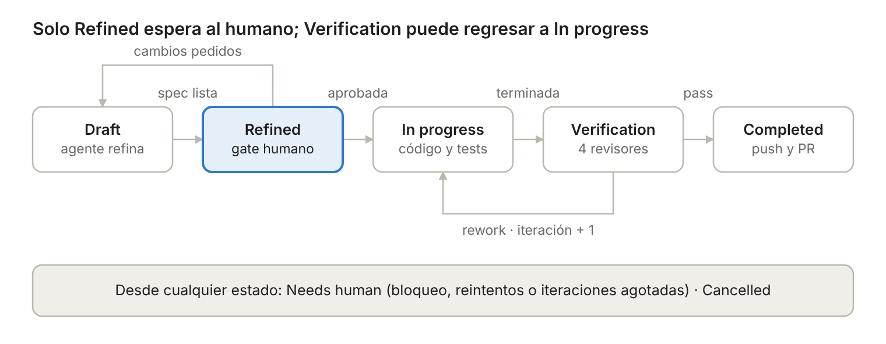
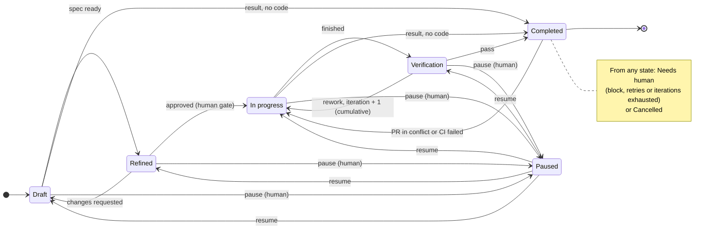
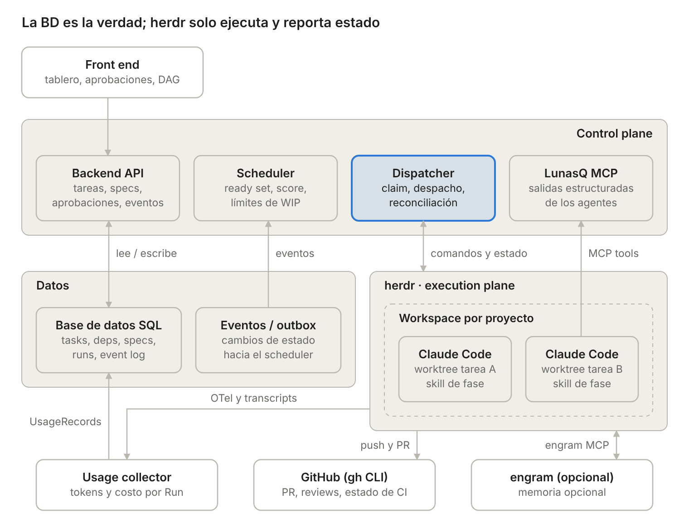
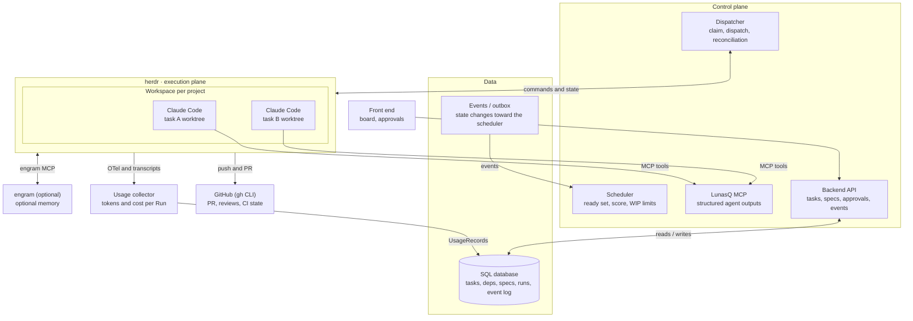

# LunasQ — Design

Oct 28, 2026 · @Sergio Sanchez

## Goal and principles

LunasQ (repository `lunas-queue`) is a multi‑project task queue where a human defines the intent and coding agents refine, implement, verify and deliver it as a PR; herdr is the execution and observation layer, not the source of truth.

**Factory model:** LunasQ is a *lights‑on* AI software factory: specialized agents refine, implement and verify with optional project memory (engram), and the human keeps two gates, approving the spec and merging each PR.

**Scope:** create tasks with intent, priority and dependencies; automatic dispatch to agents in herdr; human gates in refinement; implementation ↔ verification loop; commit, push and PR.

**Supported agents:** Claude Code, GitHub Copilot CLI and OpenAI Codex CLI are selected per phase in each project. Each CLI has its own adapter; the dispatcher uses the registry to build arguments, MCP configuration and fallback order. If a CLI fails before becoming ready, the next enabled one is tried once; if none becomes ready, the task moves to `needs_human` with each provider's diagnosis. Every provider can run verification: Claude Code launches native subagents, while Copilot and Codex use LunasQ's read-only CLI reviewer executors. Provider availability is controlled from Settings. Usage/cost tokens that are not available are shown as such, not as zero. See [ADR codex-provider](decisions/codex-provider.md).

**Out of scope (v1):** automatic merge, direct commits to main, production deployment done by LunasQ (it can be configured with project hooks), lanes by task size, acceptance tests hidden from the builder (possible future version) and automatic intake from GitHub issues (planned for v2).

Principles:

1. **Control plane vs execution plane.** The system's database is the truth. herdr keeps ephemeral state (its events are not durable), so everything is reconciled against the DB.
2. **Reconciliation, not fire‑once.** The dispatcher is a loop that compares desired state (DB) against actual state (herdr) and corrects, in the style of a Kubernetes controller.
3. **Structured outputs through MCP.** The agent reports requirements, checklist and verdicts through MCP tools; they are not inferred by reading the terminal. The terminal is only used for liveness (working / blocked / idle).
4. **Per‑task isolation.** Each task always works in its own git worktree and branch, in all phases, so that several tasks of the same repo run in parallel without stepping on each other.
5. **Verifier independence.** Whoever verifies is not the same session that implemented.
6. **Idempotency.** Every transition and every action against herdr or git can be repeated without duplicated effects.

## Domain model

Seven entities are enough (plus UsageRecord, see Consumption); the key is separating the **Task** (what) from the **Run** (each attempt of an agent in a phase), to keep a history of retries and loops.

| Entity | Purpose | Key fields |
| --- | --- | --- |
| Project | A repo and its configuration; maps 1:1 to a herdr workspace | repo, base branch, per‑phase agent profile (kind, model, effort, args), concurrency limit, test command, per‑phase hooks (in the repo's lunasq/hooks/), local path, worktree bootstrap |
| Task | Unit of work in the queue | number (#N, global sequential and immutable; ADR 0015), intent, title (generated by the refiner in the first refinement and never changes again; the UI uses the intent while it does not exist), tags, priority (unsigned integer), state, sub‑state, verification iteration (cumulative, never reset) and verification cycle start, branch, worktree path, PR URL and state (open / merged / closed), result (type and Markdown text; only on a task completed without code and without a PR), risk label (read‑only), caused\_by (task that originated this bugfix, optional), usage (read‑only) |
| TaskDependency | DAG edge | task\_id, depends\_on\_id |
| Spec | Versioned output of refinement | version, deliverable (`code` or explicitly requested repository `docs`), domain model (bounded context, glossary, aggregates, invariants, events), requirements, acceptance criteria, task list, approval state |
| Run | An agent's attempt in a phase | phase, agent kind, herdr workspace/pane/name, agent session identity (native session id or session name), run token, start, end, result, failure\_reason (text), handoff (JSON), usage (read‑only) |
| Event | Append‑only log of transitions and actions | task\_id, type, actor (human / agent / system), payload, timestamp |
| Question | Asynchronous question from the agent to the human | task\_id, run\_id, question, context, options (2 to 6, optional), state (open / answered / canceled), answer, who answered and when |

Modeling decisions:

- **Versioned spec.** Each refinement round creates a new version; the human approval is tied to a specific version. `deliverable` defaults to `code` for older handoffs and specs. `docs` is reserved for repository documentation the human explicitly asked to add or update, and is visible at the approval gate. Implementation and verification always read the approved version. Versions, author, diff and gate rules in [ADR 0013](decisions/0013-specs-y-aprobacion.md).
- **Acceptance criteria as addressable items.** Each criterion has an id, so that the verifier issues a verdict per criterion (pass / fail / evidence) and not a global boolean.
- **Event log as audit.** It allows reconstructing why a task went back to in progress and feeds the history UI.
- **Task number (#N).** In addition to its UUID, each task receives on creation a sequential, global (not per project) integer, immutable and never reused even if the task is canceled. It serves to identify it to people: pane title and workspace label in herdr, notifications, UI and `#N` mentions in the intent, which the detail links to the mentioned task. The UUID remains the identity in routes, foreign keys, branch and agent name ([ADR 0015](decisions/0015-numero-de-tarea.md)).
- **Tasks without code and Result.** An investigation, a request that is already implemented or one without resolution produces no diff. An investigation's text belongs in `submit_result`, not in a report file or a documentation-only PR. The agent closes it with `submit_result` in refinement or implementation: the task goes straight to Completed with a **Result** (`result_kind`: `research`, `already_implemented` or `not_resolvable`, and `result`, a Markdown text of up to 20,000 characters), without an approved spec, verification, delivery or PR. A task has a Result or a PR, never both. The detail shows it in a «Resultado» section and Completed shows it instead of the PR. Completed is split into two lists: the tasks with an open PR, always visible, and the rest (merged, closed, without PR and with Result) in a section collapsed by default and paginated 20 at a time ([ADR 0007](decisions/0007-maquina-de-estados.md)).
- **Run token and timeouts.** Each Run has a unique token injected into the pane; only the active Run can move the task. Stuck tasks are detected with herdr signals and a per‑phase timeout, without an agent heartbeat.

## State machine

Your five states are kept with New renamed to Draft; Draft includes the newly created task and the refinement in progress, Refined is the only human gate and the quality loop lives between In progress and Verification.

Mermaid source

Each state with an agent has a sub‑state: `queued` (waiting for a slot or dependencies), `running` (agent alive in herdr) or `waiting_human` (open question). This way the board column does not change while the task waits.

| Transition | Trigger | Guard | Actor |
| --- | --- | --- | --- |
| Draft → Refined | submit\_spec | Spec with complete requirements, criteria and task list | Refiner agent |
| Refined → Draft | Changes requested | Human comments attached to the version | Human |
| Refined → In progress | Approval | Approved spec version (dependencies were already validated before refining) | Human, then scheduler |
| In progress → Verification | submit\_for\_verification | Green test gate run by LunasQ; each criterion with at least one test; commits on the task branch | Implementer agent |
| Verification → In progress | submit\_verdict = rework | Iteration below the maximum | Verifier agent |
| Verification → Completed | submit\_verdict = pass, then delivery | Verifier's pass verdict, green test gate, coherent tests and all criteria at pass; successful push and PR | System (delivery), with the verifier's verdict |
| Draft or In progress → Completed | submit\_result | Refiner's or implementer's Run alive (`running`). From In progress, the task branch without commits on top of the base branch. Stores the Result; no verification, delivery or PR | Refiner or implementer agent |
| Any non‑terminal → Needs human | Block with timeout, retries or iterations exhausted | — | System |
| Verification → In progress | Conflicts when integrating the base branch in delivery | Without raising the iteration | System |
| Completed → In progress | The open PR ends up in conflict with the base branch (another PR was merged first), or one of its CI checks fails | The task's PR open; without raising the iteration | System (PR poller) |
| Any non‑terminal → Cancelled | Cancellation | Live agent is stopped and cleaned up | Human |
| Draft, Refined, In progress or Verification → Paused | Pause | Human only; not from Needs human, Paused or terminals; in Verification it is rejected while delivery is in progress (verifier's Run open with its pass saved). The live agent is stopped and its Run is closed as `cancelled`; the worktree and the branch are kept | Human |
| Paused → previous state | Resume | Returns to the state before the pause (the `from` of the event that entered Paused), with sub‑state `queued` if it carries an agent and the iteration intact; the phase is redispatched from scratch on the same worktree | Human |
| Needs human → previous state | Resume | Returns to the state before the last escalation, with sub‑state `queued` if it carries an agent; the iteration is kept, and after iterations exhausted a new verification cycle starts at it | Human |

Paused is the state of a task the human took out of the flow: it has no sub‑state or agent, the scheduler never dispatches it and it does not appear in the inbox (it waits for nothing from the human). It only leaves with Resume or Cancel; `escalate` and the other commands are rejected. When pausing, the open question of a task in `waiting_human` is canceled as in any other exit from that sub‑state, and the reconciler closes the open Run as `cancelled` with `task_left_phase` and releases its pane ([ADR 0007](decisions/0007-maquina-de-estados.md)).

Completed and Cancelled are terminal, unless the open PR of a completed task ends up in conflict with the base or fails CI: then it goes back to In progress ([ADR pr-en-conflicto](decisions/pr-en-conflicto.md)). The command catalog, the guards, the sub-states and the Event log are in [ADR 0007](decisions/0007-maquina-de-estados.md).

## Architecture

Four own pieces (front end, backend, scheduler, dispatcher) and an own MCP; herdr and GitHub (through the gh CLI) are external dependencies behind adapters; engram is optional and only the agents use it.

Mermaid source

| Component | Responsibility | Notes |
| --- | --- | --- |
| Front end | Create tasks, approve specs, see queue, history and consumption | Does not talk to herdr; everything goes through the backend |
| CLI | Install assets, check machine readiness and start the local service | `start` synchronizes versioned skills and agents before starting the runtime; foreign destinations are left untouched and reported |
| Backend API | Task CRUD, DAG validation, state transitions, auth | Sole writer of business state |
| SQL database | Tasks, dependencies, specs, runs, usage, event log | Atomic claims for the scheduler |
| Events / outbox | Publish state changes reliably | The outbox avoids losing events between DB and queue |
| Scheduler | Compute ready set and score; respect WIP limits | Can be part of the dispatcher in v1 |
| Dispatcher | Dispatch phases to herdr, observe signals, reconcile | herdr adapter isolated from the rest |
| LunasQ MCP | Input and output contract of the agents | Validates that the calling Run is the active one |
| Usage collector | Receive OTLP telemetry and transcripts; write UsageRecords per Run | Normalizes per agent kind; applies price table |
| herdr | Workspaces, worktrees, panes, agents, state, notifications | Ephemeral state, never the source of truth |
| GitHub (`gh` CLI) | PR, reviews, CI | Only the gh CLI, behind an adapter: create PR, read CI and reviews, detect merges by polling |
| engram | Persistent project memory (Brain) | Weak dependency: agents use it through its MCP if installed; LunasQ does not integrate it |

## Scheduler: priority, dependencies and concurrency

The scheduler does not sort a list: it computes a **ready set** (tasks whose dependencies are already satisfied) and from there picks by score, respecting concurrency limits.

**Dependencies as a DAG**

- Absence of cycles is validated when creating or editing an edge; the operation is rejected if it closes a cycle. Edges are added while the dependent task is in Draft and cannot point to a canceled task ([ADR 0010](decisions/0010-api-tareas-dag.md)).
- A task is *ready* when all its dependencies have their PR merged to the base branch or are Completed with a Result (they have no PR). It applies from refinement: with pending dependencies the task stays in Draft without an agent. If a dependency's PR is closed without merge, or the dependency is canceled without a merged PR, its dependents move to Needs human.
- Cross‑project dependencies are allowed, but visible in the UI as a risk.

**Priority score**

score = base priority + aging + unblock boost

- **Base priority:** unsigned integer defined by the human; higher number = higher priority. Ties are broken by age. The UI suggests spaced values (e.g. in steps of 100) so tasks can be inserted between others without renumbering.
- **Aging:** rises with time in ready, avoids starvation of low‑priority tasks; configured in the same units as priority (points per hour in ready).
- **Unblock boost:** a task that blocks many others rises; computed with the number of descendants in the DAG (critical path).
- **Priority inheritance:** if a task of priority 900 depends on one of 100, the one of 100 inherits 900 as effective priority while it blocks it. The effective priority is computed; the base priority the human captured does not change.

**Concurrency (WIP limits)**

| Level | What it limits | Why |
| --- | --- | --- |
| Global | Total live agents | CPU, memory, provider rate limits |
| Per project | Live agents per repo, in all phases | Merge conflicts, CI load |
| Per agent kind | Instances per provider kind | Quotas and cost per provider |
| Per phase | Refinement vs implementation | Refining is cheap and unblocks the human; more slots are worthwhile |

All limits are configurable; the global one defaults to 5 and the others are optional. No preemption: a higher‑priority task waits for the next free slot. Human gates do not consume slots: a task in refined waiting for approval has no live agent. A task with an open question (`waiting_human`) does occupy its slot. Score defaults, aging computation, dependents escalation and contract with the dispatcher: [ADR 0014](decisions/0014-scheduler.md).

**Enabled providers (Settings)**

The human enables or disables each agent provider (Claude Code, Copilot CLI and Codex CLI) from the Settings page, e.g. when a CLI is unavailable or its usage limit runs out. It is a global setting (all enabled by default) that the scheduler reads on every pass. A task's **effective provider** is the phase profile's primary if enabled; otherwise the first enabled one in the fallback order (the primary and then the others in registration order). With all disabled the scheduler does not dispatch and tasks stay in `queued`; the UI shows a paused‑dispatch notice. The dispatcher's claim revalidates against the current setting (`providers_disabled`), the launch only tries enabled providers and live agents are never interrupted. Saving the setting records `settings.updated` in the outbox, which wakes the scheduler. Detail: [ADR settings-proveedores](decisions/settings-proveedores.md).

## Dispatcher and herdr integration (initial proposal)

The dispatcher is a long‑lived worker with two inputs (DB events and herdr events) and a periodic reconciliation loop; each "dispatch" is an idempotent sequence over primitives herdr already exposes in its CLI and socket API ([CLI reference](https://herdr.dev/docs/cli-reference/), [Socket API](https://herdr.dev/docs/socket-api/)).

**herdr primitives the design uses**

| System need | herdr primitive |
| --- | --- |
| One workspace per project | `workspace create` with cwd and label |
| Per‑task isolation | `worktree create`: creates checkout + branch and opens it as a workspace grouped under the project's |
| Start an agent | `agent start` with a unique name and `--kind` (`claude`, `copilot` or `codex`) on a free shell pane |
| Send the phase instruction | `agent prompt` (optionally with wait) |
| Know whether it is working, finished or asking for permission | `events.subscribe` to `pane.agent_status_changed` (per‑pane subscription; see ADR 0004), or `agent wait` |
| Show task and phase in the sidebar | `pane report-metadata` with tokens (task id, phase, iteration) |
| Notify the human | `notification show` |
| Rebuild state after crashes | `session.snapshot` |
| Clean up | `pane close`, `worktree remove` |

**Dispatch sequence (one phase)**

1. **Claim.** The scheduler picks the highest‑score task of the ready set and claims it atomically in the DB, creating a Run with a unique token. If the claim fails, the task was already taken.
2. **Ensure the project workspace.** If it does not exist in herdr, create it; save its id in Project.
3. **Ensure the task checkout.** Always, in all phases. The first time `worktree create` creates branch and checkout from the base branch (it is not idempotent: `worktree list` is queried first and `open` is used if it already exists; ADR 0004); in later phases and rework loops `worktree open` reopens the same one. The workspace label is `<project> #N`.
4. **Start the agent.** Create pane/tab (with `pane split --env`, which sets the Run's variables in the pane), `agent start` with a deterministic name (`t<12 hex of the task id>-<phase>-<n>`, which fits herdr's 32‑character pattern; [ADR uw-16-dispatcher](decisions/uw-16-dispatcher.md)) and that phase's profile: kind as --kind; model and extra arguments after --. The deterministic name makes the operation idempotent. The pane title (`pane report-metadata`) is `LunasQ <phase> #N`; name and branch keep using the UUID.
5. **Phase prompt.** Send a short prompt that invokes the phase's skill and tells it the task id; the agent gets the full context via MCP, not through the prompt.
6. **Observe.** The Run moves to running; the dispatcher listens to the pane's state changes in herdr and starts the phase timer.
7. **Close the phase.** The primary signal is the end‑of‑phase MCP tool with structured output. The transition is applied in the DB, the session identity is saved in the Run, the pane is closed and the slot is released.

**Worktree lifecycle**

One task = one worktree = one branch, from the first dispatch until the merge; all its phases and retries work on the same checkout.

| Moment | Action | Notes |
| --- | --- | --- |
| First dispatch (refinement) | Create worktree and branch from the base branch | Branch `lunasq/<task id>`, from `origin/<base branch>` after a `git fetch`; idempotent by querying `worktree list` and using `open` if it already exists (ADR 0004, ADR 0012) |
| Worktree created | Run the project's bootstrap | Install dependencies, copy local config; runs as a child process and the worktree is recorded as ready in the DB only if it ends well, so it is retried (ADR 0012) |
| Later phases and rework | Reopen the same worktree | The new agent inherits the code state, not the session's context |
| Dependent task | Create its worktree from the base branch, which already includes the merge of its dependencies | No stacked branches |
| Delivery | Rebase onto the base branch inside the worktree, push, PR | Conflicts send the task back to in progress |
| After merge or cancellation | `worktree remove` | Does not delete the branch; requires forcing if there are uncommitted changes |

Constraints: two tasks never share a branch or worktree, and the reconciler detects orphan worktrees (nonexistent task, canceled or with its PR merged; ADR 0012) to clean them up. Cost to watch: disk and bootstrap time per task, which weighs more with many tasks in parallel.

**Signals and how they are interpreted**

| Signal | Interpretation | Action |
| --- | --- | --- |
| MCP: phase completed | Valid output | State transition, agent closed |
| herdr: `blocked` | Permission prompt in the agent's TUI | Inbox item; if it stays that way for 1 minute, notification through herdr and UI; it is answered in herdr |
| herdr: `idle`/`done` without MCP signal | It stopped without reporting | After a 15 s grace period the agent's screen is read: if it shows Claude's usage‑limit notice (`Usage limit reached · limit resets …`, the `/rate-limit-options` menu or others from [ADR 0015](decisions/0015-limite-de-uso-agente.md)), Needs human with reason `usage_limit` and notification; if not, nudge (re‑prompt) 2 times, then mark the Run failed |
| Pane closed or process exited | Crash | Run failed; up to 3 retries with backoff (30 s·2^(n‑1), cap 10 min), then Needs human with notification |
| Phase timeout expired | Stuck agent or phase longer than expected | Mark Needs human and notify; the agent is not stopped |

For new worktrees, the dispatcher accepts the CLI-specific folder-trust prompt only for the selected provider and its expected screen; this is separate from permission prompts that remain for the human.

**Phase timeout.** Configurable per project and per phase, default 30 minutes. It runs while the Run is in running and pauses in `blocked` or `waiting_human`, because that time depends on the human. When it expires, the task moves to Needs human with notification; the agent stays alive so you decide whether to wait, step in or cancel. The exit tools require `running`, so resuming closes the old Run and redispatches the phase on the same worktree. The clock lives in memory: after a restart it starts with the full budget ([ADR uw-17-reconciliacion](decisions/uw-17-reconciliacion.md)).

**Agent usage limit.** When Claude Code runs out of usage, it announces it in its TUI (`Usage limit reached · limit resets 3:45pm` with automatic wait, `usage limit reached · wrapping up`, the `/rate-limit-options` menu) and herdr does not detect it: its detection manifest does not know that UI. The watcher recognizes it by reading the agent's screen (`herdr agent read`) on the stopped‑agent path and on the `blocked` path: a note in the Event log with the text Claude drew, a notification with that information and Needs human with reason `usage_limit`, with the Run and the agent intact — the same steps as the phase timeout, with reinsertion until the human resumes it after the limit resets ([ADR 0015](decisions/0015-limite-de-uso-agente.md)).

**No heartbeat or lease in v1.** Liveness comes from herdr at no token cost: agent state, closed pane or finished process. Assumption: a single dispatcher instance. If it later scales to several, a server‑side lease is added that the dispatcher renews, never the agent.

**Session identity per Run.** The pane is closed when the phase ends, so each Run saves how to find its session afterwards: to review it, resume it or correlate its consumption. The best available is saved, in this order:

1. **The agent's native session id,** set by the dispatcher in the start args if the CLI allows it.
2. **Session id reported by herdr** in `agent_session`, when the agent's official integration publishes it.
3. **Session name** as a fallback: the agent's deterministic name in herdr (`t<12 hex>-<phase>-<n>`) plus the transcript path if known.

The Run also records which source was used, to know whether the session can be resumed or only identified.

**Reconciliation loop**

Every N seconds (default 60), at startup and on reconnecting with herdr: take `session.snapshot`, compare it with the active Runs in the DB and correct. Runs without a pane → retry. Open Runs of a task that left its phase (canceled, paused, resumed) → close as cancelled. Live Runs not observed (after a restart) → observe again. Panes with the system's prefix without a Run → close (orphans). Worktrees of canceled or merged tasks, and the orphans of each project → remove ([ADR uw-17-reconciliacion](decisions/uw-17-reconciliacion.md)). This covers the documented case of `events_lost` (in protocol 22 herdr closes the stream without an explicit message: every close counts as a loss; ADR 0004), where herdr cuts the subscription if the consumer falls behind.

**Where the dispatcher lives: external service (decided)**

The dispatcher is its own service that controls herdr through its CLI or socket API, behind an adapter. This way it stays decoupled from the lifecycle and version of herdr's plugin API (pre‑1.0), it can be tested without herdr using an adapter fake, and it can serve several machines with `--machine` if that is ever needed. A herdr plugin remains only a future option to show the board inside the TUI, with no dispatch logic.

## Per-phase hooks

Each project can configure commands that LunasQ runs at the start and at the end of each phase, to automate its own steps such as version bump, deploys to test environments, notifications or changelog generation. LunasQ runs them, not the agent, so they always run and at the same point of the flow.

**Hook points**

| Hook | When it runs | Examples |
| --- | --- | --- |
| `before_refinement` / `after_refinement` | Before dispatching the refiner / after `submit_spec`, before the human gate | Prepare test data; notify that there is a spec to approve |
| `before_implementation` / `after_implementation` | Before dispatching the implementer / on receiving `submit_for_verification`, before the test gate ([ADR uw-23-verificacion](decisions/uw-23-verificacion.md)) | Start local services; additional static analysis |
| `before_verification` / `after_verification` | On receiving `submit_for_verification`, after `after_implementation` and before the gate, so the verifier is dispatched once it finished / on receiving `submit_verdict`, before recording the verdict | Deploy to an ephemeral environment for the UI and UX reviewers; coverage report |
| `before_delivery` / `after_delivery` | Before the rebase, push and PR / after creating the PR | Version bump and changelog before the push; announce in a channel that there is a PR |
| `after_merge` | When LunasQ detects the PR merged | Deploy to staging or production, publish release |
| `on_failure` | When a Run ends unsuccessfully | Collect logs, notify through another channel |

**Where they are defined**

Hooks live in the project's repo, in `./lunasq/hooks/`, versioned with the code and reviewed by PR like any other change. The front end only shows them; they are not edited from there.

- **One directory per hook point:** `lunasq/hooks/before_delivery/`, `lunasq/hooks/after_merge/`, etc. Each executable script inside is a hook.
- **Order:** the scripts of one point run in alphabetical order of the file name, so a numeric prefix (`10-bump-version`, `20-changelog`) defines the sequence.
- **Per‑script settings:** timeout and failure policy are declared in `lunasq/hooks/config`, a JSON grouped by point and script (`{"before_delivery": {"10-bump-version": {"timeoutSeconds": 300, "policy": "warn"}}}`); if a script does not appear there, it uses the defaults (policy `block`, 10 minutes). Detail in [ADR uw-10-hooks](decisions/uw-10-hooks.md).
- **View in the front end:** per project, the hooks of each point with their content, as they are in the base branch, and their latest executions per task with output, duration and exit code.

The repo's `lunasq/` folder ends up with two parts: `hooks/` (configuration, versioned) and `tasks/` (per‑task evidence files).

**Definition of each hook**

| Field | Meaning |
| --- | --- |
| Command | Executable script in lunasq/hooks/\<point>/; runs in the task's worktree (`after_merge` runs in the base branch checkout) |
| Timeout | Maximum time; on expiry it counts as a failure. Declared in lunasq/hooks/config |
| Failure policy | `block`: the transition stops and the task moves to Needs human; `warn`: it is recorded and the flow continues. Declared in lunasq/hooks/config; block by default |
| Order | Alphabetical order of the file name inside the point's directory |

**Execution contract**

- LunasQ passes environment variables with the context: task and Run id, phase, worktree path, branch, base branch, PR URL when it exists and the phase's result.
- They run in a herdr pane inside the task's workspace, so they look the same as agents; they do not consume agent slots.
- If a hook modifies files (e.g. the version bump in `before_delivery`), LunasQ includes them in a commit with the task's trailers before the push.
- The output, duration and exit code of each hook are saved in the Event log and in the evidence file `lunasq/tasks/{id}.md`.
- Hooks must be idempotent, because a phase can repeat through rework or retries.

**Security:** LunasQ reads lunasq/hooks/ from the base branch, never from the task's branch, and a change to a hook only takes effect when its PR is merged. This way an agent cannot change a hook inside its worktree and make LunasQ run an arbitrary command.

## MCPs and skills

The contract between the system and any agent is an **own MCP (LunasQ MCP)** plus a **skill per phase**; Claude Code, Copilot CLI and Codex follow the same protocol while provider-specific command and MCP configuration stays in adapters.

**LunasQ MCP (own, exposed by the backend)**

| Tool | Phase | What it does |
| --- | --- | --- |
| get\_task\_context | All | Intent, approved spec, verification history, project conventions; mandatory before any exit tool |
| submit\_spec | Refinement | Sends domain model (DDD), requirements, acceptance criteria and task list as a new Spec version |
| ask\_human | All | Records a Question and returns immediately; the agent ends its turn and the answer arrives later as a new prompt |
| update\_checklist | Implementation | Checks off task list items; feeds progress in the UI |
| submit\_for\_verification | Implementation | Declares the end of implementation with summary, commits and criterion → tests map; rejects a docs-only diff unless the approved spec says `deliverable: docs`; triggers the test gate |
| submit\_result | Refinement and implementation | Task without code (investigation, already implemented or unresolvable): delivers the Result and completes the task without verification or PR. In implementation it is rejected if the branch has commits on top of the base branch |
| submit\_verdict | Verification | Pass or reject, verdict per criterion, each reviewer's report, consolidated must‑fix, refuted findings with their reason and risk label; each skipped reviewer requires justification |
| report\_failure | All | The agent declares it cannot continue and why |

The tools validate the run token the dispatcher injects into the pane; an old session cannot move the task. The exit tool closes the Run in the same transaction as the transition, except for a pass verdict, which leaves the Run open for delivery. Guards, errors, checklist and test gate in [ADR uw-15-mcp-tools](decisions/uw-15-mcp-tools.md).

**Skills (one per phase, versioned with the system)**

| Skill | Responsibility | Mandatory output |
| --- | --- | --- |
| refine-task | Read the repo, clarify the intent, model with DDD and write verifiable criteria in domain language | submit\_spec (or submit\_result if the task requires no code) |
| implement-task | TDD against the approved spec: failing test, minimal implementation, refactor; small commits | submit\_for\_verification (or submit\_result if it turns out there is nothing to change) |
| verify-task | Choose, based on the task and the diff, which reviewer subagents to launch, consolidate, refute findings, verify each criterion and the coherence of the tests, without editing code | submit\_verdict |
| herdr (official) | So the agent knows how to operate herdr if it needs auxiliary panes | — |

Design rule: the skills describe the *how*; the MCP is the only *output* channel. If an agent ends without calling the exit tool, the dispatcher treats it as an incomplete phase.

Delivery has no skill: rebase, push and PR are done by LunasQ inside the verifier's Run, without an agent ([ADR uw-18-skills-fase](decisions/uw-18-skills-fase.md)). Each skill carries a valid example handoff and the table of its tools' error codes.

**Handoff between phases**

Each phase starts with a new agent, but not with empty context: each phase's exit tool includes a structured JSON handoff that is validated and saved in the Run and that the next agent receives in `get_task_context`.

| Phase that ends | Handoff it leaves | Received by |
| --- | --- | --- |
| Refinement | Approved spec with domain model + notes: relevant files and modules, decisions made and discarded, assumptions | Implementation |
| Implementation | Summary of changes, criterion → tests map, files touched, design decisions, how to run the tests, known pending items | Verification |
| Verification with rework | Verdict per criterion and actionable findings with file and reason | Implementation, next iteration |
| Any phase that is retried | Questions with their answers, last checklist and summary of the failed Run | The same phase |

Rules:

- The handoff is JSON with a fixed schema per phase and bounded size; the detail lives in the repo (diff and commits), not in the handoff.
- The verifier receives the spec, the diff and the implementer's summary as claims to check, not their reasoning; this way it keeps its independence.
- If a phase ends without a handoff (crash or timeout), the next Run receives the last checklist and the worktree's current diff.

**Handoff format (JSON)**

The handoff is never free text: it is a JSON object that the LunasQ MCP validates against a JSON Schema versioned per phase. If it does not comply with the schema, the exit tool rejects the call with the validation errors and the agent fixes it and retries; the phase is not closed with an invalid handoff.

All handoffs share a common envelope and add a body according to the phase:

| Part | Fields | Phases |
| --- | --- | --- |
| Common envelope | schema version, task id, run id, phase, result, short summary, relevant files, decisions, known risks or pending items | All |
| Refinement body | deliverable (`code` by default or explicitly requested `docs`), domain model (bounded context, glossary, aggregates, invariants, events), criteria with id, task list, assumptions | Refinement |
| Implementation body | criterion → tests map, commits, changes per module, how to run the tests, deviations from the spec | Implementation |
| Verification body | pass or reject verdict, verdict per criterion, report per reviewer, skipped reviewers with justification, must‑fix, refuted findings with reason, risk label | Verification |

`submit_result` uses its own handoff (`result.json`): version, task id, run id, phase, summary, title, result kind and text. It does not go through verification, so it is not part of the per‑phase handoff nor is it read as such in `get_task_context`.

Since the format is fixed, LunasQ can use the fields without interpreting text: build the next `get_task_context`, populate the UI and render the handoff in the evidence file `lunasq/tasks/{id}.md` as a JSON block. A schema change raises its version, and LunasQ keeps the ability to read handoffs of earlier versions. Schemas, valid and invalid examples and rules between fields: `packages/schemas` ([ADR 0006](decisions/0006-handoff-v1.md)).

## Engineering practices per phase

Each phase follows a mandatory practice and the three chain together: DDD produces criteria in domain language, TDD turns each criterion into tests before the code, and verification checks traceability, runs the suite and reviews that the tests are coherent.

| Phase | Practice | Mandatory artifact | How it is checked |
| --- | --- | --- | --- |
| Refinement | DDD | Domain model in the spec: affected bounded context, ubiquitous language glossary, aggregates and entities, invariants, domain events; criteria written in domain language (Given / When / Then) | `submit_spec` requires those sections; the human reviews it at the spec gate |
| Implementation | TDD | For each criterion: failing test → minimal implementation → refactor; criterion → tests map in the handoff | Each criterion has at least one test; the branch history shows the tests together with or before the code they cover |
| Verification | Green and coherent tests | Suite result and coherence review in the verdict | Test gate run by LunasQ + coherence checklist of the approver and the code reviewer |

**Test coherence checklist**

- Each acceptance criterion has at least one test that exercises it, named in domain language.
- The tests check observable behavior, not internal details; mocks are only used at the system's boundaries.
- There are no skipped tests, empty assertions or trivial assertions that would pass with any implementation.
- They cover the domain model's invariants and edge cases.
- No existing test was weakened: a deleted test or one with relaxed assertions in the diff requires justification.
- **Reversal test:** the approver temporarily reverts the production code keeping the tests and confirms they fail; if they stay green, they do not prove the change.

**Test gate:** the Project defines its test command. LunasQ runs it in the worktree on receiving `submit_for_verification` and again before accepting a pass, without trusting what the agent reports. A red suite blocks the transition. Pane, minimal environment and record in [ADR uw-11-gate-tests](decisions/uw-11-gate-tests.md).

## Brain: engram as a weak dependency

[engram](https://github.com/Gentleman-Programming/engram) is optional: if its MCP is installed in the agent, the agent uses it on its own; LunasQ does not query it, does not write to it and works the same without it. On LunasQ's side there is only a best‑effort effort: each phase's skills include instructions to take advantage of engram when it is available.

**Instructions in the skills (if engram is available)**

| Moment | What the skill asks for |
| --- | --- |
| At the start of the phase | Retrieve project and module context with `mem_context` and `mem_search` |
| When searching | Use queries of 1 or 2 terms: engram combines the words with an implicit AND, so a long query almost never returns results |
| In refinement | Save decisions with a stable `topic_key` and keep the domain glossary under a fixed `topic_key` |
| In rework and verification | Save as `learning` the findings that explain a recurring error |
| At the close of the phase | Save a session summary with what was learned |
| Always | Ignore memories marked as superseded and review those marked as needs\_review before using them |

**What it implies**

- Memory use depends on the agent: it is not deterministic nor can it be audited from LunasQ beyond the transcript.
- No phase is blocked or degraded by the absence of engram.
- The memory lives in the machine's local engram; deterministic integration stays on the roadmap.

## Verification with subagents

The verification phase is **one selected provider session** (one slot) that launches in parallel the reviewer executions that apply to the task (of 4 possible) and acts as approver: it consolidates their findings and issues pass or reject. Claude Code uses native subagents; Copilot and Codex run the same reviewer instructions through LunasQ's read-only CLI executors. For the scheduler and for herdr it remains one live phase agent.

**Phase flow**

1. The dispatcher starts the selected verification provider in the worktree with the `verify-task` skill.
2. The session calls `get_task_context`: approved spec, criteria, branch diff, implementer's handoff.
3. It decides which reviewers apply according to the spec and the diff and launches them in parallel, by explicit name. Each reviewer is decided separately: code if code or tests change, security only if the diff touches a trust boundary (external inputs, processes, authentication, secrets, paths, dependencies), UX if a flow or its states change, UI if something visible changes. Those it does not launch are skipped with a justification that cites the diff.
4. Each reviewer receives spec and diff, and returns findings in a fixed, compact format: severity, file, evidence and affected criterion.
5. The main session (approver) deduplicates, tries to refute each serious finding by reading code or running tests, verifies each acceptance criterion and reviews the coherence of the tests with the checklist, including the reversal test.
6. It calls `submit_verdict` with pass or reject, verdict per criterion, report per reviewer, consolidated must‑fix, refuted findings with their reason and risk label.
7. On reject, the handoff to implementation carries only the must‑fix with their evidence.

**Reviewers**

| Subagent | Focus | Tools |
| --- | --- | --- |
| `lunasq-security-reviewer` | Vulnerabilities, secrets, input validation, permissions | Read‑only: Read, Grep, Glob, Bash |
| `lunasq-ux-reviewer` | User flows, empty and error states, accessibility | Read‑only; optionally a browser MCP |
| `lunasq-ui-reviewer` | Visual consistency, components, responsive | Read‑only; optionally a browser MCP |
| `lunasq-code-reviewer` | Quality, design, spec compliance and test coherence (checklist) | Read‑only: Read, Grep, Glob, Bash |

**Deterministic guards**

| Guard | Mechanism | What it guarantees |
| --- | --- | --- |
| Read‑only reviewers | Claude subagent tools omit Edit/Write; Copilot gets read-only available tools; Codex runs `codex exec --sandbox read-only --ignore-user-config` with approval policy `never` | Reviewers cannot edit the worktree through their configured tools or sandbox |
| Execution evidence | Claude's `SubagentStart`/`SubagentStop` hooks or LunasQ's Copilot/Codex reviewer executor records each start, stop and private transcript | LunasQ knows which reviewers ran in that Run |
| Complete verdict | `submit_verdict` requires, for each of the 4 reviewers, its report or the justification for why it was not launched, and is rejected if a reported reviewer does not appear finished in the Run's hooks or CLI-executor records, or if a skipped one did finish ([ADR uw-23-verificacion](decisions/uw-23-verificacion.md)) | Each reviewer runs or is skipped with an audited justification |
| Test gate | LunasQ runs the project's test command in the worktree before accepting a pass | No pass with a red suite, even if the agent says otherwise |

**Implementation details**

- **Definitions:** LunasQ installs Claude and Copilot reviewer assets in their supported user locations; the Codex executor receives the selected reviewer's instructions from the verification session.
- **Models:** Claude reviewers use Opus from their frontmatter; CLI reviewers use the verification profile's configured model. The approver uses the phase profile's default model (`DEFAULT_VERIFY_MODEL`), which the profile can change.
- **Waiting for results:** Claude receives `CLAUDE_CODE_FORK_SUBAGENT=0`; Copilot and Codex executions are synchronous and return their report before the MCP call completes.
- **UI/UX reviewers with a browser:** Claude subagents may load the browser MCP declared in their definition; the isolated Copilot/Codex CLI reviewer executors do not inherit other configured MCP servers.
- **Per‑reviewer consumption:** usage tracking breaks down by subagent with the `agent.name` attribute (requires `OTEL_LOG_TOOL_DETAILS=1` for custom names).

**Implications**

- Any provider can be selected for any phase, including verification; provider-specific reviewer execution keeps the same MCP verdict and evidence gates.
- One verification slot is 5 parallel model streams: it does not affect slots, but it does affect the provider's rate limits.
- The reports enter the approver's context, which is why the reviewers' output format is compact.

## Token consumption and cost (read‑only)

Usage collection currently supports Claude Code. Copilot CLI and Codex CLI do not report usage through LunasQ, so the UI marks their consumption as partial instead of presenting zero or an invented estimate.

**What each agent exposes**

| Agent | Source | Tokens | Cost | How it is tied to the task |
| --- | --- | --- | --- | --- |
| [Claude Code](https://code.claude.com/docs/en/monitoring-usage) | OTel: `claude_code.token.usage` and `claude_code.cost.usage` metrics; `api_request` event per call | input, output, cache read, cache write, per model | Estimated USD per request | Custom attributes via `OTEL_RESOURCE_ATTRIBUTES` (task, run, phase) + `session.id` |
| Claude Code | Per‑session JSONL transcript; statusline JSON | `message.usage` per message | `cost.total_cost_usd` per session (statusline) | Session id |
| Codex CLI | No supported usage source in LunasQ | Not available | Not available | Not collected |
| GitHub Copilot CLI | No supported usage source in LunasQ | Not available | Not available | Not collected |
| Other agents | Varies by agent | Partial or none | — | Marked *not available* |

**Attribution per task**

1. When creating the pane, the dispatcher passes environment variables with herdr's `--env`: telemetry on, the own collector's endpoint and `OTEL_RESOURCE_ATTRIBUTES` with task id, run id and phase. Claude Code copies those attributes to every metric and event.
2. Other providers may expose a session identity through herdr, but LunasQ does not infer usage from it.
3. When the Run closes, Claude's transcript is reconciled as a backup; Copilot and Codex transcripts are used for review evidence only.

**Data model**

- **UsageRecord** (new, per Run): model, tokens by type, USD cost, source (otel / transcript / computed), price version used.
- **Task.usage** (read‑only, derived): total tokens and cost, broken down by phase (refinement, implementation, verification, rework), by agent, model and verification reviewer. It is never edited; it is recomputed from the UsageRecords.
- **Versioned price table** per model, for agents that only report tokens.

**New component:** Usage collector. It receives OTLP, normalizes per agent and writes UsageRecords to the DB. In Claude Code the source is the `api_request` event (one call, one UsageRecord, deduplicated by `request_id`) and the reviewer is resolved with the `agent_id` from the subagent hooks; the metrics are delta and are discarded ([ADR uw-20-usage-collector](decisions/uw-20-usage-collector.md)). The `telemetry` flag turns it off.

**Limitations**

- Claude Code's cost is computed on the client side with public prices: it is an estimate and [may not match the invoice](https://github.com/rockdarko/claude-code-metrics-prometheus). With a subscription plan it is better to show it as *API‑equivalent cost*, not as an actual charge.
- There is a [reported issue](https://github.com/anthropics/claude-code/issues/28197) where Claude Code's transcript stores `input_tokens` as a placeholder in streaming records; that is why OTel is the primary source and the transcript only a backup, deduplicating by message id.
- The transcripts' format is internal and changes between versions.
- Claude Code's metrics are exported every 60 s by default: the live value lags; it is consolidated when the Run closes.

In the UI it is shown in the task detail and as a column in the queue.

## Human‑in‑the‑loop, verification and delivery

There is a single mandatory human gate (approving the spec) and four escalation points (agent question, blocked permission, phase timeout, exhausted verification loop); everything else is automatic.

**Spec approval (refined)**

- The UI shows the spec version with a diff against the previous one in the task detail. The Inbox only lists the tasks in refined with a link to that detail ([ADR 0015](decisions/0015-bandeja-lista-de-specs.md)).
- The human can: **approve**, **request changes** with comments (a new refinement round with those comments as input) or **edit the spec directly** and approve.
- On approval, the task enters the implementation ready set; nothing is dispatched while it waits.

**Agent questions and blocks**

Everything that waits for the human appears in the front end's Inbox; herdr only notifies. There are two cases and they are answered in different places.

| Case | Origin | Where it is seen | Where it is answered |
| --- | --- | --- | --- |
| Business or design question | The agent calls `ask_human` | Front end Inbox, with the task's context | Front end |
| Tool permission | Prompt in the agent's TUI; herdr detects it as `blocked` | Inbox, as "blocked agent", with access to the pane (`agent focus`) | herdr, in the agent's pane |

`ask_human` flow:

0. The agent can send the question in a structured way: `options` with 2 to 6 alternatives `{ label, description? }` (labels unique ignoring case and surrounding whitespace; immutable once created). Without `options` the question is open.
1. The backend stores the Question tied to the task and the Run; the task moves to `waiting_human` and the phase timeout is paused.
2. The Question appears in the Inbox immediately; if it is still open after 1 minute, it is notified through herdr and the UI.
3. The human answers in the Inbox: a question with options is shown as a group of radios (label and description) plus «Otra respuesta», which enables a text field; without options, the text field. The answer is the chosen label or the trimmed free text, never both.
4. If the agent is still alive, the dispatcher sends it the answer to the same pane with `agent prompt`. If it has already closed, a new Run is created and the Question with its answer arrives in `get_task_context`. Detail, API and edge cases: [ADR uw-22-preguntas](decisions/uw-22-preguntas.md).

The tool does not wait for the answer inside the MCP call: MCP clients have timeouts and a call hanging for hours is fragile. It records the question, tells the agent to end its turn and the answer comes in later as a new prompt. Writing directly into the herdr pane also works, but that answer is not kept in the task's history.

**Implementation ↔ verification loop**

- The verifier runs in a new agent, with the approved spec and the diff, without the implementer's context.
- Rework returns the task to in progress with the findings as structured input; the iteration counter goes up.
- The iteration counter is cumulative and never decreases. When the iterations of the current verification cycle reach 3 (`iteration - cycle start`; configurable per project with `limits.maxVerificationIterations`), the task moves to *needs human* instead of continuing the loop.
- Resuming after `iterations_exhausted` keeps the iteration and starts a new cycle at it (`verificationCycleStart`), so the task gets another full set of reworks while the UI, Runs and events keep showing the real count (3 → 4, 5, 6).
- The review is done by the specialized subagents that apply to the diff and the main session decides as approver (see Verification with subagents).

**Delivery (completed)**

LunasQ does it, without an agent, inside the verifier's Run, when the verifier records a pass ([ADR uw-26-entrega](decisions/uw-26-entrega.md)):

1. `before_delivery` hook.
2. Rebase onto `origin/<base branch>`; if there are conflicts, the task goes back to in progress (without raising the iteration) and the implementer receives the conflicting files.
3. `LunasQ-Task` and `LunasQ-Run` trailers on every commit of the branch.
4. Run the test suite one last time; if red, the task goes back to in progress just like with a conflict.
5. Close the verifier's Run, commit the evidence file and push the task's branch.
6. Create the PR with the gh CLI, titled with the task's title (or the first line of the intent if it has none), with the intent, the criteria and their evidence in the description, plus the risk label (low / medium / high) the approver assigned to prioritize your review. Record the PR and run `after_delivery`; if the hook committed changes, they are published with a second push.
7. `verdict_pass`: the task ends up in Completed. Keep or remove the worktree according to policy; dependents are released when the PR is merged.

While the PR waits for the human merge, the base keeps moving with other PRs. The PR poller also reads whether GitHub marks it as in conflict with the base; if so, the task goes back from Completed to In progress with `deliveryConflict.reason: pr_conflict`, the implementer integrates the base, and verification and delivery repeat on the same PR ([ADR pr-en-conflicto](decisions/pr-en-conflicto.md)).

Any other failure (push, `gh`, a blocked hook) escalates to Needs human. A delivery that a restart left half‑done resumes by itself on startup.

**Front end: minimal views**

- Board per project (columns by state, including Paused) and a global queue view ordered by score. Pause and resume are in the task detail (button with icon and text), on each row of «En curso» (pause only) and in the «Acciones» column of the Queue, with icon‑only buttons: pause for pausable tasks, resume for paused ones and those in Needs human.
- «En curso» tab with the In progress tasks and those with a running agent (running sub‑state) from all projects, with Iteration, Agent and Pane of each task's most recent Run; the In progress label is blue in all views. The pane id in this table and in the Runs panel is a button that focuses the agent in herdr. Detail: [ADR uw-21-front-end](decisions/uw-21-front-end.md) and [ADR runs-foco-pane](decisions/runs-foco-pane.md).
- Inbox of approvals and pending questions (everything that waits for the human); specs to approve are a list of links to the task detail, where they are approved; permission blocks include an access that focuses the pane in herdr. Detail: [ADR uw-27-bandeja](decisions/uw-27-bandeja.md) and [ADR 0015](decisions/0015-bandeja-lista-de-specs.md).
- Task detail: spec and versions, Runs (with the pane id as a button that focuses the agent in herdr), event log, link to the pane in herdr.
- Hooks view per project: content of `lunasq/hooks/` in the base branch and latest executions.

## Audit and traceability

Everything LunasQ does is traceable in two directions: from a task to each attempt of each phase, and from a line of code in production to the task and the Run that produced it.

**Where a task failed**

Each attempt is a Run tied to a phase, and each transition is recorded in the Event log with actor and timestamp. The task detail shows the Runs in order, and the last unsuccessful Run indicates the phase that failed.

| What is seen | Where it is |
| --- | --- |
| Phase, agent, model, start and end of each attempt | Run |
| Failure reason, in text | The Run's `failure_reason` |
| Who moved the task and why | Event log |
| What context the agent received | `get_task_context` and the Run's transcript |
| What the agent delivered | Handoff, spec version, verdict |
| The complete conversation | The task's evidence file |

`failure_reason` is free text that LunasQ writes when closing an unsuccessful Run: for example, the red test gate with a summary of the output, the phase timeout, the process crash or the rejected MCP tool and why.

**Code traceability**

Each commit of a task carries git trailers: `LunasQ-Task: <id>` and `LunasQ-Run: <id>`. The PR includes them in its description. With `git blame` on the failing line you get to the exact task and Run.

**Evidence file: `lunasq/tasks/{id}.md`**

Each task has an evidence file inside the project's own repo, in the task's worktree. LunasQ adds a section to it when closing each Run, so it travels in the branch and in the PR, and stays in git history after the merge.

Each Run section contains:

- phase, agent, model, start, end, result and `failure_reason`;
- the handoff delivered;
- in verification, the complete verdict: per criterion, each reviewer's report, skipped reviewers with their justification, must‑fix and refuted findings;
- the test gate's output;
- the agent session's transcript and, in verification, the subagents' transcripts, converted to markdown.

This avoids losing evidence when herdr closes the pane or when Claude Code deletes its transcripts at the end of their retention period ([30 days by default](https://code.claude.com/docs/en/sub-agents)). Before writing, LunasQ redacts detected secrets across the whole section ([ADR uw-24-archivo-evidencia](decisions/uw-24-archivo-evidencia.md)).

While the implementation and verification loop runs, the file stays uncommitted; the clean‑worktree checks ignore its changes and the pass's `HEAD` comparison tolerates commits that only touch it, because the pass's gate runs on the current `HEAD`. If the pass is still refused with `dirty_worktree` or `head_changed` (an unrelated uncommitted file, a commit that is not evidence, or no green gate), LunasQ does not leave the verifier without an exit: the pass becomes a reject with an `source: "approver"` must‑fix and the task goes back to implementation, which fixes the git state ([ADR verdict-git-rework](decisions/verdict-git-rework.md)). Before integrating the base, delivery commits the pending evidence (so the rebase does not fail if the project tracks it) and commits it again after closing the verifier's Run, before the push.

**Refuted findings**

The verdict stores every finding the approver discarded, with the reason, in addition to the must‑fix. If a production bug was in a discarded finding, the audit shows it.

**Audit of a delivered feature that fails**

The task is walked backwards, phase by phase, to locate the root cause:

| Question | Evidence | If the answer is no, the root cause is |
| --- | --- | --- |
| Did the approved spec cover the case? | Approved spec version and criteria | Spec: a criterion was missing in refinement or at the human gate |
| Was there a test for that criterion? | Handoff's criterion → tests map | Test: incomplete TDD |
| Did the test prove the change? | Coherence checklist and reversal test | Verification: a weak test was accepted |
| Did any reviewer detect it? | Reviewer reports and refuted findings | Approver: discarded a valid finding |
| Was an applicable reviewer skipped? | Skipped reviewers and their justification | Reviewer selection |
| Did the agent have the right context? | The Run's transcript (engram use, if any) | Memory: missing or outdated context |

**Closing the cycle**

- The fix is created as a new task with `caused_by` pointing to the original task, so you can see which deliveries generated later work.
- The root cause stays in the evidence file; if engram is installed, the phase's skill asks the agent to save it as a `learning`.

## Risks

The biggest risk is depending on herdr's heuristic state detection; the design mitigates it by using the MCP as the primary signal and herdr only as liveness.

| Risk | Impact | Mitigation |
| --- | --- | --- |
| herdr state detection based on terminal heuristics | Phase end wrongly detected | MCP as the primary signal; install each agent's official integration in herdr |
| herdr pre‑1.0 with frequent releases | CLI/API changes | Isolated herdr adapter; pin the version; use `api schema` to validate the contract |
| Non‑durable events (`events_lost`) | Out‑of‑sync state | Reconciliation loop with snapshot |
| Agent in `blocked` due to permissions | Stopped queue | Auto mode in all phases; whatever still asks for permission is notified after a minute |
| Conflicts between parallel tasks of the same repo | Rework at delivery | WIP per project; rebase at delivery; code‑area lock as a future extension if the problem persists |
| Infinite rework loops | Cost | Maximum iterations + human escalation |
| Prompt injection from the repo or issues | Unwanted actions | Auto mode with its action classifier; isolation per worktree; the verifier does not edit, by its skill's instruction; push only at delivery |
| engram absent or outdated memory | Agents without context or with old context | engram is optional and LunasQ works without it; the skills ask to ignore superseded memories and review the needs\_review ones |
| CLI options and terminal screens can change | A provider may fail to start or its trust prompt may be missed | Keep CLI configuration in provider adapters and test the fake/real terminal contracts; disable unavailable providers in Settings |
| 5 model streams per verification | Provider rate limits | The approver launches only the reviewers that apply; limit per agent type |
| Evidence file in the repo | Large files in the PR; sensitive data in transcripts | Secret redaction before writing; transcripts converted to compact markdown |
| Hooks with arbitrary commands | A hook modified by an agent would run unreviewed code; a failed deploy leaves the flow half‑done | Hooks read from lunasq/hooks/ in the base branch, never from the task's branch; changes only via PR; block/warn policy and timeout per hook |

## Decisions made

Summary of what has already been decided; each point is reflected in its section.

| Topic | Decision |
| --- | --- |
| Name | LunasQ in the documentation; repository `lunas-queue` |
| Initial state | Draft (formerly New) |
| Where the dispatcher lives | External service that controls herdr via CLI or socket, behind an adapter |
| Topology | herdr on a single machine; dispatcher via local socket in v1 |
| Agents | One per phase, with a structured handoff between phases |
| Agent profile | Per project and phase: kind, model and args; no per‑task override in v1 |
| Isolation | Worktree always, per task; bootstrap script per project; no dependency cache in v1 |
| Concurrency | Configurable limits; global with a default of 5 and adjustable from Settings (1 to 50); per project and per agent type optional |
| Preemption | No; a task only takes free slots |
| Priority | Unsigned integer; higher number = higher priority |
| Task identification | UUID as identity; global sequential number #N for people (herdr, notifications, UI, mentions) |
| Dependencies | Blocking only; satisfied with the PR merged into the base branch; no stacked branches |
| Refinement | Waits for the dependencies to be satisfied |
| Merge detection | Polling with the `gh` CLI in v1 |
| Liveness | No heartbeat or lease; herdr signals + phase timeout (default 30 min) |
| Permissions | Auto mode (no confirmations) in all phases, defined in the agent profile's args |
| Escalation | If an agent stays blocked or a Question stays open after 1 minute, it is notified through herdr and the UI |
| Retries | 3 retries with backoff on crash; maximum 3 verification iterations; then Needs human |
| Closing | The pane is closed when the phase ends; the worktree is kept until the merge; each Run stores the agent's session identity |
| Manual intervention | Allowed in any pane; the dispatcher only reacts to MCP signals and herdr state, so what is typed by hand does not end up in the task's history |
| Factory model | Lights‑on: human gate on the spec and on the merge; no direct commits to main; deployment only via the project's hooks |
| Brain | engram as a weak dependency: agents use it via its MCP if installed; LunasQ only adds best‑effort instructions in the skills |
| Verification | A selected provider session that launches applicable Claude subagents or LunasQ-managed Copilot/Codex reviewers and acts as approver; a single slot |
| Supported agents | Claude Code, GitHub Copilot CLI and OpenAI Codex CLI; configured per phase |
| Risk router | Label only (low / medium / high) on the PR; everything still has a human merge |
| Roadmap | Intake from GitHub issues in v2; tests hidden from the builder later; size lanes not for now |
| Reviewer definitions | Installed by LunasQ in \~/.claude/agents/lunasq/, with an optional per‑project override |
| Reviewer selection | The approver decides for each task which reviewers to launch and justifies those it skips |
| Verification models | Reviewers on Opus; approver on Sonnet |
| Refinement | DDD: the spec includes a domain model and criteria in domain language |
| Implementation | TDD: failing test, minimal implementation, refactor; criterion → tests map in the handoff |
| Tests in verification | Test gate run by LunasQ + coherence checklist with reversal test; without both there is no pass |
| Failure reason | failure\_reason in each Run, as free text |
| Code traceability | LunasQ-Task and LunasQ-Run trailers on every commit and in the PR |
| Evidence file | lunasq/tasks/{id}.md inside the project's repo, one section per Run |
| Refuted findings | Stored in the verdict with their reason |
| Bugfix of a delivery | New task with caused\_by; the lesson stays in the evidence file and, if engram is present, the agent saves it there |
| Per‑phase hooks | Per project, before and after each phase plus after\_merge and on\_failure; run by LunasQ with a block or warn policy; defined in the repo's lunasq/hooks/ and visible in the front end |
| Handoff format | JSON validated against a JSON Schema versioned per phase; an invalid handoff is rejected and the phase is not closed |

## Roadmap: v2 and later

Features left out of v1, either by explicit decision or because v1 took the simplest option; none changes the base architecture.

| Feature | What it brings | In v1 | Suggested version |
| --- | --- | --- | --- |
| Support for additional coding-agent CLIs | Choose further agents per phase according to cost or strength | Claude Code, Copilot and Codex | v2 |
| Native subagents for non-Claude providers | Provider-native reviewer fan-out rather than LunasQ-managed CLI executions | LunasQ-managed reviewers for Copilot and Codex | Later |
| Automatic intake from GitHub issues | Issues with a certain label create tasks in Draft | Tasks created by hand | v2 |
| Per‑task agent override | Change kind or model on a specific task | Only per‑project and phase profile | v2 |
| GitHub webhook for merges | Release dependents instantly, without polling | Polling with `gh` | v2 |
| Several machines with herdr (`--machine`) | Spread agents across machines | One machine, local socket | v2 |
| Shared memory with engram (Git Sync or Cloud) | Have the memory travel with the repo or be shared across machines | Local only | v2 |
| Dependency cache between worktrees | Faster bootstrap and less disk | Full bootstrap per worktree | v2 |
| herdr plugin with a board in the TUI | See the queue without leaving herdr | Own front end only | v2 |
| Notifications through other channels (chat, email) | Learn about blocks without being in front of herdr or the UI | herdr + UI | v2 |
| Factory metrics | Lead time, rework rate, first‑time pass percentage, consumption per phase | Only usage per task | v2 |
| Multi‑user with roles | Let other people create tasks, approve specs or merge | A single user | v2 or later |
| Auto‑merge by risk category | Turn the risk label into an action for low‑risk changes with a strong oracle | Label only; human merge | Later |
| Acceptance tests hidden from the builder | Prevent the builder from optimizing for the tests it sees | Visible tests | Later |
| Lanes by task size | Fast‑track without a spec gate for trivial changes | Full flow for everything | Later |
| Preemption by priority | Let an urgent task take the slot of a lower‑priority one | Free slots only | Later |
| Stacked branches | Start a dependent task without waiting for the merge | Dependency satisfied with merged PR | Later |
| Code‑area lock | Prevent two parallel tasks from touching the same module | WIP per project + rebase at delivery | Later |
| Several dispatcher instances | Dispatcher high availability | One instance; server‑side lease if scaled | Later |
| Deterministic integration with engram | LunasQ builds a memory pack per phase and writes decisions and lessons from the handoff, without depending on the agent | Optional engram, used by the agent via MCP | v2 |
