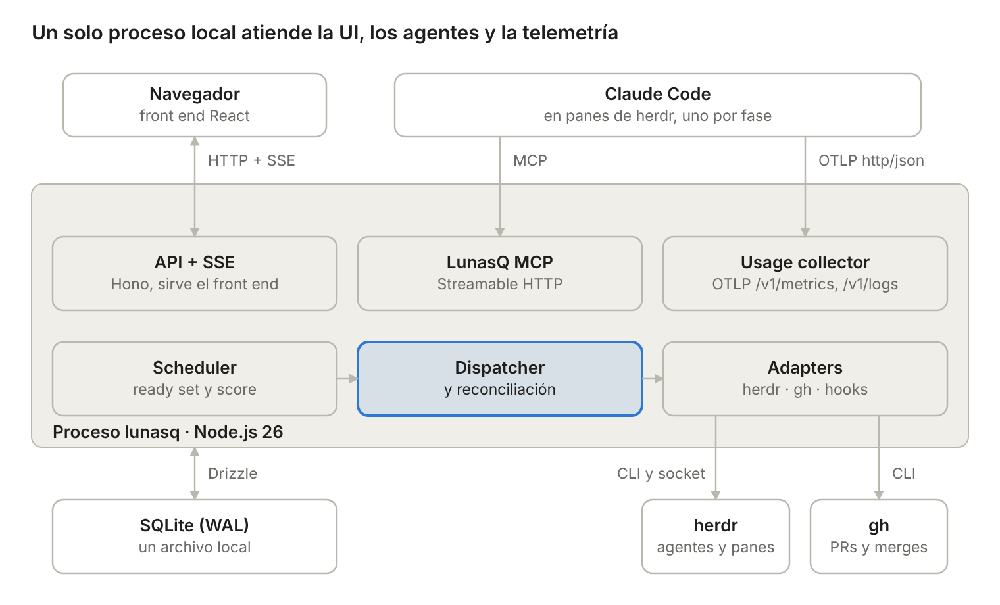
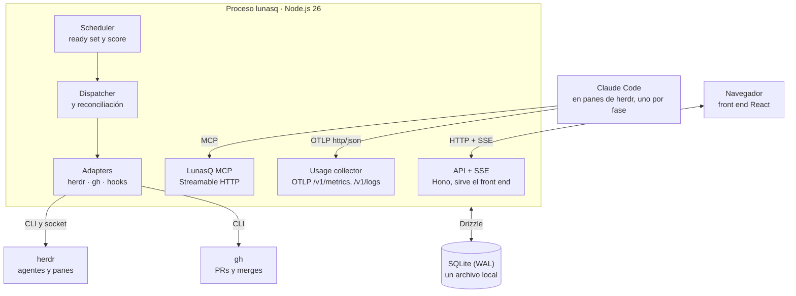

# LunasQ v1 — Tech stack

Oct 28, 2026 · @Sergio Sanchez

LunasQ v1 se construye en TypeScript sobre Node.js, con SQLite como base de datos y React + Vite en el front end, todo en un solo monorepo (`lunas-queue`) y un solo proceso local. Diseño: [design.md](design.md) · Units of work: [units-of-work.md](units-of-work.md).

## Decisiones base

Un solo lenguaje de punta a punta y cero infraestructura que operar: LunasQ corre en la máquina del usuario, con un usuario, así que todo se elige para arrancar con un comando.

| Área | Elección | Por qué |
| --- | --- | --- |
| Runtime | Node.js 26 LTS | Entra a LTS el 28 de octubre de 2026 y tiene soporte hasta abril de 2029 ([calendario](https://dev.to/royce_fabbd83cb268312e928/node-22-vs-node-24-in-2026-current-lts-upgrade-guide-1oa5)) |
| Lenguaje | TypeScript en modo estricto, en backend y front end | Tipos compartidos entre API, MCP y UI; SDK oficial de MCP en TypeScript |
| Base de datos | SQLite en modo WAL | Un archivo local, sin servidor; suficiente para un usuario y una máquina |
| Driver de SQLite | better-sqlite3 13.x con prebuilds N-API | Estable y síncrono; trae binarios para Node 26 sin compilar ([ADR 0003](decisions/0003-sqlite-driver-node26.md)) |
| Acceso a datos | Drizzle ORM + drizzle-kit | Esquema en TypeScript, migraciones versionadas, transacciones síncronas para el claim atómico |
| Servidor HTTP | Hono sobre `@hono/node-server` | Ligero, tipado, y el SDK de MCP trae helpers para Hono |
| Validación y esquemas | Zod v4 | Es la dependencia del SDK de MCP; exporta JSON Schema para los handoffs |
| Front end | React + Vite | Elegido; SPA servida por el mismo proceso |
| Monorepo | pnpm workspaces | Paquetes separados con dependencias explícitas y un solo lockfile |

El objetivo es un monolito modular: módulos con fronteras claras (dominio, scheduler, dispatcher, MCP, adapters) dentro de un solo proceso, que se pueden separar después si v2 lo pide.

## Topología en runtime

Todo LunasQ es un proceso Node.js en `localhost`: recibe la UI por HTTP y SSE, a los agentes por MCP y la telemetría por OTLP, y habla con herdr y GitHub a través de sus CLIs.

Fuente Mermaid

## Stack por componente

Cada componente del diseño queda resuelto con piezas de la misma base, sin servicios externos adicionales.

| Componente | Tecnología | Notas |
| --- | --- | --- |
| Backend API | Hono con rutas tipadas; validación de entrada con Zod | Mismos tipos que consume el front end |
| Actualizaciones en vivo | Server‑Sent Events desde Hono | Tablero y bandeja se actualizan sin polling; más simple que WebSockets |
| Máquina de estados | Módulo de dominio propio en TypeScript puro, con funciones de transición y guards | Sin framework de state machine: los estados son pocos y la lógica vive en los guards |
| Base de datos y Event log | SQLite + Drizzle; Event log como tabla append‑only | Claim atómico con transacción y `UPDATE … WHERE estado = queued` |
| Outbox | Tabla outbox en SQLite + publicador en proceso | Mismo proceso, mismo archivo: la publicación lee la tabla después del commit |
| Scheduler | Módulo en proceso que reacciona a eventos del outbox y a un tick periódico | Cálculo de ready set y score en memoria a partir de la base |
| Dispatcher y reconciliación | Módulo en proceso con loop de reconciliación | Usa el adapter de herdr; un solo dispatcher en v1 |
| LunasQ MCP | SDK oficial de MCP v2 (`@modelcontextprotocol/server` + `@modelcontextprotocol/hono`), transporte Streamable HTTP stateless en `localhost`, montado en Hono ([ADR 0001](decisions/0001-mcp-sdk.md)) | Las tools usan los mismos esquemas Zod que el resto del backend |
| Esquemas de handoff | Zod v4 como fuente (`packages/schemas/src/handoff`); JSON Schema generado y versionado en `packages/schemas/json-schema/v{n}` ([ADR 0006](decisions/0006-handoff-v1.md)) | El validador del MCP y la UI usan la misma definición |
| Usage collector | Endpoints OTLP/HTTP con JSON (`/v1/metrics`, `/v1/logs`) dentro de Hono | Claude Code soporta `http/json`, así que no hace falta un OpenTelemetry Collector aparte |
| Gate de tests y hooks | Ejecución en un pane de herdr con un wrapper que registra código de salida y salida | Lo ves en herdr como cualquier agente |
| Adapter de herdr | `child_process` para el CLI (salida JSON) y socket Unix con NDJSON para `events.subscribe` | Fake en memoria con la misma interfaz para tests |
| Ejecución de procesos | `ProcessRunner` sobre `child_process` (`sh -c`, grupo de procesos propio, timeout) para el bootstrap del worktree ([ADR 0012](decisions/0012-ciclo-de-vida-worktrees.md)) | Fake con la misma interfaz para tests |
| Adapter de GitHub | CLI `gh` con salida `--json` vía `child_process` | Usa la sesión autenticada de `gh` de la máquina |
| Archivo de evidencia | Generador de markdown propio; redacción de secretos con patrones al estilo gitleaks | Escribe en `lunasq/tasks/{id}.md` del worktree |
| Logs del propio LunasQ | pino | JSON estructurado, rotación por archivo |
| CLI e instalador | Binario `lunasq` publicado como paquete npm `lunasq` (`lunasq start`, `lunasq install`, `lunasq doctor`), armado con esbuild en un solo bundle ([ADR uw-28-instalador](decisions/uw-28-instalador.md)) | `install` verifica herdr, Claude Code y `gh`, e instala skills, subagentes y configuración en `~/.lunasq/` |

**Front end**

| Necesidad | Tecnología |
| --- | --- |
| Base | React + Vite + TypeScript |
| Routing | TanStack Router |
| Datos del servidor | TanStack Query, con invalidación desde SSE (`GET /api/stream` sigue el Event log, [ADR uw-21-front-end](decisions/uw-21-front-end.md)) |
| Componentes y estilos | shadcn/ui sobre Tailwind CSS 4 (`class-variance-authority`, `clsx`, `tailwind-merge`) |
| Tablas (cola, backlog, Runs) | TanStack Table 8.x |
| DAG de dependencias | React Flow (`@xyflow/react`) con layout automático (`@dagrejs/dagre`, [ADR uw-25-vistas-dag-hooks](decisions/uw-25-vistas-dag-hooks.md)) |
| Diff de versiones de spec | Visor de diff de texto |
| Render de handoffs y evidencia | Visor de JSON y render de markdown (`react-markdown`, sin HTML crudo) |

## Estructura del repositorio `lunas-queue`

Monorepo con pnpm workspaces; la regla es que el dominio no depende de nada externo y los adapters dependen del dominio, nunca al revés.

| Paquete | Contenido | Depende de |
| --- | --- | --- |
| `packages/schemas` | Esquemas Zod compartidos: entidades, handoffs por fase, eventos; generación de JSON Schema | — |
| `packages/domain` | Máquina de estados, guards, reglas del scheduler (ready set, score, límites), reglas de dependencias | `schemas` |
| `packages/db` | Esquema Drizzle, migraciones, repositorios, outbox | `schemas`, `domain` |
| `packages/adapters` | Adapter de herdr (real y fake), adapter de `gh`, adapter de git (lectura de la rama base y commits), runner de procesos (también en un pane de herdr), ejecutor de hooks y gate de tests | `schemas` |
| `packages/server` | Hono: API, SSE, LunasQ MCP, endpoints OTLP; scheduler, dispatcher y reconciliación; generador de evidencia | `domain`, `db`, `adapters`, `schemas` |
| `packages/web` | Front end React + Vite; se compila a estáticos (`dist/app`) que sirve `server` con `@hono/node-server` | `schemas` (solo tipos) |
| `packages/cli` | Binario `lunasq`: `start`, `install`, `doctor`; el proceso que arranca `start` lo compone `server` (`startRuntime`) | `server` |
| `packages/e2e` | Piloto end-to-end: Playwright contra `startRuntime` con herdr y GitHub falsos y git real ([ADR uw-29-e2e](decisions/uw-29-e2e.md)); nadie lo importa | `server`, `adapters`, `schemas` |
| `assets/skills` | Skills de fase: `refine-task`, `implement-task`, `verify-task` ([ADR uw-18-skills-fase](decisions/uw-18-skills-fase.md)) | — |
| `assets/agents` | Definiciones de los 4 subagentes revisores | — |

Los assets se versionan con el código y `lunasq install` los copia a `~/.claude/` (skills y `agents/lunasq/`). Las pruebas de integración contra herdr y `gh` reales viven en `packages/adapters` y corren aparte de la suite unitaria.

## Integraciones externas

LunasQ no embebe ninguna de estas herramientas: las invoca como procesos o las configura, y cada una queda detrás de un adapter con una versión mínima verificada por `lunasq doctor`.

| Herramienta | Cómo se integra | Qué configura `lunasq install` |
| --- | --- | --- |
| herdr | CLI con salida JSON y socket Unix (NDJSON) para eventos; versión mínima 0.9.5, protocol 22 ([ADR 0004](decisions/0004-herdr-version-y-cli.md)) | Verifica versión; instala la integración oficial de herdr para Claude Code |
| Claude Code | Lo arranca herdr con `agent start --kind claude`; modelo, modo Auto y demás flags van en los args del perfil de fase; el dispatcher agrega el archivo MCP y un `--settings` estable con los hooks de subagentes ([ADR uw-19-revisores](decisions/uw-19-revisores.md)) | Escribe el archivo MCP estable y el settings de hooks en `~/.lunasq/` (no registra el MCP a nivel usuario, [ADR uw-28-instalador](decisions/uw-28-instalador.md)); copia skills y subagentes a `~/.claude/` |
| GitHub | CLI `gh` con `--json` | Verifica que `gh` esté autenticado |
| git | Worktrees vía herdr; trailers `LunasQ-Task` y `LunasQ-Run` en los mensajes de commit | — |
| OpenTelemetry | Claude Code exporta métricas y eventos por OTLP/HTTP JSON a `localhost` | Variables de telemetría en el entorno de cada pane |
| engram | Sin integración: dependencia débil | Solo lo detecta y avisa si no está instalado |

**Variables que el dispatcher pasa a cada pane de agente**

| Variable | Para qué |
| --- | --- |
| `LUNASQ_RUN_TOKEN`, `LUNASQ_TASK_ID`, `LUNASQ_RUN_ID`, `LUNASQ_PHASE` | Identificar el Run ante el LunasQ MCP y en hooks |
| `CLAUDE_CODE_ENABLE_TELEMETRY=1`, `OTEL_METRICS_EXPORTER=otlp`, `OTEL_LOGS_EXPORTER=otlp`, `OTEL_EXPORTER_OTLP_PROTOCOL=http/json`, `OTEL_EXPORTER_OTLP_ENDPOINT` | Enviar uso y eventos al usage collector local |
| `OTEL_RESOURCE_ATTRIBUTES` (`lunasq.task_id`, `lunasq.run_id`, `lunasq.phase`) y `OTEL_EXPORTER_OTLP_HEADERS` (run token) | Atribuir el consumo a la tarea y autenticar al Run ante el usage collector ([ADR uw-20-usage-collector](decisions/uw-20-usage-collector.md)) |
| `OTEL_LOG_TOOL_DETAILS=1` | Nombres reales de los subagentes en el desglose por revisor |
| `CLAUDE_CODE_FORK_SUBAGENT=0` | Que el approver espere a los revisores en verificación |

## Calidad y tooling

LunasQ se construye con las mismas reglas que impone: TDD en el dominio y pruebas de contrato en cada frontera.

| Necesidad | Herramienta | Uso |
| --- | --- | --- |
| Tests unitarios y de integración | Vitest | Dominio con TDD; repositorios contra SQLite en memoria |
| Tests de contrato de adapters | Vitest con el fake y con herdr y `gh` reales | La misma suite corre contra ambos; la real en un job aparte |
| Tests del front end | Vitest + Testing Library | Componentes y flujos de la bandeja |
| End-to-end | Playwright | Flujos completos de la UI contra un servidor con el fake de herdr |
| Lint y formato | Biome | Un solo binario para lint y formato en todo el monorepo |
| Tipos | `tsc` en modo estricto, por paquete | Falla la build si un paquete viola la frontera de dependencias |
| CI | GitHub Actions | Typecheck, lint, tests unitarios y e2e en cada PR; tests contra herdr real en un job manual |

## Riesgos y verificaciones al arrancar

Cuatro puntos se validan en la primera ola, antes de construir encima, porque dependen de herramientas externas que cambian rápido.

| Punto | Riesgo | Verificación y plan B |
| --- | --- | --- |
| SDK de MCP para TypeScript | La generación v2 (paquetes `@modelcontextprotocol/server` y middleware para Hono) era pre‑estable durante 2026 ([SDK](https://github.com/modelcontextprotocol/typescript-sdk)) | Resuelto en UW-00: v2 es estable (server 2.4.0, hono 2.0.2) y se usa v2 ([ADR 0001](decisions/0001-mcp-sdk.md)). La capa del LunasQ MCP queda aislada para migrar sin tocar el dominio |
| Run token hacia el LunasQ MCP | El agente debe enviar su run token en cada llamada | Resuelto en UW-00: un archivo de configuración MCP estable con el header `X-LunasQ-Run-Token: ${LUNASQ_RUN_TOKEN}`, pasado con `--mcp-config --strict-mcp-config`; el token solo vive en el entorno del pane ([ADR 0002](decisions/0002-run-token-mcp-config.md)) |
| better-sqlite3 en Node 26 | Módulo nativo: depende de binarios precompilados para la versión de Node | Resuelto en UW-00: better-sqlite3 13 trae prebuilds N-API; en pnpm se declara `allowBuilds: { better-sqlite3: false }` para no compilar. Plan B sin cambios: `node:sqlite` detrás de Drizzle ([ADR 0003](decisions/0003-sqlite-driver-node26.md)) |
| herdr pre‑1.0 | Cambios en CLI y socket entre versiones | Versión mínima 0.9.5 (protocol 22), verificada por `lunasq doctor`; pruebas de contrato del adapter en cada actualización. Diferencias con el diseño en [ADR 0004](decisions/0004-herdr-version-y-cli.md) |

Los cuatro puntos se validaron en UW-00 sin cambiar la elección del stack; las decisiones están en `docs/decisions/`.
