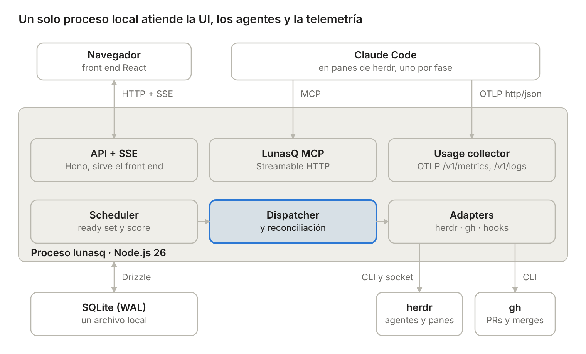
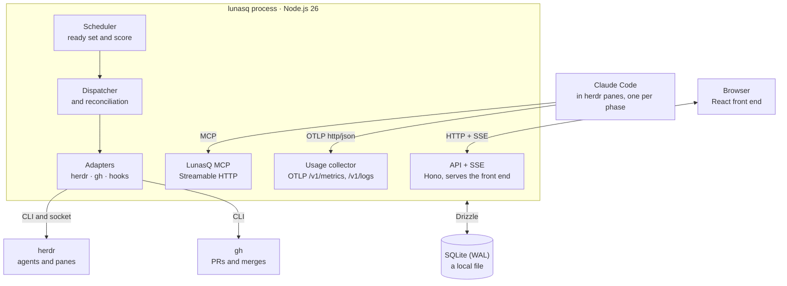

# LunasQ v1 — Tech stack

Oct 28, 2026 · @Sergio Sanchez

LunasQ v1 is built in TypeScript on Node.js, with SQLite as the database and React + Vite on the front end, all in a single monorepo (`lunas-queue`) and a single local process. Design: [design.md](design.md).

## Base decisions

One language end to end and zero infrastructure to operate: LunasQ runs on the user's machine, with one user, so everything is chosen to start with one command.

| Area | Choice | Why |
| --- | --- | --- |
| Runtime | Node.js 26 LTS | It enters LTS on October 28, 2026 and has support until April 2029 ([calendar](https://dev.to/royce_fabbd83cb268312e928/node-22-vs-node-24-in-2026-current-lts-upgrade-guide-1oa5)) |
| Language | TypeScript in strict mode, on backend and front end | Types shared between API, MCP and UI; official MCP SDK in TypeScript |
| Database | SQLite in WAL mode | A local file, no server; enough for one user and one machine |
| SQLite driver | better-sqlite3 13.x with N-API prebuilds | Stable and synchronous; ships binaries for Node 26 without compiling ([ADR 0003](decisions/0003-sqlite-driver-node26.md)) |
| Data access | Drizzle ORM + drizzle-kit | Schema in TypeScript, versioned migrations, synchronous transactions for the atomic claim |
| HTTP server | Hono over `@hono/node-server` | Lightweight, typed, and the MCP SDK ships helpers for Hono |
| Validation and schemas | Zod v4 | It is the MCP SDK's dependency; it exports JSON Schema for the handoffs |
| Front end | React + Vite | Chosen; SPA served by the same process |
| Monorepo | pnpm workspaces | Separate packages with explicit dependencies and a single lockfile |

The goal is a modular monolith: modules with clear boundaries (domain, scheduler, dispatcher, MCP, adapters) inside a single process, which can be separated later if v2 asks for it.

## Runtime topology

All of LunasQ is a Node.js process on `localhost`: it receives the UI over HTTP and SSE, the agents over MCP and the telemetry over OTLP, and talks to herdr and GitHub through their CLIs.

Mermaid source

## Stack per component

Each component of the design is solved with pieces from the same base, with no additional external services.

| Component | Technology | Notes |
| --- | --- | --- |
| Backend API | Hono with typed routes; input validation with Zod | Same types the front end consumes |
| Live updates | Server‑Sent Events from Hono | Board and inbox update without polling; simpler than WebSockets |
| State machine | Own domain module in pure TypeScript, with transition functions and guards | No state machine framework: the states are few and the logic lives in the guards |
| Database and Event log | SQLite + Drizzle; Event log as an append‑only table | Atomic claim with a transaction and `UPDATE … WHERE state = queued` |
| Outbox | Outbox table in SQLite + in‑process publisher | Same process, same file: publishing reads the table after the commit |
| Scheduler | In‑process module that reacts to outbox events and to a periodic tick | Ready set and score computed in memory from the database |
| Dispatcher and reconciliation | In‑process module with a reconciliation loop | Uses the herdr adapter; a single dispatcher in v1 |
| LunasQ MCP | Official MCP SDK v2 (`@modelcontextprotocol/server` + `@modelcontextprotocol/hono`), stateless Streamable HTTP transport on `localhost`, mounted on Hono ([ADR 0001](decisions/0001-mcp-sdk.md)) | The tools use the same Zod schemas as the rest of the backend |
| Handoff schemas | Zod v4 as the source (`packages/schemas/src/handoff`); JSON Schema generated and versioned in `packages/schemas/json-schema/v{n}` ([ADR 0006](decisions/0006-handoff-v1.md)) | The MCP validator and the UI use the same definition |
| Usage collector | OTLP/HTTP endpoints with JSON (`/v1/metrics`, `/v1/logs`) inside Hono | Claude Code supports `http/json`, so a separate OpenTelemetry Collector is not needed |
| Test gate and hooks | Execution in a herdr pane with a wrapper that records exit code and output | You see it in herdr like any agent |
| herdr adapter | `child_process` for the CLI (JSON output) and Unix socket with NDJSON for `events.subscribe` | In‑memory fake with the same interface for tests |
| Process execution | `ProcessRunner` over `child_process` (`sh -c`, own process group, timeout) for the worktree bootstrap ([ADR 0012](decisions/0012-ciclo-de-vida-worktrees.md)) | Fake with the same interface for tests |
| GitHub adapter | `gh` CLI with `--json` output via `child_process` | Uses the machine's authenticated `gh` session |
| Evidence file | Own markdown generator; secret redaction with gitleaks‑style patterns | Writes to `lunasq/tasks/{id}.md` of the worktree |
| LunasQ's own logs | pino | Structured JSON, rotation per file |
| CLI and installer | `lunasq` binary published as the npm package `lunasq` (`lunasq start`, `lunasq install`, `lunasq doctor`), built with esbuild into a single bundle ([ADR uw-28-instalador](decisions/uw-28-instalador.md)) | `install` checks herdr, Claude Code, Copilot CLI and `gh`; installs skills in `~/.claude/` and `~/.copilot/`, and registers the LunasQ MCP in Copilot's configuration |

**Front end**

| Need | Technology |
| --- | --- |
| Base | React + Vite + TypeScript |
| Routing | TanStack Router |
| Server data | TanStack Query, with invalidation from SSE (`GET /api/stream` follows the Event log, [ADR uw-21-front-end](decisions/uw-21-front-end.md)) |
| Components and styles | shadcn/ui over Tailwind CSS 4 (`class-variance-authority`, `clsx`, `tailwind-merge`) |
| Tables (queue, backlog, Runs) | TanStack Table 8.x |
| Spec version diff | Text diff viewer |
| Handoff and evidence rendering | JSON viewer and markdown rendering (`react-markdown`, no raw HTML) |
| Internationalization (ES/EN) | Own typed dictionaries in `packages/web/src/lib/dictionary/` and a `lang` attribute on `<html>`; no i18n library ([ADR i18n-es-en](decisions/i18n-es-en.md)) |

## `lunas-queue` repository structure

Monorepo with pnpm workspaces; the rule is that the domain depends on nothing external and the adapters depend on the domain, never the other way around.

| Package | Contents | Depends on |
| --- | --- | --- |
| `packages/schemas` | Shared Zod schemas: entities, per‑phase handoffs, events; JSON Schema generation | — |
| `packages/domain` | State machine, guards, scheduler rules (ready set, score, limits), dependency rules | `schemas` |
| `packages/db` | Drizzle schema, migrations, repositories, outbox | `schemas`, `domain` |
| `packages/adapters` | herdr adapter (real and fake), `gh` adapter, git adapter (reading the base branch and commits), process runner (also in a herdr pane), hook executor and test gate | `schemas` |
| `packages/server` | Hono: API, SSE, LunasQ MCP, OTLP endpoints; scheduler, dispatcher and reconciliation; evidence generator | `domain`, `db`, `adapters`, `schemas` |
| `packages/web` | React + Vite front end; compiled to statics (`dist/app`) that `server` serves with `@hono/node-server` | `schemas` (types only) |
| `packages/cli` | `lunasq` binary: `start`, `install`, `doctor`; the process `start` launches is composed by `server` (`startRuntime`) | `server` |
| `packages/e2e` | End‑to‑end pilot: Playwright against `startRuntime` with fake herdr and GitHub and real git ([ADR uw-29-e2e](decisions/uw-29-e2e.md)); nobody imports it | `server`, `adapters`, `schemas` |
| `assets/skills` | Phase skills: `refine-task`, `implement-task`, `verify-task` ([ADR uw-18-skills-fase](decisions/uw-18-skills-fase.md)) | — |
| `assets/agents` | Definitions of the 4 reviewer subagents | — |

The assets are versioned with the code. `lunasq install` copies skills to `~/.claude/` and `~/.copilot/`; the four reviewers and their hooks are installed only for Claude Code. Verification parity for Copilot is still pending. The integration tests against real herdr and `gh` live in `packages/adapters` and run apart from the unit suite.

## External integrations

LunasQ embeds none of these tools: it invokes them as processes or configures them, and each one sits behind an adapter with a minimum version verified by `lunasq doctor`.

| Tool | How it integrates | What `lunasq install` configures |
| --- | --- | --- |
| herdr | CLI with JSON output and Unix socket (NDJSON) for events; minimum version 0.9.5, protocol 22 ([ADR 0004](decisions/0004-herdr-version-y-cli.md)) | Checks the version; installs herdr's official integration for Claude Code |
| Claude Code | Started by herdr with `agent start --kind claude`; the dispatcher adds the MCP file and a stable `--settings` with subagent HTTP hooks | Writes MCP/settings in `~/.lunasq/`; copies skills and reviewers to `~/.claude/` |
| GitHub Copilot CLI | Started by herdr with `agent start --kind copilot`; always with `--autopilot` (reserved together with `--mode` and `--plan`, [ADR 0016](decisions/0016-proveedores-agente.md)), `--allow-all-tools`, `--session-id` and `--additional-mcp-config` per Run with its MCP token; it does not pass `--trust-folder` | Registers the MCP in `~/.copilot/mcp-config.json` idempotently and preserving other entries; copies skills to `~/.copilot/`. Automatic reviewer capture is not implemented yet |
| GitHub | `gh` CLI with `--json` | Checks that `gh` is authenticated |
| git | Worktrees via herdr; `LunasQ-Task` and `LunasQ-Run` trailers in commit messages | — |
| OpenTelemetry | Claude Code exports metrics and events over OTLP/HTTP JSON to `localhost` | Telemetry variables in each pane's environment |
| engram | No integration: weak dependency | It only detects it and warns if it is not installed |

**Variables the dispatcher passes to each agent pane**

| Variable | What for |
| --- | --- |
| `LUNASQ_RUN_TOKEN`, `LUNASQ_TASK_ID`, `LUNASQ_RUN_ID`, `LUNASQ_PHASE` | Identify the Run to the LunasQ MCP and in hooks |
| `CLAUDE_CODE_ENABLE_TELEMETRY=1`, `OTEL_METRICS_EXPORTER=otlp`, `OTEL_LOGS_EXPORTER=otlp`, `OTEL_EXPORTER_OTLP_PROTOCOL=http/json`, `OTEL_EXPORTER_OTLP_ENDPOINT` | Send usage and events to the local usage collector |
| `OTEL_RESOURCE_ATTRIBUTES` (`lunasq.task_id`, `lunasq.run_id`, `lunasq.phase`) and `OTEL_EXPORTER_OTLP_HEADERS` (run token) | Attribute consumption to the task and authenticate the Run to the usage collector ([ADR uw-20-usage-collector](decisions/uw-20-usage-collector.md)) |
| `OTEL_LOG_TOOL_DETAILS=1` | Real subagent names in the per‑reviewer breakdown |
| `CLAUDE_CODE_FORK_SUBAGENT=0` | Make the approver wait for the reviewers in verification |

## Quality and tooling

LunasQ is built with the same rules it enforces: TDD in the domain and contract tests at every boundary.

| Need | Tool | Use |
| --- | --- | --- |
| Unit and integration tests | Vitest | Domain with TDD; repositories against in‑memory SQLite |
| Adapter contract tests | Vitest with the fake and with real herdr and `gh` | The same suite runs against both; the real one in a separate job |
| Front end tests | Vitest + Testing Library | Components and inbox flows |
| End-to-end | Playwright | Full UI flows against a server with the herdr fake |
| Lint and format | Biome | A single binary for lint and format across the monorepo |
| Types | `tsc` in strict mode, per package | The build fails if a package violates the dependency boundary |
| CI | GitHub Actions | Typecheck, lint, unit tests and e2e on every PR; tests against real herdr in a manual job |

## Risks and checks at startup

Four points are validated in the first wave, before building on top, because they depend on external tools that change fast.

| Point | Risk | Check and plan B |
| --- | --- | --- |
| MCP SDK for TypeScript | The v2 generation (`@modelcontextprotocol/server` packages and Hono middleware) was pre‑stable during 2026 ([SDK](https://github.com/modelcontextprotocol/typescript-sdk)) | Resolved in UW-00: v2 is stable (server 2.4.0, hono 2.0.2) and v2 is used ([ADR 0001](decisions/0001-mcp-sdk.md)). The LunasQ MCP layer stays isolated so it can be migrated without touching the domain |
| Run token to the LunasQ MCP | The agent must send its run token on every call | Resolved in UW-00: a stable MCP configuration file with the `X-LunasQ-Run-Token: ${LUNASQ_RUN_TOKEN}` header, passed with `--mcp-config --strict-mcp-config`; the token only lives in the pane's environment ([ADR 0002](decisions/0002-run-token-mcp-config.md)) |
| better-sqlite3 on Node 26 | Native module: depends on precompiled binaries for the Node version | Resolved in UW-00: better-sqlite3 13 ships N-API prebuilds; in pnpm `allowBuilds: { better-sqlite3: false }` is declared so it is not compiled. Plan B unchanged: `node:sqlite` behind Drizzle ([ADR 0003](decisions/0003-sqlite-driver-node26.md)) |
| herdr pre‑1.0 | Changes in CLI and socket between versions | Minimum version 0.9.5 (protocol 22), verified by `lunasq doctor`; adapter contract tests on every update. Differences from the design in [ADR 0004](decisions/0004-herdr-version-y-cli.md) |

The four points were validated in UW-00 without changing the stack choice; the decisions are in `docs/decisions/`.
