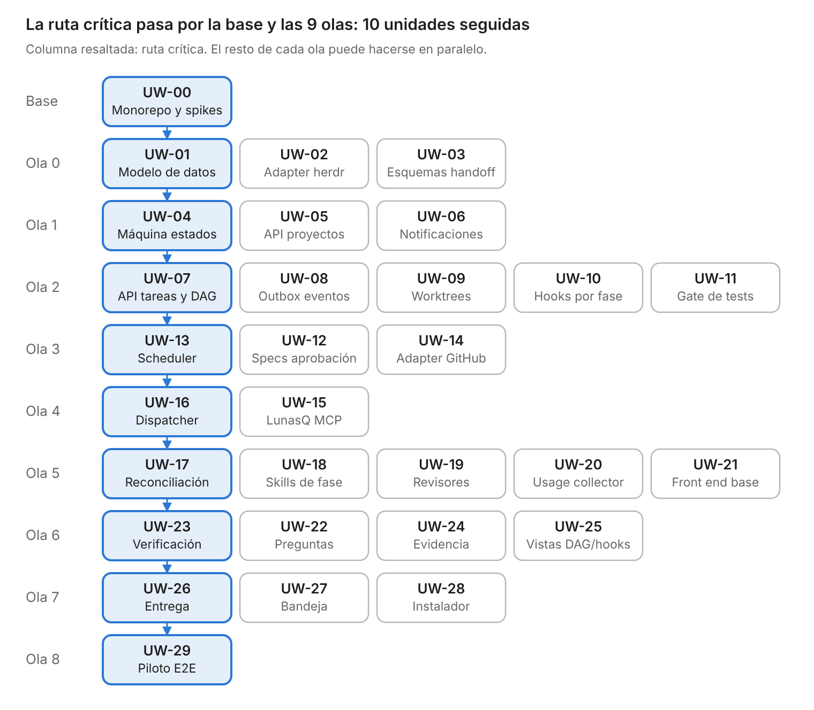
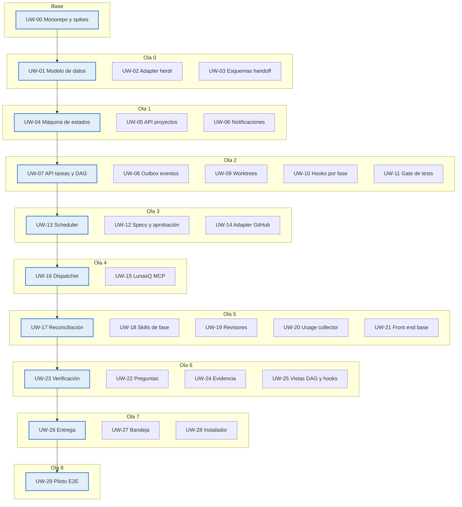

# LunasQ v1 — Units of work

Oct 28, 2026 · @Sergio Sanchez

LunasQ v1 se implementa en 30 unidades de trabajo: UW-00 como base y 29 más, agrupadas en 8 épicas y ordenadas en 9 olas, sobre el stack definido en el doc de tech stack; cada unidad se puede construir y probar por separado, y sus dependencias indican qué contrato debe existir antes (puede reemplazarse por un fake mientras tanto). Diseño de referencia: [design.md](design.md) · Tech stack: [tech-stack.md](tech-stack.md).

## Orden de implementación

UW-00 va antes que todo y cada ola depende solo de olas anteriores; dentro de una ola, las unidades se pueden trabajar en paralelo. La ruta crítica (base → datos → estados → tareas → scheduler → dispatcher → reconciliación → verificación → entrega → piloto) marca el mínimo de pasos secuenciales.

Fuente Mermaid

Para adelantar trabajo fuera de la ruta crítica, el adapter de herdr incluye un fake en memoria y los esquemas de handoff se definen primero, así orquestación y contrato con agentes avanzan sin esperar a herdr ni a Claude Code.

## Backlog

Las 30 unidades en orden de ola. Todas dependen de UW-00, que va primero; después, una unidad puede empezar cuando todas sus dependencias están en Hecho.

| ID | Unit of work | Épica | Ola | Depende de | Estado |
| --- | --- | --- | --- | --- | --- |
| UW-00 | Monorepo y validaciones técnicas | Base del proyecto | Base | — | Hecho |
| UW-01 | Modelo de datos y persistencia | Datos y dominio | 0 | — | Hecho |
| UW-02 | Adapter de herdr | Orquestación y ejecución | 0 | — | Hecho |
| UW-03 | Esquemas JSON de handoff | Contrato con agentes | 0 | — | Hecho |
| UW-04 | Máquina de estados y Event log | Datos y dominio | 1 | UW-01 | Hecho |
| UW-05 | API de proyectos | Datos y dominio | 1 | UW-01 | Hecho |
| UW-06 | Notificaciones | Orquestación y ejecución | 1 | UW-02 | Hecho |
| UW-07 | API de tareas y dependencias (DAG) | Datos y dominio | 2 | UW-01, UW-04 | Pendiente |
| UW-08 | Outbox de eventos | Datos y dominio | 2 | UW-01, UW-04 | Pendiente |
| UW-09 | Ciclo de vida de worktrees | Orquestación y ejecución | 2 | UW-02, UW-05 | Pendiente |
| UW-10 | Hooks por fase | Entrega e integración | 2 | UW-02, UW-04, UW-05 | Pendiente |
| UW-11 | Gate de tests | Calidad y verificación | 2 | UW-02, UW-04, UW-05 | Pendiente |
| UW-12 | Specs y aprobación | Datos y dominio | 3 | UW-04, UW-07 | Pendiente |
| UW-13 | Scheduler | Orquestación y ejecución | 3 | UW-07, UW-08 | Pendiente |
| UW-14 | Adapter de GitHub (gh) | Entrega e integración | 3 | UW-04, UW-07 | Pendiente |
| UW-15 | LunasQ MCP | Contrato con agentes | 4 | UW-01, UW-03, UW-04, UW-12 | Pendiente |
| UW-16 | Dispatcher | Orquestación y ejecución | 4 | UW-02, UW-04, UW-09, UW-13 | Pendiente |
| UW-17 | Señales, timeouts y reconciliación | Orquestación y ejecución | 5 | UW-06, UW-16 | Pendiente |
| UW-18 | Skills de fase | Contrato con agentes | 5 | UW-03, UW-15 | Pendiente |
| UW-19 | Subagentes revisores | Calidad y verificación | 5 | UW-15 | Pendiente |
| UW-20 | Usage collector | Observabilidad y auditoría | 5 | UW-01, UW-16 | Pendiente |
| UW-21 | Front end base | Front end y puesta en marcha | 5 | UW-05, UW-07, UW-12 | Pendiente |
| UW-22 | Preguntas y bloqueos | Humano en el loop | 6 | UW-06, UW-15, UW-16, UW-17 | Pendiente |
| UW-23 | Fase de verificación | Calidad y verificación | 6 | UW-11, UW-15, UW-17, UW-19 | Pendiente |
| UW-24 | Archivo de evidencia | Observabilidad y auditoría | 6 | UW-15, UW-17 | Pendiente |
| UW-25 | Vistas de DAG y hooks | Front end y puesta en marcha | 6 | UW-07, UW-10, UW-21 | Pendiente |
| UW-26 | Fase de entrega | Entrega e integración | 7 | UW-09, UW-10, UW-11, UW-14, UW-23 | Pendiente |
| UW-27 | Bandeja de aprobaciones y preguntas | Humano en el loop | 7 | UW-12, UW-21, UW-22 | Pendiente |
| UW-28 | Instalador de LunasQ | Front end y puesta en marcha | 7 | UW-18, UW-19 | Pendiente |
| UW-29 | Piloto end-to-end | Front end y puesta en marcha | 8 | UW-20, UW-24, UW-25, UW-26, UW-27, UW-28 | Pendiente |

## Detalle por épica

Cada unidad tiene un alcance cerrado y un criterio de terminado verificable; las dependencias están en el backlog.

### E0 · Base del proyecto

| ID | Alcance | Paquete y stack | Terminado cuando |
| --- | --- | --- | --- |
| UW-00 | Monorepo con sus paquetes vacíos y fronteras de dependencia; TypeScript estricto, Biome, Vitest y CI. Spikes de validación: SDK de MCP v2 o v1.x, run token vía `--mcp-config` por Run, better-sqlite3 en Node 26, versión mínima de herdr | Raíz de `lunas-queue` · Node.js 26 LTS, pnpm workspaces, TypeScript, Biome, Vitest, GitHub Actions | CI en verde con un test por paquete; cada spike con su resultado y decisión registrados en el repo |

### E1 · Datos y dominio

| ID | Alcance | Paquete y stack | Terminado cuando |
| --- | --- | --- | --- |
| UW-01 | Esquema de Project, Task, TaskDependency, Spec, Run, Question, UsageRecord, Event y outbox, con migraciones | `packages/db` · Drizzle ORM + drizzle-kit, better-sqlite3, SQLite en WAL | Las migraciones aplican en limpio; claves, unicidad y relaciones probadas; prioridad como entero sin signo |
| UW-04 | Máquina de estados con sub‑estados y guards; Event log append‑only con actor y payload | `packages/domain` (TypeScript puro) · tabla de eventos en `packages/db` | Tests de todas las transiciones válidas e inválidas; ninguna transición ocurre sin su evento |
| UW-05 | API de proyectos: repo, rama base, ruta local, perfil de agente por fase, límites, comando de tests y bootstrap | `packages/server` (rutas Hono) · config validada con Zod en `packages/schemas` | El perfil valida `kind = claude`; otros módulos leen la configuración sin tocar la base |
| UW-07 | API de tareas (intent, tags, prioridad, cancelación) y aristas con detección de ciclos | `packages/server` · reglas del DAG en `packages/domain` | Una arista que cierra un ciclo se rechaza; ancestros y descendientes disponibles para el scheduler |
| UW-08 | Outbox que publica cambios de estado hacia scheduler y dispatcher | `packages/db` (tabla outbox) · publicador en proceso en `packages/server` | Ningún evento se pierde ante una caída entre el commit y la publicación |
| UW-12 | Specs versionadas con modelo de dominio; aprobar, pedir cambios o editar y aprobar; diff entre versiones | `packages/server` + `packages/db` · esquema de spec en `packages/schemas` | La aprobación queda ligada a una versión exacta; pedir cambios regresa a Draft con comentarios |

### E2 · Orquestación y ejecución

| ID | Alcance | Paquete y stack | Terminado cuando |
| --- | --- | --- | --- |
| UW-02 | Adapter de herdr: workspaces, worktrees, panes, `agent start`, `prompt`, `read`, `wait`, metadata, notificaciones, `session.snapshot` y `events.subscribe` (suscripción por pane a `pane.agent_status_changed`) con manejo de pérdida de eventos (cierre del stream → re‑suscribir y reconciliar, ADR 0004); fake en memoria | `packages/adapters` · `child_process` para el CLI con salida JSON, socket Unix con NDJSON | La misma suite de contrato pasa contra herdr real y contra el fake |
| UW-06 | Notificaciones por herdr y por la UI, con escalamiento a 1 minuto | `packages/server` (SSE hacia la UI) + `packages/adapters` (toast de herdr) | Una notificación llega por ambos canales sin duplicarse |
| UW-09 | Worktree por tarea: creación, bootstrap, reapertura, remoción y detección de huérfanos | `packages/adapters` (worktrees vía herdr) + `packages/server` | Dos tareas del mismo repo trabajan en paralelo; repetir la operación no duplica nada |
| UW-13 | Ready set, score con prioridad, aging y boost, herencia de prioridad, límites (global default 5), sin preemption | Reglas en `packages/domain` · módulo en proceso en `packages/server` que reacciona al outbox y a un tick | Escenarios de DAG producen el orden esperado; nunca se exceden los límites |
| UW-16 | Claim atómico con run token; secuencia de despacho; variables de entorno del pane (incluido `LUNASQ_RUN_TOKEN`); archivo de configuración MCP estable con `${LUNASQ_RUN_TOKEN}` pasado con `--mcp-config --strict-mcp-config` (ADR 0002); confianza de carpeta del worktree en Claude Code (ADR 0004); identidad de sesión; cierre de fase | `packages/server` + `packages/adapters` · transacción síncrona de better-sqlite3 para el claim | Una fase se despacha de punta a punta contra el fake y contra herdr; repetir el despacho no duplica agentes |
| UW-17 | Señales, nudges, timeout de fase de 30 min con pausa, 3 reintentos con backoff, `failure_reason`, reconciliación con snapshot y huérfanos | `packages/server` + `packages/adapters` (`events.subscribe`, `session.snapshot`) | Cada escenario de fallo simulado termina en el estado y la notificación esperados |

### E3 · Contrato con agentes

| ID | Alcance | Paquete y stack | Terminado cuando |
| --- | --- | --- | --- |
| UW-03 | Esquemas versionados del handoff: sobre común y cuerpo por fase; ejemplos válidos e inválidos | `packages/schemas` · Zod v4 como fuente; JSON Schema generado y versionado en el repo | El validador acepta los ejemplos válidos y rechaza los inválidos con errores claros |
| UW-15 | Tools del LunasQ MCP, validación de run token, gate de `get_task_context`, validación de handoffs, disparo del gate de tests y de transiciones | `packages/server` · SDK oficial de MCP para TypeScript con Streamable HTTP montado en Hono; esquemas Zod de `packages/schemas` | Cada tool tiene tests de contrato; un handoff inválido o un run token viejo se rechazan |
| UW-18 | Skills `refine-task` (DDD), `implement-task` (TDD), `verify-task` (fan-out, checklist, prueba de reversión) y `deliver-task`, con instrucciones best effort para engram | `assets/skills` · markdown de skills de Claude Code | Cada skill produce un handoff válido en una tarea de prueba |

### E4 · Calidad y verificación

| ID | Alcance | Paquete y stack | Terminado cuando |
| --- | --- | --- | --- |
| UW-11 | Gate de tests al recibir `submit_for_verification` y antes de aceptar un pass; salida y resultado guardados | `packages/adapters` (ejecución en un pane de herdr con wrapper que registra el código de salida) + `packages/server` | Una suite en rojo bloquea la transición aunque el agente diga lo contrario |
| UW-19 | Subagentes revisores de solo lectura en Opus, salida compacta; hooks `SubagentStart` y `SubagentStop` | `assets/agents` · frontmatter de subagentes de Claude Code; los hooks llaman a un endpoint local de Hono | Los 4 se lanzan desde una sesión de prueba y LunasQ registra cada ejecución |
| UW-23 | Orquestación de la fase: approver en Sonnet, validación del veredicto contra los hooks, pass o reject, tope de 3 iteraciones, etiqueta de riesgo, hallazgos refutados | `packages/server` · reglas del veredicto en `packages/domain` | Un caso pass y uno reject recorren el loop; la cuarta iteración termina en Needs human |

### E5 · Humano en el loop

| ID | Alcance | Paquete y stack | Terminado cuando |
| --- | --- | --- | --- |
| UW-22 | `ask_human` asíncrono, `waiting_human` con pausa del timeout, respuesta al pane vivo o en un Run nuevo, bloqueos por permiso | `packages/server` + `packages/adapters` (`agent prompt`) · eventos a la UI por SSE | Una pregunta respondida minutos u horas después llega al agente correcto |
| UW-27 | Bandeja: specs por aprobar, Questions abiertas y agentes bloqueados con acceso al pane | `packages/web` · TanStack Query con invalidación por SSE, shadcn/ui, visor de diff para specs | Todo lo que espera al humano aparece y se resuelve desde la bandeja |

### E6 · Entrega e integración

| ID | Alcance | Paquete y stack | Terminado cuando |
| --- | --- | --- | --- |
| UW-10 | Hooks por fase leídos de `lunasq/hooks/` en la rama base, `lunasq/hooks/config`, ejecución en pane, block o warn, commit con trailers, registro | `packages/adapters` (ejecutor de hooks, lectura de la rama base con git) + `packages/server` | Los hooks corren en orden; un hook modificado en el branch de la tarea nunca se ejecuta |
| UW-14 | Crear PR, leer estado, CI y reviews; polling de merges; PR cerrado sin merge manda dependientes a Needs human | `packages/adapters` · CLI `gh` con `--json` vía `child_process` | Un merge detectado libera a las tareas dependientes |
| UW-26 | Entrega: `before_delivery`, rebase, gate de tests final, commits con trailers, push, PR con intent, criterios, evidencia y etiqueta de riesgo, `after_delivery` | `packages/server` + `packages/adapters` (git y `gh`) | Una tarea con pass termina en un PR con trailers y etiqueta de riesgo |

### E7 · Observabilidad y auditoría

| ID | Alcance | Paquete y stack | Terminado cuando |
| --- | --- | --- | --- |
| UW-20 | Receptor OTLP, atributos de tarea, Run y fase, UsageRecord, desglose por revisor, Task.usage read‑only | `packages/server` · endpoints OTLP/HTTP JSON (`/v1/metrics`, `/v1/logs`) en Hono, sin Collector aparte; `packages/db` | El usage de una tarea coincide con lo que reporta Claude Code |
| UW-24 | `lunasq/tasks/{id}.md` con una sección por Run: metadatos, `failure_reason`, handoff JSON, veredicto, salida de gate y hooks, transcripts en markdown | `packages/server` · generador de markdown propio; redacción de secretos con patrones al estilo gitleaks | El archivo se actualiza en cada cierre de Run y viaja en el PR |

### E8 · Front end y puesta en marcha

| ID | Alcance | Paquete y stack | Terminado cuando |
| --- | --- | --- | --- |
| UW-21 | Tablero por proyecto, cola global, alta de tareas, detalle de tarea con Runs, Event log, versiones de spec, usage y evidencia | `packages/web` · React + Vite, TanStack Router, Query y Table, shadcn/ui sobre Tailwind; servido como estáticos por `packages/server` | Una tarea se crea y se sigue de punta a punta sin usar la API a mano |
| UW-25 | DAG de dependencias y vista de hooks con sus últimas ejecuciones | `packages/web` · React Flow (`@xyflow/react`) con layout de dagre | El DAG refleja las dependencias reales; cada hook muestra contenido y ejecuciones |
| UW-28 | Instalador: verificación de herdr, Claude Code y `gh`, integración de herdr para Claude Code, skills, subagentes, registro del LunasQ MCP y telemetría | `packages/cli` · binario `lunasq` (`start`, `install`, `doctor`) publicado en npm | Una máquina limpia queda lista con un solo comando y `lunasq doctor` en verde |
| UW-29 | Piloto en un proyecto real con al menos 3 tareas con dependencias, un rework, una pregunta y un hook; suite end-to-end de la UI | Todo el monorepo · Playwright contra un servidor con el fake de herdr | Las tareas terminan en PR mergeables; la suite e2e corre en CI; hallazgos del piloto como tareas nuevas |
