# Evidencia de la tarea 1e32a54c-f407-49e6-9c4d-f0719ee59880

> Si una tarea no tiene code changes, por ehemplo tarea de investigacion que su delivery es una sintesis o invetigacion, no debe generar validacion ni PR, la tarea debe tener un campo nuevo apra el resultado y mostrarse diectametn en del task details, la tarea debe ser marcada como completada y sin PR. debe pasar algo parecido a lso falsopositivos, si uan tarea que pide un usuario no tiene resolucion o ya esta implementada, no debe generar verificacion ni Pr, tiene que dar resultado y marcarse como completada.

Una sección por Run, escrita por LunasQ al cerrarlo. No se edita a mano: se reescribe.

<!-- lunasq:run:start 6a59cd23-4a54-41fa-a1ce-622c6978dd7a -->
## Run 6a59cd23-4a54-41fa-a1ce-622c6978dd7a · refine · iteración 0

| Campo | Valor |
| --- | --- |
| Fase | refine |
| Agente | claude |
| Modelo | opus |
| Iteración | 0 |
| Inicio | 2026-11-02T04:45:09.742Z |
| Fin | 2026-11-02T04:48:16.064Z |
| Resultado | success |
| failure_reason | — |
| Sesión | 388e720f-4003-40f1-ae97-d7643510b18f |

### Handoff

```json
{
  "schemaVersion": 1,
  "taskId": "1e32a54c-f407-49e6-9c4d-f0719ee59880",
  "runId": "6a59cd23-4a54-41fa-a1ce-622c6978dd7a",
  "result": "partial",
  "summary": "Spec para cerrar tareas sin cambios de código (investigación, ya implementada, sin resolución) con un Resultado visible en el detalle: nueva tool submit_result en refinamiento e implementación que lleva la tarea directo a Completed, sin verificación ni PR, y libera a sus dependientes.",
  "relevantFiles": [
    "packages/schemas/src/enums.ts",
    "packages/schemas/src/task.ts",
    "packages/schemas/src/events.ts",
    "packages/schemas/src/handoff/index.ts",
    "packages/schemas/src/handoff/envelope.ts",
    "packages/schemas/src/handoff/refinement.ts",
    "packages/schemas/src/handoff/json-schema.ts",
    "packages/schemas/examples/handoff/v1",
    "packages/domain/src/state-machine.ts",
    "packages/domain/src/scheduler.ts",
    "packages/domain/src/worktrees.ts",
    "packages/db/src/schema.ts",
    "packages/db/src/tasks.ts",
    "packages/db/src/task-transitions.ts",
    "packages/db/drizzle",
    "packages/server/src/mcp/service.ts",
    "packages/server/src/mcp/routes.ts",
    "packages/server/src/api/tasks.ts",
    "packages/web/src/pages/task-detail.tsx",
    "packages/web/src/pages/completed.tsx",
    "assets/skills/refine-task/SKILL.md",
    "assets/skills/implement-task/SKILL.md",
    "docs/design.md",
    "docs/decisions/0007-maquina-de-estados.md"
  ],
  "decisions": [
    {
      "decision": "Una tool de salida nueva, submit_result, aceptada en las fases refine e implement",
      "rationale": "Respuesta del humano (opción A): el refinador detecta lo ya implementado o sin resolución al leer el repo, y una investigación puede cerrarla el refinador o el implementador",
      "discarded": [
        "Solo en implementación tras aprobar la spec (opción B)",
        "Solo en refinamiento pasando por el gate de aprobación (opción C)",
        "Reutilizar submit_spec o submit_for_verification con una bandera"
      ]
    },
    {
      "decision": "Comando de dominio nuevo submit_result: draft/running o in_progress/running → completed, actor agente, con el tipo de resultado como hecho del evento",
      "rationale": "transitionTask es la única vía para cambiar estado (ADR 0007) y la transición debe quedar en el Event log como task.transitioned"
    },
    {
      "decision": "El Resultado vive en la Task: columnas result_kind (research | already_implemented | not_resolvable) y result (texto Markdown), nulos hasta submit_result",
      "rationale": "El intent pide un campo nuevo en la tarea que se muestre en su detalle; la tarea es lo que la UI ya lee",
      "discarded": [
        "Guardarlo solo en el handoff del Run"
      ]
    },
    {
      "decision": "Una tarea completada con Resultado satisface a sus dependientes igual que un PR mergeado",
      "rationale": "No tendrá PR que mergear; sin esto sus dependientes esperarían para siempre"
    },
    {
      "decision": "Desde implementación, submit_result se rechaza si el branch tiene commits respecto a la rama base",
      "rationale": "Una tarea con cambios de código debe pasar por verificación y PR; submit_result es solo para tareas sin código"
    }
  ],
  "knownRisks": [
    "Desde Draft el cierre se salta el gate humano de la spec: un agente que se equivoque deja la tarea Completed sin aprobación; el humano solo lo ve en el detalle y puede crear una tarea nueva",
    "Agregar columnas a tasks puede requerir recrear la tabla en SQLite como en 0010_task_paused (triggers de número y llaves foráneas)",
    "Los tests del handoff exigen ejemplos válidos por fase; el nuevo tipo de handoff debe agregarse a los ejemplos y al JSON Schema generado"
  ],
  "phase": "refinement",
  "body": {
    "title": "Completar tareas sin cambios de código con un resultado y sin PR",
    "domainModel": {
      "boundedContext": "Cola de tareas (ciclo de vida de la tarea)",
      "glossary": [
        {
          "term": "Tarea sin código",
          "definition": "Tarea cuya entrega no es un cambio en el repo: una investigación o síntesis, o un pedido que ya está implementado o no tiene resolución"
        },
        {
          "term": "Resultado",
          "definition": "Texto Markdown que el agente entrega como producto de una tarea sin código; se guarda en la tarea y se muestra en su detalle"
        },
        {
          "term": "Tipo de resultado",
          "definition": "Clasificación del Resultado: research (investigación o síntesis), already_implemented (ya está hecho en el repo) o not_resolvable (no tiene resolución)"
        },
        {
          "term": "submit_result",
          "definition": "Tool de salida del MCP lunasq, aceptada en refinamiento e implementación, que entrega el Resultado y completa la tarea sin verificación ni PR"
        },
        {
          "term": "Completed sin PR",
          "definition": "Tarea en Completed con Resultado y sin PR (prUrl y prState nulos)"
        },
        {
          "term": "Dependiente",
          "definition": "Tarea que depende de otra en el DAG y solo se despacha cuando su dependencia se satisface"
        }
      ],
      "aggregates": [
        {
          "name": "Task",
          "entities": [
            "Resultado",
            "Run",
            "Event log"
          ]
        }
      ],
      "invariants": [
        "Una tarea solo tiene Resultado si llegó a Completed con submit_result; nunca tiene a la vez Resultado y PR",
        "submit_result solo se acepta en un Run abierto de las fases refine o implement, con la tarea en draft/running o in_progress/running",
        "Desde implementación, submit_result se rechaza si el branch de la tarea tiene commits respecto a la rama base, y la tarea no cambia",
        "Una tarea completada con submit_result no pasa por verificación, entrega, push ni creación de PR",
        "Toda transición por submit_result queda en el Event log como task.transitioned con command submit_result",
        "Una dependencia se satisface con su PR mergeado o con estar Completed con Resultado",
        "El título de la tarea solo se fija si aún es null"
      ],
      "events": [
        {
          "name": "task.transitioned (submit_result)",
          "description": "La tarea pasó de draft o in_progress a completed con un Resultado; el payload lleva from, to y el tipo de resultado en reason o note"
        },
        {
          "name": "task.titled",
          "description": "Se fija el título de la tarea cuando submit_result llega en el primer refinamiento"
        }
      ]
    },
    "requirements": [
      "El MCP lunasq expone submit_result en las fases refine e implement; en verify responde tool_not_allowed",
      "submit_result recibe un handoff validado por Zod en packages/schemas con taskId, runId, phase (la del Run), summary, title, tipo de resultado y texto del Resultado (hasta 20 000 caracteres)",
      "Un handoff inválido se rechaza con invalid_handoff y sus issues por ruta, y el Run sigue abierto",
      "Al aceptarlo, en una transacción: se guardan result_kind y result en la tarea, se fija el título si era null, la tarea pasa a completed, se registra el evento y el Run se cierra con éxito",
      "No se despacha verificador ni se ejecuta la entrega (rebase, push, PR, before_delivery ni after_delivery)",
      "El scheduler considera satisfecha una dependencia Completed con Resultado y despacha a sus dependientes",
      "La API de tareas devuelve resultKind y result",
      "El detalle de la tarea muestra una sección «Resultado» con el tipo y el texto renderizado como Markdown, y en el campo PR indica que no tiene PR",
      "La vista de Completadas muestra la tarea sin PR con su tipo de resultado",
      "Las skills refine-task e implement-task explican cuándo usar submit_result; docs/design.md y el ADR 0007 documentan el comando y la transición"
    ],
    "criteria": [
      {
        "id": "AC-1",
        "given": "una tarea en draft/running con un Run de refinamiento abierto y título null",
        "when": "el refinador llama submit_result con tipo research, un título y el texto del Resultado",
        "outcome": "la tarea queda en completed sin PR, con result_kind research, el Resultado y el título guardados, el Run cerrado con éxito y un evento task.transitioned con command submit_result de draft a completed"
      },
      {
        "id": "AC-2",
        "given": "una tarea en in_progress/running con spec aprobada y un branch sin commits respecto a la rama base",
        "when": "el implementador llama submit_result con tipo already_implemented",
        "outcome": "la tarea pasa a completed sin PR, con el Resultado guardado y sin cambiar su título, y no se despacha verificador ni se crea PR"
      },
      {
        "id": "AC-3",
        "given": "una tarea en in_progress/running cuyo branch tiene commits respecto a la rama base",
        "when": "el implementador llama submit_result",
        "outcome": "se rechaza con un error, la tarea sigue en in_progress/running sin Resultado y el Run sigue abierto"
      },
      {
        "id": "AC-4",
        "given": "un Run de verificación abierto",
        "when": "el agente llama submit_result",
        "outcome": "responde tool_not_allowed y la tarea no cambia"
      },
      {
        "id": "AC-5",
        "given": "un Run de refinamiento abierto",
        "when": "el agente llama submit_result con un tipo fuera de research, already_implemented y not_resolvable, sin texto, o con texto de más de 20 000 caracteres",
        "outcome": "responde invalid_handoff con la ruta del campo inválido, la tarea sigue en draft/running y el Run sigue abierto"
      },
      {
        "id": "AC-6",
        "given": "un handoff de submit_result cuyo taskId, runId o phase no son los del Run",
        "when": "el agente lo envía",
        "outcome": "responde handoff_mismatch y la tarea no cambia"
      },
      {
        "id": "AC-7",
        "given": "la máquina de estados del dominio",
        "when": "se aplica submit_result desde un estado distinto de draft o in_progress, desde un sub-estado distinto de running, o con un actor que no es agente",
        "outcome": "se rechaza con invalid_transition o actor_not_allowed y no se emite evento"
      },
      {
        "id": "AC-8",
        "given": "una tarea B que depende de una tarea A",
        "when": "A queda completed con Resultado y sin PR",
        "outcome": "el scheduler incluye a B en el ready set; si A está completed sin Resultado y con PR abierto, B sigue bloqueada"
      },
      {
        "id": "AC-9",
        "given": "una tarea completada con submit_result",
        "when": "el humano abre su detalle",
        "outcome": "ve la sección «Resultado» con el tipo de resultado y el texto renderizado como Markdown, y el campo PR indica que no tiene PR"
      },
      {
        "id": "AC-10",
        "given": "una tarea completada con submit_result",
        "when": "el humano abre la vista de Completadas y filtra por «sin PR»",
        "outcome": "la tarea aparece con su tipo de resultado en lugar de un enlace a PR"
      },
      {
        "id": "AC-11",
        "given": "una tarea completada sin Resultado (entregada con PR)",
        "when": "se lee por la API o se abre su detalle",
        "outcome": "resultKind y result son null y el detalle no muestra la sección «Resultado»"
      }
    ],
    "taskList": [
      {
        "id": "T-1",
        "title": "Esquemas: tipo de resultado, campos resultKind/result en Task, handoff de submit_result con ejemplos y JSON Schema, comando submit_result",
        "criterionIds": [
          "AC-5",
          "AC-6",
          "AC-11"
        ]
      },
      {
        "id": "T-2",
        "title": "Dominio: transición submit_result en la máquina de estados",
        "criterionIds": [
          "AC-7"
        ]
      },
      {
        "id": "T-3",
        "title": "Dominio: el scheduler satisface dependencias completadas con Resultado",
        "criterionIds": [
          "AC-8"
        ]
      },
      {
        "id": "T-4",
        "title": "DB: migración con result_kind y result en tasks y escritura del Resultado junto a la transición",
        "criterionIds": [
          "AC-1",
          "AC-2",
          "AC-11"
        ]
      },
      {
        "id": "T-5",
        "title": "MCP: tool submit_result en refine e implement, guard de commits y cierre del Run",
        "criterionIds": [
          "AC-1",
          "AC-2",
          "AC-3",
          "AC-4",
          "AC-5",
          "AC-6"
        ]
      },
      {
        "id": "T-6",
        "title": "API de tareas devuelve resultKind y result",
        "criterionIds": [
          "AC-9",
          "AC-11"
        ]
      },
      {
        "id": "T-7",
        "title": "Web: sección «Resultado» en el detalle y tipo de resultado en Completadas",
        "criterionIds": [
          "AC-9",
          "AC-10",
          "AC-11"
        ]
      },
      {
        "id": "T-8",
        "title": "Skills refine-task e implement-task, docs/design.md y ADR 0007 actualizados",
        "criterionIds": [
          "AC-1",
          "AC-2"
        ]
      }
    ],
    "assumptions": [
      "El humano eligió la opción A sin responder explícitamente si una tarea Completed sin PR libera a sus dependientes; se asume que sí, como se propuso en la pregunta",
      "El Resultado es Markdown de hasta 20 000 caracteres y se renderiza con react-markdown, que ya es dependencia de web",
      "Al completar con submit_result se corre el hook after_<fase> de la fase actual como en las otras tools de salida; no corren before_delivery, after_delivery ni after_merge",
      "El worktree y el branch local de una tarea completada con Resultado se pueden remover según la misma política que una tarea con PR mergeado; no se hace push del branch",
      "No se agrega un gate humano para revisar el Resultado: el humano lo lee en el detalle y, si no le sirve, crea una tarea nueva",
      "Los commits que solo tocan el archivo de evidencia de LunasQ no cuentan como commits de código para el guard de AC-3"
    ]
  }
}
```

### Transcripts

<details>
<summary>Sesión del agente</summary>

**Usuario** · 04:45:17

Usa la skill refine-task para la tarea 1e32a54c-f407-49e6-9c4d-f0719ee59880 de LunasQ. Empieza llamando get_task_context del MCP lunasq y termina con su tool de salida.

**Agente** · 04:45:18

`Skill`
```
{"skill":"refine-task","args":"1e32a54c-f407-49e6-9c4d-f0719ee59880"}
```

**Usuario** · 04:45:19

Resultado
```
Launching skill: refine-task
```

**Agente** · 04:45:21

`ToolSearch`
```
{"query":"select:mcp__lunasq__get_task_context,mcp__lunasq__submit_spec,mcp__lunasq__ask_human,mcp__lunasq__report_failure","max_results":4}
```

**Usuario** · 04:45:21

Resultado
```

```

**Agente** · 04:45:21

`mcp__lunasq__get_task_context`
```
{}
```

**Usuario** · 04:45:22

Resultado
```
{"task":{"id":"1e32a54c-f407-49e6-9c4d-f0719ee59880","number":19,"intent":"Si una tarea no tiene code changes, por ehemplo tarea de investigacion que su delivery es una sintesis o invetigacion, no debe generar validacion ni PR, la tarea debe tener un campo nuevo apra el resultado y mostrarse diectametn en del task details, la tarea debe ser marcada como completada y sin PR.\n\ndebe pasar algo parecido a lso falsopositivos, si uan tarea que pide un usuario no tiene resolucion o ya esta implementada, no debe generar verificacion ni Pr, tiene que dar resultado y marcarse como completada.","title":null,"tags":[],"state":"draft","subState":"running","verificationIteration":0,"branch":"lunasq/1e32a54c-f407-49e6-9c4d-f0719ee59880","worktreePath":"/Users/sergio.sanchez/.herdr/worktrees/lunas-queue/lunasq-1e32a54c-f407-49e6-9c4d-f0719ee59880"},"run":{"id":"6a59cd23-4a54-41fa-a1ce-622c6978dd7a","phase":"refine","iteration":0},"project":{"name":"LunasQ","repo":"sergiowero/lunas-queue","baseBranch":"main","testCommand":"pnpm test"},"approvedSpec":null,"changesRequested":null,"implementation":null,"verificationHistory":[],"rework":null,"deliveryConflict":null,"previousAttempt":null,"questions":[],"checklist":null}
```

**Agente** · 04:45:25

`Bash`
```
cd /Users/sergio.sanchez/.herdr/worktrees/lunas-queue/lunasq-1e32a54c-f407-49e6-9c4d-f0719ee59880; ls docs docs/decisions packages/*/src | head -100; wc -l docs/design.md
```

**Usuario** · 04:45:26

Resultado
```
docs:
archive
decisions
design.md
images
pilot.md
tech-stack.md

docs/decisions:
0001-mcp-sdk.md
0002-run-token-mcp-config.md
0003-sqlite-driver-node26.md
0004-herdr-version-y-cli.md
0005-convenciones-esquema-sqlite.md
0006-handoff-v1.md
0007-maquina-de-estados.md
0008-config-proyecto.md
0009-notificaciones.md
0010-api-tareas-dag.md
0011-outbox.md
0012-ciclo-de-vida-worktrees.md
0013-specs-y-aprobacion.md
0014-scheduler.md
0015-bandeja-lista-de-specs.md
0015-limite-de-uso-agente.md
0015-numero-de-tarea.md
0016-proveedores-agente.md
effort-por-fase.md
pr-en-conflicto.md
runs-foco-pane.md
settings-proveedores.md
tema-claro-oscuro.md
uw-10-hooks.md
uw-11-gate-tests.md
uw-14-adapter-github.md
uw-15-mcp-tools.md
uw-16-dispatcher.md
uw-17-reconci
… 157 caracteres omitidos …
ia.md
uw-25-vistas-dag-hooks.md
uw-26-entrega.md
uw-27-bandeja.md
uw-28-instalador.md
uw-29-e2e.md
verdict-git-rework.md

packages/adapters/src:
agents
git
github
herdr
index.test.ts
index.ts
process

packages/cli/src:
assets.test.ts
assets.ts
bin.ts
config.ts
context.ts
copilot-mcp.ts
doctor.test.ts
doctor.ts
helpers.test.ts
index.test.ts
index.ts
install.test.ts
install.ts
main.test.ts
main.ts
paths.ts
test-helpers.ts
toml.ts
versions.ts

packages/db/src:
client.test.ts
client.ts
event-log.test.ts
event-log.ts
index.test.ts
index.ts
outbox.test.ts
outbox.ts
project-workspaces.test.ts
project-workspaces.ts
projects.test.ts
projects.ts
questions.test.ts
questions.ts
run-subagents.test.ts
run-subagents.ts
runs.test.ts
     718 docs/design.md
```

**Agente** · 04:45:28

`Bash`
```
cd /Users/sergio.sanchez/.herdr/worktrees/lunas-queue/lunasq-1e32a54c-f407-49e6-9c4d-f0719ee59880; sed -n 1,330p docs/design.md
```

**Agente** · 04:45:29

`Bash`
```
cd /Users/sergio.sanchez/.herdr/worktrees/lunas-queue/lunasq-1e32a54c-f407-49e6-9c4d-f0719ee59880; sed -n 330,718p docs/design.md
```

**Usuario** · 04:45:30

Resultado
```
<persisted-output>
Output too large (31.3KB). Full output saved to: /Users/sergio.sanchez/.claude/projects/-Users-sergio-sanchez--herdr-worktrees-lunas-queue-lunasq-1e32a54c-f407-49e6-9c4d-f0719ee59880/388e720f-4003-40f1-ae97-d7643510b18f/tool-results/bc7euwp3w.txt

Preview (first 2KB):
# LunasQ — Diseño

Oct 28, 2026 · @Sergio Sanchez

## Objetivo y principios

LunasQ (repositorio `lunas-queue`) es una cola de tareas multi‑proyecto donde un humano define el intent y agentes de codificación la refinan, implementan, verifican y entregan como PR; herdr es la capa de ejecución y observación, no la fuente de verdad.

**Modelo de factory:** LunasQ es una AI software factory *lights‑on*: agentes especializados refinan, implementan y verifican con
… 755 caracteres omitidos …
como cero. La integración de revisores por subagentes sigue siendo específica de Claude Code; no declarar paridad de verificación para Copilot hasta que sus revisores y evidencia estén conectados a los mismos gates.

**Fuera de alcance (v1):** merge automático, commits directo a main, despliegue a producción hecho por LunasQ (se puede configurar con hooks del proyecto), carriles por tamaño de tarea, pruebas de aceptación ocultas al builder (posible versión futura) e intake automático desde GitHub issues (planeado para v2).

Principios:

1. **Control plane vs execution plane.** La base de datos del sistema es la verdad. herdr guarda estado efímero (sus eventos no son durables), así que todo se reconcilia contra la BD.
...
</persisted-output>
```

**Usuario** · 04:45:30

Resultado
```
<persisted-output>
Output too large (37.3KB). Full output saved to: /Users/sergio.sanchez/.claude/projects/-Users-sergio-sanchez--herdr-worktrees-lunas-queue-lunasq-1e32a54c-f407-49e6-9c4d-f0719ee59880/388e720f-4003-40f1-ae97-d7643510b18f/tool-results/b0t7h7yf8.txt

Preview (first 2KB):
| ask\_human | Todas | Registra una Question y regresa de inmediato; el agente termina su turno y la respuesta llega después como prompt nuevo |
| update\_checklist | Implementación | Marca items de la task list; alimenta el progreso en la UI |
| submit\_for\_verification | Implementación | Declara fin de implementación con resumen, commits y mapa criterio → tests; dispara el gate de tests |
| submit\_verdict | Verificación | Pass o reject, veredicto por cri
… 746 caracteres omitidos …
arar el intent, modelar con DDD y escribir criterios verificables en lenguaje del dominio | submit\_spec |
| implement-task | TDD contra la spec aprobada: test que falla, implementación mínima, refactor; commits pequeños | submit\_for\_verification |
| verify-task | Elegir según la tarea y el diff qué subagentes revisores lanzar, consolidar, refutar hallazgos, verificar cada criterio y la coherencia de los tests, sin editar código | submit\_verdict |
| herdr (oficial) | Que el agente sepa operar herdr si necesita panes auxiliares | — |

Regla de diseño: las skills describen el *cómo*; el MCP es el único canal de *salida*. Si un agente termina sin llamar la tool de salida, el dispatcher lo trata como fase incompleta.

...
</persisted-output>
```

**Agente** · 04:45:30

Leyendo el diseño (máquina de estados, entrega) para escribir la spec.

**Agente** · 04:45:32

`Bash`
```
cd /Users/sergio.sanchez/.herdr/worktrees/lunas-queue/lunasq-1e32a54c-f407-49e6-9c4d-f0719ee59880; grep -n -i -E "estado|state|done|deliver|entrega|^#" docs/design.md | head -150
```

**Usuario** · 04:45:34

Resultado
```
1:# LunasQ — Diseño
5:## Objetivo y principios
7:LunasQ (repositorio `lunas-queue`) es una cola de tareas multi‑proyecto donde un humano define el intent y agentes de codificación la refinan, implementan, verifican y entregan como PR; herdr es la capa de ejecución y observación, no la fuente de verdad.
19:1. **Control plane vs execution plane.** La base de datos del sistema es la verdad. herdr guarda estado efímero (sus eventos no son durables), así que todo se reconcilia contra la BD.
20:2. **Reconciliación, no disparo único.** El dispatcher es un loop que compara estado deseado (BD) contra estado real (herdr) y corrige, al estilo de un controller de Kubernetes.
26:## Modelo de dominio
33:| Task | Unidad de trabajo en la cola | número (#N,
… 11555 caracteres omitidos …
ssues | Acciones no deseadas | Modo Auto con su clasificador de acciones; aislamiento por worktree; el verificador no edita por instrucción de su skill; push solo en entrega |
647:## Decisiones tomadas
654:| Estado inicial | Draft (antes New) |
672:| Intervención manual | Permitida en cualquier pane; el dispatcher solo reacciona a señales MCP y de estado de herdr, así que lo escrito a mano no queda en el historial de la tarea |
689:| Bugfix de una entrega | Tarea nueva con caused\_by; la lección queda en el archivo de evidencia y, si hay engram, el agente la guarda ahí |
693:## Roadmap: v2 y posteriores
716:| Lock por área de código | Evitar que dos tareas paralelas toquen el mismo módulo | WIP por proyecto + rebase en entrega | Posterior |
```

**Agente** · 04:45:36

`Bash`
```
cd /Users/sergio.sanchez/.herdr/worktrees/lunas-queue/lunasq-1e32a54c-f407-49e6-9c4d-f0719ee59880; sed -n 48,106p docs/design.md; sed -n 508,560p docs/design.md
```

**Usuario** · 04:45:37

Resultado
````
## Máquina de estados

Se conservan tus cinco estados con New renombrado a Draft; Draft incluye la tarea recién creada y el refinamiento en curso, Refined es el único gate humano y el loop de calidad vive entre In progress y Verification.

```mermaid
stateDiagram-v2
    direction LR
    [*] --> Draft
    Draft --> Refined: spec lista
    Refined --> Draft: cambios pedidos
    Refined --> InProgress: aprobada (gate humano)
    InProgress --> Verification: terminada
    Verification --> InProgress: rework, iteración + 1
    Verification --> Complete
… 7820 caracteres omitidos …
e publican con un segundo push.
7. `verdict_pass`: la tarea queda en Completed. Conservar o remover el worktree según política; los dependientes se liberan cuando el PR se mergea.

Mientras el PR espera el merge humano, la base sigue avanzando con otros PRs. El poller de PRs lee también si GitHub lo marca en conflicto con la base; si es así, la tarea vuelve de Completed a In progress con `deliveryConflict.reason: pr_conflict`, el implementador integra la base, y verificación y entrega se repiten sobre el mismo PR ([ADR pr-en-conflicto](decisions/pr-en-conflicto.md)).

Cualquier otro fallo (push, `gh`, un hook bloqueado) escala a Needs human. Una entrega que un reinicio dejó a medias se retoma sola al arrancar.

**Front end: vistas mínimas**
````

**Agente** · 04:45:42

`Bash`
```


<details>
<summary>Fuente Mermaid</summary>


cd /Users/sergio.sanchez/.herdr/worktrees/lunas-queue/lunasq-1e32a54c-f407-49e6-9c4d-f0719ee59880; ls packages/schemas/src packages/domain/src packages/server/src packages/server/src/* packages/web/src packages/web/src/* 2>/dev/null | head -150; sed -n 1,200p docs/decisions/0007-maquina-de-estados.md
```

**Usuario** · 04:45:43

Resultado
```
packages/server/src/app.ts
packages/server/src/index.test.ts
packages/server/src/index.ts
packages/web/src/app.tsx
packages/web/src/index.css
packages/web/src/main.tsx
packages/web/src/router.tsx
packages/web/src/theme-tokens.test.ts

packages/domain/src:
delivery.test.ts
delivery.ts
dependency-graph.test.ts
dependency-graph.ts
dispatch.test.ts
dispatch.ts
hooks.test.ts
hooks.ts
index.test.ts
index.ts
project-config.test.ts
project-config.ts
providers.test.ts
providers.ts
pull-requests.test.ts
pull-requests.ts
scheduler.test.ts
scheduler.ts
spec-diff.test.ts
spec-diff.ts
state-machine.test.ts
state-machine.ts
testing.ts
verdict.test.ts
verdict.ts
worktrees.test.ts
worktrees.ts

packages/schemas/src:
delivery.test.ts
delivery.ts
enums.test.t
… 8843 caracteres omitidos …
17 y UW-26 mueven tareas solo con `transitionTask` y le pasan los hechos de cada guard.
- UW-08 publica el outbox a partir de los eventos `task.transitioned`; el esquema del payload ya está en `@lunasq/schemas`.
- La migración `0010_task_paused` recrea `tasks` (SQLite no altera un CHECK) y vuelve a crear sus triggers de número. Como drizzle corre cada migración en una transacción, donde `PRAGMA foreign_keys=OFF` no actúa, el DROP borraría en cascada Runs, aristas y usage: `migrateDatabase` apaga las llaves foráneas mientras migra, verifica `foreign_key_check` y las restaura. `writable_schema` no sirve: better-sqlite3 abre en modo defensivo.
- La base no impide un `UPDATE` crudo de `tasks.state`; la regla se cumple por convención y revisión.
```

**Agente** · 04:45:46

`Bash`
```
cd /Users/sergio.sanchez/.herdr/worktrees/lunas-queue/lunasq-1e32a54c-f407-49e6-9c4d-f0719ee59880; ls packages/schemas/src/handoff packages/server/src/mcp packages/web/src/*/ 2>/dev/null; cat packages/schemas/src/handoff/*.ts | grep -v test | head -250
```

**Usuario** · 04:45:46

Resultado
```
packages/schemas/src/handoff:
common.ts
envelope.ts
errors.ts
handoff.test.ts
implementation.ts
index.ts
json-schema.test.ts
json-schema.ts
refinement.ts
verification.ts

packages/server/src/mcp:
auth.test.ts
copilot-reviewer.test.ts
copilot-reviewer.ts
index.ts
ports.test.ts
ports.ts
routes.ts
service.ts
test-helpers.ts
tools.test.ts
verification-loop.test.ts

packages/web/src/components/:
data-table.tsx
dispatch-paused-banner.tsx
external-link-icon.tsx
hooks
icons.tsx
layout.tsx
pagination.tsx
pane-focus-button.test.tsx
pane-focus-button.tsx
project-delete-dialog.tsx
project-form-dialog.tsx
section.tsx
status.test.tsx
status.tsx
task
task-actions.test.tsx
task-actions.tsx
task-number.tsx
theme-toggle.test.tsx
theme-toggle.tsx
ui

packages
… 8391 caracteres omitidos …
"el veredicto exige exactamente los 4 revisores", () => {
    expect(REVIEWER_NAMES).toEqual([
      "lunasq-security-reviewer",
      "lunasq-ux-reviewer",
      "lunasq-ui-reviewer",
      "lunasq-code-reviewer",
    ]);
    const handoff = validExample("verification-pass");
    (handoff.body as { reviewers: Record<string, unknown> }).reviewers["lunasq-extra-reviewer"] = {
      status: "ran",
      findings: [],
    };
    expect(expectErrors(handoff)).toContainEqual({
      path: "body.reviewers",
      message: expect.stringContaining("lunasq-extra-reviewer"),
    });
  });
});
import { z } from "zod";
import { CriterionId, checkUnique, FilePath, list, ShortText, Text } from "./common.ts";
import { envelopeShape } from "./envelope.ts";
```

**Agente** · 04:45:49

`Bash`
```
cd /Users/sergio.sanchez/.herdr/worktrees/lunas-queue/lunasq-1e32a54c-f407-49e6-9c4d-f0719ee59880; cat packages/schemas/src/handoff/implementation.ts packages/schemas/src/handoff/refinement.ts; cat packages/schemas/src/task.ts | head -120; grep -n "release\|merged\|dependen" packages/domain/src/scheduler.ts | head -20
```

**Usuario** · 04:45:50

Resultado
```
import { z } from "zod";
import { CriterionId, checkUnique, FilePath, list, ShortText, Text } from "./common.ts";
import { envelopeShape } from "./envelope.ts";

export const CriterionTests = z.strictObject({
  criterionId: CriterionId,
  tests: list(z.strictObject({ file: FilePath, name: ShortText }), 50).min(1, {
    error: "cada criterio necesita al menos un test",
  }),
});

export const CommitSha = z.string().regex(/^[0-9a-f]{7,40}$/, {
  error: "commit inválido: se esperaba un SHA hexadecimal de 7 a 40 caracteres",
});

export const ImplementationBody = z
  .strictObject({
    criterionTests: list(CriterionTests, 50).min(1),
    commits: list(CommitSha).min(1),
    changesByModule: list(z.strictObject({ module: FilePath, summary: Text
… 7895 caracteres omitidos …
gs: z.array(z.string()).optional(),
  priority: Priority.optional(),
15:import { type DependencyEdge, DependencyGraph } from "./dependency-graph.ts";
109:  return dep?.prState === "merged";
112:/** Una dependencia que ya no se entregará: su dependiente quedaría esperando para siempre. */
114:  return dep.prState === "closed" || (dep.state === "cancelled" && dep.prState !== "merged");
134:    if (!graph.dependenciesOf(task.id).every((id) => satisfies(byId.get(id)))) continue;
293: * Dependientes vivos con una dependencia que ya no se entregará. Se omiten los que están en
304:    const dependsOnId = graph.dependenciesOf(task.id).find((id) => {
338:/** Lo que el snapshot conserva: las vivas, las terminales de las que dependen y sus aristas. */
```

**Agente** · 04:46:02

`mcp__lunasq__ask_human`
```
{"question":"¿En qué fase(s) puede un agente cerrar una tarea \"sin cambios de código\" con un resultado y marcarla Completed sin verificación ni PR?\n\nA) (Recomendada) En refinamiento y en implement
… 1273 caracteres omitidos …
 repo en refinamiento; una investigación puede hacerla el refinador o el implementador. Lo que no está claro es si el humano debe aprobar antes de cerrar (gate de spec) y en qué fase vive la salida."}
```

**Usuario** · 04:46:02

Resultado
```
{"questionId":"0af74997-8d24-4a86-bc52-1221680319d9"}
```

**Agente** · 04:46:07

Todavía no hay spec para la tarea 1e32a54c: el refinamiento está en pausa mientras espera tu respuesta a una pregunta de diseño que dejé en la bandeja de LunasQ.

Hoy una tarea solo llega a Completed después de pasar la verificación y abrir un PR, y sus dependientes se liberan solo cuando ese PR se mergea. Para escribir la spec necesito que decidas dos cosas:

**En qué fase puede un agente cerrar una tarea sin cambios de código** (con su resultado y sin verificación ni PR):
- **A) (la que recomiendo)** En refinamiento y en implementación. Habría una tool de salida nueva, por ejemplo `submit_result`, que guarda el tipo de resultado (investigación, ya implementado o sin resolución) y el texto. La tarea pasa directo a Completed; desde Draft eso se salta la aprobación de la spec.
- **B)** Solo en implementación. La spec se aprueba como siempre y el implementador entrega el resultado en lugar de mandar a verificación.
- **C)** Solo en refinamiento, pero con tu aprobación. La tarea queda en Refined con el resultado y pasa a Completed cuando la apruebas.

**Si una tarea completada sin PR libera a sus dependientes en ese momento.** Propongo que sí.

Cuando respondas, LunasQ me pasa la respuesta y termino la spec con `submit_spec`.

**Usuario** · 04:47:01

<pasted_content id="324f">
LunasQ: respuesta a tu pregunta de la tarea 1e32a54c-f407-49e6-9c4d-f0719ee59880. Pregunta: "¿En qué fase(s) puede un agente cerrar una tarea "sin cambios de código" con un resultado y marcarla Completed sin verificación ni PR? A) (Recomendada) En refinamiento y en implementación. Una tool de salida nueva (p. ej. `submit_result`) con el tipo de resultado (investigación / ya implementado / sin resolución) y el texto. Desde Draft va directo a Completed, sin pasar por el gate de aprobación de spec; desde In progress va directo a Completed (sin commits). El humano lee el resultado en el detalle de la tarea. B) Solo en implementación: la spec se aprueba como siempre (gate humano) y el implementador, en vez de submit_for_verification, entrega el resultado → Completed. C) Solo en refinamiento, pero pasando por el gate: el refinador entrega el resultado, la tarea queda en Refined y al aprobar el humano pasa a Completed (pedir cambios devuelve a Draft como hoy). Además: una tarea Completed sin PR, ¿debe liberar a sus dependientes en ese momento (hoy solo se liberan con el PR mergeado)? Mi propuesta es que sí.". Respuesta: "Opcion A". Continúa la fase refine con la skill refine-task y cierra con su tool de salida.
</pasted_content id="324f">

**Agente** · 04:47:07

`Bash`
```
cd /Users/sergio.sanchez/.herdr/worktrees/lunas-queue/lunasq-1e32a54c-f407-49e6-9c4d-f0719ee59880; sed -n 95,140p packages/domain/src/scheduler.ts; grep -n "PHASE_TOOLS\|allowedTools\|submit_spec\|too
… 27 caracteres omitidos …
emas/src/mcp.ts packages/server/src/mcp/*.ts | grep -v test | head -30; cat packages/schemas/src/enums.ts | head -80; ls packages/db/drizzle | tail -5; ls packages/db/src assets/skills assets/skills/*
```

**Usuario** · 04:47:07

Resultado
```
    config.maxRetryBackoffMs,
  );
  return new Date(retry.lastFailedAt.getTime() + wait);
}

/** Agente vivo: running, o waiting_human (la pregunta puede contestarse con el agente vivo). */
function holdsSlot(task: SchedulerTask): boolean {
  return (
    pendingPhase(task.state) !== null &&
    (task.subState === "running" || task.subState === "waiting_human")
  );
}

function satisfies(dep: SchedulerTask | undefined): boolean {
  return dep?.prState === "merged";
}

/** Una dependencia que ya no se entregará: su dependiente quedaría esperando para siempre. */
function failed(dep: SchedulerTask): boolean {
  return dep.prState === "closed" || (dep.state === "cancelled" && dep.prState !== "merged");
}

/**
 * Ready set ordenado por score, 
… 3902 caracteres omitidos …
.ts
verify-task

assets/skills/implement-task:
SKILL.md

assets/skills/refine-task:
SKILL.md

assets/skills/verify-task:
SKILL.md

packages/db/src:
client.test.ts
client.ts
event-log.test.ts
event-log.ts
index.test.ts
index.ts
outbox.test.ts
outbox.ts
project-workspaces.test.ts
project-workspaces.ts
projects.test.ts
projects.ts
questions.test.ts
questions.ts
run-subagents.test.ts
run-subagents.ts
runs.test.ts
runs.ts
scheduler-state.test.ts
scheduler-state.ts
schema.test.ts
schema.ts
settings.test.ts
settings.ts
specs.test.ts
specs.ts
task-prs.test.ts
task-prs.ts
task-transitions.test.ts
task-transitions.ts
task-views.test.ts
task-views.ts
task-worktrees.test.ts
task-worktrees.ts
tasks.test.ts
tasks.ts
test-helpers.ts
usage.test.ts
usage.ts
```

**Agente** · 04:47:10

`Bash`
```
cd /Users/sergio.sanchez/.herdr/worktrees/lunas-queue/lunasq-1e32a54c-f407-49e6-9c4d-f0719ee59880; sed -n 50,130p packages/server/src/mcp/service.ts; grep -n "submitSpec\|submitForVerification" packag
… 97 caracteres omitidos …
src/worktrees.ts | head; grep -n "prUrl\|Pull request\|PR\b" packages/web/src/pages/task-detail.tsx | head -20; grep -n "isTerminal\|function failed\|cancelled" packages/domain/src/scheduler.ts | head
```

**Usuario** · 04:47:11

Resultado
```
  type TestGateTrigger,
  type UpdateChecklistInput,
  VERDICT_RECORDED,
} from "@lunasq/schemas";
import type { CopilotReviewerExecutor } from "./copilot-reviewer.ts";
import type { CommitVerifier, PhaseHooks, TestGate } from "./ports.ts";

export const TOOL_NAMES = [
  "get_task_context",
  "submit_spec",
  "ask_human",
  "update_checklist",
  "submit_for_verification",
  "run_reviewer",
  "submit_verdict",
  "report_failure",
] as const;
export type ToolName = (typeof TOOL_NAMES)[number];

const ALL_PHASES: readonly Phase[] = ["refine", "implement", "verify", "deliver"];

/**
 * Rechazos del pass que el implementador puede corregir (worktree sucio, HEAD movido). En vez de
 * dejar al verificador sin salida, el pass se convierte en reject
… 2470 caracteres omitidos …
.state === "cancelled" || (task.state === "completed" && task.prState === "merged");
131:        <Field label="PR">
132:          {task.prUrl ? (
133:            <a href={task.prUrl} target="_blank" rel="noreferrer" className="underline">
134:              {task.prUrl}
18:import { isTerminal } from "./state-machine.ts";
113:function failed(dep: SchedulerTask): boolean {
114:  return dep.prState === "closed" || (dep.state === "cancelled" && dep.prState !== "merged");
139:      .filter((t): t is SchedulerTask => t !== undefined && !isTerminal(t.state));
302:    if (isTerminal(task.state) || task.state === "needs_human" || task.state === "paused") continue;
343:  const live = new Set(tasks.filter((t) => !isTerminal(t.state)).map((t) => t.id));
```

**Agente** · 04:47:27

`Bash`
```
cd /Users/sergio.sanchez/.herdr/worktrees/lunas-queue/lunasq-1e32a54c-f407-49e6-9c4d-f0719ee59880; grep -n "HookPoint\|z.enum" packages/schemas/src/hooks.ts | head -5; sed -n 275,290p docs/design.md; 
… 29 caracteres omitidos …
 | grep -A30 '"dependencies"' | head -30; grep -n "pr\b\|prUrl\|PR" packages/web/src/pages/completed.tsx | head; grep -rn "after_refine\|phaseHooks\|runHooks" packages/server/src/mcp/service.ts | head
```

**Usuario** · 04:47:28

Resultado
```
6:export const HookPoint = z.enum([
18:export type HookPoint = z.infer<typeof HookPoint>;
21:export const HookPolicy = z.enum(["block", "warn"]);
42:export const HooksConfig = z.partialRecord(HookPoint, z.record(HookScriptName, HookSettings));
54:  point: HookPoint,
## Hooks por fase

Cada proyecto puede configurar comandos que LunasQ ejecuta al inicio y al final de cada fase, para automatizar pasos propios como bump de versión, deploys a ambientes de prueba, notificaciones o generación de changelog. Los ejecuta LunasQ, no el agente, así que corren siempre y en el mismo punto del flujo.

**Puntos de enganche**

| Hook | Cuándo corre | Ejemplos |
| --- | --- | --- |
| `before_refinement` / `after_refinement` | Antes de despachar al refinador
… 1974 caracteres omitidos …
=== NO_PR ? task.prState === null : task.prState === prFilter)),
67:        id: "pr",
68:        header: "PR",
71:          return task.prUrl ? (
73:              href={task.prUrl}
78:              {`PR ${cell.getValue()}`}
115:            <Label htmlFor="completed-pr-state">Estado del PR</Label>
117:              id="completed-pr-state"
packages/server/src/mcp/service.ts:171:  phaseHooks: PhaseHooks;
packages/server/src/mcp/service.ts:198:    this.#hooks = deps.phaseHooks;
packages/server/src/mcp/service.ts:476:        return this.#runHooks(run, "after_verification", handoff.body.verdict);
packages/server/src/mcp/service.ts:705:      const blocked = await this.#runHooks(run, point);
packages/server/src/mcp/service.ts:712:  async #runHooks(
```

**Agente** · 04:48:15

`mcp__lunasq__submit_spec`
```
{"handoff":{"schemaVersion":1,"taskId":"1e32a54c-f407-49e6-9c4d-f0719ee59880","runId":"6a59cd23-4a54-41fa-a1ce-622c6978dd7a","phase":"refinement","result":"partial","summary":"Spec para cerrar tareas 
… 11420 caracteres omitidos …
tado: el humano lo lee en el detalle y, si no le sirve, crea una tarea nueva","Los commits que solo tocan el archivo de evidencia de LunasQ no cuentan como commits de código para el guard de AC-3"]}}}
```

**Usuario** · 04:48:16

Resultado
```
{"specVersion":1}
```

</details>
<!-- lunasq:run:end 6a59cd23-4a54-41fa-a1ce-622c6978dd7a -->

<!-- lunasq:run:start f1222a88-53e4-4f2e-a259-79becd810b8e -->
## Run f1222a88-53e4-4f2e-a259-79becd810b8e · verify · iteración 0

| Campo | Valor |
| --- | --- |
| Fase | verify |
| Agente | claude |
| Modelo | haiku |
| Iteración | 0 |
| Inicio | 2026-11-02T05:03:32.387Z |
| Fin | 2026-11-02T05:09:39.475Z |
| Resultado | success |
| failure_reason | — |
| Sesión | b053b917-4548-4d60-9819-4662894a2d00 |

### Veredicto

- Veredicto: **pass**
- Riesgo: high

#### Criterios

- AC-1 · pass · tools.test.ts AC-1 falla al revertir service.ts; la suite en verde
- AC-2 · pass · tools.test.ts AC-2 (ambos casos) falla al revertir service.ts
- AC-3 · pass · tools.test.ts AC-3 (commits y sin worktree) falla al revertir service.ts
- AC-4 · pass · tools.test.ts AC-4 falla al revertir service.ts (no devuelve tool_not_allowed)
- AC-5 · pass · tools.test.ts AC-5 (tipo, texto vacío, texto de 20 001) falla al revertir service.ts
- AC-6 · pass · tools.test.ts AC-6 falla al revertir service.ts
- AC-7 · pass · state-machine.test.ts submit_result falla al revertir state-machine.ts
- AC-8 · pass · scheduler.test.ts 'dependencia completed con Resultado' falla al revertir scheduler.ts
- AC-9 · pass · task-detail.test.tsx AC-9 (2 tests) falla al revertir task-detail.tsx
- AC-10 · pass · completed.test.tsx AC-10 falla al revertir completed.tsx
- AC-11 · pass · api/tasks.test.ts AC-11 falla al revertir schemas/src/task.ts (resultKind/result no llegan)

#### Revisores

- `lunasq-security-reviewer` · SIN HALLAZGOS
- `lunasq-ux-reviewer` · 1 hallazgos
  - [minor] packages/web/src/components/markdown-text.tsx:10 · AC-9 · El Markdown del Resultado conserva sus h1 y queda dentro de una región con h2; jerarquía de encabezados rota para lectores de pantalla
- `lunasq-ui-reviewer` · 2 hallazgos
  - [minor] packages/web/src/components/markdown-text.tsx:4 · AC-9 · La clase prose no tiene break-words/min-w-0; rutas largas o URLs pueden desbordar la Card en anchos chicos
  - [minor] packages/web/src/pages/completed.tsx:86 · AC-10 · El tipo de resultado sale como texto plano en la columna PR, sin Badge como en el detalle
- `lunasq-code-reviewer` · 1 hallazgos
  - [minor] packages/server/src/mcp/tools.test.ts:356 · AC-2 · La aserción de AC-2 usa titleBefore ?? 'Otro título': el test depende de una condición en lugar de afirmar un comportamiento fijo

#### Must-fix

Ninguno.

#### Hallazgos refutados

Ninguno.

### Gate de tests

#### verdict_pass · verde

- Comando: `pnpm test`
- Commit probado: b158f03e185304a90327ad5b5275b31348c8c3cd
- Exit code: 0
- Duración: 32 s

```
uture version.

Not implemented: Window's scrollTo() method
stderr | src/pages/task-detail.test.tsx > menciones #N en el intent del detalle > un número inexistente, #abc o a#5 se muestran tal cual, sin enlace
Encountered two children with the same key, `00000000-0000-4000-8000-000000000191`. Keys should be unique so that components maintain their identity across updates. Non-unique keys may cause children to be duplicated and/or omitted — the behavior is unsupported and could change in a future version.

Not implemented: Window's scrollTo() method
Not implemented: Window's scrollTo() method
Not implemented: Window's scrollTo() method
stderr | src/pages/new-task.test.tsx > alta de tareas > crea la tarea con tags, prioridad y dependencias y abre su detalle
Encountered two children with the same key, `00000000-0000-4000-8000-000000000003`. Keys should be unique so that components maintain their identity across updates. Non-unique keys may cause children to be duplicated and/or omitted — the behavior is unsupported and could change in a future version.

Not implemented: Window's scrollTo() method
Not implemented: Window's scrollTo() method
Not implemented: Window's scrollTo() method
 ✓  web  src/pages/task-detail.test.tsx (49 tests) 1755ms
Not implemented: Window's scrollTo() method
Not implemented: Window's scrollTo() method
Not implemented: Window's scrollTo() method
Not implemented: Window's scrollTo() method
Not implemented: Window's scrollTo() method
Not implemented: Window's scrollTo() method
Not implemented: Window's scrollTo() method
Not implemented: Window's scrollTo() method
Not implemented: Window's scrollTo() method
Not implemented: Window's scrollTo() method
Not implemented: Window's scrollTo() method
Not implemented: Window's scrollTo() method
Not implemented: Window's scrollTo() method
Not implemented: Window's scrollTo() method
Not implemented: Window's scrollTo() method
Not implemented: Window's scrollTo() method
Not implemented: Window's scrollTo() method
Not implemented: Window's scrollTo() method
Not implemented: Window's scrollTo() method
Not implemented: Window's scrollTo() method
Not implemented: Window's scrollTo() method
Not implemented: Window's scrollTo() method
Not implemented: Window's scrollTo() method
Not implemented: Window's scrollTo() method
Not implemented: Window's scrollTo() method
Not implemented: Window's scrollTo() method
stderr | src/pages/new-task.test.tsx > alta de tareas > envía dependsOn con las elegidas en el orden en que se agregaron
Encountered two children with the same key, `00000000-0000-4000-8000-000000000020`. Keys should be unique so that components maintain their identity across updates. Non-unique keys may cause children to be duplicated and/or omitted — the behavior is unsupported and could change in a future version.

Not implemented: Window's scrollTo() method
 ✓  web  src/pages/projects.test.tsx (13 tests) 2039ms
   ✓ alta de proyectos (7)
     ✓ crea el proyecto con los campos básicos y lo muestra en la lista 376ms
     ✓ envía comandos, límites y perfiles por fase, sin los campos vacíos 452ms
stderr | test/flow.test.tsx > flujo de punta a punta desde la UI > crea una tarea, aprueba su spec y la sigue hasta el PR
Encountered two children with the same key, `00000000-0000-4000-8000-000000000002`. Keys should be unique so that components maintain their identity across updates. Non-unique keys may cause children to be duplicated and/or omitted — the behavior is unsupported and could change in a future version.

Not implemented: Window's scrollTo() method
Not implemented: Window's scrollTo() method
Not implemented: Window's scrollTo() method
Not implemented: Window's scrollTo() method
stderr | test/flow.test.tsx > flujo de punta a punta desde la UI > crea una tarea, aprueba su spec y la sigue hasta el PR
Encountered two children with the same key, `00000000-0000-4000-8000-000000000002`. Keys should be unique so that components maintain their identity across updates. Non-unique keys may cause children to be duplicated and/or omitted — the behavior is unsupported and could change in a future version.

Not implemented: Window's scrollTo() method
 ✓  web  src/pages/completed.test.tsx (13 tests) 525ms
stderr | test/flow.test.tsx > flujo de punta a punta desde la UI > crea una tarea, aprueba su spec y la sigue hasta el PR
Encountered two children with the same key, `00000000-0000-4000-8000-000000000002`. Keys should be unique so that components maintain their identity across updates. Non-unique keys may cause children to be duplicated and/or omitted — the behavior is unsupported and could change in a future version.

Not implemented: Window's scrollTo() method
stderr | test/flow.test.tsx > flujo de punta a punta desde la UI > crea una tarea, aprueba su spec y la sigue hasta el PR
Encountered two children with the same key, `00000000-0000-4000-8000-000000000002`. Keys should be unique so that components maintain their identity across updates. Non-unique keys may cause children to be duplicated and/or omitted — the behavior is unsupported and could change in a future version.

Not implemented: Window's scrollTo() method
stderr | src/pages/new-task.test.tsx > alta de tareas > permite depender de tareas de otro proyecto y las marca
Encountered two children with the same key, `00000000-0000-4000-8000-000000000024`. Keys should be unique so that components maintain their identity across updates. Non-unique keys may cause children to be duplicated and/or omitted — the behavior is unsupported and could change in a future version.

Not implemented: Window's scrollTo() method
Not implemented: Window's scrollTo() method
Not implemented: Window's scrollTo() method
Not implemented: Window's scrollTo() method
 ✓  web  test/flow.test.tsx (1 test) 316ms
   ✓ flujo de punta a punta desde la UI (1)
     ✓ crea una tarea, aprueba su spec y la sigue hasta el PR 316ms
 ✓  web  src/pages/queue.test.tsx (7 tests) 317ms
Not implemented: Window's scrollTo() method
Not implemented: Window's scrollTo() method
Not implemented: Window's scrollTo() method
Not implemented: Window's scrollTo() method
 ✓  web  src/pages/new-task.test.tsx (13 tests) 850ms
   ✓ alta de tareas (13)
     ✓ crea la tarea con tags, prioridad y dependencias y abre su detalle 314ms
Not implemented: Window's scrollTo() method
stderr | src/lib/live.test.tsx > actualización en vivo por SSE > un change de la tarea refresca su detalle sin esperar el intervalo
Encountered two children with the same key, `00000000-0000-4000-8000-000000000002`. Keys should be unique so that components maintain their identity across updates. Non-unique keys may cause children to be duplicated and/or omitted — the behavior is unsupported and could change in a future version.

stderr | src/lib/live.test.tsx > actualización en vivo por SSE > un change de la tarea refresca su detalle sin esperar el intervalo
Encountered two children with the same key, `00000000-0000-4000-8000-000000000002`. Keys should be unique so that components maintain their identity across updates. Non-unique keys may cause children to be duplicated and/or omitted — the behavior is unsupported and could change in a future version.

Not implemented: Window's scrollTo() method
Not implemented: Window's scrollTo() method
Not implemented: Window's scrollTo() method
Not implemented: Window's scrollTo() method
Not implemented: Window's scrollTo() method
 ✓  web  src/lib/live.test.tsx (6 tests) 252ms
Not implemented: Window's scrollTo() method
Not implemented: Window's scrollTo() method
Not implemented: Window's scrollTo() method
Not implemented: Window's scrollTo() method
Not implemented: Window's scrollTo() method
Not implemented: Window's scrollTo() method
Not implemented: Window's scrollTo() method
Not implemented: Window's scrollTo() method
Not implemented: Window's scrollTo() method
Not implemented: Window's scrollTo() method
Not implemented: Window's scrollTo() method
Not implemented: Window's scrollTo() method
 ✓  web  src/components/theme-toggle.test.tsx (11 tests) 253ms
Not implemented: Window's scrollTo() method
Not implemented: Window's scrollTo() method
Not implemented: Window's scrollTo() method
 ✓  web  src/components/pane-focus-button.test.tsx (10 tests) 180ms
Not implemented: Window's scrollTo() method
Not implemented: Window's scrollTo() method
Not implemented: Window's scrollTo() method
Not implemented: Window's scrollTo() method
Not implemented: Window's scrollTo() method
Not implemented: Window's scrollTo() method
stderr | src/pages/task-number.test.tsx > número de tarea en las vistas > detalle: la cabecera y las dependencias muestran el #N
Encountered two children with the same key, `00000000-0000-4000-8000-000000000022`. Keys should be unique so that components maintain their identity across updates. Non-unique keys may cause children to be duplicated and/or omitted — the behavior is unsupported and could change in a future version.

Not implemented: Window's scrollTo() method
Not implemented: Window's scrollTo() method
Not implemented: Window's scrollTo() method
Not implemented: Window's scrollTo() method
Not implemented: Window's scrollTo() method
stderr | src/pages/task-number.test.tsx > número de tarea en las vistas > detalle: el selector para agregar dependencia muestra el #N de cada candidata
Encountered two children with the same key, `00000000-0000-4000-8000-000000000025`. Keys should be unique so that components maintain their identity across updates. Non-unique keys may cause children to be duplicated and/or omitted — the behavior is unsupported and could change in a future version.

 ✓  web  src/pages/task-number.test.tsx (8 tests) 306ms
Not implemented: Window's scrollTo() method
Not implemented: Window's scrollTo() method
Not implemented: Window's scrollTo() method
Not implemented: Window's scrollTo() method
Not implemented: Window's scrollTo() method
Not implemented: Window's scrollTo() method
Not implemented: Window's scrollTo() method
 ✓  web  src/pages/hooks.test.tsx (8 tests) 270ms
 ✓  web  src/pages/board.test.tsx (5 tests) 283ms
 ✓  @lunasq/server  src/evidence/service.test.ts (19 tests) 9841ms
   ✓ EvidenceService.recordRun (13)
     ✓ escribe lunasq/tasks/{id}.md con la sección del Run al cerrarse 395ms
     ✓ registra failure_reason, handoff, salida del gate y hooks del Run 436ms
     ✓ no mezcla los eventos de otros Runs ni de otras tareas 323ms
     ✓ convierte a markdown el transcript de la sesión y de los subagentes 426ms
     ✓ redacta secretos antes de escribir 500ms
     ✓ no deja archivos temporales junto al de evidencia 494ms
     ✓ no escribe nada para un Run que sigue abierto 321ms
     ✓ no escribe si el Run no existe o la tarea ya no tiene worktree 534ms
     ✓ no escribe a través de un symlink en lunasq/ ni en lunasq/tasks 471ms
     ✓ cierres concurrentes de varios Runs no pierden secciones 321ms
     ✓ deja el archivo sin commitear y el worktree limpio para los chequeos de UW-15/23 476ms
   ✓ EvidenceService.commit (5)
     ✓ commitea solo el archivo de evidencia, con los trailers de la tarea y el último Run 1031ms
     ✓ viaja en el branch: el archivo queda en el árbol de HEAD 798ms
     ✓ una sección nueva después del commit se commitea como cambio aparte 1033ms
     ✓ es null si no hay archivo ni worktree 384ms
     ✓ funciona también si el proyecto ignora lunasq/tasks/ en su .gitignore 871ms
   ✓ RunRepository sin cambios (1)
     ✓ el servicio solo lee: no modifica el Run 446ms
 ✓  web  src/components/task-actions.test.tsx (9 tests) 210ms
 ✓  web  src/components/status.test.tsx (2 tests) 21ms
 ✓  web  src/lib/api.test.ts (8 tests) 9ms
 ✓  web  src/theme-tokens.test.ts (5 tests) 4ms
 ✓  web  src/lib/format.test.ts (6 tests) 4ms
 ✓  web  src/lib/theme.test.ts (14 tests) 6ms
 ✓  e2e  harness/fixture.test.ts (3 tests) 5085ms
   ✓ fixture del piloto (3)
     ✓ deja main en el origin con los hooks por fase y una suite que corre 1287ms
     ✓ mergeIntoMain avanza main del origin hasta la rama de la tarea 1720ms
     ✓ mergeIntoMain rechaza una rama que no descende de main 2078ms
 ✓  web  src/lib/mentions.test.ts (4 tests) 3ms
 ✓  web  test/index-html.test.ts (5 tests) 3ms
 ✓  @lunasq/server  src/hooks/service.git.test.ts (4 tests) 11789ms
   ✓ HookService con git real (4)
     ✓ los hooks corren en orden y lo que dejan se commitea con los trailers 3147ms
     ✓ un hook modificado o agregado en el branch de la tarea nunca se ejecuta 2854ms
     ✓ un cambio de hook entra en vigor cuando llega a la rama base 3745ms
     ✓ after_merge corre en el commit mergeado aunque el checkout del proyecto esté atrasado 2043ms
 ✓  @lunasq/server  src/mcp/ports.test.ts (12 tests) 12248ms
   ✓ GitCommitVerifier contra un repo real (11)
     ✓ acepta commits del branch y rechaza los de la base o desconocidos 1258ms
     ✓ rechaza un commit que ya está en origin/<base> aunque la base local vaya atrasada 2681ms
     ✓ una rama base inexistente no da los commits por buenos 966ms
     ✓ branchHasCommits distingue un branch con commits de uno que está en la base 1020ms
     ✓ branchHasCommits no cuenta lo que ya está en origin/<base> aunque la base local vaya atrasada 1972ms
     ✓ branchHasCommits con una base que no existe asume que hay commits 834ms
     ✓ uncommitted lista cambios y archivos sin seguimiento; vacío con el worktree limpio 950ms
     ✓ uncommitted ignora el archivo de evidencia de lunasq/tasks/ 820ms
     ✓ onlyEvidenceBetween acepta commits que solo tocan lunasq/tasks/ 855ms
     ✓ onlyEvidenceBetween rechaza un HEAD que no desciende del commit del gate 483ms
     ✓ una rama base con forma de opción no se interpreta como opción de git 396ms
 ✓  @lunasq/adapters  src/git/real.test.ts (27 tests) 30324ms
   ✓ contrato del adapter de git: git real (19)
     ✓ rama base (5)
       ✓ fetch trae el commit nuevo del remoto y resolveCommit da su sha 1454ms
       ✓ fetch de un branch inexistente y resolveCommit de un ref inexistente fallan 787ms
       ✓ listFiles da los archivos directos del directorio con su bit de ejecución 1027ms
       ✓ readFile lee el commit; undefined si no existe o es un directorio 795ms
       ✓ los cambios del working tree no se ven en el commit 1161ms
     ✓ worktrees temporales (1)
       ✓ addDetachedWorktree abre el commit en otra ruta y removeWorktree lo borra 1518ms
     ✓ commit de cambios (3)
       ✓ isDirty ve archivos nuevos y modificados 1568ms
       ✓ commitAll commitea todo con los trailers y no crea commits vacíos 1544ms
       ✓ isDirty y commitAll ignoran lunasq/tasks/, que es de LunasQ 1967ms
     ✓ integración con la rama base (8)
       ✓ rebase sin novedades en la base no toca la rama 1721ms
       ✓ rebase pone los commits de la rama sobre la base nueva 2290ms
       ✓ rebase con un conflicto lo aborta y deja el worktree como estaba 1308ms
       ✓ rebase con el worktree sucio falla sin tocar nada 1100ms
       ✓ listCommits da los commits de base..HEAD del más viejo al más nuevo 876ms
       ✓ addTrailers reescribe los commits indicados y repetirlo no cambia nada 1183ms
       ✓ push publica el HEAD en la rama del remoto y se repite tras reescribir la historia 1377ms
       ✓ push a un remoto que no existe falla con git_failed 613ms
     ✓ commitPaths (2)
       ✓ commitea solo esas rutas con los trailers y no crea commits vacíos 711ms
       ✓ commitea una nueva versión del archivo ya rastreado 825ms
   ✓ RealGit (8)
     ✓ listFiles no cuenta symlinks: podrían apuntar al worktree de la tarea 956ms
     ✓ git replace desde un worktree no cambia lo que se lee de la base 898ms
     ✓ fetch devuelve el sha del remoto aunque otro checkout mueva el ref local 752ms
     ✓ fetch repite cuando otro fetch del mismo ref le gana la carrera 782ms
     ✓ fetch no repite un fallo que no es la carrera 599ms
     ✓ commitAll no corre los hooks de git del repo y, si el commit falla, deja el índice limpio 933ms
     ✓ un ref con forma de opción no se interpreta como opción 882ms

 Test Files  161 passed | 6 skipped (167)
      Tests  2314 passed | 39 skipped (2353)
   Start at  23:08:23
   Duration  30.57s (tests 75%, import 18%, environment 5%, transform 2%, setup 1%)

    Isolate  167 workers spawned · ~161ms startup each (spawn + environment, per file)
             at least ~2.29s faster with isolate: false — reuses workers across files instead of one per file
```

#### delivery · verde

- Comando: `pnpm test`
- Commit probado: 7dbedc70be7a1b918862484b5bd50aa8ddcbd84f
- Exit code: 0
- Duración: 35 s

```
xistente es un enlace a su detalle
Encountered two children with the same key, `00000000-0000-4000-8000-000000000187`. Keys should be unique so that components maintain their identity across updates. Non-unique keys may cause children to be duplicated and/or omitted — the behavior is unsupported and could change in a future version.

Not implemented: Window's scrollTo() method
stderr | src/pages/task-detail.test.tsx > menciones #N en el intent del detalle > un número inexistente, #abc o a#5 se muestran tal cual, sin enlace
Encountered two children with the same key, `00000000-0000-4000-8000-000000000191`. Keys should be unique so that components maintain their identity across updates. Non-unique keys may cause children to be duplicated and/or omitted — the behavior is unsupported and could change in a future version.

Not implemented: Window's scrollTo() method
Not implemented: Window's scrollTo() method
Not implemented: Window's scrollTo() method
Not implemented: Window's scrollTo() method
 ✓  web  src/pages/task-detail.test.tsx (49 tests) 1643ms
Not implemented: Window's scrollTo() method
Not implemented: Window's scrollTo() method
Not implemented: Window's scrollTo() method
Not implemented: Window's scrollTo() method
Not implemented: Window's scrollTo() method
Not implemented: Window's scrollTo() method
Not implemented: Window's scrollTo() method
 ✓  web  src/pages/projects.test.tsx (13 tests) 1851ms
   ✓ alta de proyectos (7)
     ✓ crea el proyecto con los campos básicos y lo muestra en la lista 339ms
     ✓ envía comandos, límites y perfiles por fase, sin los campos vacíos 454ms
Not implemented: Window's scrollTo() method
Not implemented: Window's scrollTo() method
Not implemented: Window's scrollTo() method
Not implemented: Window's scrollTo() method
Not implemented: Window's scrollTo() method
Not implemented: Window's scrollTo() method
Not implemented: Window's scrollTo() method
Not implemented: Window's scrollTo() method
Not implemented: Window's scrollTo() method
Not implemented: Window's scrollTo() method
Not implemented: Window's scrollTo() method
Not implemented: Window's scrollTo() method
Not implemented: Window's scrollTo() method
Not implemented: Window's scrollTo() method
Not implemented: Window's scrollTo() method
Not implemented: Window's scrollTo() method
Not implemented: Window's scrollTo() method
Not implemented: Window's scrollTo() method
Not implemented: Window's scrollTo() method
Not implemented: Window's scrollTo() method
Not implemented: Window's scrollTo() method
Not implemented: Window's scrollTo() method
Not implemented: Window's scrollTo() method
Not implemented: Window's scrollTo() method
Not implemented: Window's scrollTo() method
 ✓  web  src/pages/queue.test.tsx (7 tests) 385ms
Not implemented: Window's scrollTo() method
Not implemented: Window's scrollTo() method
Not implemented: Window's scrollTo() method
Not implemented: Window's scrollTo() method
Not implemented: Window's scrollTo() method
Not implemented: Window's scrollTo() method
Not implemented: Window's scrollTo() method
Not implemented: Window's scrollTo() method
Not implemented: Window's scrollTo() method
Not implemented: Window's scrollTo() method
Not implemented: Window's scrollTo() method
Not implemented: Window's scrollTo() method
 ✓  web  src/pages/completed.test.tsx (13 tests) 481ms
Not implemented: Window's scrollTo() method
Not implemented: Window's scrollTo() method
 ✓  web  src/pages/in-progress.test.tsx (21 tests) 892ms
Not implemented: Window's scrollTo() method
Not implemented: Window's scrollTo() method
Not implemented: Window's scrollTo() method
Not implemented: Window's scrollTo() method
stderr | test/flow.test.tsx > flujo de punta a punta desde la UI > crea una tarea, aprueba su spec y la sigue hasta el PR
Encountered two children with the same key, `00000000-0000-4000-8000-000000000002`. Keys should be unique so that components maintain their identity across updates. Non-unique keys may cause children to be duplicated and/or omitted — the behavior is unsupported and could change in a future version.

Not implemented: Window's scrollTo() method
stderr | test/flow.test.tsx > flujo de punta a punta desde la UI > crea una tarea, aprueba su spec y la sigue hasta el PR
Encountered two children with the same key, `00000000-0000-4000-8000-000000000002`. Keys should be unique so that components maintain their identity across updates. Non-unique keys may cause children to be duplicated and/or omitted — the behavior is unsupported and could change in a future version.

Not implemented: Window's scrollTo() method
Not implemented: Window's scrollTo() method
stderr | test/flow.test.tsx > flujo de punta a punta desde la UI > crea una tarea, aprueba su spec y la sigue hasta el PR
Encountered two children with the same key, `00000000-0000-4000-8000-000000000002`. Keys should be unique so that components maintain their identity across updates. Non-unique keys may cause children to be duplicated and/or omitted — the behavior is unsupported and could change in a future version.

stderr | test/flow.test.tsx > flujo de punta a punta desde la UI > crea una tarea, aprueba su spec y la sigue hasta el PR
Encountered two children with the same key, `00000000-0000-4000-8000-000000000002`. Keys should be unique so that components maintain their identity across updates. Non-unique keys may cause children to be duplicated and/or omitted — the behavior is unsupported and could change in a future version.

Not implemented: Window's scrollTo() method
Not implemented: Window's scrollTo() method
Not implemented: Window's scrollTo() method
stderr | src/pages/task-number.test.tsx > número de tarea en las vistas > detalle: la cabecera y las dependencias muestran el #N
Encountered two children with the same key, `00000000-0000-4000-8000-000000000022`. Keys should be unique so that components maintain their identity across updates. Non-unique keys may cause children to be duplicated and/or omitted — the behavior is unsupported and could change in a future version.

Not implemented: Window's scrollTo() method
stderr | src/pages/task-number.test.tsx > número de tarea en las vistas > detalle: el selector para agregar dependencia muestra el #N de cada candidata
Encountered two children with the same key, `00000000-0000-4000-8000-000000000025`. Keys should be unique so that components maintain their identity across updates. Non-unique keys may cause children to be duplicated and/or omitted — the behavior is unsupported and could change in a future version.

Not implemented: Window's scrollTo() method
 ✓  web  src/pages/task-number.test.tsx (8 tests) 330ms
 ✓  web  test/flow.test.tsx (1 test) 449ms
   ✓ flujo de punta a punta desde la UI (1)
     ✓ crea una tarea, aprueba su spec y la sigue hasta el PR 449ms
Not implemented: Window's scrollTo() method
Not implemented: Window's scrollTo() method
Not implemented: Window's scrollTo() method
Not implemented: Window's scrollTo() method
Not implemented: Window's scrollTo() method
 ✓  web  src/pages/board.test.tsx (5 tests) 207ms
Not implemented: Window's scrollTo() method
Not implemented: Window's scrollTo() method
Not implemented: Window's scrollTo() method
Not implemented: Window's scrollTo() method
Not implemented: Window's scrollTo() method
Not implemented: Window's scrollTo() method
Not implemented: Window's scrollTo() method
Not implemented: Window's scrollTo() method
 ✓  web  src/pages/hooks.test.tsx (8 tests) 299ms
Not implemented: Window's scrollTo() method
stderr | src/lib/live.test.tsx > actualización en vivo por SSE > un change de la tarea refresca su detalle sin esperar el intervalo
Encountered two children with the same key, `00000000-0000-4000-8000-000000000002`. Keys should be unique so that components maintain their identity across updates. Non-unique keys may cause children to be duplicated and/or omitted — the behavior is unsupported and could change in a future version.

Not implemented: Window's scrollTo() method
stderr | src/lib/live.test.tsx > actualización en vivo por SSE > un change de la tarea refresca su detalle sin esperar el intervalo
Encountered two children with the same key, `00000000-0000-4000-8000-000000000002`. Keys should be unique so that components maintain their identity across updates. Non-unique keys may cause children to be duplicated and/or omitted — the behavior is unsupported and could change in a future version.

Not implemented: Window's scrollTo() method
Not implemented: Window's scrollTo() method
Not implemented: Window's scrollTo() method
Not implemented: Window's scrollTo() method
Not implemented: Window's scrollTo() method
Not implemented: Window's scrollTo() method
Not implemented: Window's scrollTo() method
Not implemented: Window's scrollTo() method
Not implemented: Window's scrollTo() method
Not implemented: Window's scrollTo() method
Not implemented: Window's scrollTo() method
Not implemented: Window's scrollTo() method
 ✓  web  src/components/status.test.tsx (2 tests) 23ms
Not implemented: Window's scrollTo() method
Not implemented: Window's scrollTo() method
 ✓  web  src/lib/live.test.tsx (6 tests) 244ms
Not implemented: Window's scrollTo() method
 ✓  web  src/components/theme-toggle.test.tsx (11 tests) 272ms
 ✓  web  src/components/pane-focus-button.test.tsx (10 tests) 194ms
 ✓  web  src/components/task-actions.test.tsx (9 tests) 156ms
 ✓  web  src/lib/api.test.ts (8 tests) 7ms
 ✓  web  src/theme-tokens.test.ts (5 tests) 5ms
 ✓  web  src/lib/format.test.ts (6 tests) 3ms
 ✓  web  src/lib/theme.test.ts (14 tests) 6ms
 ✓  @lunasq/server  src/evidence/service.test.ts (19 tests) 10960ms
   ✓ EvidenceService.recordRun (13)
     ✓ escribe lunasq/tasks/{id}.md con la sección del Run al cerrarse 534ms
     ✓ agrega una sección por cada Run, en orden de cierre 309ms
     ✓ repetir el cierre del mismo Run deja el archivo igual 329ms
     ✓ registra failure_reason, handoff, salida del gate y hooks del Run 436ms
     ✓ no mezcla los eventos de otros Runs ni de otras tareas 416ms
     ✓ convierte a markdown el transcript de la sesión y de los subagentes 471ms
     ✓ redacta secretos antes de escribir 327ms
     ✓ no deja archivos temporales junto al de evidencia 463ms
     ✓ no escribe nada para un Run que sigue abierto 646ms
     ✓ no escribe si el Run no existe o la tarea ya no tiene worktree 422ms
     ✓ no escribe a través de un symlink en lunasq/ ni en lunasq/tasks 576ms
     ✓ cierres concurrentes de varios Runs no pierden secciones 399ms
     ✓ deja el archivo sin commitear y el worktree limpio para los chequeos de UW-15/23 472ms
   ✓ EvidenceService.commit (5)
     ✓ commitea solo el archivo de evidencia, con los trailers de la tarea y el último Run 1164ms
     ✓ viaja en el branch: el archivo queda en el árbol de HEAD 1013ms
     ✓ una sección nueva después del commit se commitea como cambio aparte 1245ms
     ✓ es null si no hay archivo ni worktree 408ms
     ✓ funciona también si el proyecto ignora lunasq/tasks/ en su .gitignore 971ms
   ✓ RunRepository sin cambios (1)
     ✓ el servicio solo lee: no modifica el Run 357ms
 ✓  web  src/lib/mentions.test.ts (4 tests) 3ms
Not implemented: Window's scrollTo() method
 ✓  web  test/index-html.test.ts (5 tests) 3ms
Not implemented: Window's scrollTo() method
Not implemented: Window's scrollTo() method
Not implemented: Window's scrollTo() method
Not implemented: Window's scrollTo() method
Not implemented: Window's scrollTo() method
Not implemented: Window's scrollTo() method
Not implemented: Window's scrollTo() method
Not implemented: Window's scrollTo() method
Not implemented: Window's scrollTo() method
Not implemented: Window's scrollTo() method
 ✓  e2e  harness/fixture.test.ts (3 tests) 5684ms
   ✓ fixture del piloto (3)
     ✓ deja main en el origin con los hooks por fase y una suite que corre 1425ms
     ✓ mergeIntoMain avanza main del origin hasta la rama de la tarea 2032ms
     ✓ mergeIntoMain rechaza una rama que no descende de main 2225ms
Not implemented: Window's scrollTo() method
Not implemented: Window's scrollTo() method
Not implemented: Window's scrollTo() method
 ✓  web  src/components/settings-button.test.tsx (13 tests) 200ms
 ✓  @lunasq/server  src/mcp/ports.test.ts (12 tests) 13717ms
   ✓ GitCommitVerifier contra un repo real (11)
     ✓ acepta commits del branch y rechaza los de la base o desconocidos 1396ms
     ✓ rechaza un commit que ya está en origin/<base> aunque la base local vaya atrasada 3006ms
     ✓ una rama base inexistente no da los commits por buenos 1006ms
     ✓ branchHasCommits distingue un branch con commits de uno que está en la base 1120ms
     ✓ branchHasCommits no cuenta lo que ya está en origin/<base> aunque la base local vaya atrasada 2382ms
     ✓ branchHasCommits con una base que no existe asume que hay commits 1062ms
     ✓ uncommitted lista cambios y archivos sin seguimiento; vacío con el worktree limpio 972ms
     ✓ uncommitted ignora el archivo de evidencia de lunasq/tasks/ 779ms
     ✓ onlyEvidenceBetween acepta commits que solo tocan lunasq/tasks/ 875ms
     ✓ onlyEvidenceBetween rechaza un HEAD que no desciende del commit del gate 456ms
     ✓ una rama base con forma de opción no se interpreta como opción de git 660ms
 ✓  @lunasq/server  src/hooks/service.git.test.ts (4 tests) 13477ms
   ✓ HookService con git real (4)
     ✓ los hooks corren en orden y lo que dejan se commitea con los trailers 3731ms
     ✓ un hook modificado o agregado en el branch de la tarea nunca se ejecuta 3395ms
     ✓ un cambio de hook entra en vigor cuando llega a la rama base 4060ms
     ✓ after_merge corre en el commit mergeado aunque el checkout del proyecto esté atrasado 2290ms
 ✓  @lunasq/adapters  src/git/real.test.ts (27 tests) 32339ms
   ✓ contrato del adapter de git: git real (19)
     ✓ rama base (5)
       ✓ fetch trae el commit nuevo del remoto y resolveCommit da su sha 2101ms
       ✓ fetch de un branch inexistente y resolveCommit de un ref inexistente fallan 1035ms
       ✓ listFiles da los archivos directos del directorio con su bit de ejecución 811ms
       ✓ readFile lee el commit; undefined si no existe o es un directorio 1080ms
       ✓ los cambios del working tree no se ven en el commit 1442ms
     ✓ worktrees temporales (1)
       ✓ addDetachedWorktree abre el commit en otra ruta y removeWorktree lo borra 1819ms
     ✓ commit de cambios (3)
       ✓ isDirty ve archivos nuevos y modificados 1640ms
       ✓ commitAll commitea todo con los trailers y no crea commits vacíos 2196ms
       ✓ isDirty y commitAll ignoran lunasq/tasks/, que es de LunasQ 2190ms
     ✓ integración con la rama base (8)
       ✓ rebase sin novedades en la base no toca la rama 1823ms
       ✓ rebase pone los commits de la rama sobre la base nueva 2163ms
       ✓ rebase con un conflicto lo aborta y deja el worktree como estaba 1350ms
       ✓ rebase con el worktree sucio falla sin tocar nada 1134ms
       ✓ listCommits da los commits de base..HEAD del más viejo al más nuevo 1011ms
       ✓ addTrailers reescribe los commits indicados y repetirlo no cambia nada 1161ms
       ✓ push publica el HEAD en la rama del remoto y se repite tras reescribir la historia 1320ms
       ✓ push a un remoto que no existe falla con git_failed 767ms
     ✓ commitPaths (2)
       ✓ commitea solo esas rutas con los trailers y no crea commits vacíos 689ms
       ✓ commitea una nueva versión del archivo ya rastreado 688ms
   ✓ RealGit (8)
     ✓ listFiles no cuenta symlinks: podrían apuntar al worktree de la tarea 806ms
     ✓ git replace desde un worktree no cambia lo que se lee de la base 903ms
     ✓ fetch devuelve el sha del remoto aunque otro checkout mueva el ref local 712ms
     ✓ fetch repite cuando otro fetch del mismo ref le gana la carrera 805ms
     ✓ fetch no repite un fallo que no es la carrera 612ms
     ✓ commitAll no corre los hooks de git del repo y, si el commit falla, deja el índice limpio 1077ms
     ✓ un ref con forma de opción no se interpreta como opción 645ms

 Test Files  162 passed | 6 skipped (168)
      Tests  2327 passed | 39 skipped (2366)
   Start at  23:09:06
   Duration  32.87s (tests 74%, import 17%, environment 5%, transform 3%, setup 1%)

    Isolate  168 workers spawned · ~188ms startup each (spawn + environment, per file)
             at least ~2.69s faster with isolate: false — reuses workers across files instead of one per file
```

### Transcripts

<details>
<summary>Sesión del agente</summary>

**Usuario** · 05:03:37

Usa la skill verify-task para la tarea 1e32a54c-f407-49e6-9c4d-f0719ee59880 de LunasQ. Empieza llamando get_task_context del MCP lunasq y termina con su tool de salida.

**Agente** · 05:03:39

`ToolSearch`
```
{"query":"select:mcp__lunasq__get_task_context","max_results":1}
```

**Usuario** · 05:03:39

Resultado
```

```

**Agente** · 05:03:40

`Skill`
```
{"skill":"verify-task"}
```

**Usuario** · 05:03:40

Resultado
```
Launching skill: verify-task
```

**Agente** · 05:03:41

`mcp__lunasq__get_task_context`
```
{}
```

**Usuario** · 05:03:42

Resultado
```
{"task":{"id":"1e32a54c-f407-49e6-9c4d-f0719ee59880","number":19,"intent":"Si una tarea no tiene code changes, por ehemplo tarea de investigacion que su delivery es una sintesis o invetigacion, no debe generar validacion ni PR, la tarea debe tener un campo nuevo apra el resultado y mostrarse diectametn en del task details, la tarea debe ser marcada como completada y sin PR.\n\ndebe pasar algo parecido a lso falsopositivos, si uan tarea que pide un usuario no tiene resolucion o ya esta implementada, no debe generar verificacion ni Pr, tiene que dar resultado y marcarse como completada.","title":"Completar tareas sin cambios de código con un resultado y sin PR","tags":[],"state":"verification","subState":"running","verificationIteration":0,"b
… 18338 caracteres omitidos …
"Dominio: transición submit_result en la máquina de estados","done":true},{"taskId":"T-3","title":"Dominio: el scheduler satisface dependencias completadas con Resultado","done":true},{"taskId":"T-4","title":"DB: migración con result_kind y result en tasks y escritura del Resultado junto a la transición","done":true},{"taskId":"T-5","title":"MCP: tool submit_result en refine e implement, guard de commits y cierre del Run","done":true},{"taskId":"T-6","title":"API de tareas devuelve resultKind y result","done":true},{"taskId":"T-7","title":"Web: sección «Resultado» en el detalle y tipo de resultado en Completadas","done":true},{"taskId":"T-8","title":"Skills refine-task e implement-task, docs/design.md y ADR 0007 actualizados","done":true}]}
```

**Agente** · 05:03:44

`Bash`
```
echo "HEAD=$(git rev-parse HEAD)" && git status --porcelain && git fetch origin main --quiet; BASE=$(git merge-base origin/main HEAD); echo "BASE=$BASE"; git log --oneline $BASE..HEAD; echo "---"; git diff --stat $BASE...HEAD | tail -n 50
```

**Usuario** · 05:03:46

Resultado
```
HEAD=b158f03e185304a90327ad5b5275b31348c8c3cd
BASE=92c8029dadd96278fab92790d3661a859a1bdd7c
b158f03 docs(skills): submit_result en refine-task e implement-task, design.md y ADR 0007
2a488d3 feat(web): sección Resultado en el detalle y tipo de resultado en Completadas
3041275 test(server): la API de tareas devuelve resultKind y result
210cfe1 feat(server): tool MCP submit_result para tareas sin código
2eb95a5 feat(domain,db): transición submit_result, dependencias satisfechas por Resultado y columnas result_kind/result
003d890 feat(schemas): tipo de resultado, campos resultKind/result y handoff de submit_result
---
 packages/db/drizzle/meta/_journal.json            |    7 +
 packages/db/src/scheduler-state.test.ts           |   17 +
 package
… 2135 caracteres omitidos …
er/reconciler.test.ts |   44 +
 packages/server/src/reconciler/reconciler.ts      |   11 +-
 packages/server/src/skills/examples.test.ts       |   12 +-
 packages/web/src/components/markdown-text.tsx     |   13 +
 packages/web/src/components/task/evidence.tsx     |    9 +-
 packages/web/src/components/task/result.tsx       |   22 +
 packages/web/src/lib/format.ts                    |   16 +-
 packages/web/src/pages/completed.test.tsx         |   38 +
 packages/web/src/pages/completed.tsx              |   44 +-
 packages/web/src/pages/task-detail.test.tsx       |   55 +
 packages/web/src/pages/task-detail.tsx            |    4 +
 packages/web/test/fake-api.ts                     |    2 +
 58 files changed, 2793 insertions(+), 66 deletions(-)
```

**Agente** · 05:03:55

`Agent`
```
{"subagent_type":"lunasq-code-reviewer","description":"Revisar código de tarea 1e32a54c","run_in_background":false,"prompt":"Revisa el diff de la tarea 1e32a54c-f407-49e6-9c4d-f0719ee59880 de LunasQ e
… 2180 caracteres omitidos …
viales ni debilitados).\n\nFormato de salida obligatorio: una línea por hallazgo `[<severidad>] <archivo>[:<línea>] · <criterio> · <evidencia>` con severidad critical|major|minor, o `SIN HALLAZGOS`."}
```

**Agente** · 05:03:58

`Agent`
```
{"subagent_type":"lunasq-security-reviewer","description":"Revisar seguridad de tarea 1e32a54c","run_in_background":false,"prompt":"Revisa la seguridad del diff de la tarea 1e32a54c-f407-49e6-9c4d-f07
… 1280 caracteres omitidos …
, enlaces javascript:).\n\nFormato de salida obligatorio: una línea por hallazgo `[<severidad>] <archivo>[:<línea>] · <criterio> · <evidencia>` con severidad critical|major|minor, o `SIN HALLAZGOS`."}
```

**Agente** · 05:04:01

`Agent`
```
{"subagent_type":"lunasq-ux-reviewer","description":"Revisar UX de tarea 1e32a54c","run_in_background":false,"prompt":"Revisa la UX del diff de la tarea 1e32a54c-f407-49e6-9c4d-f0719ee59880 de LunasQ 
… 1033 caracteres omitidos …
s, etiquetas, enlaces).\n\nFormato de salida obligatorio: una línea por hallazgo `[<severidad>] <archivo>[:<línea>] · <criterio> · <evidencia>` con severidad critical|major|minor, o `SIN HALLAZGOS`."}
```

**Agente** · 05:04:03

`Agent`
```
{"subagent_type":"lunasq-ui-reviewer","description":"Revisar UI de tarea 1e32a54c","run_in_background":false,"prompt":"Revisa la UI del diff de la tarea 1e32a54c-f407-49e6-9c4d-f0719ee59880 de LunasQ 
… 698 caracteres omitidos …
ted.tsx, lib/format.ts.\n\nFormato de salida obligatorio: una línea por hallazgo `[<severidad>] <archivo>[:<línea>] · <criterio> · <evidencia>` con severidad critical|major|minor, o `SIN HALLAZGOS`."}
```

**Agente** · 05:04:04

`Bash`
```
pnpm test 2>&1 | tail -n 80
```

**Usuario** · 05:04:30

Resultado
```
  This agent's report was delivered to you as a message from "a7974c96367b12508" (its SubagentHandback call). Read it there; it is not repeated here.
  
agentId: a7974c96367b12508 (use SendMessage with to: 'a7974c96367b12508', summary: '<5-10 word recap>' to continue this agent)
<usage>subagent_tokens: 22993
tool_uses: 4
duration_ms: 26100</usage>
```

**Usuario** · 05:04:35

Resultado
```
  This agent's report was delivered to you as a message from "af599afa1c98f52c4" (its SubagentHandback call). Read it there; it is not repeated here.
  
agentId: af599afa1c98f52c4 (use SendMessage with to: 'af599afa1c98f52c4', summary: '<5-10 word recap>' to continue this agent)
<usage>subagent_tokens: 21553
tool_uses: 7
duration_ms: 30352</usage>
```

**Usuario** · 05:04:49

Resultado
```
  This agent's report was delivered to you as a message from "a2af0dfcf3bcbc0a1" (its SubagentHandback call). Read it there; it is not repeated here.
  
agentId: a2af0dfcf3bcbc0a1 (use SendMessage with to: 'a2af0dfcf3bcbc0a1', summary: '<5-10 word recap>' to continue this agent)
<usage>subagent_tokens: 35773
tool_uses: 6
duration_ms: 44861</usage>
```

**Usuario** · 05:06:22

Resultado
```
  This agent's report was delivered to you as a message from "a000bb812852c09e8" (its SubagentHandback call). Read it there; it is not repeated here.
  
agentId: a000bb812852c09e8 (use SendMessage with to: 'a000bb812852c09e8', summary: '<5-10 word recap>' to continue this agent)
<usage>subagent_tokens: 78476
tool_uses: 24
duration_ms: 137335</usage>
```

**Usuario** · 05:06:57

Resultado
```
Not implemented: Window's scrollTo() method
Not implemented: Window's scrollTo() method
Not implemented: Window's scrollTo() method
Not implemented: Window's scrollTo() method
Not implemented: Window's scrollTo() method
Not implemented: Window's scrollTo() method
Not implemented: Window's scrollTo() method
Not implemented: Window's scrollTo() method
Not implemented: Window's scrollTo() method
Not implemented: Window's scrollTo() method
Not implemented: Window's scrollTo() method
Not implemented: Window's scrollTo() method
Not implemented: Window's scrollTo() method
Not implemented: Window's scrollTo() method
Not implemented: Window's scrollTo() method
Not implemented: Window's scrollTo() method
Not implemented: Window's scrollTo() method
No
… 2015 caracteres omitidos …
method
Not implemented: Window's scrollTo() method
Not implemented: Window's scrollTo() method
Not implemented: Window's scrollTo() method
Not implemented: Window's scrollTo() method
Not implemented: Window's scrollTo() method
Not implemented: Window's scrollTo() method
Not implemented: Window's scrollTo() method
Not implemented: Window's scrollTo() method

 Test Files  161 passed | 6 skipped (167)
      Tests  2314 passed | 39 skipped (2353)
   Start at  23:06:23
   Duration  33.96s (tests 76%, import 16%, environment 4%, transform 2%, setup 1%)

    Isolate  167 workers spawned · ~186ms startup each (spawn + environment, per file)
             at least ~2.64s faster with isolate: false — reuses workers across files instead of one per file
```

**Agente** · 05:07:04

Los cuatro revisores y la suite ya respondieron: suite en verde (2314 pasan), seguridad sin hallazgos, y hay hallazgos menores de código, UX y UI. Falta la prueba de reversión, así que reviso las funciones que implementan los criterios.

**Agente** · 05:07:05

`Bash`
```
git diff --name-only $BASE...HEAD 2>/dev/null || git diff --name-only 92c8029dadd96278fab92790d3661a859a1bdd7c...HEAD | grep -v -E '\.test\.|test-helpers|testing\.ts|/test/'; echo ---; grep -n "submitResult\|submit_result" packages/server/src/mcp/service.ts | head -20; echo ---; grep -n "completeTaskWithResult" packages/db/src/tasks.ts | head
```

**Usuario** · 05:07:06

Resultado
```
---
65:  "submit_result",
105:  submit_result: ["refine", "implement"],
122:  // submit_result en implementación con un branch que ya tiene commits sobre la base.
447:  async submitResult(run: RunRow, input: unknown): Promise<Outcome<{ state: "completed" }>> {
---
399:export function completeTaskWithResult(
```

**Agente** · 05:07:08

`Bash`
```
git diff --name-only 92c8029dadd96278fab92790d3661a859a1bdd7c...HEAD | grep -v -E '\.test\.tsx?$|test-helpers|testing\.ts|/test/'; echo ---; sed -n 440,520p packages/server/src/mcp/service.ts
```

**Usuario** · 05:07:09

Resultado
```
assets/skills/README.md
assets/skills/implement-task/SKILL.md
assets/skills/refine-task/SKILL.md
docs/decisions/0007-maquina-de-estados.md
docs/decisions/uw-15-mcp-tools.md
docs/design.md
packages/db/drizzle/0012_task_result.sql
packages/db/drizzle/meta/0012_snapshot.json
packages/db/drizzle/meta/_journal.json
packages/db/src/scheduler-state.ts
packages/db/src/schema.ts
packages/db/src/task-worktrees.ts
packages/db/src/tasks.ts
packages/domain/src/scheduler.ts
packages/domain/src/state-machine.ts
packages/domain/src/worktrees.ts
packages/schemas/json-schema/v1/result.json
packages/schemas/src/enums.ts
packages/schemas/src/events.ts
packages/schemas/src/handoff/index.ts
packages/schemas/src/handoff/json-schema.ts
packages/schemas/src/handoff
… 2752 caracteres omitidos …
});
      if (!result.ok) {
        throw new Rejected(
          fail("transition_rejected", `${result.error.code}: ${result.error.message}`),
        );
      }
      return { ok: true, data: { state: "completed" } };
    });
  }

  async submitVerdict(
    run: RunRow,
    input: unknown,
  ): Promise<Outcome<{ verdict: "pass" | "reject" }>> {
    const parsed = this.#parse(run, input, "verification");
    if (!parsed.ok) return parsed;
    let handoff = parsed.data;
    const spec = this.#specs.approved(run.taskId);
    if (!spec) return fail("no_approved_spec", "la tarea no tiene spec aprobada");
    const coverage = checkCriteria(
      spec,
      handoff.body.criteriaVerdicts.map((c) => c.criterionId),
      "body.criteriaVerdicts",
```

**Agente** · 05:07:17

`Read`
```
{"file_path":"/Users/sergio.sanchez/.herdr/worktrees/lunas-queue/lunasq-1e32a54c-f407-49e6-9c4d-f0719ee59880/packages/server/src/mcp/service.ts","offset":446,"limit":3}
```

**Usuario** · 05:07:17

Resultado
```
446	   */
447	  async submitResult(run: RunRow, input: unknown): Promise<Outcome<{ state: "completed" }>> {
448	    const parsed = parseResultHandoff(input);
```

**Agente** · 05:07:19

`Edit`
```
{"replace_all":false,"file_path":"/Users/sergio.sanchez/.herdr/worktrees/lunas-queue/lunasq-1e32a54c-f407-49e6-9c4d-f0719ee59880/packages/server/src/mcp/service.ts","old_string":"  async submitResult(
… 50 caracteres omitidos …
ate: \"completed\" }>> {\n","new_string":"  async submitResult(run: RunRow, input: unknown): Promise<Outcome<{ state: \"completed\" }>> {\n    return fail(\"not_implemented\", \"reversion stub\");\n"}
```

**Usuario** · 05:07:19

Resultado
```
The file /Users/sergio.sanchez/.herdr/worktrees/lunas-queue/lunasq-1e32a54c-f407-49e6-9c4d-f0719ee59880/packages/server/src/mcp/service.ts has been updated successfully.
```

**Agente** · 05:07:21

`Bash`
```
pnpm --filter @lunas/server exec vitest run src/mcp/tools.test.ts src/mcp/ports.test.ts 2>&1 | grep -E "^\s*(×|✗|FAIL|✓)|AssertionError|TypeError|Tests |Test Files" | head -80; echo; pnpm --filter @lunas/server exec vitest run src/mcp/tools.test.ts 2>&1 | grep -E "FAIL " | head -60
```

**Usuario** · 05:07:22

Resultado
```
(Bash completed with no output)
```

**Agente** · 05:07:24

`Bash`
```
grep '"name"' packages/server/package.json && pnpm --filter $(node -p "require('./packages/server/package.json').name") exec vitest run src/mcp/tools.test.ts 2>&1 | tail -n 150 | grep -E "FAIL|×|Tests |Test Files|AssertionError" | head -80
```

**Usuario** · 05:07:26

Resultado
```
  "name": "@lunasq/server",
 FAIL  src/mcp/tools.test.ts > submit_result > AC-5: un tipo fuera de los tres da invalid_handoff con la ruta y el Run sigue abierto
AssertionError: expected { error: 'not_implemented', …(1) } to match object { error: 'invalid_handoff', …(1) }
 FAIL  src/mcp/tools.test.ts > submit_result > AC-5: un texto vacío da invalid_handoff con la ruta y el Run sigue abierto
 FAIL  src/mcp/tools.test.ts > submit_result > AC-5: un texto de más de 20 000 caracteres da invalid_handoff con la ruta y el Run sigue abierto
AssertionError: expected { error: 'not_implemented', …(1) } to match object { error: 'invalid_handoff', …(1) }
 FAIL  src/mcp/tools.test.ts > submit_result > AC-6: taskId, runId o fase que no son los del Run dan handoff_mismatch
AssertionError: expected { error: 'not_implemented', …(1) } to match object { error: 'handoff_mismatch', …(1) }
 FAIL  src/mcp/tools.test.ts > submit_result > si la tarea ya no está en running no escribe el Resultado
AssertionError: expected { error: 'not_implemented', …(1) } to match object { error: 'transition_rejected' }
 FAIL  src/mcp/tools.test.ts > submit_result > un reintento tras completar responde invalid_run_token y no cambia nada
AssertionError: expected { error: 'not_implemented', …(1) } to match object { error: 'invalid_run_token' }
 Test Files  1 failed (1)
      Tests  11 failed | 65 passed (76)
[ERR_PNPM_RECURSIVE_EXEC_FIRST_FAIL] Command failed with exit code 1: vitest run src/mcp/tools.test.ts
```

**Agente** · 05:07:29

`Bash`
```
pnpm --filter @lunasq/server exec vitest run src/mcp/tools.test.ts 2>&1 | grep -E " FAIL | ✓ .*submit|× " | sed 's/\x1b\[[0-9;]*m//g' | sort -u
```

**Usuario** · 05:07:32

Resultado
```
     × AC-1: en refinamiento completa la tarea sin PR con Resultado, título y Run cerrado 12ms
     × AC-2: en implementación sin commits sobre la base completa la tarea y conserva su título 10ms
     × AC-2: una tarea ya titulada conserva su título 10ms
     × AC-3: con commits sobre la base se rechaza y la tarea y el Run quedan como estaban 11ms
     × AC-3: sin worktree no se puede comprobar el branch 10ms
     × AC-5: un texto de más de 20 000 caracteres da invalid_handoff con la ruta y el Run sigue abierto 8ms
     × AC-5: un texto vacío da invalid_handoff con la ruta y el Run sigue abierto 9ms
     × AC-5: un tipo fuera de los tres da invalid_handoff con la ruta y el Run sigue abierto 9ms
     × AC-6: taskId, runId o fase que no son l
… 766 caracteres omitidos …
el branch
 FAIL  src/mcp/tools.test.ts > submit_result > AC-5: un texto de más de 20 000 caracteres da invalid_handoff con la ruta y el Run sigue abierto
 FAIL  src/mcp/tools.test.ts > submit_result > AC-5: un texto vacío da invalid_handoff con la ruta y el Run sigue abierto
 FAIL  src/mcp/tools.test.ts > submit_result > AC-5: un tipo fuera de los tres da invalid_handoff con la ruta y el Run sigue abierto
 FAIL  src/mcp/tools.test.ts > submit_result > AC-6: taskId, runId o fase que no son los del Run dan handoff_mismatch
 FAIL  src/mcp/tools.test.ts > submit_result > si la tarea ya no está en running no escribe el Resultado
 FAIL  src/mcp/tools.test.ts > submit_result > un reintento tras completar responde invalid_run_token y no cambia nada
```

**Agente** · 05:07:36

AC-1, AC-2, AC-3, AC-5 y AC-6 fallan por aserción con el stub. AC-4 no falla con el stub, así que reviso la guarda de fase revirtiendo `service.ts` entero, junto con la máquina de estados y el scheduler.

**Agente** · 05:07:38

`Bash`
```
git checkout 92c8029dadd96278fab92790d3661a859a1bdd7c -- packages/server/src/mcp/service.ts packages/domain/src/state-machine.ts packages/domain/src/scheduler.ts && echo "=== server mcp" && pnpm --fil
… 159 caracteres omitidos …
 -60; echo "=== domain" && pnpm --filter @lunasq/domain exec vitest run src/state-machine.test.ts src/scheduler.test.ts 2>&1 | sed 's/\x1b\[[0-9;]*m//g' | grep -E "^ FAIL |Tests " | sort -u | head -40
```

**Usuario** · 05:07:41

Resultado
```
=== server mcp
    304|     expect(result).toEqual({ isError: false, body: { state: "completed…
    345|     expect(result).toEqual({ isError: false, body: { state: "completed…
    420|     expect(result).toMatchObject({ isError: true, body: { error: "tool…
 FAIL  src/mcp/tools.test.ts > submit_result > AC-1: en refinamiento completa la tarea sin PR con Resultado, título y Run cerrado
 FAIL  src/mcp/tools.test.ts > submit_result > AC-2: en implementación sin commits sobre la base completa la tarea y conserva su título
 FAIL  src/mcp/tools.test.ts > submit_result > AC-2: una tarea ya titulada conserva su título
 FAIL  src/mcp/tools.test.ts > submit_result > AC-3: con commits sobre la base se rechaza y la tarea y el Run quedan como estaban
 F
… 4821 caracteres omitidos …
completa de estados × comandos > needs_human/- submit_result → rechazada
 FAIL  src/state-machine.test.ts > transition: tabla completa de estados × comandos > paused/- submit_result → rechazada
 FAIL  src/state-machine.test.ts > transition: tabla completa de estados × comandos > refined/- submit_result → rechazada
 FAIL  src/state-machine.test.ts > transition: tabla completa de estados × comandos > verification/queued submit_result → rechazada
 FAIL  src/state-machine.test.ts > transition: tabla completa de estados × comandos > verification/running submit_result → rechazada
 FAIL  src/state-machine.test.ts > transition: tabla completa de estados × comandos > verification/waiting_human submit_result → rechazada
⎯⎯⎯⎯⎯⎯ Failed Tests 30 ⎯⎯⎯⎯⎯⎯⎯
```

**Agente** · 05:07:45

Los tests de servidor y dominio fallan por aserción al revertir (AC-1 a AC-8 cubiertos). El aviso de `service.ts` es mi propia reversión. Restauro y reviso la web.

**Agente** · 05:07:46

`Bash`
```
git checkout HEAD -- packages/server/src/mcp/service.ts packages/domain/src/state-machine.ts packages/domain/src/scheduler.ts && git checkout 92c8029dadd96278fab92790d3661a859a1bdd7c -- packages/web/s
… 263 caracteres omitidos …
sort -u | head -40; git checkout HEAD -- packages/web/src/pages/task-detail.tsx packages/web/src/pages/completed.tsx && echo "=== status" && git status --porcelain && echo "HEAD=$(git rev-parse HEAD)"
```

**Usuario** · 05:07:54

Resultado
```
=== web
      Tests  5 failed | 57 passed (62)
 FAIL  |web| src/pages/completed.test.tsx > pestaña Completed > AC-10: filtrando por Sin PR, la tarea con Resultado muestra su tipo en lugar de un PR
 FAIL  |web| src/pages/task-detail.test.tsx > detalle de tarea > Resultado de una tarea sin código > AC-9: el campo PR indica que no tiene PR
 FAIL  |web| src/pages/task-detail.test.tsx > detalle de tarea > Resultado de una tarea sin código > AC-9: muestra la sección Resultado con el tipo y el texto renderizado como Markdown
 FAIL  |web| src/pages/task-detail.test.tsx > detalle de tarea > Resultado de una tarea sin código > el tipo already_implemented se muestra como «Ya implementada»
 FAIL  |web| src/pages/task-detail.test.tsx > detalle de tarea > Resultado de una tarea sin código > el tipo not_resolvable se muestra como «Sin resolución»
⎯⎯⎯⎯⎯⎯⎯ Failed Tests 5 ⎯⎯⎯⎯⎯⎯⎯
=== status
HEAD=b158f03e185304a90327ad5b5275b31348c8c3cd
```

**Agente** · 05:07:59

`Bash`
```
git checkout 92c8029dadd96278fab92790d3661a859a1bdd7c -- packages/schemas/src/task.ts && pnpm --filter @lunasq/server exec vitest run src/api/tasks.test.ts 2>&1 | sed 's/\x1b\[[0-9;]*m//g' | grep -E "^ FAIL |^AssertionError|Tests " | sort -u | head -20; git checkout HEAD -- packages/schemas/src/task.ts && git status --porcelain && echo "HEAD=$(git rev-parse HEAD)"
```

**Usuario** · 05:08:02

Resultado
```
      Tests  23 failed | 5 passed (28)
 FAIL  src/api/tasks.test.ts > dependencias > cada error del repositorio responde con su código HTTP
 FAIL  src/api/tasks.test.ts > dependencias > DELETE quita la arista (204) y responde 404 si no existía
 FAIL  src/api/tasks.test.ts > dependencias > PUT agrega la arista (201) y repetirla responde 200 sin duplicar
 FAIL  src/api/tasks.test.ts > dependencias > responde 404 si la tarea no existe y 422 si la dependencia no existe
 FAIL  src/api/tasks.test.ts > dependencias > responde 409 cycle con el camino si la arista cierra un ciclo
 FAIL  src/api/tasks.test.ts > dependencias > responde 409 si la tarea no está en draft o la dependencia está cancelada
 FAIL  src/api/tasks.test.ts > GET /api/tasks > list
… 692 caracteres omitidos …
rea en draft y responde 201
 FAIL  src/api/tasks.test.ts > POST /api/tasks/:id/cancel > acepta un cuerpo vacío
 FAIL  src/api/tasks.test.ts > POST /api/tasks/:id/cancel > cancela con nota opcional y registra el evento
 FAIL  src/api/tasks.test.ts > POST /api/tasks/:id/cancel > responde 409 si ya está cancelada, 404 si no existe y 400 con nota inválida
 FAIL  src/api/tasks.test.ts > POST /api/tasks/:id/pause > pausa una tarea pausable, responde 200 y registra el evento
 FAIL  src/api/tasks.test.ts > POST /api/tasks/:id/pause > pausa una verificación en curso sin pass guardado
 FAIL  src/api/tasks.test.ts > POST /api/tasks/:id/pause > responde 404 si no existe y 409 con el código si no es pausable
HEAD=b158f03e185304a90327ad5b5275b31348c8c3cd
```

**Agente** · 05:08:15

Revertí y restauré todo: `HEAD` sigue en `b158f03` y el worktree está limpio. Cubrí los criterios con la prueba de reversión. Cargo la tool de salida para enviar el veredicto.

**Agente** · 05:08:15

`ToolSearch`
```
{"query":"select:mcp__lunasq__submit_verdict","max_results":1}
```

**Usuario** · 05:08:15

Resultado
```

```

**Agente** · 05:08:21

`mcp__lunasq__submit_verdict`
```
{"handoff":{"schemaVersion":1,"taskId":"1e32a54c-f407-49e6-9c4d-f0719ee59880","runId":"f1222a88-53e4-4f2e-a259-79becd810b8e","phase":"verification","result":"completed","summary":"pass: los 11 criteri
… 2983 caracteres omitidos …
aserción de AC-2 usa titleBefore ?? 'Otro título': el test depende de una condición en lugar de afirmar un comportamiento fijo","criterionId":"AC-2"}]}},"mustFix":[],"refuted":[],"riskLabel":"high"}}}
```

**Usuario** · 05:08:56

Resultado
```
{"verdict":"pass"}
```

**Agente** · 05:08:59

Veredicto **pass** registrado en `submit_verdict` para la tarea 1e32a54c (run f1222a88), riesgo **high**.

- **Criterios:** los 11 AC pasan. Revertí cada implementación (`service.ts`, `state-machine.ts`, `scheduler.ts`, `task-detail.tsx`, `completed.tsx`, `schemas/src/task.ts`) y los tests de cada criterio fallaron por aserción.
- **Suite:** `pnpm test` pasa (161 archivos, 2314 tests).
- **Revisores:** seguridad sin hallazgos. Código, UX y UI lanzados; reportaron solo hallazgos menores (no bloquean):
  - `tools.test.ts:356`: aserción de AC-2 con `titleBefore ?? "Otro título"`.
  - `markdown-text.tsx:4` y `:10`: `break-words` ausente y jerarquía de encabezados rota dentro de la sección Resultado.
  - `completed.tsx:86`: el tipo de resultado va como texto plano, sin Badge.
- **Riesgo high:** la migración `0012_task_result` recrea la tabla `tasks` y se editó a mano.
- **Estado:** `HEAD` sigue en `b158f03` y el worktree quedó limpio.

</details>

<details>
<summary>Subagente lunasq-code-reviewer (a000bb812852c09e8)</summary>

**Usuario** · 05:04:04

Revisa el diff de la tarea 1e32a54c-f407-49e6-9c4d-f0719ee59880 de LunasQ en /Users/sergio.sanchez/.herdr/worktrees/lunas-queue/lunasq-1e32a54c-f407-49e6-9c4d-f0719ee59880. Base: BASE=92c8029dadd96278fab92790d3661a859a1bdd7c (usa `git diff $BASE...HEAD`; HEAD=b158f03). No edites nada.

Tarea: "Completar tareas sin cambios de código con un resultado y sin PR". Introduce la tool MCP submit_result (fases refine e implement), que completa la tarea con un Resultado Markdown y su tipo (research | already_implemented | not_resolvable) sin verificación ni PR. Guard: en implementación, si el branch tiene commits sobre la base, se rechaza (branch_has_commits).

Criterios AC-1..AC-11 (resumen):
- AC-1 refine: submit_result con research, título y texto → completed sin PR, result_kind/result/título guardados, Run cerrado, evento task.transitioned command submit_result draft→completed.
- AC-2 implement sin commits: already_implemented → completed sin PR, título no cambia, sin verificador ni PR.
- AC-3 implement con commits: rechaza, tarea y Run intactos.
- AC-4 en verify: tool_not_allowed.
- AC-5 tipo inválido, texto vacío o >20000 chars → invalid_handoff con ruta; tarea y Run intactos.
- AC-6 taskId/runId/phase distintos → handoff_mismatch.
- AC-7 transición desde estado/sub-estado no permitido o actor no agente → rechazo, sin evento.
- AC-8 scheduler: dependencia completed con Resultado y sin PR satisface; si completed sin Resultado con PR abierto, sigue bloqueada.
- AC-9 detalle: sección «Resultado» con tipo y Markdown renderizado; campo PR dice que no tiene PR.
- AC-10 Completadas: filtro «sin PR» muestra tipo de resultado.
- AC-11 tarea sin Resultado: resultKind y result null, sin sección.

Enfócate en correctitud y diseño de: packages/domain/src/state-machine.ts, scheduler.ts, worktrees.ts; packages/db/src/tasks.ts (completeTaskWithResult, transacción), packages/db/drizzle/0012_task_result.sql y su migración editada a mano; packages/server/src/mcp/service.ts y ports.ts (branchHasCommits); packages/server/src/reconciler/reconciler.ts; packages/schemas/src/handoff/result.ts. Revisa también la coherencia de los tests con el checklist (criterio con test que lo ejercita, comportamiento observable, no tests triviales ni debilitados).

Formato de salida obligatorio: una línea por hallazgo `[<severidad>] <archivo>[:<línea>] · <criterio> · <evidencia>` con severidad critical|major|minor, o `SIN HALLAZGOS`.

**Agente** · 05:04:07

`Bash`
```
git diff --stat 92c8029dadd96278fab92790d3661a859a1bdd7c...HEAD
```

**Usuario** · 05:04:08

Resultado
```
 assets/skills/README.md                           |    2 +-
 assets/skills/implement-task/SKILL.md             |   29 +-
 assets/skills/refine-task/SKILL.md                |   29 +-
 assets/skills/skills.test.ts                      |   12 +
 docs/decisions/0007-maquina-de-estados.md         |    8 +-
 docs/decisions/uw-15-mcp-tools.md                 |    3 +-
 docs/design.md                                    |   15 +-
 packages/db/drizzle/0012_task_result.sql          |   59 +
 packages/db/drizzle/meta/0012_snapshot.json       | 1391 +++++++++++++++++++++
 packages/db/drizzle/meta/_journal.json            |    7 +
 packages/db/src/scheduler-state.test.ts           |   17 +
 packages/db/src/scheduler-state.ts                |    9 +-
 pa
… 2079 caracteres omitidos …
er/reconciler.test.ts |   44 +
 packages/server/src/reconciler/reconciler.ts      |   11 +-
 packages/server/src/skills/examples.test.ts       |   12 +-
 packages/web/src/components/markdown-text.tsx     |   13 +
 packages/web/src/components/task/evidence.tsx     |    9 +-
 packages/web/src/components/task/result.tsx       |   22 +
 packages/web/src/lib/format.ts                    |   16 +-
 packages/web/src/pages/completed.test.tsx         |   38 +
 packages/web/src/pages/completed.tsx              |   44 +-
 packages/web/src/pages/task-detail.test.tsx       |   55 +
 packages/web/src/pages/task-detail.tsx            |    4 +
 packages/web/test/fake-api.ts                     |    2 +
 58 files changed, 2793 insertions(+), 66 deletions(-)
```

**Agente** · 05:04:10

`Bash`
```
B=92c8029dadd96278fab92790d3661a859a1bdd7c; git diff $B...HEAD -- packages/domain/src packages/db/src packages/db/drizzle/0012_task_result.sql packages/schemas/src/handoff/result.ts packages/schemas/src/enums.ts packages/schemas/src/task.ts packages/schemas/src/events.ts
```

**Usuario** · 05:04:11

Resultado
```
<persisted-output>
Output too large (39.9KB). Full output saved to: /Users/sergio.sanchez/.claude/projects/-Users-sergio-sanchez--herdr-worktrees-lunas-queue-lunasq-1e32a54c-f407-49e6-9c4d-f0719ee59880/b053b917-4548-4d60-9819-4662894a2d00/tool-results/bm7a06ums.txt

Preview (first 2KB):
diff --git a/packages/db/drizzle/0012_task_result.sql b/packages/db/drizzle/0012_task_result.sql
new file mode 100644
index 0000000..86bce0e
--- /dev/null
+++ b/packages/db/drizzle/0012_task_result.sql
@@ -0,0 +1,59 @@
+-- Editada a mano: drizzle-kit recrea `tasks` para agregar `result_kind` con su CHECK (SQLite no
+-- agrega un CHECK de tabla con ALTER) y no recrea los triggers de 0008, que se agregan al final.
+-- El DROP borraría en cascada Runs, aristas,
… 663 caracteres omitidos …
	`verification_iteration` integer DEFAULT 0 NOT NULL,
+	`branch` text,
+	`worktree_path` text,
+	`pr_url` text,
+	`pr_state` text,
+	`risk_label` text,
+	`result_kind` text,
+	`result` text,
+	`caused_by` text,
+	`created_at` integer DEFAULT (cast(unixepoch('subsec') * 1000 as integer)) NOT NULL,
+	`updated_at` integer DEFAULT (cast(unixepoch('subsec') * 1000 as integer)) NOT NULL,
+	FOREIGN KEY (`project_id`) REFERENCES `projects`(`id`) ON UPDATE no action ON DELETE restrict,
+	FOREIGN KEY (`caused_by`) REFERENCES `tasks`(`id`) ON UPDATE no action ON DELETE set null,
+	CONSTRAINT "tasks_priority_unsigned" CHECK(typeof("__new_tasks"."priority") = 'integer' and "__new_tasks"."priority" between 0 and 9007199254740991),
...
</persisted-output>
```

**Agente** · 05:04:13

`Read`
```
{"file_path":"/Users/sergio.sanchez/.claude/projects/-Users-sergio-sanchez--herdr-worktrees-lunas-queue-lunasq-1e32a54c-f407-49e6-9c4d-f0719ee59880/b053b917-4548-4d60-9819-4662894a2d00/tool-results/bm7a06ums.txt"}
```

**Usuario** · 05:04:13

Resultado
```
1	diff --git a/packages/db/drizzle/0012_task_result.sql b/packages/db/drizzle/0012_task_result.sql
2	new file mode 100644
3	index 0000000..86bce0e
4	--- /dev/null
5	+++ b/packages/db/drizzle/0012_task_result.sql
6	@@ -0,0 +1,59 @@
7	+-- Editada a mano: drizzle-kit recrea `tasks` para agregar `result_kind` con su CHECK (SQLite no
8	+-- agrega un CHECK de tabla con ALTER) y no recrea los triggers de 0008, que se agregan al final.
9	+-- El DROP borraría en cascada Runs, aristas, eventos y usage si las claves foráneas estuvieran
10	+-- activas: PRAGMA foreign_keys no actúa dentro de la transacción de la migración, así que
11	+-- migrateDatabase las apaga antes y verifica foreign_key_check después (client.ts). El INSERT ... SELECT omite las colu
… 43084 caracteres omitidos …
los mueve la máquina de estados.
959	 import { z } from "zod";
960	-import { PrState, RiskLabel, SubState, TaskState } from "./enums.ts";
961	+import { PrState, ResultKind, RiskLabel, SubState, TaskState } from "./enums.ts";
962	 
963	 const unique = <T>(items: T[]): T[] => [...new Set(items)];
964	 
965	@@ -69,6 +69,9 @@ export const Task = z.strictObject({
966	   prUrl: z.string().nullable(),
967	   prState: PrState.nullable(),
968	   riskLabel: RiskLabel.nullable(),
969	+  // Resultado de una tarea completada sin código (submit_result); null si se entregó con PR.
970	+  resultKind: ResultKind.nullable(),
971	+  result: z.string().nullable(),
972	   causedBy: z.uuid().nullable(),
973	   createdAt: z.date(),
974	   updatedAt: z.date(),
975
```

**Agente** · 05:04:17

`Bash`
```
B=92c8029dadd96278fab92790d3661a859a1bdd7c; git diff $B...HEAD -- packages/server/src/mcp/service.ts packages/server/src/mcp/ports.ts packages/server/src/mcp/routes.ts packages/server/src/reconciler/r
… 9 caracteres omitidos …
.ts packages/server/src/mcp/ports.test.ts packages/server/src/mcp/test-helpers.ts packages/server/src/reconciler/reconciler.test.ts; grep -n "foreign_keys\|foreign_key_check" packages/db/src/client.ts
```

**Usuario** · 05:04:18

Resultado
```
diff --git a/packages/server/src/mcp/ports.test.ts b/packages/server/src/mcp/ports.test.ts
index 4a85b9a..b5edd84 100644
--- a/packages/server/src/mcp/ports.test.ts
+++ b/packages/server/src/mcp/ports.test.ts
@@ -93,6 +93,39 @@ describe("GitCommitVerifier contra un repo real", { timeout: 30_000 }, () => {
     ).toEqual([work]);
   });
 
+  it("branchHasCommits distingue un branch con commits de uno que está en la base", async () => {
+    const { dir, base } = repo();
+    const verifier = new GitCommitVerifier(new ShellProcessRunner());
+    expect(await verifier.branchHasCommits({ worktreePath: dir, baseBranch: "main" })).toBe(true);
+    // Sin commits propios: el branch apunta a la base.
+    git(dir, "reset", "-q", "--hard", base);
+ 
… 13530 caracteres omitidos …
mmand === "pause" ||
+        command === "resume" ||
+        command === "submit_result"
+      ) {
+        this.wake();
+      }
     } else if (message.topic === TASK_PR_STATE_CHANGED) {
       const payload = TaskPrStateChangedPayload.safeParse(message.payload);
       if (payload.success && payload.data.to === "merged") this.wake();
18:  sqlite.pragma("foreign_keys = ON");
27: * donde `PRAGMA foreign_keys=OFF` no actúa, y las que recrean una tabla padre (0010 con `tasks`)
33:  const foreignKeys = sqlite.pragma("foreign_keys", { simple: true }) === 1;
34:  sqlite.pragma("foreign_keys = OFF");
37:    const violations = sqlite.pragma("foreign_key_check") as unknown[];
42:    sqlite.pragma(`foreign_keys = ${foreignKeys ? "ON" : "OFF"}`);
```

**Agente** · 05:04:27

`Bash`
```
grep -n "#close\b\|#close(" packages/server/src/mcp/service.ts | head; grep -n "handoff" packages/db/src/schema.ts | head; grep -rn "\.handoff\b" packages/server/src packages/db/src --include=*.ts | grep -v test | head -30
```

**Usuario** · 05:04:28

Resultado
```
300:      this.#close(tx, run, { result: "success", handoff: parsed.data });
425:      this.#close(tx, run, { result: "success", handoff });
490:      this.#close(tx, run, { result: "success", handoff });
577:        this.#close(tx, run, { result: "success", handoff });
603:      this.#close(tx, run, { result: "failure", failureReason: input.reason });
843:  #close(tx: Tx, run: RunRow, input: Parameters<typeof closeRun>[2]): void {
228:    handoff: text("handoff", { mode: "json" }),
(eval):1: no matches found: --include=*.ts
```

**Agente** · 05:04:30

`Bash`
```
rg -n "handoff" packages/db/src/runs.ts | head -20; rg -n "\.handoff\b|parseHandoff\(|HandoffV1" packages/server/src packages/db/src packages/domain/src -g '!*.test.ts' | head -30
```

**Usuario** · 05:04:31

Resultado
```
251:  /** Guarda el handoff sin cerrar el Run: el verificador con pass sigue abierto (ADR 0007). */
252:  recordHandoff(runId: string, handoff: unknown): void {
253:    this.db.update(runs).set({ handoff }).where(eq(runs.id, runId)).run();
270:            isNotNull(runs.handoff),
279:  handoffs(taskId: string, phase: Phase): unknown[] {
281:      .select({ handoff: runs.handoff })
283:      .where(and(eq(runs.taskId, taskId), eq(runs.phase, phase), isNotNull(runs.handoff)))
286:      .map((r) => r.handoff);
289:  /** El Run más nuevo de la fase con handoff guardado, con su iteración; null si no hay. */
293:  ): { runId: string; iteration: number; handoff: unknown } | null {
296:        .select({ runId: runs.id, iteration: runs.iteration, ha
… 1967 caracteres omitidos …
es/server/src/mcp/service.ts:557:      if (current.handoff !== null) {
packages/server/src/mcp/service.ts:558:        if (JSON.stringify(current.handoff) === JSON.stringify(handoff)) {
packages/server/src/mcp/service.ts:619:    const parsed = parseHandoff(input);
packages/server/src/mcp/service.ts:807:    const handoff = latest ? storedHandoff(latest.handoff) : undefined;
packages/server/src/mcp/service.ts:882:  const parsed = parseHandoff(value);
packages/server/src/delivery/service.ts:140:    const parsed = latest ? parseHandoff(latest.handoff) : null;
packages/server/src/delivery/service.ts:291:      const parsed = parseHandoff(stored);
packages/server/src/mcp/test-helpers.ts:49:  return { ...handoff, taskId: run.taskId, runId: run.id };
```

**Agente** · 05:04:38

`Bash`
```
sed -n 100,140p packages/domain/src/scheduler.ts; rg -n "resultKind|class InMemorySchedulerStateReader" packages/domain/src -g '!*.test.ts'
```

**Usuario** · 05:04:39

Resultado
```
  return new Date(retry.lastFailedAt.getTime() + wait);
}

/** Agente vivo: running, o waiting_human (la pregunta puede contestarse con el agente vivo). */
function holdsSlot(task: SchedulerTask): boolean {
  return (
    pendingPhase(task.state) !== null &&
    (task.subState === "running" || task.subState === "waiting_human")
  );
}

/** Una dependencia se satisface con su PR mergeado o completada con Resultado (ADR 0007). */
function satisfies(dep: SchedulerTask | undefined): boolean {
  if (!dep) return false;
  return dep.prState === "merged" || (dep.state === "completed" && Boolean(dep.resultKind));
}

/** Una dependencia que ya no se entregará: su dependiente quedaría esperando para siempre. */
function failed(dep: SchedulerTask): bo
… 1263 caracteres omitidos …
/domain/src/scheduler.ts:114:  return dep.prState === "merged" || (dep.state === "completed" && Boolean(dep.resultKind));
packages/domain/src/scheduler.ts:358:export class InMemorySchedulerStateReader implements SchedulerStateReader {
packages/domain/src/testing.ts:120:  resultKind?: ResultKind | null;
packages/domain/src/testing.ts:195:          { name: "investigada", state: "completed", resultKind: "research" },
packages/domain/src/testing.ts:201:      expect(dep).toMatchObject({ state: "completed", prState: null, resultKind: "research" });
packages/domain/src/worktrees.ts:29:  resultKind?: ResultKind | null;
packages/domain/src/worktrees.ts:38:  return task.state === "completed" && (task.prState === "merged" || Boolean(task.resultKind));
```

**Agente** · 05:04:42

`Bash`
```
sed -n 55,100p packages/db/src/scheduler-state.ts
```

**Usuario** · 05:04:42

Resultado
```
              .select({
                taskId: taskDependencies.taskId,
                dependsOnId: taskDependencies.dependsOnId,
              })
              .from(taskDependencies)
              .where(inArray(taskDependencies.taskId, liveIds))
              .all();
      const liveSet = new Set(liveIds);
      const missing = [...new Set(edges.map((e) => e.dependsOnId))].filter(
        (id) => !liveSet.has(id),
      );
      const terminal =
        missing.length === 0
          ? []
          : tx.select(columns).from(tasks).where(inArray(tasks.id, missing)).all();
      const lastTransition = new Map(
        (liveIds.length === 0
          ? []
          : tx
              .select({ taskId: events.taskId, at: max(events.created
… 345 caracteres omitidos …
ario).
      const openRunKind = new Map(
        (liveIds.length === 0
          ? []
          : tx
              .select({ taskId: runs.taskId, agentKind: runs.agentKind })
              .from(runs)
              .where(and(inArray(runs.taskId, liveIds), isNull(runs.endedAt)))
              .all()
        ).map((row) => [row.taskId, row.agentKind]),
      );

      const rows = [...live, ...terminal];
      // Solo las dependencias ya satisfechas (PR mergeado o completada con Resultado): lo que
      // cambie en las demás no hace lista a la tarea.
      const mergedAt = new Map(
        rows
          .filter((t) => t.prState === "merged" || (t.state === "completed" && t.resultKind))
          .map((t) => [t.id, t.updatedAt.getTime()]),
```

**Agente** · 05:04:47

`Bash`
```
rg -n '"merged"' packages -g '!*.test.ts' -g '!*.test.tsx' -g '!**/drizzle/**' | grep -v "schemas/src/enums" | head -40
```

**Usuario** · 05:04:47

Resultado
```
packages/domain/src/scheduler.ts:114:  return dep.prState === "merged" || (dep.state === "completed" && Boolean(dep.resultKind));
packages/domain/src/scheduler.ts:119:  return dep.prState === "closed" || (dep.state === "cancelled" && dep.prState !== "merged");
packages/domain/src/testing.ts:165:          { name: "hecha", state: "completed", prState: "merged" },
packages/domain/src/testing.ts:167:          { name: "suelta", state: "completed", prState: "merged" },
packages/domain/src/testing.ts:168:          { name: "fin", state: "completed", prState: "merged" },
packages/domain/src/testing.ts:181:      expect(snapshot.tasks.find((t) => t.id === idOf("hecha"))?.prState).toBe("merged");
packages/domain/src/worktrees.ts:38:  return task.state 
… 803 caracteres omitidos …
.to !== "merged" || taskId === null) return;
packages/server/src/github/poller.ts:113:        const at = pr.state === "merged" ? pr.mergedAt : pr.closedAt;
packages/server/src/github/poller.ts:119:        if (changed && pr.state === "merged") result.merged.push(tracked.taskId);
packages/server/src/reconciler/reconciler.ts:154:      if (payload.success && payload.data.to === "merged") this.wake();
packages/adapters/src/github/fake.ts:82:    pr.state = "merged";
packages/adapters/src/github/wire.ts:174:    state: pr.state === "OPEN" ? "open" : pr.state === "MERGED" ? "merged" : "closed",
packages/adapters/src/github/contract.ts:79:      expect(merged.state).toBe("merged");
packages/server/src/api/views.ts:71:  if (task.prState === "merged") {
```

**Agente** · 05:04:50

`Bash`
```
sed -n 40,110p packages/server/src/api/views.ts; rg -n "worktreeReleased" packages -g '!*.test.ts'
```

**Usuario** · 05:04:51

Resultado
```
async function readWorktree(worktreePath: string, taskId: string): Promise<string | undefined> {
  try {
    return await readFile(join(worktreePath, evidenceFile(taskId)), "utf8");
  } catch (error) {
    if ((error as NodeJS.ErrnoException).code === "ENOENT") return undefined;
    throw error;
  }
}

/**
 * Evidencia de la tarea: del worktree mientras existe; si no, de su branch y, tras el merge (la
 * branch puede haberse borrado), de la rama base. Lee refs ya presentes en el repo del proyecto,
 * sin fetch: una lectura de la UI no toca la red. Un ref ausente o un repo inaccesible cuentan
 * como «no está».
 */
async function findEvidence(deps: ViewDeps, task: Task): Promise<TaskEvidence | null> {
  const file = evidenceFile(task.id);
  
… 2107 caracteres omitidos …
        score: r.score,
          effectivePriority: r.effectivePriority,
          usage: totals,
          position: r.position,
packages/domain/src/worktrees.ts:36:export function worktreeReleased(task: WorktreeTaskView): boolean {
packages/domain/src/worktrees.ts:59:    else if (worktreeReleased(task)) orphans.push({ worktree, taskId, reason: "task_released" });
packages/server/src/worktrees/service.ts:13:  worktreeReleased,
packages/server/src/worktrees/service.ts:108:      if (worktreeReleased(task)) {
packages/server/src/worktrees/service.ts:185:          if (task && !worktreeReleased(task)) return;
packages/db/src/task-worktrees.ts:57:          // La misma regla que worktreeReleased (domain): cancelada, o completada y mergeada o con
```

**Agente** · 05:04:55

`Bash`
```
sed -n 95,200p packages/server/src/worktrees/service.ts; sed -n 40,65p packages/domain/src/worktrees.ts; rg -n "TaskWorktreeRecord|TaskWorktreeStore" packages/domain/src packages/server/src -g '!*.test.ts' | head
```

**Usuario** · 05:04:55

Resultado
```
    this.tasks = deps.tasks;
    this.workspaces = deps.workspaces;
    this.bootstrapTimeoutMs = deps.bootstrapTimeoutMs ?? DEFAULT_BOOTSTRAP_TIMEOUT_MS;
  }

  /**
   * Asegura el checkout de la tarea: lo crea desde la rama base la primera vez y lo reabre
   * después. Idempotente; corre el bootstrap mientras el worktree no conste como listo en la BD.
   */
  ensure(taskId: string): Promise<EnsuredWorktree> {
    return this.locks.run(taskId, async () => {
      const task = this.tasks.get(taskId);
      if (!task) throw new WorktreeError("task_not_found", `tarea ${taskId} no existe`);
      if (worktreeReleased(task)) {
        throw new WorktreeError("task_released", `la tarea ${taskId} ya liberó su worktree`);
      }
      const proje
… 4771 caracteres omitidos …
trees.ts:64:export type TaskWorktreeRecord = WorktreeTaskView & {
packages/domain/src/worktrees.ts:75:export interface TaskWorktreeStore {
packages/domain/src/worktrees.ts:76:  get(taskId: string): TaskWorktreeRecord | null;
packages/server/src/worktrees/service.ts:11:  type TaskWorktreeStore,
packages/server/src/worktrees/service.ts:49:  tasks: TaskWorktreeStore;
packages/server/src/worktrees/service.ts:79:  private readonly tasks: TaskWorktreeStore;
packages/server/src/hooks/service.ts:29:  type TaskWorktreeStore,
packages/server/src/hooks/service.ts:68:  tasks: TaskWorktreeStore;
packages/server/src/hooks/service.ts:149:  private readonly tasks: TaskWorktreeStore;
packages/server/src/dispatcher/dispatcher.ts:42:  type TaskWorktreeRecord,
```

**Agente** · 05:04:59

`Bash`
```
rg -n "releasable|force|remove\(" packages/server/src/reconciler/reconciler.ts | head; sed -n 160,240p packages/server/src/reconciler/reconciler.ts
```

**Usuario** · 05:05:00

Resultado
```
240:    for (const task of this.taskWorktrees.releasable()) {
245:          const { removed } = await this.worktrees.remove(task.id);
    do {
      this.rerun = false;
      if (this.stopped) break;
      result = await this.pass();
    } while (this.rerun);
    return result;
  }

  private async pass(): Promise<ReconcileResult> {
    this.passes += 1;
    const result = emptyResult();
    const snap = await this.herdr.snapshot();
    // Después del snapshot: todo agente del snapshot fue arrancado por un Run que ya existe aquí.
    const active = this.runs.active();
    const watching = new Set(this.watcher.watching());

    for (const listed of active) {
      await this.guard(listed.id, async () => {
        // Se relee: las correccione
… 2168 caracteres omitidos …
un(
          run.id,
          `agent_lost: el agente ${run.herdrName ?? "?"} no está en herdr (pane ${run.herdrPane ?? "?"})`,
        );
        if (res.closed) result.failed.push(run.id);
      });
    }
    // Después de cerrar los Runs de tareas que salieron de su fase: así no se relanzan.
    await this.dispatcher.recover();

    const owned = new Set(active.map((r) => r.herdrName).filter((n) => n !== null));
    for (const agent of snap.agents) {
      if (!isAgentName(agent.name) || owned.has(agent.name)) continue;
      await this.guard(agent.name, async () => {
        await this.herdr.closePane(agent.paneId);
        result.orphanPanes.push(agent.paneId);
      });
    }

    for (const task of this.taskWorktrees.releasable()) {
```

**Agente** · 05:05:10

`Bash`
```
B=92c8029dadd96278fab92790d3661a859a1bdd7c; git diff $B...HEAD -- packages/server/src/mcp/tools.test.ts packages/server/src/mcp/auth.test.ts packages/server/src/api/tasks.test.ts packages/server/src/skills/examples.test.ts
```

**Usuario** · 05:05:10

Resultado
```
diff --git a/packages/server/src/api/tasks.test.ts b/packages/server/src/api/tasks.test.ts
index b98e598..b2658bf 100644
--- a/packages/server/src/api/tasks.test.ts
+++ b/packages/server/src/api/tasks.test.ts
@@ -117,6 +117,37 @@ describe("GET y PATCH /api/tasks/:id", () => {
     expect((await send("GET", `/api/tasks/${missing}`)).status).toBe(404);
   });
 
+  it("AC-11: una tarea sin Resultado devuelve resultKind y result nulos", async () => {
+    const { send, create } = setup();
+    const task = await create();
+    expect(await (await send("GET", `/api/tasks/${task.id}`)).json()).toMatchObject({
+      resultKind: null,
+      result: null,
+    });
+    const listed = (await (await send("GET", "/api/tasks")).json()) as TaskBody[];

… 12751 caracteres omitidos …
e ejemplo de las skills de fase", () => {
     expect(result.success && result.data.phase).toBe(phase);
   });
 
+  it.each([
+    ["refine-task", "refinement"],
+    ["implement-task", "implementation"],
+  ])("%s trae un handoff de submit_result %s válido", (skill, phase) => {
+    const example = jsonBlocks(skill).find((block) => "resultKind" in block);
+    const result = parseResultHandoff(example);
+    expect(result.success ? [] : result.errors).toEqual([]);
+    expect(result.success && result.data.phase).toBe(phase);
+  });
+
   it("verify-task trae también un cuerpo de pass válido con el mismo sobre", () => {
     const [reject, passBody] = jsonBlocks("verify-task");
     const result = parseHandoff({ ...reject, body: passBody });
```

**Agente** · 05:05:17

`Bash`
```
B=92c8029dadd96278fab92790d3661a859a1bdd7c; git diff $B...HEAD -- packages/web/src
```

**Usuario** · 05:05:18

Resultado
```
diff --git a/packages/web/src/components/markdown-text.tsx b/packages/web/src/components/markdown-text.tsx
new file mode 100644
index 0000000..9547999
--- /dev/null
+++ b/packages/web/src/components/markdown-text.tsx
@@ -0,0 +1,13 @@
+import Markdown from "react-markdown";
+
+const prose =
+  "flex flex-col gap-2 text-sm [&_h1]:text-lg [&_h1]:font-semibold [&_h2]:text-base [&_h2]:font-semibold [&_h3]:font-semibold [&_pre]:overflow-x-auto [&_pre]:rounded-md [&_pre]:bg-muted [&_pre]:p-2 [&_code]:text-xs [&_ul]:list-disc [&_ul]:pl-5 [&_ol]:list-decimal [&_ol]:pl-5";
+
+/** Markdown con el estilo de prosa de la UI (evidencia, Resultado de una tarea). */
+export function MarkdownText({ children }: { children: string }) {
+  return (
+    <div cl
… 11249 caracteres omitidos …
anel } from "../components/task/spec.tsx";
 import { UsagePanel } from "../components/task/usage.tsx";
@@ -133,6 +134,8 @@ function Header({ task }: { task: Json<Task> }) {
             <a href={task.prUrl} target="_blank" rel="noreferrer" className="underline">
               {task.prUrl}
             </a>
+          ) : task.resultKind ? (
+            "Sin PR"
           ) : (
             "—"
           )}
@@ -163,6 +166,7 @@ export function TaskDetailPage() {
   return (
     <div className="flex flex-col gap-4">
       <Header task={task.data} />
+      <ResultPanel task={task.data} />
       <div className="grid gap-4 lg:grid-cols-2">
         <DependenciesPanel task={task.data} />
         <UsagePanel key={taskId} taskId={taskId} />
```

**Agente** · 05:05:22

`Bash`
```
rg -n "Sin PR|prFilter|none" packages/web/src/pages/completed.tsx
```

**Usuario** · 05:05:22

Resultado
```
21:const NO_PR = "none";
25:  const [prFilter, setPrFilter] = useState("");
37:          (prFilter === "" ||
38:            (prFilter === NO_PR ? task.prState === null : task.prState === prFilter)),
40:    [tasks.data, prFilter],
66:      // Sin PR: una tarea completada con Resultado muestra su tipo en lugar del PR.
122:              value={prFilter}
131:              <option value={NO_PR}>Sin PR</option>
```

**Agente** · 05:05:26

`Bash`
```
rg -n "CREATE TRIGGER|CREATE (UNIQUE )?INDEX .* ON `tasks`|ON `tasks`" packages/db/drizzle/*.sql; ls packages/db/drizzle
```

**Usuario** · 05:05:27

Resultado
```
(eval):1: command not found: tasks
(eval):1: command not found: tasks
packages/db/drizzle/0012_task_result.sql:29:	FOREIGN KEY (`project_id`) REFERENCES `projects`(`id`) ON UPDATE no action ON DELETE restrict,
packages/db/drizzle/0012_task_result.sql:30:	FOREIGN KEY (`caused_by`) REFERENCES `tasks`(`id`) ON UPDATE no action ON DELETE set null,
packages/db/drizzle/0012_task_result.sql:45:CREATE UNIQUE INDEX `tasks_number_unique` ON `tasks` (`number`);--> statement-breakpoint
packages/db/drizzle/0012_task_result.sql:46:CREATE INDEX `tasks_project_idx` ON `tasks` (`project_id`);--> statement-breakpoint
packages/db/drizzle/0012_task_result.sql:47:CREATE INDEX `tasks_state_idx` ON `tasks` (`state`,`sub_state`);
packages/db/drizzle/0012_task_resu
… 6632 caracteres omitidos …
t_idx` ON `tasks` (`project_id`);--> statement-breakpoint
packages/db/drizzle/0010_task_paused.sql:43:CREATE INDEX `tasks_state_idx` ON `tasks` (`state`,`sub_state`);--> statement-breakpoint
packages/db/drizzle/0010_task_paused.sql:44:CREATE TRIGGER `tasks_assign_number` AFTER INSERT ON `tasks` WHEN NEW.`number` IS NULL
packages/db/drizzle/0010_task_paused.sql:50:CREATE TRIGGER `tasks_number_immutable` BEFORE UPDATE OF `number` ON `tasks`
0000_init.sql
0001_events_append_only.sql
0002_specs_aprobacion.sql
0003_runs_context_read.sql
0004_dispatcher.sql
0005_run_subagents.sql
0006_usage_agent_id.sql
0007_task_title.sql
0008_task_number.sql
0009_agent_kind_copilot.sql
0010_task_paused.sql
0011_settings_proveedores.sql
0012_task_result.sql
meta
```

**Agente** · 05:05:37

`Bash`
```
rg -n "async ready|title" packages/server/src/mcp/test-helpers.ts | head; rg -n "title" packages/db/src/test-helpers.ts | head
```

**Usuario** · 05:05:37

Resultado
```
63:    title: "Elegir la base de datos",
```

**Agente** · 05:05:40

`Bash`
```
rg -n "ready" packages/server/src/mcp/test-helpers.ts | head -5; rg -n "ready\(|ready =" packages/server/src/mcp/*.ts | grep -v "h.ready" | head
```

**Usuario** · 05:05:41

Resultado
```
221:  /** Run activo de la fase con su sesión MCP; `ready` ya llamó get_task_context. */
256:  async function ready(
303:    ready,
packages/server/src/mcp/test-helpers.ts:256:  async function ready(
```

**Agente** · 05:05:43

`Read`
```
{"file_path":"/Users/sergio.sanchez/.herdr/worktrees/lunas-queue/lunasq-1e32a54c-f407-49e6-9c4d-f0719ee59880/packages/server/src/mcp/test-helpers.ts","offset":225,"limit":80}
```

**Usuario** · 05:05:43

Resultado
```
225	    opts: { approved?: boolean; agentKind?: "claude" | "copilot" } = {},
226	  ) {
227	    const t = task(position, opts);
228	    const run = insertRun(db, t.id, { phase, agentKind: opts.agentKind ?? "claude" });
229	    // En verificación, la tarea llega con el gate de submit_for_verification en verde en su HEAD.
230	    if (phase === "verify") gated(t.id, commitVerifier.headSha);
231	    const { call } = await connect(run.runToken);
232	    return { task: t, run, call };
233	  }
234	
235	  /** Registra un gate en verde de submit_for_verification sobre `headSha`. */
236	  function gated(taskId: string, headSha: string | null) {
237	    appendEvent(db, {
238	      taskId,
239	      type: TEST_GATE_EXECUTED,
240	      actor: "system",
2
… 1283 caracteres omitidos …
/** Veredicto de ejemplo con los revisores que reporta `ran` registrados en los hooks del Run. */
280	  function verdictFor(
281	    example: "verification-pass" | "verification-reject",
282	    run: { id: string; taskId: string },
283	  ) {
284	    const handoff = handoffFor(example, run);
285	    const reviewers = handoff.body.reviewers as Record<string, { status: string }>;
286	    reviewersRan(
287	      run.id,
288	      Object.keys(reviewers).filter((name) => reviewers[name]?.status === "ran"),
289	    );
290	    return handoff;
291	  }
292	
293	  return {
294	    db,
295	    project,
296	    app,
297	    testGate,
298	    commitVerifier,
299	    phaseHooks,
300	    connect,
301	    task,
302	    session,
303	    ready,
304	    gated,
```

**Agente** · 05:05:56

`Bash`
```
rg -n "onMessage|command ===|TASK_PR_STATE_CHANGED|wake" packages/server/src/dispatcher/dispatcher.ts packages/server/src/*.ts | head -30
```

**Usuario** · 05:05:57

Resultado
```
(Bash completed with no output)
```

**Agente** · 05:05:59

`Bash`
```
rg -n "onMessage\(|\.subscribe\(|tick" packages/server/src -g '!*.test.ts' | head -30
```

**Usuario** · 05:06:00

Resultado
```
packages/server/src/outbox/fixtures/deliver-then-crash.ts:9:publisher.subscribe("*", () => {
packages/server/src/reconciler/reconciler.ts:137:   * al tick (detener el agente de una tarea cancelada o pausada, ADR 0010; remover su worktree, ADR 0012).
packages/server/src/reconciler/reconciler.ts:139:  onMessage(message: OutboxMessage): void {
packages/server/src/hooks/after-merge.ts:21:  return opts.publisher.subscribe(TASK_PR_STATE_CHANGED, (message) => {
packages/server/src/notifications/sse.ts:14:      const unsubscribe = hub.subscribe(
packages/server/src/reconciler/watcher.ts:144:      sub: this.herdr.subscribe({ paneIds: [agent.paneId] }, (event) =>
packages/server/src/reconciler/watcher.ts:224:    this.lifecycle ??= this.herdr.subscrib
… 796 caracteres omitidos …
tor.ts:196:        this.publisher.subscribe(TASK_PR_STATE_CHANGED, (m) => this.reconciler.onMessage(m)),
packages/server/src/scheduler/scheduler.ts:4:// outbox y en un tick periódico; como recalcula todo desde la base, repetir una pasada no
packages/server/src/scheduler/scheduler.ts:109:  /** Se suscribe al outbox, arranca el tick y hace una primera pasada. */
packages/server/src/scheduler/scheduler.ts:113:    this.unsubscribe ??= this.publisher?.subscribe("*", () => this.wake());
packages/server/src/scheduler/scheduler.ts:114:    this.timer ??= setInterval(() => this.wake(), this.config.tickIntervalMs);
packages/server/src/scheduler/scheduler.ts:118:  /** Detiene el tick y la suscripción y espera la pasada en curso, que no despacha más. */
```

**Agente** · 05:06:05

`Read`
```
{"file_path":"/Users/sergio.sanchez/.herdr/worktrees/lunas-queue/lunasq-1e32a54c-f407-49e6-9c4d-f0719ee59880/packages/server/src/dispatcher/orchestrator.ts","offset":180,"limit":20}
```

**Usuario** · 05:06:05

Resultado
```
180	  async start(): Promise<void> {
181	    await ensureMcpConfig(this.mcp.configPath, this.mcp.url);
182	    await ensureHookSettings(this.hooks.settingsPath, this.hooks.url);
183	    await this.dispatcher.recover();
184	    if (this.unsubscribes.length === 0 && this.publisher) {
185	      this.unsubscribes = [
186	        this.publisher.subscribe(TASK_TRANSITIONED, async (m) => {
187	          if (m.taskId === null) return;
188	          this.watcher.onTransition(m);
189	          this.reconciler.onMessage(m);
190	          this.questionEscalations.onTransition(m);
191	          const task = this.tasks.get(m.taskId);
192	          const notification = task && escalationNotification(task.number, m);
193	          if (notification) await this.notify(notification);
194	          await this.onTransition(m);
195	        }),
196	        this.publisher.subscribe(TASK_PR_STATE_CHANGED, (m) => this.reconciler.onMessage(m)),
197	      ];
198	    }
199	    await this.reconciler.start();
```

**Agente** · 05:06:08

`Bash`
```
rg -n "onTransition" packages/server/src/dispatcher/orchestrator.ts packages/server/src/reconciler/watcher.ts packages/server/src/questions/*.ts 2>/dev/null | head; rg -n "private async onTransition|async onTransition" -A25 packages/server/src/dispatcher/orchestrator.ts
```

**Usuario** · 05:06:10

Resultado
```
packages/server/src/dispatcher/orchestrator.ts:188:          this.watcher.onTransition(m);
packages/server/src/dispatcher/orchestrator.ts:190:          this.questionEscalations.onTransition(m);
packages/server/src/dispatcher/orchestrator.ts:194:          await this.onTransition(m);
packages/server/src/dispatcher/orchestrator.ts:208:  async onTransition(message: OutboxMessage): Promise<void> {
packages/server/src/questions/escalations.test.ts:64:    s.escalations.onTransition(transitioned(s.task.id, running, waiting));
packages/server/src/questions/escalations.test.ts:86:    s.escalations.onTransition(message);
packages/server/src/questions/escalations.test.ts:87:    s.escalations.onTransition(message);
packages/server/src/questions/escalati
… 490 caracteres omitidos …
10-    if (!payload.success) return;
211-    const { from, to } = payload.data;
212-    if (message.taskId === null || from.subState !== "running" || to.subState === "running") return;
213-    const run = this.runs.latestForTask(message.taskId);
214-    if (run?.endedAt) await this.dispatcher.releaseRun(run.id);
215-  }
216-
217-  /** Detiene scheduler y reconciliación, espera los lanzamientos en curso y deja de observar. */
218-  async stop(): Promise<void> {
219-    for (const unsubscribe of this.unsubscribes.splice(0)) unsubscribe();
220-    await this.reconciler.stop();
221-    await this.scheduler.stop();
222-    await this.dispatcher.idle();
223-    await this.watcher.stop();
224-    this.notifications?.escalator.stop();
225-  }
226-}
```

**Agente** · 05:06:21

`SubagentHandback`
```
{"message":"[minor] /Users/sergio.sanchez/.herdr/worktrees/lunas-queue/lunasq-1e32a54c-f407-49e6-9c4d-f0719ee59880/packages/server/src/mcp/tools.test.ts:356 · AC-2 · La aserción `expect(h.taskOf(task.
… 442 caracteres omitidos …
t, el de la tarea ya titulada. O se fija el título solo en refine, o se aclara en la spec que en implement se completa si falta, y el test debería afirmar uno de los dos comportamientos sin el `??`."}
```

**Usuario** · 05:06:22

Resultado
```
{"success":true,"message":"Report delivered to your caller."}
```

</details>

<details>
<summary>Subagente lunasq-security-reviewer (a2af0dfcf3bcbc0a1)</summary>

**Usuario** · 05:04:04

Revisa la seguridad del diff de la tarea 1e32a54c-f407-49e6-9c4d-f0719ee59880 de LunasQ en /Users/sergio.sanchez/.herdr/worktrees/lunas-queue/lunasq-1e32a54c-f407-49e6-9c4d-f0719ee59880. Base: BASE=92c8029dadd96278fab92790d3661a859a1bdd7c (`git diff $BASE...HEAD`; HEAD=b158f03). No edites nada.

Tarea: nueva tool MCP submit_result que acepta un handoff externo (texto Markdown de hasta 20 000 caracteres, tipo, título) y completa la tarea sin verificación ni PR. En implementación consulta git (branchHasCommits) para el guard de commits sobre la base; el worktree se libera al completar.

Revisa especialmente: validación de entradas del handoff (packages/schemas/src/handoff/result.ts, packages/server/src/mcp/service.ts, routes.ts, auth.test/auth), autorización por actor y por fase (tool_not_allowed, actor_not_allowed), que ningún dato externo llegue sin validar a SQL (packages/db/src/tasks.ts, migración packages/db/drizzle/0012_task_result.sql) ni a un comando de git (packages/server/src/mcp/ports.ts branchHasCommits: revisa inyección por nombre de rama o base, argumentos armados como string), liberación del worktree (packages/domain/src/worktrees.ts, packages/db/src/task-worktrees.ts) y que no haya renderizado de Markdown inseguro en la web (packages/web/src/components/markdown-text.tsx, components/task/result.tsx: HTML crudo, enlaces javascript:).

Formato de salida obligatorio: una línea por hallazgo `[<severidad>] <archivo>[:<línea>] · <criterio> · <evidencia>` con severidad critical|major|minor, o `SIN HALLAZGOS`.

**Agente** · 05:04:07

`Bash`
```
git diff --stat 92c8029dadd96278fab92790d3661a859a1bdd7c...HEAD
```

**Usuario** · 05:04:08

Resultado
```
 assets/skills/README.md                           |    2 +-
 assets/skills/implement-task/SKILL.md             |   29 +-
 assets/skills/refine-task/SKILL.md                |   29 +-
 assets/skills/skills.test.ts                      |   12 +
 docs/decisions/0007-maquina-de-estados.md         |    8 +-
 docs/decisions/uw-15-mcp-tools.md                 |    3 +-
 docs/design.md                                    |   15 +-
 packages/db/drizzle/0012_task_result.sql          |   59 +
 packages/db/drizzle/meta/0012_snapshot.json       | 1391 +++++++++++++++++++++
 packages/db/drizzle/meta/_journal.json            |    7 +
 packages/db/src/scheduler-state.test.ts           |   17 +
 packages/db/src/scheduler-state.ts                |    9 +-
 pa
… 2079 caracteres omitidos …
er/reconciler.test.ts |   44 +
 packages/server/src/reconciler/reconciler.ts      |   11 +-
 packages/server/src/skills/examples.test.ts       |   12 +-
 packages/web/src/components/markdown-text.tsx     |   13 +
 packages/web/src/components/task/evidence.tsx     |    9 +-
 packages/web/src/components/task/result.tsx       |   22 +
 packages/web/src/lib/format.ts                    |   16 +-
 packages/web/src/pages/completed.test.tsx         |   38 +
 packages/web/src/pages/completed.tsx              |   44 +-
 packages/web/src/pages/task-detail.test.tsx       |   55 +
 packages/web/src/pages/task-detail.tsx            |    4 +
 packages/web/test/fake-api.ts                     |    2 +
 58 files changed, 2793 insertions(+), 66 deletions(-)
```

**Agente** · 05:04:11

`Bash`
```
B=92c8029dadd96278fab92790d3661a859a1bdd7c; git diff $B...HEAD -- packages/schemas/src/handoff/result.ts packages/server/src/mcp/ports.ts packages/server/src/mcp/routes.ts packages/server/src/mcp/serv
… 84 caracteres omitidos …
c/worktrees.ts packages/web/src/components packages/db/drizzle/0012_task_result.sql packages/domain/src/state-machine.ts packages/server/src/reconciler/reconciler.ts packages/db/src/scheduler-state.ts
```

**Usuario** · 05:04:12

Resultado
```
diff --git a/packages/db/drizzle/0012_task_result.sql b/packages/db/drizzle/0012_task_result.sql
new file mode 100644
index 0000000..86bce0e
--- /dev/null
+++ b/packages/db/drizzle/0012_task_result.sql
@@ -0,0 +1,59 @@
+-- Editada a mano: drizzle-kit recrea `tasks` para agregar `result_kind` con su CHECK (SQLite no
+-- agrega un CHECK de tabla con ALTER) y no recrea los triggers de 0008, que se agregan al final.
+-- El DROP borraría en cascada Runs, aristas, eventos y usage si las claves foráneas estuvieran
+-- activas: PRAGMA foreign_keys no actúa dentro de la transacción de la migración, así que
+-- migrateDatabase las apaga antes y verifica foreign_key_check después (client.ts). El INSERT ... SELECT omite las columnas
+-- nuevas: la tabl
… 26536 caracteres omitidos …
ución. Se muestra directo en el detalle.
+import type { Task } from "@lunasq/schemas";
+import type { Json } from "../../lib/api.ts";
+import { RESULT_KIND_LABEL } from "../../lib/format.ts";
+import { MarkdownText } from "../markdown-text.tsx";
+import { Section } from "../section.tsx";
+import { Badge } from "../ui/badge.tsx";
+
+export function ResultPanel({ task }: { task: Json<Task> }) {
+  if (!task.resultKind || task.result === null) return null;
+  return (
+    <Section title="Resultado">
+      <div className="flex flex-col gap-3">
+        <div>
+          <Badge variant="outline">{RESULT_KIND_LABEL[task.resultKind]}</Badge>
+        </div>
+        <MarkdownText>{task.result}</MarkdownText>
+      </div>
+    </Section>
+  );
+}
```

**Agente** · 05:04:16

`Bash`
```
rg -n "function quote|const quote|import.*quote" packages/server/src/mcp/ports.ts packages/adapters/src -A6 | head -40; rg -n "baseBranch" packages/schemas/src | head; rg -n "BranchName|baseBranch" packages/schemas/src/project.ts | head
```

**Usuario** · 05:04:17

Resultado
```
packages/server/src/mcp/ports.ts:100:const quote = (value: string) => `'${value.replaceAll("'", `'\\''`)}'`;
packages/server/src/mcp/ports.ts-101-
packages/server/src/mcp/ports.ts-102-export class GitCommitVerifier implements CommitVerifier {
packages/server/src/mcp/ports.ts-103-  readonly #runner: ProcessRunner;
packages/server/src/mcp/ports.ts-104-
packages/server/src/mcp/ports.ts-105-  constructor(runner: ProcessRunner) {
packages/server/src/mcp/ports.ts-106-    this.#runner = runner;
packages/schemas/src/delivery.ts:23:  baseBranch: z.string().min(1),
packages/schemas/src/project.test.ts:15:  baseBranch: "main",
packages/schemas/src/project.test.ts:141:    ["rama vacía", { baseBranch: "" }],
packages/schemas/src/project.test.ts:156:    expect(ProjectUpdate.parse({ baseBranch: "develop" })).toEqual({ baseBranch: "develop" });
packages/schemas/src/delivery.test.ts:11:      baseBranch: "main",
packages/schemas/src/delivery.test.ts:23:      baseBranch: "main",
packages/schemas/src/delivery.test.ts:34:      baseBranch: "main",
packages/schemas/src/delivery.test.ts:42:    const ok = { runId, reason: "rebase_conflict", baseBranch: "main", files: [], output: null };
packages/schemas/src/mcp.ts:109:    baseBranch: z.string(),
packages/schemas/src/project.ts:70:  baseBranch: nonEmpty,
70:  baseBranch: nonEmpty,
93:  baseBranch: configFields.baseBranch.optional(),
```

**Agente** · 05:04:30

`Bash`
```
B=92c8029dadd96278fab92790d3661a859a1bdd7c; git diff $B...HEAD -- docs/design.md docs/decisions/0007-maquina-de-estados.md; rg -n "removeWorktree|worktree remove|--force" packages/adapters/src packages/server/src/reconciler | head -20
```

**Usuario** · 05:04:31

Resultado
```
diff --git a/docs/decisions/0007-maquina-de-estados.md b/docs/decisions/0007-maquina-de-estados.md
index 8e4f4f1..a81487c 100644
--- a/docs/decisions/0007-maquina-de-estados.md
+++ b/docs/decisions/0007-maquina-de-estados.md
@@ -10,7 +10,7 @@
 
 ## Decisión
 
-- **Comandos.** La máquina de estados recibe 15 comandos (`TaskCommand` en `@lunasq/schemas`). Once cambian el estado: `submit_spec`, `request_changes`, `approve`, `submit_for_verification`, `verdict_rework`, `verdict_pass`, `delivery_conflict`, `escalate`, `cancel`, `pause` y `resume`. Cuatro cambian solo el sub‑estado: `dispatch` (queued → running), `ask_human` (running → waiting\_human), `answer` (waiting\_human → running si el agente sigue vivo, o queued si no) y `run_failed` (run
… 19375 caracteres omitidos …
 });
packages/adapters/src/herdr/fake.controls.test.ts:152:    const err = await fake.removeWorktree({ workspaceId: worktree.workspaceId }).catch((e) => e);
packages/adapters/src/herdr/fake.controls.test.ts:156:    await fake.removeWorktree({ workspaceId: worktree.workspaceId, force: true });
packages/adapters/src/herdr/fake.controls.test.ts:160:    await fake.removeWorktree({ workspaceId: again.worktree.workspaceId });
packages/adapters/src/herdr/real.ts:137:  async removeWorktree(input: { workspaceId: string; force?: boolean }) {
packages/adapters/src/herdr/real.ts:138:    const force = input.force ? ["--force"] : [];
packages/adapters/src/herdr/types.ts:131:  removeWorktree(input: { workspaceId: string; force?: boolean }): Promise<void>;
```

**Agente** · 05:04:45

`Bash`
```
rg -n "react-markdown|rehype" packages/web/package.json; rg -n "const guarded|function guarded" -A25 packages/server/src/mcp/routes.ts | head -40
```

**Usuario** · 05:04:46

Resultado
```
22:    "react-markdown": "^10.1.0",
39:  const guarded = async (
40-    tool: ToolName,
41-    call: (run: RunRow) => Outcome<unknown> | Promise<Outcome<unknown>>,
42-  ) => {
43-    const auth = service.authorize(token, tool);
44-    if (!auth.ok) return toResult(auth);
45-    return toResult(await call(auth.data));
46-  };
47-
48-  server.registerTool(
49-    "get_task_context",
50-    {
51-      description:
52-        "Intent, spec aprobada, handoffs previos, Questions, checklist y convenciones del proyecto. Obligatoria antes de cualquier otra tool del Run.",
53-      inputSchema: GetTaskContextInput,
54-    },
55-    () => guarded("get_task_context", (run) => service.getTaskContext(run)),
56-  );
57-  server.registerTool(
58-    "submit_spec",
59-    {
60-      description: `Refinamiento: entrega el handoff de refinamiento (modelo de dominio, requerimientos, criterios, task list y supuestos) como nueva versión de Spec y cierra el Run. ${HANDOFF_HINT}`,
61-      inputSchema: HandoffInput,
62-    },
63-    ({ handoff }) => guarded("submit_spec", (run) => service.submitSpec(run, handoff)),
64-  );
```

**Agente** · 05:04:49

`SubagentHandback`
```
{"message":"SIN HALLAZGOS"}
```

**Usuario** · 05:04:49

Resultado
```
{"success":true,"message":"Report delivered to your caller."}
```

</details>

<details>
<summary>Subagente lunasq-ux-reviewer (af599afa1c98f52c4)</summary>

**Usuario** · 05:04:04

Revisa la UX del diff de la tarea 1e32a54c-f407-49e6-9c4d-f0719ee59880 de LunasQ en /Users/sergio.sanchez/.herdr/worktrees/lunas-queue/lunasq-1e32a54c-f407-49e6-9c4d-f0719ee59880. Base: BASE=92c8029dadd96278fab92790d3661a859a1bdd7c (`git diff $BASE...HEAD`; HEAD=b158f03). No edites nada.

Tarea: las tareas sin cambios de código se completan con un Resultado (tipo research | already_implemented | not_resolvable + texto Markdown) y sin PR. Criterios de UX relevantes: AC-9 (detalle muestra sección «Resultado» con tipo y Markdown renderizado; el campo PR indica que no tiene PR), AC-10 (vista Completadas, filtro «sin PR», muestra tipo de resultado en lugar de enlace a PR), AC-11 (sin Resultado, no se muestra la sección).

Revisa: packages/web/src/components/task/result.tsx, packages/web/src/pages/task-detail.tsx, packages/web/src/pages/completed.tsx, packages/web/src/components/task/evidence.tsx, packages/web/src/lib/format.ts, packages/web/src/components/markdown-text.tsx. Foco en estados vacíos, de carga y error, textos visibles (en español, consistentes con el resto), y accesibilidad (encabezados, etiquetas, enlaces).

Formato de salida obligatorio: una línea por hallazgo `[<severidad>] <archivo>[:<línea>] · <criterio> · <evidencia>` con severidad critical|major|minor, o `SIN HALLAZGOS`.

**Agente** · 05:04:07

`Bash`
```
git diff 92c8029dadd96278fab92790d3661a859a1bdd7c...HEAD -- packages/web
```

**Usuario** · 05:04:08

Resultado
```
diff --git a/packages/web/src/components/markdown-text.tsx b/packages/web/src/components/markdown-text.tsx
new file mode 100644
index 0000000..9547999
--- /dev/null
+++ b/packages/web/src/components/markdown-text.tsx
@@ -0,0 +1,13 @@
+import Markdown from "react-markdown";
+
+const prose =
+  "flex flex-col gap-2 text-sm [&_h1]:text-lg [&_h1]:font-semibold [&_h2]:text-base [&_h2]:font-semibold [&_h3]:font-semibold [&_pre]:overflow-x-auto [&_pre]:rounded-md [&_pre]:bg-muted [&_pre]:p-2 [&_code]:text-xs [&_ul]:list-disc [&_ul]:pl-5 [&_ol]:list-decimal [&_ol]:pl-5";
+
+/** Markdown con el estilo de prosa de la UI (evidencia, Resultado de una tarea). */
+export function MarkdownText({ children }: { children: string }) {
+  return (
+    <div cl
… 11648 caracteres omitidos …

           )}
@@ -163,6 +166,7 @@ export function TaskDetailPage() {
   return (
     <div className="flex flex-col gap-4">
       <Header task={task.data} />
+      <ResultPanel task={task.data} />
       <div className="grid gap-4 lg:grid-cols-2">
         <DependenciesPanel task={task.data} />
         <UsagePanel key={taskId} taskId={taskId} />
diff --git a/packages/web/test/fake-api.ts b/packages/web/test/fake-api.ts
index 7d71ce2..a9203a0 100644
--- a/packages/web/test/fake-api.ts
+++ b/packages/web/test/fake-api.ts
@@ -190,6 +190,8 @@ export class FakeApi {
       prUrl: null,
       prState: null,
       riskLabel: null,
+      resultKind: null,
+      result: null,
       causedBy: null,
       createdAt: at,
       updatedAt: at,
```

**Agente** · 05:04:11

`Bash`
```
cat -n packages/web/src/pages/completed.tsx | sed -n 1,140p; cat packages/web/src/components/section.tsx; sed -n 100,160p packages/web/src/pages/task-detail.tsx
```

**Usuario** · 05:04:11

Resultado
```
     1	// Tareas completadas de todos los proyectos; el filtro permite enfocarse en uno.
     2	import { PrState, type Task } from "@lunasq/schemas";
     3	import { useQuery } from "@tanstack/react-query";
     4	import { Link } from "@tanstack/react-router";
     5	import { createColumnHelper } from "@tanstack/react-table";
     6	import { useMemo, useState } from "react";
     7	import { DataTable } from "../components/data-table.tsx";
     8	import { ExternalLinkIcon } from "../components/external-link-icon.tsx";
     9	import { Loading, QueryError } from "../components/status.tsx";
    10	import { TaskNumber } from "../components/task-number.tsx";
    11	import { buttonVariants } from "../components/ui/button.tsx";
    12	import { Labe
… 7080 caracteres omitidos …
="_blank" rel="noreferrer" className="underline">
              {task.prUrl}
            </a>
          ) : task.resultKind ? (
            "Sin PR"
          ) : (
            "—"
          )}
          {task.prState && ` (${task.prState})`}
        </Field>
        {task.causedBy && (
          <Field label="Originada por">
            <Link to="/tasks/$taskId" params={{ taskId: task.causedBy }} className="underline">
              {task.causedBy}
            </Link>
          </Field>
        )}
      </dl>
    </header>
  );
}

export function TaskDetailPage() {
  const { taskId } = route.useParams();
  const task = useQuery(queries.task(taskId));
  if (task.error) {
    if (task.error instanceof ApiError && task.error.status === 404) {
```

**Agente** · 05:04:16

`Bash`
```
grep -n "CardTitle" -A6 packages/web/src/components/ui/card.tsx | head -20; rg -n "result" packages/schemas/src | rg -iv "runresult" | head -20
```

**Usuario** · 05:04:17

Resultado
```
12:export function CardTitle({ className, ...props }: ComponentProps<"h2">) {
13-  return (
14-    <h2
15-      className={cn("text-base font-semibold leading-none tracking-tight", className)}
16-      {...props}
17-    />
18-  );
packages/schemas/src/spec.test.ts:33:      const result = SpecContent.safeParse({ ...specContentExample(), [field]: [] });
packages/schemas/src/spec.test.ts:34:      expect(result.success, field).toBe(false);
packages/schemas/src/spec.test.ts:44:    const result = SpecContent.safeParse(content);
packages/schemas/src/spec.test.ts:45:    expect(result.error?.issues.map((i) => i.path.join("."))).toEqual([
packages/schemas/src/spec.test.ts:54:    content.criteria.push({ id: "AC-1", given: "otro", when: "otro", outcome
… 562 caracteres omitidos …
es/schemas/src/project.test.ts:69:      const result = AgentProfiles.safeParse({ [phase]: { kind: "codex" } });
packages/schemas/src/project.test.ts:70:      expect(result.success).toBe(false);
packages/schemas/src/project.test.ts:71:      expect(result.error?.issues[0]?.path).toEqual([phase, "kind"]);
packages/schemas/src/project.test.ts:167:    const result = ProjectUpdate.safeParse({ agentProfiles: { verify: { kind: "codex" } } });
packages/schemas/src/project.test.ts:168:    expect(result.success).toBe(false);
packages/schemas/src/events.ts:12:  "submit_result",
packages/schemas/src/views.test.ts:25:      result: null,
packages/schemas/src/views.test.ts:87:      resultKind: null,
packages/schemas/src/views.test.ts:88:      result: null,
```

**Agente** · 05:04:20

`Bash`
```
rg -n "submit_result" -A12 packages/server/src --glob '!*.test.ts' | rg -n "z\.|min|trim" | head
```

**Usuario** · 05:04:21

Resultado
```
(Bash completed with no output)
```

**Agente** · 05:04:23

`Bash`
```
rg -n "SubmitResult|submitResult" packages/schemas/src packages/server/src packages/domain/src --glob '!*.test.ts' | head; rg -n "SubmitResult" -A8 packages/schemas/src | head -30
```

**Usuario** · 05:04:26

Resultado
```
packages/server/src/mcp/routes.ts:98:    ({ handoff }) => guarded("submit_result", (run) => service.submitResult(run, handoff)),
packages/server/src/mcp/service.ts:447:  async submitResult(run: RunRow, input: unknown): Promise<Outcome<{ state: "completed" }>> {
```

**Agente** · 05:04:28

`Bash`
```
sed -n 440,480p packages/server/src/mcp/service.ts; rg -n "ResultHandoff|resultHandoff" -A6 packages/schemas/src | head -20
```

**Usuario** · 05:04:29

Resultado
```
  }

  /**
   * Tarea sin código (ADR 0007): el Resultado reemplaza a la spec o al diff. Completa la tarea sin
   * verificación, entrega ni PR. En implementación solo si el branch no tiene commits sobre la
   * base: con código, la salida es submit_for_verification.
   */
  async submitResult(run: RunRow, input: unknown): Promise<Outcome<{ state: "completed" }>> {
    const parsed = parseResultHandoff(input);
    if (!parsed.success) {
      return fail("invalid_handoff", "el handoff no cumple el esquema", { issues: parsed.errors });
    }
    const handoff = parsed.data;
    const issues: HandoffError[] = [];
    if (handoff.phase !== HANDOFF_PHASE[run.phase]) {
      issues.push({
        path: "phase",
        message: `se esperaba ${HA
… 1929 caracteres omitidos …
lt.test.ts-21-  it("acepta el handoff de refinamiento y el de implementación", () => {
packages/schemas/src/handoff/result.test.ts:22:    expect(parseResultHandoff(valid)).toEqual({ success: true, data: valid });
packages/schemas/src/handoff/result.test.ts-23-    const implementation = { ...valid, phase: "implementation", resultKind: "already_implemented" };
packages/schemas/src/handoff/result.test.ts:24:    expect(parseResultHandoff(implementation)).toEqual({ success: true, data: implementation });
packages/schemas/src/handoff/result.test.ts-25-  });
packages/schemas/src/handoff/result.test.ts-26-
packages/schemas/src/handoff/result.test.ts-27-  it.each(["research", "already_implemented", "not_resolvable"])("acepta el tipo %s", (kind) => {
```

**Agente** · 05:04:34

`SubagentHandback`
```
{"message":"[minor] /Users/sergio.sanchez/.herdr/worktrees/lunas-queue/lunasq-1e32a54c-f407-49e6-9c4d-f0719ee59880/packages/web/src/components/markdown-text.tsx:10 · AC-9 · El Markdown del Resultado s
… 221 caracteres omitidos …
). Quien navega por encabezados con un lector de pantalla ve una jerarquía rota: aparecen dos h1 y el h1 queda debajo de un h2. Esto ahora también afecta al detalle de la tarea, además de Evidencia."}
```

**Usuario** · 05:04:35

Resultado
```
{"success":true,"message":"Report delivered to your caller."}
```

</details>

<details>
<summary>Subagente lunasq-ui-reviewer (a7974c96367b12508)</summary>

**Usuario** · 05:04:04

Revisa la UI del diff de la tarea 1e32a54c-f407-49e6-9c4d-f0719ee59880 de LunasQ en /Users/sergio.sanchez/.herdr/worktrees/lunas-queue/lunasq-1e32a54c-f407-49e6-9c4d-f0719ee59880. Base: BASE=92c8029dadd96278fab92790d3661a859a1bdd7c (`git diff $BASE...HEAD`; HEAD=b158f03). No edites nada.

Tarea: nueva sección «Resultado» en el detalle de tarea y tipo de resultado en la vista Completadas para tareas sin PR. Revisa consistencia visual con componentes existentes, uso de componentes compartidos (¿MarkdownText reutiliza lo que ya existe?, ¿result.tsx sigue los patrones de evidence.tsx?), markup, estilos y comportamiento responsive en packages/web/src/components/markdown-text.tsx, components/task/result.tsx, components/task/evidence.tsx, pages/task-detail.tsx, pages/completed.tsx, lib/format.ts.

Formato de salida obligatorio: una línea por hallazgo `[<severidad>] <archivo>[:<línea>] · <criterio> · <evidencia>` con severidad critical|major|minor, o `SIN HALLAZGOS`.

**Agente** · 05:04:07

`Bash`
```
git diff --stat 92c8029dadd96278fab92790d3661a859a1bdd7c...HEAD && git diff 92c8029dadd96278fab92790d3661a859a1bdd7c...HEAD -- packages/web
```

**Usuario** · 05:04:09

Resultado
```
 assets/skills/README.md                           |    2 +-
 assets/skills/implement-task/SKILL.md             |   29 +-
 assets/skills/refine-task/SKILL.md                |   29 +-
 assets/skills/skills.test.ts                      |   12 +
 docs/decisions/0007-maquina-de-estados.md         |    8 +-
 docs/decisions/uw-15-mcp-tools.md                 |    3 +-
 docs/design.md                                    |   15 +-
 packages/db/drizzle/0012_task_result.sql          |   59 +
 packages/db/drizzle/meta/0012_snapshot.json       | 1391 +++++++++++++++++++++
 packages/db/drizzle/meta/_journal.json            |    7 +
 packages/db/src/scheduler-state.test.ts           |   17 +
 packages/db/src/scheduler-state.ts                |    9 +-
 pa
… 15228 caracteres omitidos …

           )}
@@ -163,6 +166,7 @@ export function TaskDetailPage() {
   return (
     <div className="flex flex-col gap-4">
       <Header task={task.data} />
+      <ResultPanel task={task.data} />
       <div className="grid gap-4 lg:grid-cols-2">
         <DependenciesPanel task={task.data} />
         <UsagePanel key={taskId} taskId={taskId} />
diff --git a/packages/web/test/fake-api.ts b/packages/web/test/fake-api.ts
index 7d71ce2..a9203a0 100644
--- a/packages/web/test/fake-api.ts
+++ b/packages/web/test/fake-api.ts
@@ -190,6 +190,8 @@ export class FakeApi {
       prUrl: null,
       prState: null,
       riskLabel: null,
+      resultKind: null,
+      result: null,
       causedBy: null,
       createdAt: at,
       updatedAt: at,
```

**Agente** · 05:04:14

`Bash`
```
cd /Users/sergio.sanchez/.herdr/worktrees/lunas-queue/lunasq-1e32a54c-f407-49e6-9c4d-f0719ee59880/packages/web/src && cat components/section.tsx components/ui/badge.tsx && sed -n 1,140p pages/completed.tsx && rg -n "Badge" --glob '*.tsx' | head -30 && rg -n "Section title" -A3 components/task/*.tsx | head -60
```

**Usuario** · 05:04:15

Resultado
```
import { type ReactNode, useId } from "react";
import { Card, CardContent, CardHeader, CardTitle } from "./ui/card.tsx";

/** Bloque con título que los lectores de pantalla (y los tests) ven como región con nombre. */
export function Section({ title, children }: { title: string; children: ReactNode }) {
  const id = useId();
  return (
    <Card aria-labelledby={id}>
      <CardHeader>
        <CardTitle id={id}>{title}</CardTitle>
      </CardHeader>
      <CardContent>{children}</CardContent>
    </Card>
  );
}

export function Muted({ children }: { children: ReactNode }) {
  return <p className="text-sm text-muted-foreground">{children}</p>;
}
import { cva, type VariantProps } from "class-variance-authority";
import type { ComponentProps
… 9922 caracteres omitidos …
   <QueryError error={runs.error} />
components/task/usage.tsx-26-      </Section>
components/task/usage.tsx-27-    );
--
components/task/usage.tsx:45:    <Section title="Usage">
components/task/usage.tsx-46-      {!data ? (
components/task/usage.tsx-47-        <Loading />
components/task/usage.tsx-48-      ) : (
--
components/task/spec.tsx:294:    <Section title="Spec">
components/task/spec.tsx-295-      <SpecVersions task={task} />
components/task/spec.tsx-296-    </Section>
components/task/spec.tsx-297-  );
--
components/task/runs.tsx:75:    <Section title="Runs">
components/task/runs.tsx-76-      {runs.error ? (
components/task/runs.tsx-77-        <QueryError error={runs.error} />
components/task/runs.tsx-78-      ) : runs.isPending ? (
```

**Agente** · 05:04:20

`Bash`
```
cd /Users/sergio.sanchez/.herdr/worktrees/lunas-queue/lunasq-1e32a54c-f407-49e6-9c4d-f0719ee59880/packages/web/src && cat components/ui/card.tsx; sed -n 95,175p pages/task-detail.tsx; rg -n "break-|wrap-|min-w-0" --glob '*.tsx' | head
```

**Usuario** · 05:04:21

Resultado
```
import type { ComponentProps } from "react";
import { cn } from "../../lib/utils.ts";

export function Card({ className, ...props }: ComponentProps<"section">) {
  return <section className={cn("card", className)} {...props} />;
}

export function CardHeader({ className, ...props }: ComponentProps<"header">) {
  return <header className={cn("flex flex-col gap-1 p-4 pb-2", className)} {...props} />;
}

export function CardTitle({ className, ...props }: ComponentProps<"h2">) {
  return (
    <h2
      className={cn("text-base font-semibold leading-none tracking-tight", className)}
      {...props}
    />
  );
}

export function CardContent({ className, ...props }: ComponentProps<"div">) {
  return <div className={cn("p-4 pt-2", className)} {.
… 2597 caracteres omitidos …
 className="grid gap-4 lg:grid-cols-2">
        <DependenciesPanel task={task.data} />
        <UsagePanel key={taskId} taskId={taskId} />
      </div>
      <SpecPanel task={task.data} />
      <RunsPanel key={taskId} taskId={taskId} />
pages/task-detail.tsx:30:      <dd className="text-sm break-all">{children}</dd>
pages/settings.test.tsx:403:    expect(nav?.className).toContain("min-w-0");
components/task/event-log.tsx:21:const PRE = "max-h-80 overflow-auto whitespace-pre-wrap break-all rounded bg-muted p-2 text-xs";
components/task/handoff-dialog.tsx:161:      <dd className="min-w-0 whitespace-pre-wrap break-words text-sm">{text}</dd>
components/layout.tsx:48:          <nav className="-my-2 flex min-w-0 gap-1 overflow-x-auto px-1 py-2">
```

**Agente** · 05:04:30

`SubagentHandback`
```
{"message":"[minor] /Users/sergio.sanchez/.herdr/worktrees/lunas-queue/lunasq-1e32a54c-f407-49e6-9c4d-f0719ee59880/packages/web/src/components/markdown-text.tsx:4 · AC-9 · La clase `prose` no tiene `b
… 740 caracteres omitidos …
ant=\"outline\">`, y la vista vecina `in-progress.tsx:115` muestra con Badge outline las etiquetas de estado de la tabla. Por eso no se distingue a simple vista del «—» ni de los estados sin enlace."}
```

**Usuario** · 05:04:30

Resultado
```
{"success":true,"message":"Report delivered to your caller."}
```

</details>
<!-- lunasq:run:end f1222a88-53e4-4f2e-a259-79becd810b8e -->
