# Evidencia de la tarea 1e32a54c-f407-49e6-9c4d-f0719ee59880

> Si una tarea no tiene code changes, por ehemplo tarea de investigacion que su delivery es una sintesis o invetigacion, no debe generar validacion ni PR, la tarea debe tener un campo nuevo apra el resultado y mostrarse diectametn en del task details, la tarea debe ser marcada como completada y sin PR. debe pasar algo parecido a lso falsopositivos, si uan tarea que pide un usuario no tiene resolucion o ya esta implementada, no debe generar verificacion ni Pr, tiene que dar resultado y marcarse como completada.

Una sección por Run, escrita por LunasQ al cerrarlo. No se edita a mano: se reescribe.

<!-- lunasq:run:start 6a59cd23-4a54-41fa-a1ce-622c6978dd7a -->
## Run 6a59cd23-4a54-41fa-a1ce-622c6978dd7a · refine · iteración 0

| Campo | Valor |
| --- | --- |
| Fase | refine |
| Agente | claude |
| Modelo | opus |
| Iteración | 0 |
| Inicio | 2026-11-02T04:45:09.742Z |
| Fin | 2026-11-02T04:48:16.064Z |
| Resultado | success |
| failure_reason | — |
| Sesión | 388e720f-4003-40f1-ae97-d7643510b18f |

### Handoff

```json
{
  "schemaVersion": 1,
  "taskId": "1e32a54c-f407-49e6-9c4d-f0719ee59880",
  "runId": "6a59cd23-4a54-41fa-a1ce-622c6978dd7a",
  "result": "partial",
  "summary": "Spec para cerrar tareas sin cambios de código (investigación, ya implementada, sin resolución) con un Resultado visible en el detalle: nueva tool submit_result en refinamiento e implementación que lleva la tarea directo a Completed, sin verificación ni PR, y libera a sus dependientes.",
  "relevantFiles": [
    "packages/schemas/src/enums.ts",
    "packages/schemas/src/task.ts",
    "packages/schemas/src/events.ts",
    "packages/schemas/src/handoff/index.ts",
    "packages/schemas/src/handoff/envelope.ts",
    "packages/schemas/src/handoff/refinement.ts",
    "packages/schemas/src/handoff/json-schema.ts",
    "packages/schemas/examples/handoff/v1",
    "packages/domain/src/state-machine.ts",
    "packages/domain/src/scheduler.ts",
    "packages/domain/src/worktrees.ts",
    "packages/db/src/schema.ts",
    "packages/db/src/tasks.ts",
    "packages/db/src/task-transitions.ts",
    "packages/db/drizzle",
    "packages/server/src/mcp/service.ts",
    "packages/server/src/mcp/routes.ts",
    "packages/server/src/api/tasks.ts",
    "packages/web/src/pages/task-detail.tsx",
    "packages/web/src/pages/completed.tsx",
    "assets/skills/refine-task/SKILL.md",
    "assets/skills/implement-task/SKILL.md",
    "docs/design.md",
    "docs/decisions/0007-maquina-de-estados.md"
  ],
  "decisions": [
    {
      "decision": "Una tool de salida nueva, submit_result, aceptada en las fases refine e implement",
      "rationale": "Respuesta del humano (opción A): el refinador detecta lo ya implementado o sin resolución al leer el repo, y una investigación puede cerrarla el refinador o el implementador",
      "discarded": [
        "Solo en implementación tras aprobar la spec (opción B)",
        "Solo en refinamiento pasando por el gate de aprobación (opción C)",
        "Reutilizar submit_spec o submit_for_verification con una bandera"
      ]
    },
    {
      "decision": "Comando de dominio nuevo submit_result: draft/running o in_progress/running → completed, actor agente, con el tipo de resultado como hecho del evento",
      "rationale": "transitionTask es la única vía para cambiar estado (ADR 0007) y la transición debe quedar en el Event log como task.transitioned"
    },
    {
      "decision": "El Resultado vive en la Task: columnas result_kind (research | already_implemented | not_resolvable) y result (texto Markdown), nulos hasta submit_result",
      "rationale": "El intent pide un campo nuevo en la tarea que se muestre en su detalle; la tarea es lo que la UI ya lee",
      "discarded": [
        "Guardarlo solo en el handoff del Run"
      ]
    },
    {
      "decision": "Una tarea completada con Resultado satisface a sus dependientes igual que un PR mergeado",
      "rationale": "No tendrá PR que mergear; sin esto sus dependientes esperarían para siempre"
    },
    {
      "decision": "Desde implementación, submit_result se rechaza si el branch tiene commits respecto a la rama base",
      "rationale": "Una tarea con cambios de código debe pasar por verificación y PR; submit_result es solo para tareas sin código"
    }
  ],
  "knownRisks": [
    "Desde Draft el cierre se salta el gate humano de la spec: un agente que se equivoque deja la tarea Completed sin aprobación; el humano solo lo ve en el detalle y puede crear una tarea nueva",
    "Agregar columnas a tasks puede requerir recrear la tabla en SQLite como en 0010_task_paused (triggers de número y llaves foráneas)",
    "Los tests del handoff exigen ejemplos válidos por fase; el nuevo tipo de handoff debe agregarse a los ejemplos y al JSON Schema generado"
  ],
  "phase": "refinement",
  "body": {
    "title": "Completar tareas sin cambios de código con un resultado y sin PR",
    "domainModel": {
      "boundedContext": "Cola de tareas (ciclo de vida de la tarea)",
      "glossary": [
        {
          "term": "Tarea sin código",
          "definition": "Tarea cuya entrega no es un cambio en el repo: una investigación o síntesis, o un pedido que ya está implementado o no tiene resolución"
        },
        {
          "term": "Resultado",
          "definition": "Texto Markdown que el agente entrega como producto de una tarea sin código; se guarda en la tarea y se muestra en su detalle"
        },
        {
          "term": "Tipo de resultado",
          "definition": "Clasificación del Resultado: research (investigación o síntesis), already_implemented (ya está hecho en el repo) o not_resolvable (no tiene resolución)"
        },
        {
          "term": "submit_result",
          "definition": "Tool de salida del MCP lunasq, aceptada en refinamiento e implementación, que entrega el Resultado y completa la tarea sin verificación ni PR"
        },
        {
          "term": "Completed sin PR",
          "definition": "Tarea en Completed con Resultado y sin PR (prUrl y prState nulos)"
        },
        {
          "term": "Dependiente",
          "definition": "Tarea que depende de otra en el DAG y solo se despacha cuando su dependencia se satisface"
        }
      ],
      "aggregates": [
        {
          "name": "Task",
          "entities": [
            "Resultado",
            "Run",
            "Event log"
          ]
        }
      ],
      "invariants": [
        "Una tarea solo tiene Resultado si llegó a Completed con submit_result; nunca tiene a la vez Resultado y PR",
        "submit_result solo se acepta en un Run abierto de las fases refine o implement, con la tarea en draft/running o in_progress/running",
        "Desde implementación, submit_result se rechaza si el branch de la tarea tiene commits respecto a la rama base, y la tarea no cambia",
        "Una tarea completada con submit_result no pasa por verificación, entrega, push ni creación de PR",
        "Toda transición por submit_result queda en el Event log como task.transitioned con command submit_result",
        "Una dependencia se satisface con su PR mergeado o con estar Completed con Resultado",
        "El título de la tarea solo se fija si aún es null"
      ],
      "events": [
        {
          "name": "task.transitioned (submit_result)",
          "description": "La tarea pasó de draft o in_progress a completed con un Resultado; el payload lleva from, to y el tipo de resultado en reason o note"
        },
        {
          "name": "task.titled",
          "description": "Se fija el título de la tarea cuando submit_result llega en el primer refinamiento"
        }
      ]
    },
    "requirements": [
      "El MCP lunasq expone submit_result en las fases refine e implement; en verify responde tool_not_allowed",
      "submit_result recibe un handoff validado por Zod en packages/schemas con taskId, runId, phase (la del Run), summary, title, tipo de resultado y texto del Resultado (hasta 20 000 caracteres)",
      "Un handoff inválido se rechaza con invalid_handoff y sus issues por ruta, y el Run sigue abierto",
      "Al aceptarlo, en una transacción: se guardan result_kind y result en la tarea, se fija el título si era null, la tarea pasa a completed, se registra el evento y el Run se cierra con éxito",
      "No se despacha verificador ni se ejecuta la entrega (rebase, push, PR, before_delivery ni after_delivery)",
      "El scheduler considera satisfecha una dependencia Completed con Resultado y despacha a sus dependientes",
      "La API de tareas devuelve resultKind y result",
      "El detalle de la tarea muestra una sección «Resultado» con el tipo y el texto renderizado como Markdown, y en el campo PR indica que no tiene PR",
      "La vista de Completadas muestra la tarea sin PR con su tipo de resultado",
      "Las skills refine-task e implement-task explican cuándo usar submit_result; docs/design.md y el ADR 0007 documentan el comando y la transición"
    ],
    "criteria": [
      {
        "id": "AC-1",
        "given": "una tarea en draft/running con un Run de refinamiento abierto y título null",
        "when": "el refinador llama submit_result con tipo research, un título y el texto del Resultado",
        "outcome": "la tarea queda en completed sin PR, con result_kind research, el Resultado y el título guardados, el Run cerrado con éxito y un evento task.transitioned con command submit_result de draft a completed"
      },
      {
        "id": "AC-2",
        "given": "una tarea en in_progress/running con spec aprobada y un branch sin commits respecto a la rama base",
        "when": "el implementador llama submit_result con tipo already_implemented",
        "outcome": "la tarea pasa a completed sin PR, con el Resultado guardado y sin cambiar su título, y no se despacha verificador ni se crea PR"
      },
      {
        "id": "AC-3",
        "given": "una tarea en in_progress/running cuyo branch tiene commits respecto a la rama base",
        "when": "el implementador llama submit_result",
        "outcome": "se rechaza con un error, la tarea sigue en in_progress/running sin Resultado y el Run sigue abierto"
      },
      {
        "id": "AC-4",
        "given": "un Run de verificación abierto",
        "when": "el agente llama submit_result",
        "outcome": "responde tool_not_allowed y la tarea no cambia"
      },
      {
        "id": "AC-5",
        "given": "un Run de refinamiento abierto",
        "when": "el agente llama submit_result con un tipo fuera de research, already_implemented y not_resolvable, sin texto, o con texto de más de 20 000 caracteres",
        "outcome": "responde invalid_handoff con la ruta del campo inválido, la tarea sigue en draft/running y el Run sigue abierto"
      },
      {
        "id": "AC-6",
        "given": "un handoff de submit_result cuyo taskId, runId o phase no son los del Run",
        "when": "el agente lo envía",
        "outcome": "responde handoff_mismatch y la tarea no cambia"
      },
      {
        "id": "AC-7",
        "given": "la máquina de estados del dominio",
        "when": "se aplica submit_result desde un estado distinto de draft o in_progress, desde un sub-estado distinto de running, o con un actor que no es agente",
        "outcome": "se rechaza con invalid_transition o actor_not_allowed y no se emite evento"
      },
      {
        "id": "AC-8",
        "given": "una tarea B que depende de una tarea A",
        "when": "A queda completed con Resultado y sin PR",
        "outcome": "el scheduler incluye a B en el ready set; si A está completed sin Resultado y con PR abierto, B sigue bloqueada"
      },
      {
        "id": "AC-9",
        "given": "una tarea completada con submit_result",
        "when": "el humano abre su detalle",
        "outcome": "ve la sección «Resultado» con el tipo de resultado y el texto renderizado como Markdown, y el campo PR indica que no tiene PR"
      },
      {
        "id": "AC-10",
        "given": "una tarea completada con submit_result",
        "when": "el humano abre la vista de Completadas y filtra por «sin PR»",
        "outcome": "la tarea aparece con su tipo de resultado en lugar de un enlace a PR"
      },
      {
        "id": "AC-11",
        "given": "una tarea completada sin Resultado (entregada con PR)",
        "when": "se lee por la API o se abre su detalle",
        "outcome": "resultKind y result son null y el detalle no muestra la sección «Resultado»"
      }
    ],
    "taskList": [
      {
        "id": "T-1",
        "title": "Esquemas: tipo de resultado, campos resultKind/result en Task, handoff de submit_result con ejemplos y JSON Schema, comando submit_result",
        "criterionIds": [
          "AC-5",
          "AC-6",
          "AC-11"
        ]
      },
      {
        "id": "T-2",
        "title": "Dominio: transición submit_result en la máquina de estados",
        "criterionIds": [
          "AC-7"
        ]
      },
      {
        "id": "T-3",
        "title": "Dominio: el scheduler satisface dependencias completadas con Resultado",
        "criterionIds": [
          "AC-8"
        ]
      },
      {
        "id": "T-4",
        "title": "DB: migración con result_kind y result en tasks y escritura del Resultado junto a la transición",
        "criterionIds": [
          "AC-1",
          "AC-2",
          "AC-11"
        ]
      },
      {
        "id": "T-5",
        "title": "MCP: tool submit_result en refine e implement, guard de commits y cierre del Run",
        "criterionIds": [
          "AC-1",
          "AC-2",
          "AC-3",
          "AC-4",
          "AC-5",
          "AC-6"
        ]
      },
      {
        "id": "T-6",
        "title": "API de tareas devuelve resultKind y result",
        "criterionIds": [
          "AC-9",
          "AC-11"
        ]
      },
      {
        "id": "T-7",
        "title": "Web: sección «Resultado» en el detalle y tipo de resultado en Completadas",
        "criterionIds": [
          "AC-9",
          "AC-10",
          "AC-11"
        ]
      },
      {
        "id": "T-8",
        "title": "Skills refine-task e implement-task, docs/design.md y ADR 0007 actualizados",
        "criterionIds": [
          "AC-1",
          "AC-2"
        ]
      }
    ],
    "assumptions": [
      "El humano eligió la opción A sin responder explícitamente si una tarea Completed sin PR libera a sus dependientes; se asume que sí, como se propuso en la pregunta",
      "El Resultado es Markdown de hasta 20 000 caracteres y se renderiza con react-markdown, que ya es dependencia de web",
      "Al completar con submit_result se corre el hook after_<fase> de la fase actual como en las otras tools de salida; no corren before_delivery, after_delivery ni after_merge",
      "El worktree y el branch local de una tarea completada con Resultado se pueden remover según la misma política que una tarea con PR mergeado; no se hace push del branch",
      "No se agrega un gate humano para revisar el Resultado: el humano lo lee en el detalle y, si no le sirve, crea una tarea nueva",
      "Los commits que solo tocan el archivo de evidencia de LunasQ no cuentan como commits de código para el guard de AC-3"
    ]
  }
}
```

### Transcripts

<details>
<summary>Sesión del agente</summary>

**Usuario** · 04:45:17

Usa la skill refine-task para la tarea 1e32a54c-f407-49e6-9c4d-f0719ee59880 de LunasQ. Empieza llamando get_task_context del MCP lunasq y termina con su tool de salida.

**Agente** · 04:45:18

`Skill`
```
{"skill":"refine-task","args":"1e32a54c-f407-49e6-9c4d-f0719ee59880"}
```

**Usuario** · 04:45:19

Resultado
```
Launching skill: refine-task
```

**Agente** · 04:45:21

`ToolSearch`
```
{"query":"select:mcp__lunasq__get_task_context,mcp__lunasq__submit_spec,mcp__lunasq__ask_human,mcp__lunasq__report_failure","max_results":4}
```

**Usuario** · 04:45:21

Resultado
```

```

**Agente** · 04:45:21

`mcp__lunasq__get_task_context`
```
{}
```

**Usuario** · 04:45:22

Resultado
```
{"task":{"id":"1e32a54c-f407-49e6-9c4d-f0719ee59880","number":19,"intent":"Si una tarea no tiene code changes, por ehemplo tarea de investigacion que su delivery es una sintesis o invetigacion, no debe generar validacion ni PR, la tarea debe tener un campo nuevo apra el resultado y mostrarse diectametn en del task details, la tarea debe ser marcada como completada y sin PR.\n\ndebe pasar algo parecido a lso falsopositivos, si uan tarea que pide un usuario no tiene resolucion o ya esta implementada, no debe generar verificacion ni Pr, tiene que dar resultado y marcarse como completada.","title":null,"tags":[],"state":"draft","subState":"running","verificationIteration":0,"branch":"lunasq/1e32a54c-f407-49e6-9c4d-f0719ee59880","worktreePath":"/Users/sergio.sanchez/.herdr/worktrees/lunas-queue/lunasq-1e32a54c-f407-49e6-9c4d-f0719ee59880"},"run":{"id":"6a59cd23-4a54-41fa-a1ce-622c6978dd7a","phase":"refine","iteration":0},"project":{"name":"LunasQ","repo":"sergiowero/lunas-queue","baseBranch":"main","testCommand":"pnpm test"},"approvedSpec":null,"changesRequested":null,"implementation":null,"verificationHistory":[],"rework":null,"deliveryConflict":null,"previousAttempt":null,"questions":[],"checklist":null}
```

**Agente** · 04:45:25

`Bash`
```
cd /Users/sergio.sanchez/.herdr/worktrees/lunas-queue/lunasq-1e32a54c-f407-49e6-9c4d-f0719ee59880; ls docs docs/decisions packages/*/src | head -100; wc -l docs/design.md
```

**Usuario** · 04:45:26

Resultado
```
docs:
archive
decisions
design.md
images
pilot.md
tech-stack.md

docs/decisions:
0001-mcp-sdk.md
0002-run-token-mcp-config.md
0003-sqlite-driver-node26.md
0004-herdr-version-y-cli.md
0005-convenciones-esquema-sqlite.md
0006-handoff-v1.md
0007-maquina-de-estados.md
0008-config-proyecto.md
0009-notificaciones.md
0010-api-tareas-dag.md
0011-outbox.md
0012-ciclo-de-vida-worktrees.md
0013-specs-y-aprobacion.md
0014-scheduler.md
0015-bandeja-lista-de-specs.md
0015-limite-de-uso-agente.md
0015-numero-de-tarea.md
0016-proveedores-agente.md
effort-por-fase.md
pr-en-conflicto.md
runs-foco-pane.md
settings-proveedores.md
tema-claro-oscuro.md
uw-10-hooks.md
uw-11-gate-tests.md
uw-14-adapter-github.md
uw-15-mcp-tools.md
uw-16-dispatcher.md
uw-17-reconci
… 157 caracteres omitidos …
ia.md
uw-25-vistas-dag-hooks.md
uw-26-entrega.md
uw-27-bandeja.md
uw-28-instalador.md
uw-29-e2e.md
verdict-git-rework.md

packages/adapters/src:
agents
git
github
herdr
index.test.ts
index.ts
process

packages/cli/src:
assets.test.ts
assets.ts
bin.ts
config.ts
context.ts
copilot-mcp.ts
doctor.test.ts
doctor.ts
helpers.test.ts
index.test.ts
index.ts
install.test.ts
install.ts
main.test.ts
main.ts
paths.ts
test-helpers.ts
toml.ts
versions.ts

packages/db/src:
client.test.ts
client.ts
event-log.test.ts
event-log.ts
index.test.ts
index.ts
outbox.test.ts
outbox.ts
project-workspaces.test.ts
project-workspaces.ts
projects.test.ts
projects.ts
questions.test.ts
questions.ts
run-subagents.test.ts
run-subagents.ts
runs.test.ts
     718 docs/design.md
```

**Agente** · 04:45:28

`Bash`
```
cd /Users/sergio.sanchez/.herdr/worktrees/lunas-queue/lunasq-1e32a54c-f407-49e6-9c4d-f0719ee59880; sed -n 1,330p docs/design.md
```

**Agente** · 04:45:29

`Bash`
```
cd /Users/sergio.sanchez/.herdr/worktrees/lunas-queue/lunasq-1e32a54c-f407-49e6-9c4d-f0719ee59880; sed -n 330,718p docs/design.md
```

**Usuario** · 04:45:30

Resultado
```
<persisted-output>
Output too large (31.3KB). Full output saved to: /Users/sergio.sanchez/.claude/projects/-Users-sergio-sanchez--herdr-worktrees-lunas-queue-lunasq-1e32a54c-f407-49e6-9c4d-f0719ee59880/388e720f-4003-40f1-ae97-d7643510b18f/tool-results/bc7euwp3w.txt

Preview (first 2KB):
# LunasQ — Diseño

Oct 28, 2026 · @Sergio Sanchez

## Objetivo y principios

LunasQ (repositorio `lunas-queue`) es una cola de tareas multi‑proyecto donde un humano define el intent y agentes de codificación la refinan, implementan, verifican y entregan como PR; herdr es la capa de ejecución y observación, no la fuente de verdad.

**Modelo de factory:** LunasQ es una AI software factory *lights‑on*: agentes especializados refinan, implementan y verifican con
… 755 caracteres omitidos …
como cero. La integración de revisores por subagentes sigue siendo específica de Claude Code; no declarar paridad de verificación para Copilot hasta que sus revisores y evidencia estén conectados a los mismos gates.

**Fuera de alcance (v1):** merge automático, commits directo a main, despliegue a producción hecho por LunasQ (se puede configurar con hooks del proyecto), carriles por tamaño de tarea, pruebas de aceptación ocultas al builder (posible versión futura) e intake automático desde GitHub issues (planeado para v2).

Principios:

1. **Control plane vs execution plane.** La base de datos del sistema es la verdad. herdr guarda estado efímero (sus eventos no son durables), así que todo se reconcilia contra la BD.
...
</persisted-output>
```

**Usuario** · 04:45:30

Resultado
```
<persisted-output>
Output too large (37.3KB). Full output saved to: /Users/sergio.sanchez/.claude/projects/-Users-sergio-sanchez--herdr-worktrees-lunas-queue-lunasq-1e32a54c-f407-49e6-9c4d-f0719ee59880/388e720f-4003-40f1-ae97-d7643510b18f/tool-results/b0t7h7yf8.txt

Preview (first 2KB):
| ask\_human | Todas | Registra una Question y regresa de inmediato; el agente termina su turno y la respuesta llega después como prompt nuevo |
| update\_checklist | Implementación | Marca items de la task list; alimenta el progreso en la UI |
| submit\_for\_verification | Implementación | Declara fin de implementación con resumen, commits y mapa criterio → tests; dispara el gate de tests |
| submit\_verdict | Verificación | Pass o reject, veredicto por cri
… 746 caracteres omitidos …
arar el intent, modelar con DDD y escribir criterios verificables en lenguaje del dominio | submit\_spec |
| implement-task | TDD contra la spec aprobada: test que falla, implementación mínima, refactor; commits pequeños | submit\_for\_verification |
| verify-task | Elegir según la tarea y el diff qué subagentes revisores lanzar, consolidar, refutar hallazgos, verificar cada criterio y la coherencia de los tests, sin editar código | submit\_verdict |
| herdr (oficial) | Que el agente sepa operar herdr si necesita panes auxiliares | — |

Regla de diseño: las skills describen el *cómo*; el MCP es el único canal de *salida*. Si un agente termina sin llamar la tool de salida, el dispatcher lo trata como fase incompleta.

...
</persisted-output>
```

**Agente** · 04:45:30

Leyendo el diseño (máquina de estados, entrega) para escribir la spec.

**Agente** · 04:45:32

`Bash`
```
cd /Users/sergio.sanchez/.herdr/worktrees/lunas-queue/lunasq-1e32a54c-f407-49e6-9c4d-f0719ee59880; grep -n -i -E "estado|state|done|deliver|entrega|^#" docs/design.md | head -150
```

**Usuario** · 04:45:34

Resultado
```
1:# LunasQ — Diseño
5:## Objetivo y principios
7:LunasQ (repositorio `lunas-queue`) es una cola de tareas multi‑proyecto donde un humano define el intent y agentes de codificación la refinan, implementan, verifican y entregan como PR; herdr es la capa de ejecución y observación, no la fuente de verdad.
19:1. **Control plane vs execution plane.** La base de datos del sistema es la verdad. herdr guarda estado efímero (sus eventos no son durables), así que todo se reconcilia contra la BD.
20:2. **Reconciliación, no disparo único.** El dispatcher es un loop que compara estado deseado (BD) contra estado real (herdr) y corrige, al estilo de un controller de Kubernetes.
26:## Modelo de dominio
33:| Task | Unidad de trabajo en la cola | número (#N,
… 11555 caracteres omitidos …
ssues | Acciones no deseadas | Modo Auto con su clasificador de acciones; aislamiento por worktree; el verificador no edita por instrucción de su skill; push solo en entrega |
647:## Decisiones tomadas
654:| Estado inicial | Draft (antes New) |
672:| Intervención manual | Permitida en cualquier pane; el dispatcher solo reacciona a señales MCP y de estado de herdr, así que lo escrito a mano no queda en el historial de la tarea |
689:| Bugfix de una entrega | Tarea nueva con caused\_by; la lección queda en el archivo de evidencia y, si hay engram, el agente la guarda ahí |
693:## Roadmap: v2 y posteriores
716:| Lock por área de código | Evitar que dos tareas paralelas toquen el mismo módulo | WIP por proyecto + rebase en entrega | Posterior |
```

**Agente** · 04:45:36

`Bash`
```
cd /Users/sergio.sanchez/.herdr/worktrees/lunas-queue/lunasq-1e32a54c-f407-49e6-9c4d-f0719ee59880; sed -n 48,106p docs/design.md; sed -n 508,560p docs/design.md
```

**Usuario** · 04:45:37

Resultado
````
## Máquina de estados

Se conservan tus cinco estados con New renombrado a Draft; Draft incluye la tarea recién creada y el refinamiento en curso, Refined es el único gate humano y el loop de calidad vive entre In progress y Verification.

```mermaid
stateDiagram-v2
    direction LR
    [*] --> Draft
    Draft --> Refined: spec lista
    Refined --> Draft: cambios pedidos
    Refined --> InProgress: aprobada (gate humano)
    InProgress --> Verification: terminada
    Verification --> InProgress: rework, iteración + 1
    Verification --> Complete
… 7820 caracteres omitidos …
e publican con un segundo push.
7. `verdict_pass`: la tarea queda en Completed. Conservar o remover el worktree según política; los dependientes se liberan cuando el PR se mergea.

Mientras el PR espera el merge humano, la base sigue avanzando con otros PRs. El poller de PRs lee también si GitHub lo marca en conflicto con la base; si es así, la tarea vuelve de Completed a In progress con `deliveryConflict.reason: pr_conflict`, el implementador integra la base, y verificación y entrega se repiten sobre el mismo PR ([ADR pr-en-conflicto](decisions/pr-en-conflicto.md)).

Cualquier otro fallo (push, `gh`, un hook bloqueado) escala a Needs human. Una entrega que un reinicio dejó a medias se retoma sola al arrancar.

**Front end: vistas mínimas**
````

**Agente** · 04:45:42

`Bash`
```


<details>
<summary>Fuente Mermaid</summary>


cd /Users/sergio.sanchez/.herdr/worktrees/lunas-queue/lunasq-1e32a54c-f407-49e6-9c4d-f0719ee59880; ls packages/schemas/src packages/domain/src packages/server/src packages/server/src/* packages/web/src packages/web/src/* 2>/dev/null | head -150; sed -n 1,200p docs/decisions/0007-maquina-de-estados.md
```

**Usuario** · 04:45:43

Resultado
```
packages/server/src/app.ts
packages/server/src/index.test.ts
packages/server/src/index.ts
packages/web/src/app.tsx
packages/web/src/index.css
packages/web/src/main.tsx
packages/web/src/router.tsx
packages/web/src/theme-tokens.test.ts

packages/domain/src:
delivery.test.ts
delivery.ts
dependency-graph.test.ts
dependency-graph.ts
dispatch.test.ts
dispatch.ts
hooks.test.ts
hooks.ts
index.test.ts
index.ts
project-config.test.ts
project-config.ts
providers.test.ts
providers.ts
pull-requests.test.ts
pull-requests.ts
scheduler.test.ts
scheduler.ts
spec-diff.test.ts
spec-diff.ts
state-machine.test.ts
state-machine.ts
testing.ts
verdict.test.ts
verdict.ts
worktrees.test.ts
worktrees.ts

packages/schemas/src:
delivery.test.ts
delivery.ts
enums.test.t
… 8843 caracteres omitidos …
17 y UW-26 mueven tareas solo con `transitionTask` y le pasan los hechos de cada guard.
- UW-08 publica el outbox a partir de los eventos `task.transitioned`; el esquema del payload ya está en `@lunasq/schemas`.
- La migración `0010_task_paused` recrea `tasks` (SQLite no altera un CHECK) y vuelve a crear sus triggers de número. Como drizzle corre cada migración en una transacción, donde `PRAGMA foreign_keys=OFF` no actúa, el DROP borraría en cascada Runs, aristas y usage: `migrateDatabase` apaga las llaves foráneas mientras migra, verifica `foreign_key_check` y las restaura. `writable_schema` no sirve: better-sqlite3 abre en modo defensivo.
- La base no impide un `UPDATE` crudo de `tasks.state`; la regla se cumple por convención y revisión.
```

**Agente** · 04:45:46

`Bash`
```
cd /Users/sergio.sanchez/.herdr/worktrees/lunas-queue/lunasq-1e32a54c-f407-49e6-9c4d-f0719ee59880; ls packages/schemas/src/handoff packages/server/src/mcp packages/web/src/*/ 2>/dev/null; cat packages/schemas/src/handoff/*.ts | grep -v test | head -250
```

**Usuario** · 04:45:46

Resultado
```
packages/schemas/src/handoff:
common.ts
envelope.ts
errors.ts
handoff.test.ts
implementation.ts
index.ts
json-schema.test.ts
json-schema.ts
refinement.ts
verification.ts

packages/server/src/mcp:
auth.test.ts
copilot-reviewer.test.ts
copilot-reviewer.ts
index.ts
ports.test.ts
ports.ts
routes.ts
service.ts
test-helpers.ts
tools.test.ts
verification-loop.test.ts

packages/web/src/components/:
data-table.tsx
dispatch-paused-banner.tsx
external-link-icon.tsx
hooks
icons.tsx
layout.tsx
pagination.tsx
pane-focus-button.test.tsx
pane-focus-button.tsx
project-delete-dialog.tsx
project-form-dialog.tsx
section.tsx
status.test.tsx
status.tsx
task
task-actions.test.tsx
task-actions.tsx
task-number.tsx
theme-toggle.test.tsx
theme-toggle.tsx
ui

packages
… 8391 caracteres omitidos …
"el veredicto exige exactamente los 4 revisores", () => {
    expect(REVIEWER_NAMES).toEqual([
      "lunasq-security-reviewer",
      "lunasq-ux-reviewer",
      "lunasq-ui-reviewer",
      "lunasq-code-reviewer",
    ]);
    const handoff = validExample("verification-pass");
    (handoff.body as { reviewers: Record<string, unknown> }).reviewers["lunasq-extra-reviewer"] = {
      status: "ran",
      findings: [],
    };
    expect(expectErrors(handoff)).toContainEqual({
      path: "body.reviewers",
      message: expect.stringContaining("lunasq-extra-reviewer"),
    });
  });
});
import { z } from "zod";
import { CriterionId, checkUnique, FilePath, list, ShortText, Text } from "./common.ts";
import { envelopeShape } from "./envelope.ts";
```

**Agente** · 04:45:49

`Bash`
```
cd /Users/sergio.sanchez/.herdr/worktrees/lunas-queue/lunasq-1e32a54c-f407-49e6-9c4d-f0719ee59880; cat packages/schemas/src/handoff/implementation.ts packages/schemas/src/handoff/refinement.ts; cat packages/schemas/src/task.ts | head -120; grep -n "release\|merged\|dependen" packages/domain/src/scheduler.ts | head -20
```

**Usuario** · 04:45:50

Resultado
```
import { z } from "zod";
import { CriterionId, checkUnique, FilePath, list, ShortText, Text } from "./common.ts";
import { envelopeShape } from "./envelope.ts";

export const CriterionTests = z.strictObject({
  criterionId: CriterionId,
  tests: list(z.strictObject({ file: FilePath, name: ShortText }), 50).min(1, {
    error: "cada criterio necesita al menos un test",
  }),
});

export const CommitSha = z.string().regex(/^[0-9a-f]{7,40}$/, {
  error: "commit inválido: se esperaba un SHA hexadecimal de 7 a 40 caracteres",
});

export const ImplementationBody = z
  .strictObject({
    criterionTests: list(CriterionTests, 50).min(1),
    commits: list(CommitSha).min(1),
    changesByModule: list(z.strictObject({ module: FilePath, summary: Text
… 7895 caracteres omitidos …
gs: z.array(z.string()).optional(),
  priority: Priority.optional(),
15:import { type DependencyEdge, DependencyGraph } from "./dependency-graph.ts";
109:  return dep?.prState === "merged";
112:/** Una dependencia que ya no se entregará: su dependiente quedaría esperando para siempre. */
114:  return dep.prState === "closed" || (dep.state === "cancelled" && dep.prState !== "merged");
134:    if (!graph.dependenciesOf(task.id).every((id) => satisfies(byId.get(id)))) continue;
293: * Dependientes vivos con una dependencia que ya no se entregará. Se omiten los que están en
304:    const dependsOnId = graph.dependenciesOf(task.id).find((id) => {
338:/** Lo que el snapshot conserva: las vivas, las terminales de las que dependen y sus aristas. */
```

**Agente** · 04:46:02

`mcp__lunasq__ask_human`
```
{"question":"¿En qué fase(s) puede un agente cerrar una tarea \"sin cambios de código\" con un resultado y marcarla Completed sin verificación ni PR?\n\nA) (Recomendada) En refinamiento y en implement
… 1273 caracteres omitidos …
 repo en refinamiento; una investigación puede hacerla el refinador o el implementador. Lo que no está claro es si el humano debe aprobar antes de cerrar (gate de spec) y en qué fase vive la salida."}
```

**Usuario** · 04:46:02

Resultado
```
{"questionId":"0af74997-8d24-4a86-bc52-1221680319d9"}
```

**Agente** · 04:46:07

Todavía no hay spec para la tarea 1e32a54c: el refinamiento está en pausa mientras espera tu respuesta a una pregunta de diseño que dejé en la bandeja de LunasQ.

Hoy una tarea solo llega a Completed después de pasar la verificación y abrir un PR, y sus dependientes se liberan solo cuando ese PR se mergea. Para escribir la spec necesito que decidas dos cosas:

**En qué fase puede un agente cerrar una tarea sin cambios de código** (con su resultado y sin verificación ni PR):
- **A) (la que recomiendo)** En refinamiento y en implementación. Habría una tool de salida nueva, por ejemplo `submit_result`, que guarda el tipo de resultado (investigación, ya implementado o sin resolución) y el texto. La tarea pasa directo a Completed; desde Draft eso se salta la aprobación de la spec.
- **B)** Solo en implementación. La spec se aprueba como siempre y el implementador entrega el resultado en lugar de mandar a verificación.
- **C)** Solo en refinamiento, pero con tu aprobación. La tarea queda en Refined con el resultado y pasa a Completed cuando la apruebas.

**Si una tarea completada sin PR libera a sus dependientes en ese momento.** Propongo que sí.

Cuando respondas, LunasQ me pasa la respuesta y termino la spec con `submit_spec`.

**Usuario** · 04:47:01

<pasted_content id="324f">
LunasQ: respuesta a tu pregunta de la tarea 1e32a54c-f407-49e6-9c4d-f0719ee59880. Pregunta: "¿En qué fase(s) puede un agente cerrar una tarea "sin cambios de código" con un resultado y marcarla Completed sin verificación ni PR? A) (Recomendada) En refinamiento y en implementación. Una tool de salida nueva (p. ej. `submit_result`) con el tipo de resultado (investigación / ya implementado / sin resolución) y el texto. Desde Draft va directo a Completed, sin pasar por el gate de aprobación de spec; desde In progress va directo a Completed (sin commits). El humano lee el resultado en el detalle de la tarea. B) Solo en implementación: la spec se aprueba como siempre (gate humano) y el implementador, en vez de submit_for_verification, entrega el resultado → Completed. C) Solo en refinamiento, pero pasando por el gate: el refinador entrega el resultado, la tarea queda en Refined y al aprobar el humano pasa a Completed (pedir cambios devuelve a Draft como hoy). Además: una tarea Completed sin PR, ¿debe liberar a sus dependientes en ese momento (hoy solo se liberan con el PR mergeado)? Mi propuesta es que sí.". Respuesta: "Opcion A". Continúa la fase refine con la skill refine-task y cierra con su tool de salida.
</pasted_content id="324f">

**Agente** · 04:47:07

`Bash`
```
cd /Users/sergio.sanchez/.herdr/worktrees/lunas-queue/lunasq-1e32a54c-f407-49e6-9c4d-f0719ee59880; sed -n 95,140p packages/domain/src/scheduler.ts; grep -n "PHASE_TOOLS\|allowedTools\|submit_spec\|too
… 27 caracteres omitidos …
emas/src/mcp.ts packages/server/src/mcp/*.ts | grep -v test | head -30; cat packages/schemas/src/enums.ts | head -80; ls packages/db/drizzle | tail -5; ls packages/db/src assets/skills assets/skills/*
```

**Usuario** · 04:47:07

Resultado
```
    config.maxRetryBackoffMs,
  );
  return new Date(retry.lastFailedAt.getTime() + wait);
}

/** Agente vivo: running, o waiting_human (la pregunta puede contestarse con el agente vivo). */
function holdsSlot(task: SchedulerTask): boolean {
  return (
    pendingPhase(task.state) !== null &&
    (task.subState === "running" || task.subState === "waiting_human")
  );
}

function satisfies(dep: SchedulerTask | undefined): boolean {
  return dep?.prState === "merged";
}

/** Una dependencia que ya no se entregará: su dependiente quedaría esperando para siempre. */
function failed(dep: SchedulerTask): boolean {
  return dep.prState === "closed" || (dep.state === "cancelled" && dep.prState !== "merged");
}

/**
 * Ready set ordenado por score, 
… 3902 caracteres omitidos …
.ts
verify-task

assets/skills/implement-task:
SKILL.md

assets/skills/refine-task:
SKILL.md

assets/skills/verify-task:
SKILL.md

packages/db/src:
client.test.ts
client.ts
event-log.test.ts
event-log.ts
index.test.ts
index.ts
outbox.test.ts
outbox.ts
project-workspaces.test.ts
project-workspaces.ts
projects.test.ts
projects.ts
questions.test.ts
questions.ts
run-subagents.test.ts
run-subagents.ts
runs.test.ts
runs.ts
scheduler-state.test.ts
scheduler-state.ts
schema.test.ts
schema.ts
settings.test.ts
settings.ts
specs.test.ts
specs.ts
task-prs.test.ts
task-prs.ts
task-transitions.test.ts
task-transitions.ts
task-views.test.ts
task-views.ts
task-worktrees.test.ts
task-worktrees.ts
tasks.test.ts
tasks.ts
test-helpers.ts
usage.test.ts
usage.ts
```

**Agente** · 04:47:10

`Bash`
```
cd /Users/sergio.sanchez/.herdr/worktrees/lunas-queue/lunasq-1e32a54c-f407-49e6-9c4d-f0719ee59880; sed -n 50,130p packages/server/src/mcp/service.ts; grep -n "submitSpec\|submitForVerification" packag
… 97 caracteres omitidos …
src/worktrees.ts | head; grep -n "prUrl\|Pull request\|PR\b" packages/web/src/pages/task-detail.tsx | head -20; grep -n "isTerminal\|function failed\|cancelled" packages/domain/src/scheduler.ts | head
```

**Usuario** · 04:47:11

Resultado
```
  type TestGateTrigger,
  type UpdateChecklistInput,
  VERDICT_RECORDED,
} from "@lunasq/schemas";
import type { CopilotReviewerExecutor } from "./copilot-reviewer.ts";
import type { CommitVerifier, PhaseHooks, TestGate } from "./ports.ts";

export const TOOL_NAMES = [
  "get_task_context",
  "submit_spec",
  "ask_human",
  "update_checklist",
  "submit_for_verification",
  "run_reviewer",
  "submit_verdict",
  "report_failure",
] as const;
export type ToolName = (typeof TOOL_NAMES)[number];

const ALL_PHASES: readonly Phase[] = ["refine", "implement", "verify", "deliver"];

/**
 * Rechazos del pass que el implementador puede corregir (worktree sucio, HEAD movido). En vez de
 * dejar al verificador sin salida, el pass se convierte en reject
… 2470 caracteres omitidos …
.state === "cancelled" || (task.state === "completed" && task.prState === "merged");
131:        <Field label="PR">
132:          {task.prUrl ? (
133:            <a href={task.prUrl} target="_blank" rel="noreferrer" className="underline">
134:              {task.prUrl}
18:import { isTerminal } from "./state-machine.ts";
113:function failed(dep: SchedulerTask): boolean {
114:  return dep.prState === "closed" || (dep.state === "cancelled" && dep.prState !== "merged");
139:      .filter((t): t is SchedulerTask => t !== undefined && !isTerminal(t.state));
302:    if (isTerminal(task.state) || task.state === "needs_human" || task.state === "paused") continue;
343:  const live = new Set(tasks.filter((t) => !isTerminal(t.state)).map((t) => t.id));
```

**Agente** · 04:47:27

`Bash`
```
cd /Users/sergio.sanchez/.herdr/worktrees/lunas-queue/lunasq-1e32a54c-f407-49e6-9c4d-f0719ee59880; grep -n "HookPoint\|z.enum" packages/schemas/src/hooks.ts | head -5; sed -n 275,290p docs/design.md; 
… 29 caracteres omitidos …
 | grep -A30 '"dependencies"' | head -30; grep -n "pr\b\|prUrl\|PR" packages/web/src/pages/completed.tsx | head; grep -rn "after_refine\|phaseHooks\|runHooks" packages/server/src/mcp/service.ts | head
```

**Usuario** · 04:47:28

Resultado
```
6:export const HookPoint = z.enum([
18:export type HookPoint = z.infer<typeof HookPoint>;
21:export const HookPolicy = z.enum(["block", "warn"]);
42:export const HooksConfig = z.partialRecord(HookPoint, z.record(HookScriptName, HookSettings));
54:  point: HookPoint,
## Hooks por fase

Cada proyecto puede configurar comandos que LunasQ ejecuta al inicio y al final de cada fase, para automatizar pasos propios como bump de versión, deploys a ambientes de prueba, notificaciones o generación de changelog. Los ejecuta LunasQ, no el agente, así que corren siempre y en el mismo punto del flujo.

**Puntos de enganche**

| Hook | Cuándo corre | Ejemplos |
| --- | --- | --- |
| `before_refinement` / `after_refinement` | Antes de despachar al refinador
… 1974 caracteres omitidos …
=== NO_PR ? task.prState === null : task.prState === prFilter)),
67:        id: "pr",
68:        header: "PR",
71:          return task.prUrl ? (
73:              href={task.prUrl}
78:              {`PR ${cell.getValue()}`}
115:            <Label htmlFor="completed-pr-state">Estado del PR</Label>
117:              id="completed-pr-state"
packages/server/src/mcp/service.ts:171:  phaseHooks: PhaseHooks;
packages/server/src/mcp/service.ts:198:    this.#hooks = deps.phaseHooks;
packages/server/src/mcp/service.ts:476:        return this.#runHooks(run, "after_verification", handoff.body.verdict);
packages/server/src/mcp/service.ts:705:      const blocked = await this.#runHooks(run, point);
packages/server/src/mcp/service.ts:712:  async #runHooks(
```

**Agente** · 04:48:15

`mcp__lunasq__submit_spec`
```
{"handoff":{"schemaVersion":1,"taskId":"1e32a54c-f407-49e6-9c4d-f0719ee59880","runId":"6a59cd23-4a54-41fa-a1ce-622c6978dd7a","phase":"refinement","result":"partial","summary":"Spec para cerrar tareas 
… 11420 caracteres omitidos …
tado: el humano lo lee en el detalle y, si no le sirve, crea una tarea nueva","Los commits que solo tocan el archivo de evidencia de LunasQ no cuentan como commits de código para el guard de AC-3"]}}}
```

**Usuario** · 04:48:16

Resultado
```
{"specVersion":1}
```

</details>
<!-- lunasq:run:end 6a59cd23-4a54-41fa-a1ce-622c6978dd7a -->
